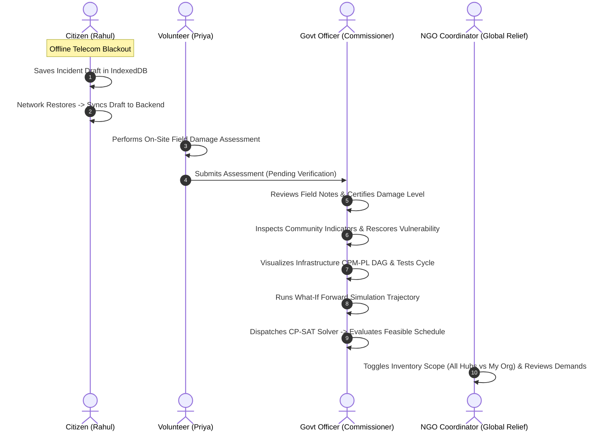

# DIRS — Capstone Demonstration Runbook & Presentation Guide
## Disaster Intelligence and Response System (DIRS)

**Document Identifier:** `DIRS-CAPSTONE-RUNBOOK-007`  
**Classification:** OFFICIAL / OPERATIONAL RUNBOOK  
**Target Release:** DIRS v5.2 (Capstone Release)  
**Parent Programme:** Phase 6G / Accelerated Work Package 4 (Capstone Packaging & Verification)  
**Publication Date:** November 18, 2026  
**Status:** Certified / Complete  

---

## 1. Demonstration Scenario Narrative

### Scenario: Category 4 Cyclone Aftermath & Severe Multi-Ward Inundation
* **Geographic Corridor:** South Chennai Disaster Response Corridor (Adyar, Velachery, Royapuram, Tambaram).
* **Impact Profile:** Inundation exceeding 1.8 meters across multiple wards; electric grid failure at Adyar Substation; water treatment pipeline rupture; primary health centre perimeter collapse.
* **Demonstration Objective:** Showcase end-to-end multi-role response, offline-first intake resilience, volunteer field damage inspections, government engineering verification, community recovery tracking, CPM-PL infrastructure precedence visualization, and CP-SAT recovery portfolio optimization.

---

## 2. Environment Prerequisites & Startup Procedure

### 2.1 System Requirements
* Node.js v18+ and npm v9+
* Python 3.11+
* Modern Web Browser (Chromium / Google Chrome recommended)
* Network: Localhost (Port 8000 for FastAPI, Port 5173 for Vite)

### 2.2 Backend Startup
Open a dedicated terminal window:
```powershell
cd C:\Users\shubh\Downloads\DIRS
$env:PYTHONPATH="C:\Users\shubh\Downloads\DIRS\backend"
uvicorn app.main:app --host 127.0.0.1 --port 8000 --reload
```
* **Readiness Check:** Navigate to `http://127.0.0.1:8000/docs` to verify OpenAPI UI.

### 2.3 Frontend Startup
Open a second dedicated terminal window:
```powershell
cd C:\Users\shubh\Downloads\DIRS\frontend
npm run dev
```
* **Readiness Check:** Navigate to `http://localhost:5173` to verify DIRS authentication gateway.

---

## 3. Verified Demonstration Accounts

| Role Identifier | Email Address | Password | Operational Access | Primary Dashboard |
| :--- | :--- | :--- | :--- | :--- |
| **`GOVT` (Super-Role)** | `admin@dirs.gov` | `Admin123!` | Executive Command, Verification, Precedence, Optimization | `/admin` |
| **`CITIZEN`** | `citizen@dirs.org` | `Citizen123!` | Incident Reporting, Offline Intake, Shelter Discovery | `/citizen` |
| **`VOLUNTEER`** | `volunteer@dirs.org` | `Volunteer123!` | Field Inspection Intake, Assigned Missions | `/volunteer` |
| **`NGO`** | `ngo@dirs.org` | `Ngo123!` | Inventory Scoping, Stock Dispatch, Relief Demands | `/ngo` |
| **`ADMIN`** | `admin@dirs.gov` | `Admin123!` | Pure Optimization Solver Orchestration | `/admin/recovery-optimization` |

---

## 4. Master Demonstration Script & Step-by-Step Sequence



### Step 1: Citizen Offline Reporting & Sync Resilience
1. Navigate to `http://localhost:5173/login`. Log in as `citizen@dirs.org` / `Citizen123!`.
2. Notice the **Citizen Operations Console** and the **Municipal Recovery Status Card** (displaying overall municipal recovery score and sector restoration indicators).
3. Click **Report Incident** in the navigation bar.
4. Fill in incident details:
   - Title: `Flash Flooding near Adyar Riverfront`
   - Disaster Type: `FLOOD`
   - Severity: `4 - High`
   - Casualties: `2`
   - Description: `Water rising rapidly near residential street.`
5. Click **Save Local Draft**.
6. Observe the **Offline Resilience Banner** appear with message: `1 local draft ready for synchronization`.
7. Click **Manage Queue** to open the `DraftSyncManager` drawer. Inspect the persistent draft payload, creation timestamp, and `DRAFT` status.
8. Click **Sync Now**.
9. Observe transition: `SYNCING` $\to$ `SYNCED` with verified server UUID acknowledgment.

### Step 2: Volunteer Field Damage Inspection Intake
1. Log out. Log in as `volunteer@dirs.org` / `Volunteer123!`.
2. In the Volunteer Dashboard, observe the **Missions** tab showing responder status and tactical tasking.
3. Switch to the **Field Damage Inspection** tab.
4. Fill in damage evaluation:
   - Facility Name: `Adyar Primary Health Centre Substation`
   - Sector: `HEALTH`
   - Ward: `Ward 172`
   - Observed Damage: `MODERATE`
   - Structural Notes: `Perimeter boundary collapsed; ground floor waterlogged.`
   - Assessor Confidence: `85%`
5. Click **Submit Damage Assessment**.
6. Assessment is transmitted to backend and queued under `PENDING_VERIFICATION`.

### Step 3: Government Command Center & Engineering Certification Gate
1. Log out. Log in as `admin@dirs.gov` / `Admin123!`.
2. In the Command Center, observe the three-tab operational interface:
   - Tab 1: **Live Emergency Operations**
   - Tab 2: **Infrastructure Precedence (CPM-PL)**
   - Tab 3: **Field Inspections Verification**
3. Click Tab 3: **Field Inspections Verification**.
4. Review the incoming volunteer inspection.
5. Click **Certify** to open the **Engineering Assessment Certification Gate** modal.
6. Select Action: `VERIFY`, Certified Damage Level: `MODERATE`, and enter mandatory engineering notes: `Field report matches satellite imagery and patrol log.`
7. Click **Commit Decision**. Assessment is committed with full audit logging.

### Step 4: Community Recovery Monitoring & Simulation Workbench
1. In the sidebar, click **Simulation & Recovery Intelligence** (`/admin/simulation`).
2. Inspect the **Municipal Recovery & Essential Services Summary** cards (Power, Water, Health, Schools, Livelihoods).
3. Under **Vulnerability Rescoring**, select Ward 172, observed damage level `MODERATE`, and click **Recalculate Vulnerability**. Observe the normalized $\phi$ score and confidence factor with freshness decay.
4. Under **What-If Recovery Forward Simulation**, adjust the budget multiplier to `1.25x`, select Priority Sector `POWER`, and click **Execute Forward Simulation**.
5. Inspect the forward recovery trajectory chart and bottleneck resource analysis.

### Step 5: Infrastructure Precedence Network Visualization & Cycle Detection
1. Return to **Command Center** (`/admin`) and select Tab 2: **Infrastructure Precedence (CPM-PL)**.
2. Observe the interactive SVG precedence network with topological node layout, dependency edges, and critical path highlighting.
3. Click any project node to open the **Project Inspector Drawer** displaying Early Start ($ES$), Late Finish ($LF$), and Total Float ($TF$).
4. Click **Validate Dependency Link** to launch the dry-run edge validator.
5. Enter a cyclic dependency (e.g. connecting an existing downstream project back to an upstream project) and click **Run Dry-Run Validation**.
6. Observe the instant red cycle rejection alert displaying the exact circular loop path without altering the database.

### Step 6: Mathematical Recovery Portfolio Optimization (CP-SAT)
1. In the sidebar, click **Recovery Optimization** (`/admin/recovery-optimization`).
2. Review the **Scenario Parameters** ($T=12$ periods, ₹85,00,000 budget, candidate reconstruction projects).
3. Click **Evaluate Optimal Portfolio Schedule**.
4. A human-in-the-loop confirmation modal appears. Confirm execution.
5. Observe the **Indeterminate Solver Overlay** with real-time monotonic stopwatch.
6. Review the results:
   - Solver Status Banner: `OPTIMAL / FEASIBLE`
   - 1-Based Periodic Gantt Timeline: Visual scheduled project spans.
   - Dual-Ledger Solvency Matrix: Independent CCU ledger vs. INR liquidity accounting.
   - Unselected Projects Registry: Neutral "Not selected" outcome status without fabricated causes.

### Step 7: NGO Logistics Coordination & Scope Scoping
1. Log out. Log in as `ngo@dirs.org` / `Ngo123!`.
2. Observe the **Organization Profile** verifying partnership credentials.
3. Toggle the inventory scope switch between **All Hubs** (viewing multi-agency situational supply across the disaster zone) and **My Org Only** (filtering strictly to depot assets owned by Global Relief Foundation).
4. Review the **Field Relief Demands Feed** showing live commodity requests from evacuation shelters.
5. Inspect the **Institutional Governance Notice** clarifying statutory boundaries regarding capital projects.

---

## 5. Troubleshooting & Demo Support

* **Port Already in Use:** If Port 8000 or 5173 is occupied, terminate stale node/python processes:
  ```powershell
  Stop-Process -Name "python", "node" -Force -ErrorAction SilentlyContinue
  ```
* **Session Desynchronization:** If switching accounts displays cached query data, clear `localStorage` via DevTools or click **Sign Out** from the user badge to trigger clean session termination.
* **Non-Destructive Demo Data Reset:** The test and demo suites operate safely against seeded synthetic data. Do not execute scripts with `db.delete()` or raw SQL drops.
