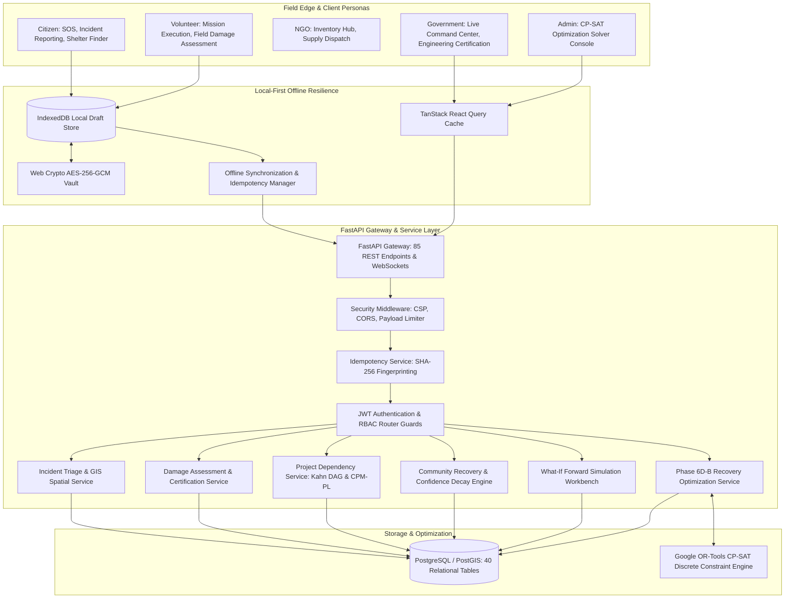
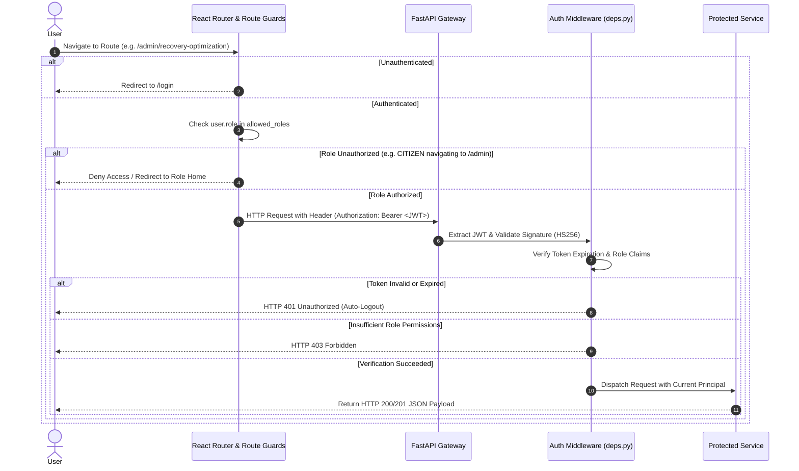
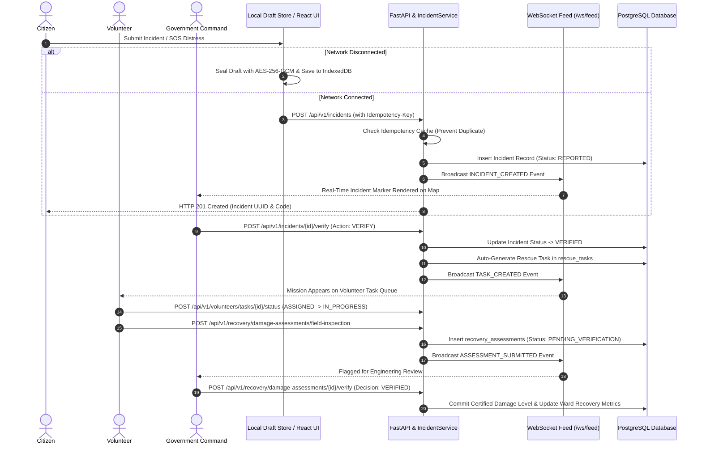
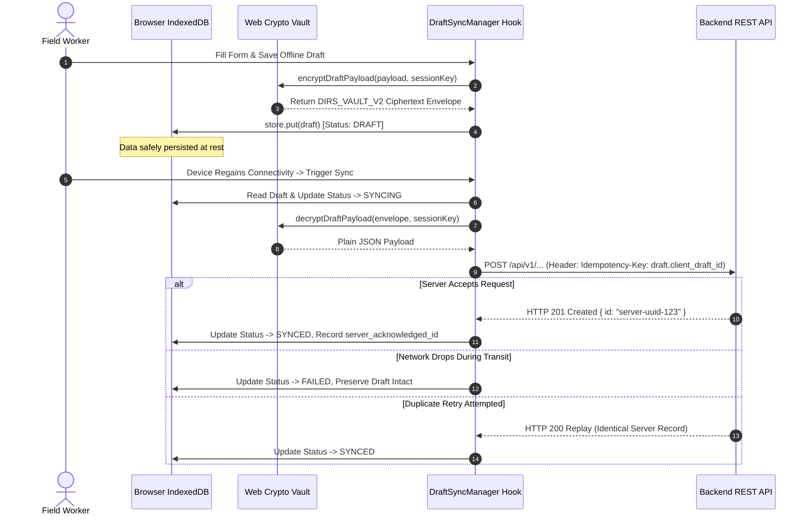
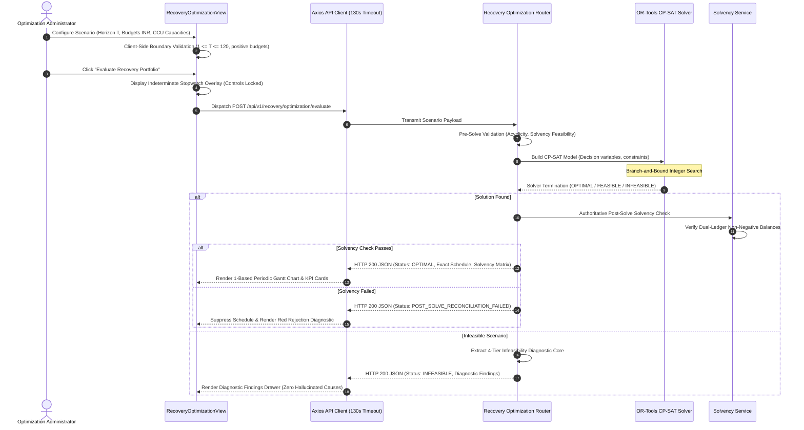

# DIRS — Capstone Evidence Extraction: System Architecture Specification
## Module 03: Architectural Topologies, Domain Flows & Implementation Schematics

**Document Identifier:** `DIRS-CAPSTONE-EVIDENCE-03`  
**Classification:** OFFICIAL / ACADEMIC CAPSTONE EVIDENCE  
**Degree Programme:** Bachelor of Technology (B.Tech) in Computer Science & Engineering  
**Institution:** VIT-AP University, Andhra Pradesh, India  
**Target Release:** DIRS v6.0 (Enterprise Hardened)  
**Audit Status:** STRICT READ-ONLY FORENSIC EXTRACTION  
**Evidence Sources:** `backend/app/main.py`, `backend/app/routers/`, `frontend/src/App.tsx`, `frontend/src/utils/offlineDraftStore.ts`  

---

## 1. High-Level System Architecture

DIRS is structured into four cohesive architectural tiers: the **Field Edge & Client Layer**, the **Local-First Client Resilience Layer**, the **Backend Application Gateway & Domain Service Layer**, and the **Persistence & Discrete Optimization Layer**.



---

## 2. Frontend Application Architecture

The frontend is a single-page application (SPA) built with React 18, TypeScript, and Vite.

### 2.1 Component Structure & Module Hierarchy
- `src/App.tsx`: Central route table defining route guards and role-based redirects.
- `src/pages/`: Role-specific view components:
  - `citizen/`: `CitizenDashboard.tsx`, `ReportIncident.tsx`, `ShelterFinder.tsx`.
  - `volunteer/`: `VolunteerDashboard.tsx`, `VolunteerFieldInspection.tsx`.
  - `ngo/`: `NGODashboard.tsx`.
  - `admin/`: `CommandCenter.tsx`, `RecoveryOptimizationView.tsx`, `DisasterSimulationView.tsx`.
- `src/components/`: Reusable, modular presentation components:
  - `recovery/`: `SolverControlBar.tsx`, `SolverStatusBanner.tsx`, `OptimizationKPIStats.tsx`, `ProjectScheduleTimeline.tsx`, `FinancialSolvencyMatrix.tsx`, `InfeasibilityDiagnosticsView.tsx`, `IndeterminateSolverOverlay.tsx`, `PrecedenceGraphVisualizer.tsx`, `RecoverySimulationWorkbench.tsx`.
  - `layout/`: `Sidebar.tsx`, `Navbar.tsx`.
  - `common/`: `DraftSyncManager.tsx`, `OfflineBanner.tsx`.
- `src/hooks/`: Custom stateful hooks:
  - `useOfflineDrafts.ts`: Local-first IndexedDB draft management, vault unlocking, background synchronization.
  - `useRecoveryOptimization.ts`: CP-SAT solver dispatch, indeterminate timer, solvency data caching.
  - `useNetworkStatus.ts`: Online/offline connectivity detection via `navigator.onLine` and window events.
- `src/utils/`:
  - `offlineDraftStore.ts`: Transactional IndexedDB access layer and session key manager.
  - `cryptoVault.ts`: W3C Web Crypto AES-256-GCM authenticated encryption engine.

---

## 3. Backend Architecture & Service Modularity

The backend is built with FastAPI, adhering strictly to a layered service-oriented architecture:

```
backend/
├── app/
│   ├── main.py                  # ASGI Application, Security Middleware, Lifespan/Startup
│   ├── config.py                # Pydantic v2 Settings with fail-closed security validators
│   ├── database.py              # SQLAlchemy engine, declarative Base, sessionmaker
│   ├── core/
│   │   ├── security.py          # BCrypt password hashing, JWT creation & decoding
│   │   ├── deps.py              # Dependency injection: get_db, get_current_user, require_role
│   │   ├── idempotency.py       # IdempotencyService with SHA-256 request fingerprinting
│   │   ├── logger.py            # Structured logging with sensitive data redaction filter
│   │   └── websocket_manager.py # Real-time event broadcasting (/ws/feed)
│   ├── models/                  # SQLAlchemy ORM relational models (40 tables)
│   ├── schemas/                 # Pydantic v2 data transfer objects (DTOs)
│   ├── routers/                 # Modular API endpoints (85 endpoints across 14 modules)
│   ├── services/                # Core business logic (incidents, volunteers, shelters, GIS)
│   └── recovery/                # Mathematical recovery domain sub-system
│       ├── optimization/        # Google OR-Tools CP-SAT solver implementation
│       ├── services/            # CPM-PL, Kahn DAG, vulnerability rescoring, simulation
│       └── schemas/             # Exact integer and currency string DTO contracts
```

---

## 4. Database Architecture & Schema Invariants

- **Total Tables:** Exactly **40 Relational Tables**.
- **Alembic Version Head:** `phase6b_recovery_foundation`.
- **Dialect Support:** PostgreSQL 16 with PostGIS 3.4 spatial extensions (production), SQLite (test fallback).
- **Core Entity Groups:**
  1. **Identity & RBAC:** `users`, `citizen_profiles`, `volunteer_profiles`, `ngo_profiles`, `audit_logs`.
  2. **Emergency Operations:** `incidents`, `incident_reports`, `incident_media`, `incident_clusters`, `alerts`, `shelters`, `road_blockages`, `rescue_tasks`.
  3. **Humanitarian Logistics:** `resources`, `resource_requests`, `donations`, `vehicles`, `resource_demand_predictions`.
  4. **Post-Disaster Recovery:** `recovery_assessments`, `recovery_needs`, `recovery_projects`, `project_dependencies`, `recovery_resources`, `recovery_override_logs`, `community_recovery_metrics`.
  5. **Optimization & Simulation:** `optimization_runs`, `optimization_recommendations`, `optimization_override_logs`, `simulation_scenarios`, `simulation_runs`.
  6. **AI & Knowledge:** `knowledge_documents`, `knowledge_chunks`, `rag_query_logs`, `cv_damage_assessments`, `ai_predictions`, `ai_recommendations`.

---

## 5. Domain Interaction Flows

### 5.1 Role-Based Route Authorization Flow



### 5.2 Incident Lifecycle & Emergency Response Flow



### 5.3 Offline Draft Synchronization & Replay Flow



### 5.4 Recovery Portfolio Optimization & Solvency Flow


