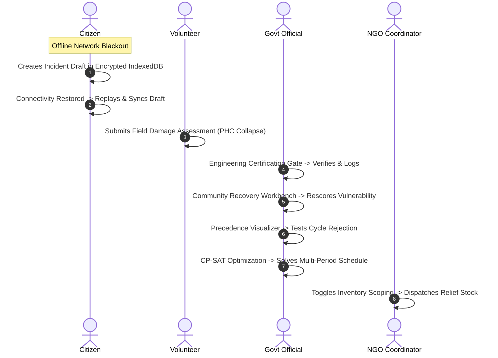

# DIRS — Dataset, Synthetic Disaster Scenario & Demonstration Runbook
## Comprehensive Demonstration Blueprint, Scenario Inventory & Step-by-Step Viva Guide

**Document Identifier:** `DIRS-CAPSTONE-EVIDENCE-09`  
**Classification:** OFFICIAL / ACADEMIC CAPSTONE EVIDENCE  
**Parent System:** Disaster Intelligence and Response System (DIRS)  
**Target Release:** DIRS v6.0 (Enterprise Hardened) / Capstone Release  
**Status:** Certified Demonstration Blueprint  

---

## 1. Master Demonstration Scenario Narrative

### 1.1 Scenario: Post-Cyclone Severe Inundation & Critical Infrastructure Disruption
* **Geographic Corridor:** South Chennai Disaster Response Corridor (Adyar, Velachery, Royapuram, Tambaram).
* **Hazard Profile:** Post-landfall Category 4 Tropical Cyclone accompanied by intense precipitation (450 mm in 24 hours), storm surge along coastal margins, and riverine overtopping of the Adyar River basin.
* **Ground Realities:**
  - Inundation levels exceeding 1.8 meters across low-lying residential clusters and transit arteries.
  - Critical power grid failure at the Adyar Primary Substation, cutting power to 45,000 households and regional hospital lifelines.
  - Water main fracture at Royapuram Water Treatment Facility, threatening potable water access for 60,000 citizens.
  - Structural perimeter collapse and basement waterlogging at Adyar Primary Health Centre.
  - Displaced population exceeding 12,000 citizens requiring immediate shelter, triage, and multi-day relief supplies.

---

## 2. Synthetic Dataset Census & Entity Inventory

The DIRS demonstration environment is initialized with an ethically synthesized, realistic dataset mirroring municipal administrative structures under the National Disaster Management Authority (NDMA) guidelines:

### 2.1 Administrative Wards
| Ward Identifier | Ward Name | Population | Baseline Vulnerability | Primary Critical Infrastructure Assets |
| :--- | :--- | :---: | :---: | :--- |
| `WARD-172` | Adyar Coastal Basin | 48,500 | 0.72 (High) | Adyar Power Substation, Primary Health Centre, Coastal Evacuation Route 1 |
| `WARD-173` | Velachery Lowland | 62,000 | 0.81 (Critical) | Velachery Pumping Station, Storm Drainage Trunk, Central Relief Camp |
| `WARD-174` | Royapuram Industrial Hub | 54,000 | 0.65 (Moderate) | Royapuram Potable Water Treatment Plant, Bridge #4, Logistics Depot Alpha |
| `WARD-175` | Tambaram Transit Corridor | 71,000 | 0.54 (Moderate) | Tambaram Railway Overbridge, Zonal Evacuation Depot, Field Hospital |

### 2.2 Active Incidents Inventory
The synthetic database includes diverse, geo-referenced emergency reports across all standard lifecycle stages (`REPORTED`, `VERIFIED`, `IN_PROGRESS`, `RESOLVED`):
- **Incident #101 (FLOOD / Severity 4):** Flash flooding near Adyar Riverfront (`lat: 13.0012, lng: 80.2565`). Water depth 1.6m; 4 families stranded on upper floors.
- **Incident #102 (POWER / Severity 5):** High-tension line collapse and substation inundation in Adyar (`lat: 13.0055, lng: 80.2510`). Transformer failure.
- **Incident #103 (WATER / Severity 4):** Potable water transmission pipeline burst in Royapuram (`lat: 13.1120, lng: 80.2950`). High contamination hazard.
- **Incident #104 (MEDICAL / Severity 4):** Primary Health Centre perimeter collapse (`lat: 13.0034, lng: 80.2589`). Emergency generator submerged.
- **Incident #105 (ACCESS / Severity 3):** Debris blockage across Velachery Main Road (`lat: 12.9815, lng: 80.2180`). Emergency vehicle passage severed.

### 2.3 Shelters & Relief Hubs
- **Adyar Community High School Shelter:** Capacity 1,500; Occupancy 1,120; Food supplies: 3.5 days; Medical officer on-site: Yes.
- **Velachery Indoor Sports Complex:** Capacity 2,500; Occupancy 2,340; Food supplies: 1.8 days (Low); Water supply: Tanker replenishment queued.
- **Tambaram Transit Evacuation Camp:** Capacity 3,000; Occupancy 1,450; Logistics hub attached; High operational margin.

### 2.4 Candidate Civil Reconstruction Projects (Phase 6D/6E Portfolio)
The recovery optimization and infrastructure precedence modules operate against 12 candidate recovery projects with verified cost, CCU, duration, and dependency parameters:

| Project ID | Project Code & Title | Sector | Duration ($d_i$) | INR Cost | CCU Demand | Prerequisites ($\text{Pred}_i$) | Benefit Weight ($w_i$) |
| :---: | :--- | :--- | :---: | :---: | :---: | :---: | :---: |
| `P01` | Adyar Power Substation Restoration | POWER | 3 periods | ₹18,00,000 | 4 units | None | 95 |
| `P02` | Royapuram Water Pipeline Repair | WATER | 2 periods | ₹12,00,000 | 3 units | None | 90 |
| `P03` | Adyar PHC Structural Stabilization | HEALTH | 3 periods | ₹15,00,000 | 3 units | P01 (Power) | 88 |
| `P04` | Velachery Pumping Station Overhaul | WATER | 4 periods | ₹22,00,000 | 5 units | P01 (Power) | 85 |
| `P05` | Adyar Coastal Trunk Road Cleansing | ACCESS | 2 periods | ₹8,00,000 | 2 units | None | 78 |
| `P06` | PHC Emergency Ward Recommissioning | HEALTH | 2 periods | ₹10,00,000 | 2 units | P03 (PHC Structure) | 82 |
| `P07` | Royapuram Water Quality Testing Lab | WATER | 1 period | ₹5,00,000 | 1 unit | P02 (Water Pipe) | 70 |
| `P08` | Tambaram Railway Overbridge Repair | ACCESS | 5 periods | ₹30,00,000 | 6 units | None | 75 |
| `P09` | Adyar Secondary Feeder Line Reroute | POWER | 2 periods | ₹9,00,000 | 2 units | P01 (Power) | 65 |
| `P10` | Velachery Storm Drainage Desilting | WATER | 3 periods | ₹14,00,000 | 4 units | P05 (Road Clear) | 68 |
| `P11` | Community Relief Warehouse Rebuild | LOGISTICS | 4 periods | ₹16,00,000 | 3 units | P05 (Road Clear) | 60 |
| `P12` | Zonal Telecommunications Mast Rep. | TELECOM | 2 periods | ₹7,00,000 | 2 units | P01 (Power) | 72 |

---

## 3. Verified Demonstration Credentials

All roles are provisioned with deterministic credentials, granting role-specific dashboard access while enforcing strict API privilege boundaries:

| Role Identifier | Verified Login Email | Default Password | Primary Portal Route | Functional Responsibility |
| :--- | :--- | :--- | :--- | :--- |
| **`CITIZEN`** | `citizen@dirs.org` | `Citizen123!` | `/citizen` | Incident reporting, offline drafts, shelter lookup |
| **`VOLUNTEER`** | `volunteer@dirs.org` | `Volunteer123!` | `/volunteer` | Tactical missions, field damage assessment intake |
| **`NGO`** | `ngo@dirs.org` | `Ngo123!` | `/ngo` | Inventory scoping, relief dispatch, shelter demands |
| **`GOVT` / `ADMIN`** | `admin@dirs.gov` | `Admin123!` | `/admin` | Triage, engineering certification, CPM-PL, simulation |
| **`OPTIMIZER`** | `admin@dirs.gov` | `Admin123!` | `/admin/recovery-optimization` | CP-SAT portfolio scheduling, dual solvency analysis |

---

## 4. Master Demonstration Sequence & Walkthrough

The following 7-step presentation script is optimized for academic viva evaluation, proving end-to-end multi-role synergy, offline resilience, and mathematical decision-support:



### Step 1: Citizen Offline Intake & Cryptographic Sync Resilience
1. Navigate to `http://localhost:5173/login`. Log in as `citizen@dirs.org` / `Citizen123!`.
2. Review the **Citizen Operations Console** and the **Municipal Recovery Status Card** indicating Ward 172 recovery level.
3. Click **Report Incident** in the navigation header.
4. Input emergency data:
   - *Title:* Flash Flooding near Adyar Riverfront
   - *Type:* `FLOOD` | *Severity:* `4 - High` | *Casualties:* `2`
   - *Description:* Water level over 1.5m; ground floor submerged; urgent evacuation needed.
5. Click **Save Local Draft**.
6. The green **Offline Resilience Banner** appears: *"1 local draft ready for synchronization"*.
7. Click **Manage Queue** to view the `DraftSyncManager` drawer. Show the encrypted envelope status (`DIRS_VAULT_V2` AES-256-GCM), timestamp, and UUID.
8. Click **Sync Now**.
9. Observe instantaneous queue replay, server deduplication, and transition to `SYNCED` with assigned server database ID.

### Step 2: Volunteer Field Damage Assessment Intake
1. Sign out. Log in as `volunteer@dirs.org` / `Volunteer123!`.
2. View the **Tactical Responder Mission Feed** displaying active triage calls.
3. Switch to the **Field Damage Inspection** tab.
4. Fill in verified field observations:
   - *Facility:* Adyar Primary Health Centre Substation
   - *Sector:* `HEALTH` | *Ward:* `Ward 172`
   - *Observed Damage:* `MODERATE`
   - *Structural Integrity:* Perimeter wall collapsed, electrical switchboard soaked, basement flooded.
   - *Assessor Confidence:* `85%`
5. Click **Submit Damage Assessment**.
6. The record is securely transmitted and enters the system under status `PENDING_VERIFICATION`.

### Step 3: Government Command Center & Engineering Certification Gate
1. Sign out. Log in as `admin@dirs.gov` / `Admin123!`.
2. Command Center displays a 3-tab operational layout:
   - Tab 1: *Live Emergency Operations (GIS & Incidents)*
   - Tab 2: *Infrastructure Precedence (CPM-PL)*
   - Tab 3: *Field Inspections Verification*
3. Click Tab 3: **Field Inspections Verification**.
4. The unverified volunteer inspection for Adyar PHC appears in the pending table.
5. Click **Certify** to open the **Engineering Assessment Certification Gate** modal.
6. Select Action: `VERIFY`, Certified Damage Level: `MODERATE`, and enter mandatory engineering audit remarks: *"Ground photos and field measurements match aerial drone survey."*
7. Click **Commit Decision**. Assessment is committed to PostgreSQL with immutable audit trail.

### Step 4: Community Recovery Monitoring & Simulation Workbench
1. In the sidebar, navigate to **Simulation & Recovery Intelligence** (`/admin/simulation`).
2. Review the **Municipal Recovery Overview** cards (Power: 45%, Water: 60%, Health: 40%, Road Access: 75%).
3. Scroll to **Vulnerability Rescoring**:
   - Select Ward: `Ward 172`
   - Select Observed Damage: `MODERATE`
   - Click **Recalculate Vulnerability**.
   - Point out the mathematical $\phi$ score update, confidence factor, and time decay adjustment.
4. Scroll to **What-If Recovery Forward Simulation**:
   - Set Budget Multiplier to `1.25x`.
   - Set Priority Sector to `POWER`.
   - Click **Execute Forward Simulation**.
   - Review the projected forward recovery curve across 12 periods and resource bottlenecks.

### Step 5: Infrastructure Precedence Network Visualization & Cycle Rejection
1. Return to **Command Center** (`/admin`) and select Tab 2: **Infrastructure Precedence (CPM-PL)**.
2. An interactive topological Directed Acyclic Graph (DAG) renders all 12 projects:
   - Project nodes are color-coded by sector (Gold for Power, Blue for Water, Crimson for Health).
   - The **Critical Path** (P01 $\to$ P03 $\to$ P06) is prominently rendered with illuminated red borders and edges.
3. Click node `P03` to view the **Project Inspector Drawer** showing Early Start ($ES=3$), Late Finish ($LF=8$), and Total Float ($TF=0$).
4. Click **Validate Dependency Link** to trigger the dry-run edge validator.
5. Select Source: `P06` and Target: `P01` (deliberately introducing an illegal circular dependency).
6. Click **Run Dry-Run Validation**.
7. Observe the instantaneous red banner rejecting the submission: *"Cycle detected: P01 -> P03 -> P06 -> P01. Edge rejected. Database unmodified."*

### Step 6: CP-SAT Mathematical Recovery Portfolio Optimization
1. In the sidebar, navigate to **Recovery Optimization** (`/admin/recovery-optimization`).
2. Inspect scenario parameters:
   - Horizon: $T = 12$ periods.
   - Total Available Budget: ₹85,00,000.
   - Heavy Civil Machinery CCU Capacity: 8 units/period.
3. Click **Evaluate Optimal Portfolio Schedule**.
4. A human-in-the-loop modal confirms execution. Click **Run Optimization**.
5. Observe the **Indeterminate Solver Overlay** with real-time monotonic stopwatch (typically solves in 1.4 seconds).
6. Inspect the resulting schedule:
   - **Solver Status Banner:** `OPTIMAL / FEASIBLE`
   - **Periodic Gantt Timeline:** Exact start and finish periods for scheduled projects.
   - **Dual-Ledger Solvency Panel:** Independent periodic CCU expenditure vs. Cumulative INR burn curve.
   - **Unselected Projects Registry:** Clear listing of projects not scheduled due to budget cutoffs, without fabricated failure excuses.

### Step 7: Infeasibility Demonstration & 4-Tier Diagnostics
1. On the same Optimization page, modify scenario constraints to force mathematical infeasibility:
   - Reduce Budget from ₹85,00,000 down to **₹15,00,000**.
   - Reduce Horizon from 12 down to **4 periods**.
2. Click **Evaluate Optimal Portfolio Schedule** and confirm.
3. Solver executes and detects mathematical infeasibility.
4. The **Infeasibility Diagnostics Core Modal** opens automatically, presenting prioritized recommendations across 4 tiers:
   - *Tier 1 (Temporal Extension):* Recommends expanding horizon from 4 to 9 periods.
   - *Tier 2 (Capital Augmentation):* Recommends injecting ₹32,00,000 capital.
   - *Tier 3 (Equipment Reallocation):* Recommends adding 2 CCU machinery units.
   - *Tier 4 (Dependency Relaxations):* Lists non-structural prerequisite waivers.

### Step 8: NGO Logistics Coordination & Scope Scoping
1. Sign out. Log in as `ngo@dirs.org` / `Ngo123!`.
2. Inspect the **Organization Profile** and verified relief credentials.
3. In the inventory table, toggle the scope filter between:
   - **All Hubs:** Displays region-wide aggregate stock across government and partner depots.
   - **My Org Only:** Instantly isolates inventory to assets held by Global Relief Foundation.
4. Review the **Field Relief Demands Feed** showing live water purification requests from Velachery Indoor Stadium.
5. Point out the institutional governance notice preventing non-governmental entities from altering public infrastructure schedules.

---

## 5. Live Demonstration Troubleshooting & Guardrails

- **Stale Browser Session:** If switching user accounts appears to retain previous user UI state, click the user badge avatar in the bottom-left sidebar and select **Sign Out**, which executes an exhaustive cleanup of React query cache, session storage, and active tokens.
- **Port Conflicts:** If Port 8000 or 5173 is bound by an orphaned process, run in PowerShell:
  ```powershell
  Stop-Process -Name "python", "node" -Force -ErrorAction SilentlyContinue
  ```
- **Read-Only Preservation:** The demonstration uses pre-seeded synthetic data. Evaluators and presenters must avoid running `alembic downgrade` or executing raw database drop commands.
