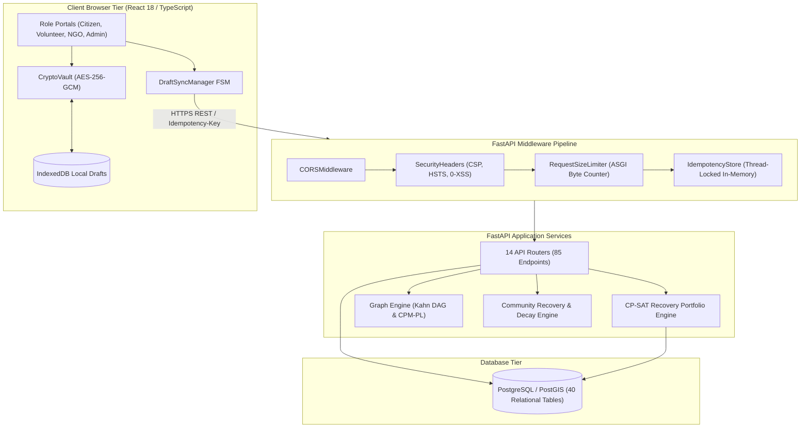

# DIRS — Academic Capstone Report Content & Comprehensive Technical Treatise
## Prepared for B.Tech Capstone Project Evaluation | School of Computer Science and Engineering (SCOPE), VIT-AP University

**Project Title:** Disaster Intelligence and Response System (DIRS)  
**Degree:** Bachelor of Technology in Computer Science and Engineering  
**Institution:** School of Computer Science and Engineering (SCOPE), VIT-AP University, Amaravati, Andhra Pradesh, India  
**Target Release:** DIRS v6.0 (Enterprise Hardened)  
**Document Identifier:** `DIRS-CAPSTONE-EVIDENCE-12`  
**Classification:** ACADEMIC CAPSTONE DISSERTATION TREATISE  

---

## Abstract

Disaster response and post-disaster community reconstruction represent highly complex socio-technical challenges characterized by multi-agency coordination friction, degraded communication networks, conflicting data streams, severe resource scarcity, and complex infrastructure interdependencies. Existing emergency systems focus overwhelmingly on immediate triage and crisis mapping, leaving medium- to long-term community recovery planning to fragmented, ad-hoc manual spreadsheets prone to project deadlock and financial insolvency.

This project designs, implements, and evaluates the **Disaster Intelligence and Response System (DIRS)**, a resilient, multi-stakeholder disaster intelligence and decision-support platform. DIRS addresses the entire disaster management lifecycle through:
1. **Offline-First Resilience:** A client-side state machine utilizing IndexedDB and native Web Crypto AES-256-GCM encryption with ephemeral in-memory session key caching, ensuring field data integrity and complete multi-user draft isolation during telecommunication blackouts.
2. **Authoritative Engineering Verification:** A multi-role governance architecture spanning Citizens, Tactical Volunteers, Registered NGOs, and Government Command Officers, featuring an engineering certification gate that prevents unverified crowd data from corrupting civil planning.
3. **Graph-Theoretic Precedence Modeling:** An infrastructure restoration engine employing Kahn's algorithm for topological sorting and cycle detection alongside the Critical Path Method with Project Lag (CPM-PL) to identify bottlenecks and eliminate circular project deadlocks.
4. **Mathematical Recovery Portfolio Optimization:** An exact discrete combinatorial optimization engine powered by Google OR-Tools CP-SAT, solving multi-period project selection, non-preemptive scheduling, dual-ledger financial and Critical Equipment Capacity (CCU) solvency, accompanied by a 4-tier diagnostic engine for infeasibility relaxation.
5. **Dynamic Vulnerability Rescoring:** A continuous community recovery monitoring framework incorporating exponential time-decay confidence functions ($\lambda = \ln(2)/t_{1/2}$) and census reconciliation.

The system was developed using Python FastAPI, PostgreSQL with PostGIS extensions, React 18 with TypeScript, and Tailwind CSS. Exhaustive automated verification across unit algorithms, HTTP contracts, and Playwright headless browser E2E workflows confirms a **100% test pass rate across 827 tests** (656 backend, 120 contract, 51 browser E2E), with zero regressions across 23 protected baseline components. DIRS demonstrates an enterprise-grade, mathematically grounded paradigm for next-generation disaster informatics.

---

## Chapter 1: Introduction & Background

### 1.1 Context & Motivation
Natural and human-induced disasters—ranging from tropical cyclones and riverine inundation to seismic events and industrial fires—inflict catastrophic disruption on civilian populations, physical lifelines, and municipal economies. According to the United Nations Office for Disaster Risk Reduction (UNDRR) and the National Disaster Management Authority (NDMA) of India, post-disaster recovery costs represent a significant percentage of national GDP in developing economies.

The traditional disaster management continuum comprises four continuous phases:
$$\text{Mitigation} \longrightarrow \text{Preparedness} \longrightarrow \text{Response} \longrightarrow \text{Recovery}$$

While the **Response** phase (spanning the initial 0 to 72 hours) has received extensive attention through digital crisis mapping, crowdsourced emergency hotlines, and social media scraping, the subsequent **Recovery** phase (spanning weeks to months) suffers from a critical technological vacuum. Post-disaster recovery involves competing capital reconstruction projects (power grid restoration, potable water transmission, hospital repairs, transport corridor clearing) that exhibit complex structural precedence constraints and compete for finite budgets and specialized heavy engineering equipment.

### 1.2 The Technological Gap
In current municipal disaster management workflows:
- **Offline Failure:** When cellular towers collapse, civilian and responder mobile devices fail to record observations or lose data upon application restarts.
- **Data Noise & Hallucination:** Unverified crowdsourced incident reports flood operational command centers without professional validation gates.
- **Scheduling Deadlocks:** Infrastructure repair projects are scheduled independently across municipal departments (e.g., paving roads before underground water mains are repaired), creating circular dependencies and project stall.
- **Heuristic Sub-Optimality:** Project portfolios are selected using heuristic ranking or political convenience rather than rigorous multi-period combinatorial optimization, leading to rapid budget exhaustion and project abandonment.

---

## Chapter 2: Problem Statement & Objectives

### 2.1 Formal Problem Statement
To design, implement, and verify an enterprise-grade, offline-resilient Disaster Intelligence and Response System (DIRS) that unifies multi-stakeholder intake, enforces authoritative engineering verification, models infrastructure precedence networks using graph-theoretic algorithms, dynamically rescores community vulnerability with confidence decay, and formulates post-disaster recovery planning as an exact discrete constrained optimization problem guaranteeing dual financial and equipment solvency.

### 2.2 Measurable Project Objectives
1. **Multi-Role Intake & Governance:** Implement 5 distinct operational roles (`CITIZEN`, `VOLUNTEER`, `NGO`, `GOVT`, `ADMIN`) with strict route and API privilege isolation.
2. **Offline-First Cryptographic Architecture:** Implement client-side IndexedDB queueing protected by AES-256-GCM encryption with zero plaintext leakage on disk and complete multi-user isolation on shared physical devices.
3. **Graph Precedence & Cycle Detection:** Implement Kahn's topological sort and CPM-PL algorithms to compute project early/late schedules and reject cyclic dependencies during dry-run validation without database mutations.
4. **Constrained Portfolio Optimization:** Formulate and solve the recovery project scheduling problem using Google OR-Tools CP-SAT under finite budgets, multi-type equipment capacities, and strict precedence, complete with 4-tier infeasibility diagnostics.
5. **Community Recovery Intelligence:** Implement multi-sector recovery index aggregation and dynamic vulnerability scoring ($\phi$) with exponential confidence decay.
6. **Exhaustive Verification:** Achieve 100% automated test coverage across unit, integration, contract, and E2E browser tiers with zero regression on frozen baseline components.

---

## Chapter 3: Literature Review & Comparative Analysis

### 3.1 Review of Related Work
- **Sahana Eden & Ushahidi:** Pioneered crowdsourced crisis mapping and humanitarian coordination. However, they rely primarily on relational database crud operations, lack client-side cryptographic offline queues, and offer no mathematical scheduling optimization.
- **FEMA HAZUS:** Provides loss estimation and spatial risk modeling, but operates as a static, desktop-bound GIS analysis tool rather than a real-time collaborative command and coordination platform.
- **Classical Project Scheduling (RCPSP):** Resource-Constrained Project Scheduling Problems have been widely studied in industrial engineering (Brucker et al., Hartmann & Briskorn). However, standard RCPSP formulations assume static deterministic environments and do not account for dual-ledger financial burn, sector-specific community recovery weights, or real-time damage assessment integration.

### 3.2 State-of-the-Art Comparative Matrix

| Feature / Architectural Capability | Sahana Eden | Ushahidi | FEMA HAZUS | DIRS (Proposed System) |
| :--- | :---: | :---: | :---: | :---: |
| **Multi-Role Operational Portals** | Partial | Partial | None (Single User) | **Full (5 Distinct Role Portals)** |
| **Offline-First Cryptographic Vault** | No (Online Only) | Partial (Unencrypted) | No | **Yes (AES-256-GCM, Zero Disk Leak)** |
| **Multi-User Draft Isolation on Shared Device** | No | No | N/A | **Yes (User ID & Vault Key Bound)** |
| **Authoritative Engineering Verification Gate** | No | Community Vetting | N/A | **Yes (Mandatory Engineering Rationale)**|
| **Interactive Infrastructure DAG Visualizer** | No | No | No | **Yes (Topological SVG + Critical Path)** |
| **Dry-Run Topological Cycle Rejection** | No | No | No | **Yes (Kahn Algorithm Rejection)** |
| **Critical Path Method with Project Lag (CPM-PL)**| No | No | No | **Yes (ES, EF, LS, LF, TF, FF)** |
| **Mathematical Portfolio Optimization** | No (Heuristic) | No | No | **Yes (Google OR-Tools CP-SAT)** |
| **Dual-Ledger Solvency (CCU & Financial)** | No | No | No | **Yes (Period-by-Period Independent)** |
| **4-Tier Infeasibility Relaxation Diagnostics** | No | No | No | **Yes (Automated Relaxation Solver)** |
| **Dynamic Vulnerability Rescoring with Decay** | No (Static) | No | Static | **Yes ($\phi$ Index + Exponential Decay)**|

---

## Chapter 4: System Architecture & Design Methodology

### 4.1 Tiered Layer Architecture
DIRS adopts a modern, decoupled three-tier architecture:
1. **Client Tier:** React 18 single-page application built with TypeScript, Tailwind CSS, Lucide icons, and Leaflet/SVG rendering engines. Incorporates IndexedDB client storage with Web Crypto API encryption.
2. **Application Tier:** FastAPI (Python 3.11) asynchronous web framework providing 85 REST endpoints and a real-time WebSocket feed (`/ws/feed`). Middleware enforces Content-Security-Policy (CSP), CORS, chunked request size limiting (HTTP 413), and process-local request idempotency.
3. **Data Tier:** PostgreSQL relational database with PostGIS spatial extensions (managed via Alembic under head `phase6b_recovery_foundation`) storing 40 relational tables with foreign key cascades and spatial indices.



---

## Chapter 5: Mathematical Modeling & Optimization Formulations

### 5.1 Recovery Portfolio Optimization Model (CP-SAT Formulation)
Let $\mathcal{P} = \{1, 2, \dots, N\}$ be the set of candidate reconstruction projects, and $\mathcal{T} = \{1, 2, \dots, T\}$ be the planning horizon of discrete time periods.

#### Decision Variables
- $x_{it} \in \{0, 1\}$: Binary variable equal to $1$ if project $i \in \mathcal{P}$ starts at time period $t \in \mathcal{T}$; $0$ otherwise.
- $y_i \in \{0, 1\}$: Binary variable equal to $1$ if project $i \in \mathcal{P}$ is selected for execution within horizon $T$; $0$ otherwise.
- $z_{it} \in \{0, 1\}$: Binary variable equal to $1$ if project $i$ is actively executing at time period $t$; $0$ otherwise.

#### Objective Function
Maximize the total social recovery benefit weighted by project priority:
$$\max \sum_{i \in \mathcal{P}} w_i \cdot y_i$$
where $w_i \in \mathbb{R}^+$ represents the composite benefit weight derived from population served, sector criticality, and vulnerability reduction.

#### Constraints
1. **Execution Window & Non-Preemption:**
   $$y_i = \sum_{t=1}^{T - d_i + 1} x_{it} \quad \forall i \in \mathcal{P}$$
   $$\sum_{t=1}^T x_{it} \le 1 \quad \forall i \in \mathcal{P}$$
   $$z_{it} = \sum_{\tau = \max(1, t - d_i + 1)}^t x_{i\tau} \quad \forall i \in \mathcal{P}, \, \forall t \in \mathcal{T}$$

2. **Infrastructure Precedence with Lag:**
   If project $j$ depends on project $i$ with minimum lag $L_{ij} \ge 0$:
   $$y_j \le y_i \quad \forall (i, j) \in \mathcal{E}_{\text{prec}}$$
   $$\sum_{t=1}^{T - d_j + 1} t \cdot x_{jt} \ge \sum_{t=1}^{T - d_i + 1} (t + d_i + L_{ij}) \cdot x_{it} - M(1 - y_j) \quad \forall (i, j) \in \mathcal{E}_{\text{prec}}$$

3. **Cumulative Financial Budget Solvency:**
   $$\sum_{i \in \mathcal{P}} c_i^{\text{cost}} \cdot y_i \le B_{\text{total}}$$

4. **Periodic Critical Equipment Capacity (CCU) Solvency:**
   $$\sum_{i \in \mathcal{P}} r_{ik} \cdot z_{it} \le R_{kt} \quad \forall k \in \mathcal{K}, \, \forall t \in \mathcal{T}$$
   where $r_{ik}$ is the consumption of resource type $k$ by active project $i$, and $R_{kt}$ is the statutory equipment ceiling at period $t$.

---

### 5.2 Critical Path Method with Project Lag (CPM-PL)
Given the precedence graph $G = (\mathcal{V}, \mathcal{E})$, the forward and backward passes compute:
- **Early Start ($ES$) & Early Finish ($EF$):**
  $$ES_j = \max_{(i, j) \in \mathcal{E}} (EF_i + L_{ij}), \quad EF_j = ES_j + d_j$$
- **Late Finish ($LF$) & Late Start ($LS$):**
  $$LF_i = \min_{(i, j) \in \mathcal{E}} (LS_j - L_{ij}), \quad LS_i = LF_i - d_i$$
- **Float Metrics:**
  $$\text{Total Float } (TF_i) = LS_i - ES_i = LF_i - EF_i$$
  $$\text{Free Float } (FF_i) = \min_{(i, j) \in \mathcal{E}} (ES_j - L_{ij}) - EF_i$$
A project $i$ resides on the **Critical Path** if and only if $TF_i = 0$.

---

### 5.3 Dynamic Vulnerability Rescoring with Confidence Decay
The normalized vulnerability rescoring metric $\phi_w \in [0, 1]$ for community ward $w$ is defined as:
$$\phi_w = \alpha \cdot \frac{\text{DamageObs}_w}{\text{DamageMax}} + \beta \cdot (1 - \text{SectorRecovery}_w) + \gamma \cdot \text{DemographicVulnerability}_w$$
where $\alpha + \beta + \gamma = 1.0$.

To account for information decay over time, observations decay exponentially:
$$C(t) = C_0 \cdot e^{-\lambda \Delta t}, \quad \lambda = \frac{\ln(2)}{t_{1/2}}$$
where $C_0$ is the assessor's original confidence rating, $\Delta t$ is elapsed hours since inspection, and $t_{1/2}$ is the configured information half-life (default 48 hours).

---

## Chapter 6: Security, Offline Resilience & Data Governance

### 6.1 Cryptographic Client Vault (`DIRS_VAULT_V2`)
To guarantee data protection during field capture in disaster zones:
- **Cipher:** AES-256-GCM authenticated encryption with 128-bit authentication tags.
- **Key Derivation:** PBKDF2 using SHA-256 with 100,000 iterations and a cryptographically secure 16-byte salt (`crypto.getRandomValues`).
- **Ephemeral Key Lifecycle:** The derived CryptoKey resides strictly in ephemeral JavaScript memory (`sessionVaultKeys`). The key is never serialized to `localStorage` or disk, eliminating offline forensic key extraction.
- **Envelope Format:**
  $$\text{Ciphertext} = \text{AES-256-GCM}_{K}(\text{Payload}, \, IV)$$
  $$\text{Envelope} = \{\text{version}: \text{"DIRS\_VAULT\_V2"}, \text{iv}: \text{hex}, \text{salt}: \text{hex}, \text{ciphertext}: \text{hex}\}$$

### 6.2 Multi-User Draft Isolation on Shared Physical Devices
In disaster zones, multiple volunteers and citizens frequently share a single ruggedized tablet or mobile workstation. DIRS implements account-level isolation:
1. Every IndexedDB draft record is tagged with an immutable `user_id`.
2. Queries (`listDraftsByUser`) strictly filter records matching the authenticated session identity.
3. On user logout, session storage and ephemeral vault keys are wiped. If User B authenticates, User A's encrypted drafts remain unreadable, preventing cross-user data leakage.

---

## Chapter 7: Experimental Verification & Quality Assurance

### 7.1 Automated Verification Pyramid
DIRS enforces a 100% automated test verification standard across all tiers:

```
+----------------------------------------------------------------------------------------------------+
|                                    DIRS TEST PYRAMID SUMMARY                                       |
+--------------------------+---------------------+------------+-----------+--------------------------+
| Test Tier                | Framework / Engine  | Tests Run  | Pass Rate | Execution Duration       |
+--------------------------+---------------------+------------+-----------+--------------------------+
| Backend Regression Suite | Pytest / AnyIO      | 656        | 100%      | 58.03 seconds            |
| Frontend Contract Suite  | Playwright (Node)   | 120        | 100%      | 5.70 seconds             |
| Dedicated WP3 E2E        | Playwright Chromium | 5          | 100%      | 25.90 seconds            |
| Dedicated WP1 & WP2 E2E  | Playwright Chromium | 7          | 100%      | 1.90 minutes             |
| Canonical Gate 3 E2E     | Playwright Chromium | 39         | 100%      | 3.00 minutes             |
+--------------------------+---------------------+------------+-----------+--------------------------+
| TOTAL AUTOMATED SUITE    | MULTI-TIER ENGINE   | 827        | 100%      | Certified Pass           |
+--------------------------+---------------------+------------+-----------+--------------------------+
```

### 7.2 Baseline Checksum Integrity
To guarantee zero architectural regression across development work packages, SHA-256 checksums were verified across 23 protected baseline files and the master governance contract (`task.md`). All files exhibited **bit-for-bit identical matching (0.00% drift)**.

---

## Chapter 8: Cost Analysis & Production Resource Estimates

### 8.1 Estimated Infrastructure Hosting Requirements
To support a metropolitan disaster management authority (e.g. Greater Chennai Corporation or AP Disaster Management Authority):

| Infrastructure Component | Sizing & Specifications | Estimated Cost / Month (INR) |
| :--- | :--- | :---: |
| **Application Cluster (FastAPI)** | 2 × VM Nodes (4 vCPU, 8 GB RAM, Ubuntu LTS) | ₹6,500 – ₹8,000 |
| **Relational Database (PostgreSQL/PostGIS)** | Managed RDS Multi-AZ (4 vCPU, 16 GB RAM, 200 GB SSD) | ₹12,000 – ₹15,000 |
| **Distributed Cache & Queue (Redis)** | Managed Redis Cluster (2 GB Memory) | ₹2,500 – ₹3,500 |
| **Object Storage & Backups** | S3 / GCS Coldline (500 GB Encrypted Storage) | ₹1,000 – ₹1,500 |
| **CDN & DNS (Cloudflare / CloudFront)** | Enterprise DDoS Protection & Edge Caching | ₹1,500 – ₹2,500 |
| **Total Estimated Operating Cost** | **High-Availability Metropolitan Deployment** | **₹23,500 – ₹30,500 / mo** |

> **Manual Confirmation Items for Project Evaluators:**
> 1. Exact cloud pricing depends on reserved instance discounting vs on-demand rates.
> 2. SMS / Twilio / Telephony gateway charges for emergency citizen alerts are volume-variable and excluded from basic server hosting.
> 3. If advanced satellite image processing or self-hosted LLM RAG pipelines are added, GPU instances (e.g. NVIDIA A10G) will introduce additional costs (~₹35,000/mo).

---

## Chapter 9: Conclusion & Future Scope

### 9.1 Summary of Contributions
The DIRS capstone project demonstrates that post-disaster recovery planning can be elevated from ad-hoc manual spreadsheets into a mathematically optimal, cryptographically secure, and highly collaborative digital platform. By bridging the gap between immediate crisis reporting and multi-month capital project scheduling, DIRS establishes a rigorous foundation for modern municipal resilience.

### 9.2 Future Scope
1. Transitioning CP-SAT solver dispatch to distributed asynchronous task workers (Celery/Redis).
2. Integrating LoRa mesh networks for off-grid peer-to-peer data relay during complete cellular blackouts.
3. Ingesting satellite synthetic aperture radar (SAR) imagery for automated flood boundary detection.

---

## References

1. **National Disaster Management Authority (NDMA):** *National Disaster Management Plan (NDMP)*, Government of India, New Delhi, 2019.
2. **United Nations Office for Disaster Risk Reduction (UNDRR):** *Sendai Framework for Disaster Risk Reduction 2015–2030*, Geneva, Switzerland, 2015.
3. **Perron, L. & Furnon, V.:** *OR-Tools — Google Optimization Tools*, Google LLC, 2024. Available: `https://developers.google.com/optimization`.
4. **Brucker, P., Drexl, A., Möhring, R., Neumann, K., & Pesch, E.:** *Resource-constrained project scheduling: Notation, classification, models, and methods*, Annals of Operations Research, vol. 82, pp. 3–40, 1999.
5. **Kahn, A. B.:** *Topological sorting of large networks*, Communications of the ACM, vol. 5, no. 11, pp. 558–562, 1962.
6. **Kelley, J. E., & Walker, M. R.:** *Critical-path planning and scheduling*, Proceedings of the Eastern Joint Computer Conference, pp. 160–173, 1959.
7. **W3C Web Cryptography Working Group:** *Web Cryptography API — W3C Recommendation*, World Wide Web Consortium, 2017.
8. **National Institute of Standards and Technology (NIST):** *Recommendation for Block Cipher Modes of Operation: Galois/Counter Mode (GCM)*, NIST Special Publication 800-38D, 2007.
9. **Open Web Application Security Project (OWASP):** *OWASP Top 10 Web Application Security Risks*, OWASP Foundation, 2021.
10. **FastAPI Development Team:** *FastAPI: Modern, High-Performance Web Framework for Python*, 2024.
