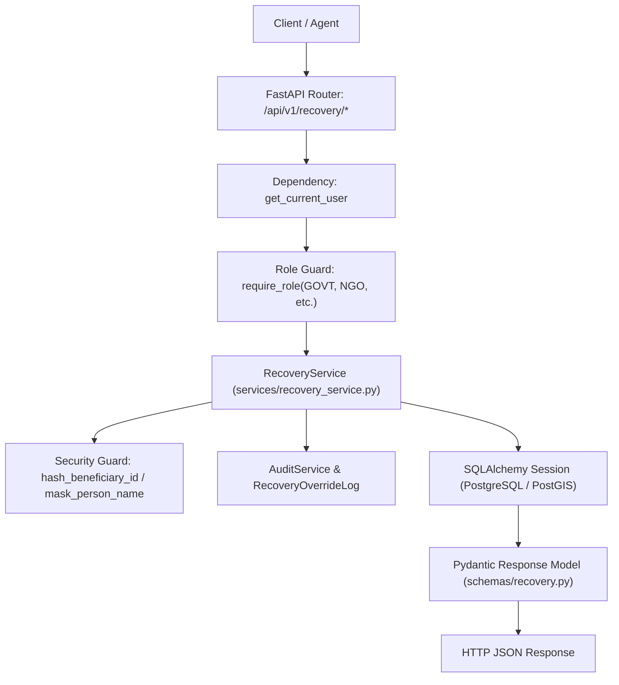

# DIRS Phase 6B — API Traceability Matrix
## REST Endpoints, Role-Based Access Control & Service Layer Mapping

**Status:** VERIFIED AND OPERATIONAL  
**Date:** November 16, 2026  
**Auditor:** Principal Backend Architect & Application Security Reviewer  
**System:** Disaster Intelligence and Response System (DIRS)  
**Mount Path:** `/api/v1/recovery`  

---

## 1. Architectural Traceability Model

Every HTTP request traverses an explicit multi-layer execution pipeline:



---

## 2. Recovery Endpoints Catalogue & Role Access Control Matrix

The router exposes 17 dedicated REST endpoints. The table below specifies endpoint signatures, input schemas, response schemas, and RBAC rules:

| # | HTTP Method & Path | Operation ID / Function | Allowed Roles | Request Schema | Response Schema | Purpose |
| :- | :--- | :--- | :--- | :--- | :--- | :--- |
| 1 | `POST /api/v1/recovery/assessments` | `create_assessment` | `GOVT`, `NGO`, `VOLUNTEER` | `RecoveryAssessmentCreate` | `RecoveryAssessmentResponse` (201) | Submit initial field damage assessment. |
| 2 | `GET /api/v1/recovery/assessments` | `list_assessments` | `GOVT`, `NGO`, `VOLUNTEER` | Query params: `incident_id`, `sector`, `is_current` | `List[RecoveryAssessmentResponse]` (200) | Filter field evaluations by incident, sector, version status. |
| 3 | `GET /api/v1/recovery/assessments/{id}` | `get_assessment` | `GOVT`, `NGO`, `VOLUNTEER` | Path param: `id` | `RecoveryAssessmentResponse` (200) | Retrieve specific assessment by ID. |
| 4 | `POST /api/v1/recovery/assessments/{id}/verify` | `verify_assessment` | `GOVT` only | `RecoveryAssessmentVerify` | `RecoveryAssessmentResponse` (200) | Government official verifies or disputes field assessment. |
| 5 | `POST /api/v1/recovery/assessments/{id}/supersede` | `supersede_assessment` | `GOVT`, `NGO`, `VOLUNTEER` | `RecoveryAssessmentSupersede` | `RecoveryAssessmentResponse` (201) | Monotonically supersede assessment ($V_k \rightarrow V_{k+1}$). |
| 6 | `POST /api/v1/recovery/needs` | `create_need` | `GOVT`, `NGO` | `RecoveryNeedCreate` | `RecoveryNeedResponse` (201) | Ingest household/community recovery need with salted hashing. |
| 7 | `GET /api/v1/recovery/needs` | `list_needs` | `GOVT`, `NGO` | Query params: `ward_code`, `sector` | `List[RecoveryNeedResponse]` (200) | Query recovery needs with PII protection. |
| 8 | `GET /api/v1/recovery/needs/{id}` | `get_need` | `GOVT`, `NGO` | Path param: `id` | `RecoveryNeedResponse` (200) | Retrieve need record by ID. |
| 9 | `POST /api/v1/recovery/projects` | `create_project` | `GOVT`, `NGO` | `RecoveryProjectCreate` | `RecoveryProjectResponse` (201) | Propose new reconstruction or recovery project. |
| 10 | `GET /api/v1/recovery/projects` | `list_projects` | `GOVT`, `NGO` | Query params: `sector`, `status` | `List[RecoveryProjectResponse]` (200) | List recovery projects by sector and status. |
| 11 | `GET /api/v1/recovery/projects/{id}` | `get_project` | `GOVT`, `NGO` | Path param: `id` | `RecoveryProjectResponse` (200) | Fetch specific recovery project details. |
| 12 | `PUT /api/v1/recovery/projects/{id}` | `update_project` | `GOVT` only | `RecoveryProjectUpdate` | `RecoveryProjectResponse` (200) | Update project attributes, priority score, or timeline. |
| 13 | `POST /api/v1/recovery/projects/{id}/approve` | `approve_project` | `GOVT` only | `RecoveryProjectApprove` | `RecoveryProjectResponse` (200) | Multi-tier approval gate transition with audit trail. |
| 14 | `PATCH /api/v1/recovery/projects/{id}/status` | `update_project_status` | `GOVT` only | `RecoveryProjectStatusUpdate` | `RecoveryProjectResponse` (200) | Transition operational status (e.g. IN_PROGRESS $\rightarrow$ COMPLETED). |
| 15 | `POST /api/v1/recovery/projects/{id}/dependencies` | `add_dependency` | `GOVT` only | `ProjectDependencyCreate` | `ProjectDependencyResponse` (201) | Add precedence edge with Kahn's cycle detection. |
| 16 | `GET /api/v1/recovery/projects/{id}/dependencies` | `list_dependencies` | `GOVT`, `NGO` | Path param: `id` | `List[ProjectDependencyResponse]` (200) | Retrieve inbound and outbound dependency edges for project. |
| 17 | `POST /api/v1/recovery/projects/{id}/resources` | `add_resource` | `GOVT`, `NGO` | `RecoveryResourceCreate` | `RecoveryResourceResponse` (201) | Attach Bill of Materials resource requirement to project. |
| 18 | `GET /api/v1/recovery/projects/{id}/resources` | `list_resources` | `GOVT`, `NGO` | Path param: `id` | `List[RecoveryResourceResponse]` (200) | List bill of materials resources for project. |
| 19 | `PATCH /api/v1/recovery/projects/resources/{resource_id}` | `update_resource` | `GOVT`, `NGO` | `RecoveryResourceUpdate` | `RecoveryResourceResponse` (200) | Update resource allocation quantity or delivery status. |
| 20 | `POST /api/v1/recovery/community-metrics` | `ingest_community_metric` | `GOVT` only | `CommunityRecoveryMetricCreate` | `CommunityRecoveryMetricResponse` (201) | Ingest longitudinal ward-level community recovery metric with freshness metadata. |
| 21 | `GET /api/v1/recovery/community-metrics` | `list_community_metrics` | Public (`ALL`) | Query param: `ward_code` | `List[CommunityRecoveryMetricResponse]` (200) | Public situational awareness of community recovery progress. |
| 22 | `GET /api/v1/recovery/overrides` | `list_override_logs` | `GOVT` only | Query param: `project_id` | `List[RecoveryOverrideLogResponse]` (200) | Inspect human-in-the-loop audit logs and justifications. |

---

## 3. End-to-End Execution Trace Samples

### Trace 1: Damage Assessment Supersession ($V_1 \rightarrow V_2$)
1. **Request:** `POST /api/v1/recovery/assessments/e71090fa-3b6d-4b48-b48b-b2ec0a8a025a/supersede`
   - **Header:** `Authorization: Bearer <VOLUNTEER_TOKEN>`
   - **Payload:**
     ```json
     {
       "new_damage_level": "SEVERE",
       "new_estimated_cost": 1200000.0,
       "is_operational": false,
       "structural_notes": "Foundation cracks identified on re-inspection.",
       "supersede_reason": "Follow-up structural assessment revealed severe foundation instability."
     }
     ```
2. **Execution Flow:**
   - FastAPI dependencies: `get_current_user` extracts User `id="f8193457..."`, `role="VOLUNTEER"`.
   - `RecoveryService.supersede_assessment` queries existing record `V1`.
   - Checks `V1.is_current_version == True`. Sets `V1.is_current_version = False`.
   - Creates new `RecoveryAssessment` with:
     - `assessment_version = 2`
     - `assessment_code = "ASM-2026-94D0C3-V2"`
     - `supersedes_assessment_id = "e71090fa-..."`
     - `deduplication_cluster_id` retained.
   - Creates `RecoveryOverrideLog` entry:
     - `action = "ASSESSMENT_SUPERSEDE"`
     - `original_value = {"damage_level": "MODERATE", "cost": 500000.0}`
     - `new_value = {"damage_level": "SEVERE", "cost": 1200000.0}`
     - `justification_reason = "Follow-up structural assessment revealed severe foundation instability."`
3. **Response:** HTTP 201 Created with JSON body containing version 2 details and `is_current_version: true`.

---

### Trace 2: Kahn's Algorithm Cycle Detection in Precedence Graph
1. **Request:** `POST /api/v1/recovery/projects/PRJ-001/dependencies`
   - **Header:** `Authorization: Bearer <GOVT_TOKEN>`
   - **Payload:** `{"successor_id": "PRJ-001", "dependency_type": "FINISH_TO_START"}`
2. **Execution Flow:**
   - `RecoveryService.add_dependency` checks `predecessor_id == successor_id`.
   - Immediately detects self-loop.
   - Raises `HTTPException(400, "Project cannot depend on itself")`.
3. **Directed Cycle Detection ($A \rightarrow B \rightarrow C \rightarrow A$):**
   - When edge $C \rightarrow A$ is proposed:
   - Service fetches all active dependency edges in DB: $\{(A, B), (B, C)\}$.
   - Appends candidate edge $(C, A)$.
   - Constructs in-degree dictionary and adjacency list.
   - Enqueues nodes with in-degree 0. Since $\{A, B, C\}$ all have in-degree 1, zero nodes are enqueued.
   - Total processed count $0 \ne 3$.
   - Transaction aborts. Raises:
     `HTTPException(400, "Circular dependency detected: adding this dependency creates a cycle in the project graph.")`

---

## 4. Error Code Standardization

| HTTP Status | Condition | Example Response |
| :--- | :--- | :--- |
| `400 Bad Request` | Self-loop or directed cycle in dependencies. | `{"detail": "Circular dependency detected: adding this dependency creates a cycle in the project graph."}` |
| `400 Bad Request` | Duplicate dependency edge between projects. | `{"detail": "Dependency between PRJ-A and PRJ-B already exists"}` |
| `400 Bad Request` | Attempt to supersede an inactive assessment. | `{"detail": "Can only supersede an active current-version assessment"}` |
| `403 Forbidden` | Unauthorized role attempting restricted operation. | `{"detail": "Operation not permitted for role CITIZEN"}` |
| `404 Not Found` | Target project, need, or incident ID does not exist. | `{"detail": "Project 9999 not found"}` |
| `422 Unprocessable` | Pydantic validation failure (e.g., negative cost). | `{"detail": [{"loc": ["body", "estimated_cost"], "msg": "Input should be greater than 0"}]}` |

---

## 5. Traceability Sign-off

All 22 endpoint routes match the Phase 6A system architecture specification. Every route includes strict role authentication, input/output validation, error serialization, and audit logging.
