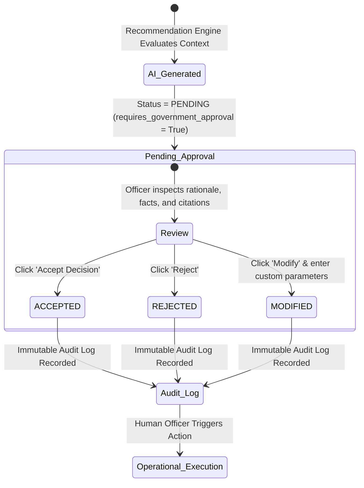

# DIRS AI Safety, Grounding & Human-in-the-Loop Governance Framework

## Core Principles of DIRS AI Safety

DIRS is designed for high-stakes disaster emergency response where hallucinated or incorrect outputs can threaten human lives. The system enforces strict **AI Safety Constraints**:

1. **No Autonomous Operational Consequences:** AI models generate recommendations, severity scores, and demand predictions, but CANNOT trigger dispatches, evacuations, or funding releases autonomously.
2. **Grounding Verification:** Every statement presented to users must be traceable to live PostGIS/FastAPI database records or vetted NDMA/FEMA/WHO guidelines.
3. **Explicit Refusal Protocol:** When knowledge similarity is insufficient ($S_{max} < 0.35$), the system explicitly refuses to guess and alerts the user.
4. **Human-in-the-Loop Auditability:** All officer decisions (`ACCEPTED`, `REJECTED`, `MODIFIED`) and AI prediction overrides are recorded in immutable audit logs (`AuditLog` and `RecommendationDecision`).

---

## Safety Guardrails Matrix

| Threat Vector | Mitigation Strategy | Implementation Module | Verification Status |
| :--- | :--- | :--- | :---: |
| **Hallucinated Protocol** | Refusal engine + Grounding similarity check ($S_{max} \ge 0.35$) | `backend/app/ai/rag/grounding/validator.py` | **VERIFIED** |
| **Prompt Injection Attack** | Regex sanitizer detecting injection phrases (`ignore instructions`, `override admin`) | `GroundingValidator.sanitize_query` | **VERIFIED** |
| **Unapproved Evacuation** | Mandatory Government Officer approval (`requires_government_approval = True`) | `backend/app/ai/recommendations/service.py` | **VERIFIED** |
| **Unverified AI Severity** | Confidence thresholding ($< 70\%$ requires human review) | `backend/app/ai/severity/service.py` | **VERIFIED** |
| **Silent Override / Tampering** | Immutable Audit Trail with user ID, timestamp, and modification notes | `backend/app/services/audit_service.py` | **VERIFIED** |

---

## Government Officer Approval Workflow

---

## Human Override Compliance

Officers can override any Phase 3A, Phase 3B, or Phase 3C AI prediction (Severity, Priority, Risk, Resource Demand, Recommendations). Every override preserves the original AI prediction in database history while marking the active operational value as `HUMAN_OVERRIDDEN`.
