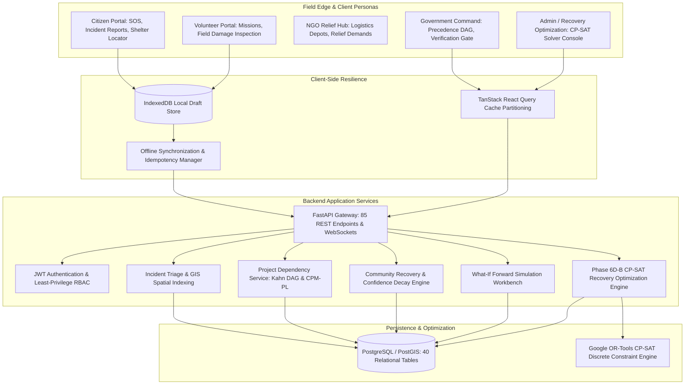
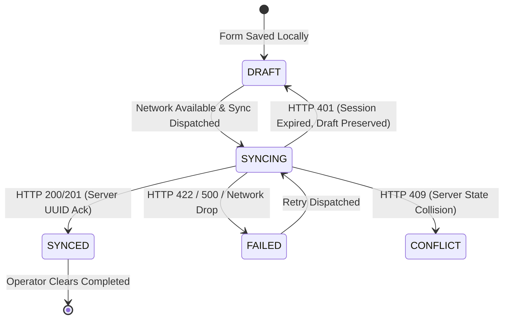

# DIRS — Definitive Final System Architecture Specification
## Disaster Intelligence and Response System (DIRS)

**Document Identifier:** `DIRS-CAPSTONE-ARCH-001`  
**Classification:** OFFICIAL / TECHNICAL ARCHITECTURE  
**Target Release:** DIRS v5.2 (Capstone Release)  
**Parent Programme:** Phase 6G / Accelerated Work Package 4 (Capstone Packaging & Verification)  
**Publication Date:** November 18, 2026  
**Status:** Certified / Complete  

---

## 1. System Overview & Mission Architecture

The **Disaster Intelligence and Response System (DIRS)** is an enterprise-grade disaster management, situational awareness, recovery optimization, and decision-support platform designed for catastrophic emergencies and post-disaster rehabilitation.

DIRS unifies real-time emergency telemetry, volunteer mobilization, humanitarian logistics, infrastructure restoration planning, vulnerability tracking, and mathematical portfolio scheduling into a role-aware operational console:

---

## 2. Frontend Architecture

### 2.1 Technology Stack & Invariants
* **Runtime & Framework:** React 18.3+ with TypeScript 5.5+ and Vite 5.4 bundler.
* **UI Styling:** Tailwind CSS 3.4 utility framework combined with custom operational design system tokens (zinc/slate military dark-theme palette).
* **Iconography:** Lucide React icons.
* **State Management & Caching:** TanStack React Query v5 with principal-partitioned query keys (`[queryName, user?.id]`) to eliminate memory-cache leakage during multi-user device sharing.
* **HTTP Client:** Axios instance with request/response interceptors injecting JWT Bearer tokens and normalizing structured 401, 422, and 500 exceptions.
* **Routing:** React Router v6 enforcing least-privilege route guards (`<ProtectedRoute>`).
* **Offline Storage:** Native browser IndexedDB transactional storage (`dirs_offline_drafts`) wrapped in clean async utilities without external heavy runtime dependencies.

### 2.2 Client Route Topology & Guard Matrix
All routes are guarded in `frontend/src/App.tsx`:

| Route Path | View Component | Authorized Roles | Fallback Behavior |
| :--- | :--- | :--- | :--- |
| `/login` | `Login.tsx` | Public | Redirects to role home if authenticated |
| `/register` | `Register.tsx` | Public | Redirects to role home if authenticated |
| `/citizen` | `CitizenDashboard.tsx` | `CITIZEN`, `GOVT` | Redirects to `/login` |
| `/citizen/report` | `ReportIncident.tsx` | `CITIZEN`, `VOLUNTEER`, `GOVT` | Redirects to `/citizen` |
| `/citizen/shelters` | `ShelterFinder.tsx` | All authenticated | Redirects to `/login` |
| `/volunteer` | `VolunteerDashboard.tsx` | `VOLUNTEER`, `GOVT` | Redirects to `/citizen` |
| `/ngo` | `NGODashboard.tsx` | `NGO`, `GOVT` | Redirects to `/citizen` |
| `/admin` | `CommandCenter.tsx` | `GOVT` | Redirects to `/citizen` (ADMIN $\to$ `/admin/recovery-optimization`) |
| `/admin/simulation` | `DisasterSimulationView.tsx` | `GOVT` | Redirects to `/admin/recovery-optimization` |
| `/admin/recovery-optimization` | `RecoveryOptimizationView.tsx` | `GOVT`, `ADMIN` | Redirects to `/citizen` |

---

## 3. Backend Architecture

### 3.1 Technology Stack & API Topology
* **Framework:** FastAPI 0.110+ on Python 3.11.
* **ASGI Server:** Uvicorn with async worker loop and WebSocket connection management (`/ws/feed`).
* **Validation & Schemas:** Pydantic v2 data transfer objects enforcing strict boundary validation, exact types, and regex checks.
* **Data Persistence:** SQLAlchemy 2.0 ORM with PostgreSQL dialect and GeoAlchemy2 spatial type bindings.
* **Database Migrations:** Alembic migration environment locked at head `phase6b_recovery_foundation`.
* **Optimization Subsystem:** Google OR-Tools CP-SAT discrete solver (`ortools.sat.python.cp_model`) executing discrete multi-period resource allocation.
* **API Structure:** 85 REST endpoints grouped under `/api/v1/` across 16 domain routers.

### 3.2 Service Layer Breakdown
1. **`auth.py` / `user_service.py`:** Authentication, password hashing via bcrypt, and JWT token issuance with expiry claims.
2. **`incident_service.py`:** Incident intake, geospatial clustering within 500m radius, and emergency SOS dispatch.
3. **`project_dependency_service.py`:** Precedence network extraction, Kahn's algorithm topological sorting, cycle detection, and Critical Path Method with Project Lag (CPM-PL).
4. **`community_monitoring_service.py`:** Ward-level recovery indicator aggregation, sector index calculations (Power, Water, Health, Schools, Livelihoods), and confidence decay calculations.
5. **`vulnerability_scoring_service.py`:** Normalized physical and socioeconomic vulnerability rescoring ($\phi \in [0.0, 1.0]$) incorporating observational confidence decay.
6. **`recovery_simulation_service.py`:** Forward What-If recovery trajectory simulation under budget perturbations, supply-chain shocks, and secondary hazards.
7. **`recovery_optimization_orchestrator.py` & `recovery_cpsat_solver.py`:** Authoritative Phase 6D-B CP-SAT optimization engine with dual-ledger CCU/INR solvency, resource constraints, and 4-tier infeasibility diagnostics.

---

## 4. Database Architecture & Schema Overview

The DIRS database schema is organized into 40 relational tables with zero unapplied migrations:

```mermaid
erDiagram
    users ||--o{ citizen_profiles : has
    users ||--o{ volunteer_profiles : has
    users ||--o{ ngo_profiles : has
    users ||--o{ audit_logs : generates
    users ||--o{ resources : owns

    incidents ||--o{ incident_reports : receives
    incidents ||--o{ incident_media : contains
    incidents ||--o{ rescue_tasks : generates
    incidents ||--o{ resource_requests : demands
    incidents ||--o{ recovery_assessments : evaluates

    recovery_projects ||--o{ project_dependencies : precedes
    recovery_projects ||--o{ recovery_needs : requires
    recovery_projects ||--o{ recovery_resources : consumes

    community_recovery_metrics ||--o{ simulation_runs : references
    optimization_runs ||--o{ optimization_recommendations : produces
    optimization_runs ||--o{ optimization_override_logs : audits
```

### Table Domain Classification
* **Identity & Profiles (5):** `users`, `citizen_profiles`, `volunteer_profiles`, `ngo_profiles`, `audit_logs`.
* **Incidents & Operations (8):** `incidents`, `incident_reports`, `incident_clusters`, `incident_media`, `alerts`, `shelters`, `road_blockages`, `vehicles`.
* **Rescue & Logistics (4):** `rescue_tasks`, `resources`, `resource_requests`, `donations`.
* **AI & Grounded Knowledge (8):** `ai_predictions`, `ai_recommendations`, `cv_damage_assessments`, `risk_assessments`, `resource_demand_predictions`, `knowledge_documents`, `knowledge_chunks`, `rag_query_logs`.
* **Decision Recommendations (2):** `recommendation_decisions`, `spatial_ref_sys`.
* **Recovery Infrastructure & Precedence (5):** `recovery_projects`, `project_dependencies`, `recovery_assessments`, `recovery_needs`, `recovery_resources`.
* **Monitoring, Rescoring & Simulation (4):** `community_recovery_metrics`, `simulation_scenarios`, `simulation_runs`, `recovery_override_logs`.
* **Optimization & Solvency (4):** `optimization_runs`, `optimization_recommendations`, `optimization_override_logs`, `alembic_version`.

---

## 5. Offline Resilience & Synchronization Lifecycle

Frontline disaster zones frequently suffer power collapse and telecom fiber cuts. DIRS implements a client-side local-first offline architecture:

### 5.1 IndexedDB Schema (`dirs_offline_drafts`)
* **Store Name:** `dirs_offline_drafts`
* **Key Path:** `id` (client-generated UUID v4)
* **Indices:**
  - `by_user_id`: Index on `user_id`
  - `by_draft_type`: Index on `draft_type` (`INCIDENT_REPORT` | `FIELD_DAMAGE_INSPECTION`)
  - `by_sync_status`: Index on `sync_status` (`DRAFT` | `SYNCING` | `SYNCED` | `FAILED` | `CONFLICT`)
  - `by_user_type`: Compound index `['user_id', 'draft_type']`

### 5.2 Synchronization State Machine

### 5.3 Delivery Semantics & Idempotency Safeguards
* **At-Least-Once Delivery:** The synchronization engine provides At-Least-Once delivery.
* **Client Idempotency Guard:** If a draft has already reached `SYNCED` and holds a `server_acknowledged_id`, subsequent sync calls immediately return the cached acknowledgement without dispatching redundant network calls.
* **Server Triage Safety:** Because field reports represent observational telemetry, network drops during in-flight requests that cause client retry are safely deduplicated or merged by Government Command triage (`POST /api/v1/incidents/merge` and engineering verification gates).

---

## 6. Mathematical Intelligence & Recovery Engines

### 6.1 Infrastructure Restoration Intelligence (Phase 6E / WP1)
* **Kahn's Topological Sort:** Linear-time algorithm determining executable project execution orders.
* **Directed Cycle Extraction:** Detects circular precedence loops ($A \to B \to C \to A$) and returns the exact ordered cycle path for operator rectification.
* **CPM-PL Forward/Backward Pass:** Calculates Early Start ($ES$), Early Finish ($EF$), Late Start ($LS$), Late Finish ($LF$), Total Float ($TF$), and Free Float ($FF$) incorporating mandatory project lags ($L_{ij}$).
* **Critical Path Identification:** Identifies bottlenecks where $TF_i = 0$.

### 6.2 Community Recovery & Forward Simulation (Phase 6F / WP2)
* **Confidence Decay Engine:** Applies exponential temporal decay based on observation age:
  $$\text{Confidence}(t) = \text{BaseConfidence} \times e^{-\lambda \Delta t}$$
  Categorized into `FRESH` ($\le 24\text{h}$), `MODERATE` ($\le 72\text{h}$), `STALE_AMBER` ($\le 168\text{h}$), and `EXPIRED_RED` ($> 168\text{h}$).
* **Vulnerability Rescoring:** Computes normalized ward vulnerability score $\phi \in [0.0, 1.0]$ combining sector restoration deficits and census data.
* **What-If Simulation Workbench:** Non-mutating forward simulator evaluating recovery trajectory shifts under budget perturbations, supply-chain bottlenecks, and secondary disaster recurrence.

### 6.3 Mathematical Recovery Portfolio Optimization (Phase 6D-B)
* **Solver Engine:** Google OR-Tools CP-SAT discrete optimization solver.
* **Dual-Ledger Solvency:** Strictly separates integer Community Credit Unit (CCU) ledger balances from exact Decimal INR liquidity balances.
* **4-Tier Infeasibility Diagnostics:** Structured diagnostics identifying budget exhaustion, resource deficits, deadline breaches, or circular dependencies with minimal assumption cores.

---

## 7. Operational Roles & Security Boundaries

DIRS enforces strict Principle of Least Privilege across five personas:
1. **`CITIZEN`:** Public reporting, emergency SOS signaling, and shelter discovery. Strictly prohibited from administrative controls, volunteer tasks, and engineering verification.
2. **`VOLUNTEER`:** Field mission execution and on-site damage assessment intake. Cannot self-verify inspections or assign tasks.
3. **`NGO`:** Humanitarian commodity depot management and relief request fulfillment. Governed by statutory notice: capital infrastructure projects are institutional government matters; zero arbitrary string packing in database records.
4. **`GOVT` (Super-Role):** Operational command, volunteer tasking, engineering assessment certification, precedence network inspection, vulnerability rescoring, and simulation.
5. **`ADMIN`:** Dedicated recovery portfolio optimization solver access, scenario configuration, and mathematical schedule evaluation.
