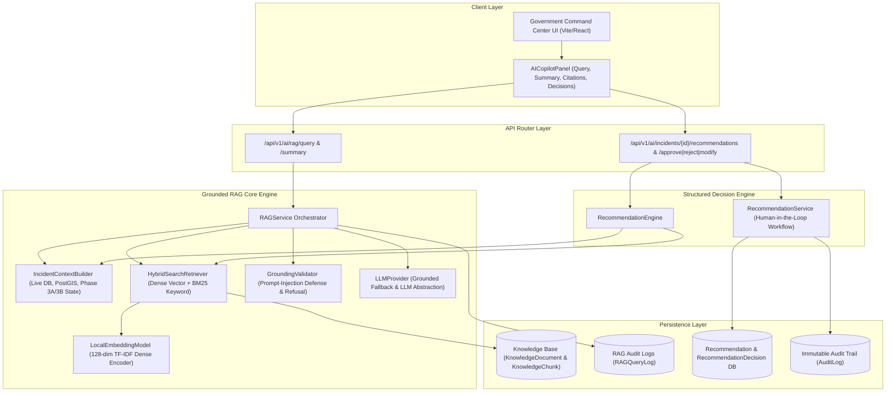

# DIRS Phase 3C — Grounded RAG & AI Decision Copilot Architecture

## Executive Overview

DIRS Phase 3C introduces an authoritative **Grounded Knowledge & AI Copilot Subsystem** (`backend/app/ai/rag/`) built specifically for emergency command and control operations. Unlike generic chatbots, DIRS Phase 3C operates on strict **grounding guarantees**: every summary, fact, inference, and decision recommendation must be directly verifiable against live PostGIS/FastAPI system state or retrieved from vetted emergency guidelines (NDMA, FEMA, WHO).

---

## High-Level Architecture Diagram

---

## Key Subcomponents

### 1. Authoritative Knowledge Base & Vector Index
- **Models:** `KnowledgeDocument` (document metadata, source URL, version hash) and `KnowledgeChunk` (token chunk, section title, 128-dimensional dense vector embedding).
- **Ingestion & Chunker:** Section-aware text chunker (`backend/app/ai/rag/ingestion/chunker.py`) preserving markdown headers (`#`, `##`) with 500-token chunk size and 80-token overlap.
- **Dense Encoder:** Deterministic local TF-IDF vector encoder (`backend/app/ai/rag/embeddings/model.py`) mapping disaster terminology to 128-dimensional L2-normalized vector space.

### 2. Hybrid Retrieval Engine
- `HybridSearchRetriever` combines dense vector cosine similarity (0.6 weight) and BM25 keyword matching (0.4 weight) filtered by disaster hazard type (e.g. `CYCLONE`, `FLOOD`, `MEDICAL`).

### 3. Grounded Context Builder
- `IncidentContextBuilder` aggregates live PostGIS incident coordinates, Phase 3A severity & priority scores, duplicate candidate links, Phase 3B CV damage class, meteorological risk level, forecasted resource demand, nearby shelter capacities, and active volunteer assignments.

### 4. Grounding Validation & Safety Guardrails
- **Prompt-Injection Defense:** Sanitizes regex injection patterns (`ignore instructions`, `reveal system prompt`, `override admin privileges`).
- **Controlled Refusal Engine:** Evaluates maximum similarity score ($S_{max}$). If $S_{max} < 0.35$ and no live incident context is present, returns controlled refusal: *"I don't have enough verified information..."* with `is_grounded = false`.

### 5. Structured Decision Recommendation Engine
- `RecommendationEngine` generates structured decision items across 4 categories: `EVACUATION`, `MEDICAL_TRIAGE`, `SHELTER_ALLOCATION`, `RESOURCE_REALLOCATION`.
- Each recommendation carries rationale, evidence citations, required resource estimates, risk if delayed, and `requires_government_approval = True`.

### 6. Human-in-the-Loop Approval Workflow
- `RecommendationService` allows Government Officers to `ACCEPT`, `REJECT`, or `MODIFY` recommendations. Original AI recommendations remain immutable, while officer decisions and modified parameters are logged to `RecommendationDecision` and `AuditLog`.

---

## Non-Negotiable Operational Safety Rules

> [!IMPORTANT]
> 1. **No Autonomous Operational Dispatch:** The RAG Copilot and Recommendation Engine NEVER execute operational actions (evacuations, resource dispatch, fund allocation) autonomously. All recommendations require explicit Government Officer approval.
> 2. **Fact vs Inference Separation:** All responses explicitly separate verified system facts from AI inferences.
> 3. **Immutable Audit Trail:** All decisions, overrides, and queries are recorded with user ID, timestamp, and decision notes.
