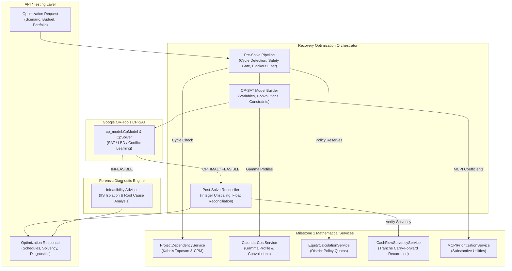

# DIRS Phase 6D-B — Milestone 2A: CP-SAT Optimization Engine Architecture

**Document ID:** `DIRS-PHASE6D-B-M2A-ARCH-01`  
**Classification:** OPERATIONS RESEARCH & OPTIMIZATION SYSTEM ARCHITECTURE  
**Author:** Principal Software Architect, Operations Research Specialist & Optimization Engineer  
**Date:** November 17, 2026  
**Status:** COMPLETE (MILESTONE 2A DESIGN SPECIFICATION)  
**Database Policy:** ZERO MIGRATIONS — Schema strictly frozen at `phase6b_recovery_foundation`  

---

## 1. Executive Summary & Purpose

This architectural specification establishes the system design, modular decomposition, and component interfaces for the **DIRS Phase 6D-B Recovery Optimization Engine**. 

Under Phase 6D-B Milestone 2A, this document articulates the architecture of the Google OR-Tools CP-SAT mathematical engine, strictly decoupled from database persistence and Web API routing. It consumes the domain contracts and pure mathematical services delivered in Milestone 1, enforces all physical, financial, and governance constraints without silent relaxation, and returns structured optimization schedules.

### Governing Architectural Invariants
1. **Zero Database Migrations:** Operates exclusively in-memory on caller-supplied input contracts. Zero writes to `recovery_projects.priority_score`, zero schema mutations.
2. **Pure Functional Pipeline:** Optimization input is validated, pre-solved, modeled in CP-SAT, solved, and serialized into immutable output objects.
3. **No Silent Relaxation (RSK-M2-01 Approved Option A):** Mandatory life-safety projects ($S_L \ge 0.85$, `TIER_1_MANDATORY`) must all be selected ($w_j = 1$). If budgets, resources, dependencies, or horizons conflict, the solver halts and returns `INFEASIBLE` with structured forensic diagnostics. It never softens constraints automatically.
4. **Reproducibility & Determinism (RSK-M2-03 Approved Option A):** Default single-worker search (`num_search_workers = 1`), fixed random seed (`random_seed = 42`), time limit, OR-Tools version logging, and canonical SHA-256 request fingerprinting. Cross-platform bitwise identity across differing OS/CPU architectures is explicitly disclaimed.
5. **Funding Policy Solvency (RSK-M2-05 Approved Option A):** Global multi-period cash solvency is default; per-fund constraints are activated only when explicit funding-source rules are provided. Classified strictly as funding-policy constraints with zero real-world banking claims.
6. **Preservation of Milestone 1 Implementation Exceptions:**
   - `DEV-M1-01`: Exact raw floating-point score comparisons (no tolerance grouping).
   - `DEV-M1-02`: Ascending `project_id` non-substantive stable final arbiter (no SHA-256 hash).

---

## 2. Solver Engine Technology Selection: Google OR-Tools CP-SAT

### 2.1 Technology Rationale
Google OR-Tools CP-SAT (version `9.15.6755`) is selected as the primary optimization technology for Phase 6D-B based on research established in `PHASE6D_SOLVER_AND_BENCHMARK_STRATEGY.md`:
- **Native Interval Variables:** `NewOptionalIntervalVar` allows seamless modeling of project durations and execution presence without big-$M$ relaxations.
- **Efficient Conflict Clause Learning:** CP-SAT's SAT-based conflict analysis quickly proves infeasibility when physical constraints or budgets conflict.
- **Cumulative Resource Constraints:** Native `AddCumulative` constraints efficiently enforce multi-period engineering crew and heavy machinery limits.
- **Deterministic Multi-Threading:** Supports fixed-seed, single-worker, or multi-worker search with deterministic execution guarantees.

---

## 3. High-Level Modular Decomposition

The optimization subsystem is located strictly within `backend/app/recovery/optimization/` (to be implemented in Milestone 2B):

```
backend/app/recovery/optimization/
├── __init__.py                                 # Public engine exports
├── schemas.py                                  # Input & output domain dataclasses
├── recovery_cpsat_solver.py                    # Low-level OR-Tools model builder & CP-SAT wrapper
├── recovery_optimization_orchestrator.py       # Portfolio validator, pre-solver & scenario coordinator
└── infeasibility_advisor.py                    # Forensic conflict diagnostic engine
```



---

## 4. Execution Pipeline & Stage Architecture

The solver executes through a strict 5-stage sequential pipeline:

### Stage 1: Input Validation & Pre-Solve Gate
1. **Demographic & Input Sanity:** Verifies planning horizon $T \ge 1$, period length $\Delta t > 0$, non-negative budgets $B_t \ge 0$, and valid project attributes.
2. **Topological Precedence Cycle Audit:** Executes Kahn's algorithm via `ProjectDependencyService.analyze_dependencies`. If cycles exist, raises `CyclicDependencyError` immediately before model construction.
3. **Blackout District Ring-Fencing:** Identifies districts with `is_blackout == True` or $|J_d| = 0$. Evaluates $R_{\text{blackout}, d} = \underline{\theta}_d B$ via `EquityCalculationService` and deducts it from allocable capital.
4. **Mandatory Life-Safety Identification:** Segregates projects into $\mathcal{P}_{\text{Tier 1}}$ ($S_L \ge 0.85$) and standard projects $\mathcal{P}_{\text{Standard}}$.

### Stage 2: Decision Variable & Interval Construction
1. Create selection booleans $w_j \in \{0, 1\}$.
2. Create start indicators $x_{j, t} \in \{0, 1\}$ for all feasible calendar periods $t \in [E_j, T - d_j + 1]$.
3. Construct CP-SAT optional interval variables $I_j$ present if and only if $w_j = 1$.
4. Define periodic expenditure convolution expressions $E_{j, t}$.
5. Construct multi-period liquid cash balances $\Phi_t \ge 0$, with initial cash $\Phi_0 \ge 0$.
6. Construct binary funding source assignment variables $z_{j, f} \in \{0, 1\}$ for all $f \in \mathcal{F}_j^{\text{eligible}}$ (RSK-M2-06: Indivisible Project Funding).

### Stage 3: Constraint System Assembly
1. **Structural Selection Precedence:** $w_j \le w_i$ for all $(i, j) \in \mathcal{E}$.
2. **Timing Precedence with Lag:** $S_j \ge S_i + d_i + L_{ij}$ enforced only when $w_j = 1$.
3. **Execution Uniqueness:** $\sum_t x_{j, t} = w_j$.
4. **Fiscal Solvency Recurrence:** $\Phi_t = \eta \Phi_{t-1} + B_t - \sum_j E_{j, t} \ge 0$, with initial cash balance $\Phi_0 \ge 0$.
5. **District Policy Equity Floors:** $\sum_{j \in J_d} c_j w_j \ge \min(\underline{\theta}_d B, \sum_{j \in J_d} c_j)$.
6. **Mandatory Life-Safety Hard Mandate:** $w_j = 1$ for all $j \in \mathcal{P}_{\text{Tier 1}}$ (subject to horizon and solvability).
7. **Resource Capacity Envelopes:** $\sum_j u_{j, r} y_{j, t} \le R_{r, t}$.
8. **Indivisible Funding Allocation (RSK-M2-06):** $\sum_{f \in \mathcal{F}_j^{\text{eligible}}} z_{j, f} = w_j$ and $\sum_j c_j z_{j, f} \le F_f^{\max}$. Zero splitting of project cost across multiple funds.

### Stage 4: Multi-Objective Function Assembly
- Scale additive MCPI utility by integer scaling factor $S_{\text{MCPI}} = 10,000$.
- Add optional small acceleration incentive (early start preference) that is mathematically proven to be non-compensatory relative to project selection.

### Stage 5: Solver Execution, Solution Extraction & Diagnostics
- Invoke `CpSolver.Solve(model)`.
- If `OPTIMAL` or `FEASIBLE`:
  - Extract $w_j$, $S_j$, $C_j^{\text{end}}$, periodic cash flows $E_{j, t}$, and cash reserves $\Phi_t$.
  - Unscale integer values back to standard reporting units (INR Lakhs, floating percentages).
  - Verify complete portfolio solvency against `CashFlowSolvencyService`.
- If `INFEASIBLE`:
  - Invoke `InfeasibilityAdvisor` to identify deterministic pre-solve causes and extract CP-SAT's sufficient assumption core (mandatory life-safety budget deficit vs. precedence cycle vs. equity floor vs. resource conflict). Note: CP-SAT provides a sufficient assumption core, not a guaranteed minimal or unique conflict set.
  - Return detailed structured forensic report without altering any constraint.
- If `UNKNOWN` (Timeout):
  - Return status `TIMEOUT_UNKNOWN` with best bound and elapsed runtime. **Never report a timeout as proof of infeasibility.**

---

## 5. Domain Interface Contracts

### 5.1 Optimization Request Contract (`RecoveryOptimizationRequest`)
```python
@dataclass(frozen=True)
class ProjectOptimizationCandidate:
  project_id: str
  project_code: str
  title: str
  district_id: str
  total_cost: float  # c_j in INR Lakhs
  duration_periods: int  # d_j >= 1
  mcpi_score: float  # b_j in [0.0, 100.0]
  is_tier1_mandatory: bool  # S_L >= 0.85
  earliest_start_period: int = 1  # E_j >= 1
  curve_type: DisbursementCurveType = DisbursementCurveType.UNIFORM
  custom_gamma: Optional[List[float]] = None
  resource_demands: Dict[str, int] = field(default_factory=dict)


@dataclass(frozen=True)
class RecoveryOptimizationRequest:
  scenario_name: str
  planning_horizon: int  # T periods
  period_duration_days: int  # Delta t (default 30)
  budget_envelopes: List[float]  # B_t in INR Lakhs (length T)
  district_equity_floors: Dict[str, float]  # district_id -> theta_d
  blackout_districts: List[str]  # Districts under blackout
  candidates: List[ProjectOptimizationCandidate]
  dependencies: List[DependencyEdge]
  resource_capacities: Dict[str, List[int]] = field(default_factory=dict)
  fiscal_retention_rate: float = 1.0  # eta in [0.0, 1.0]
  enable_early_start_bonus: bool = False
  max_solve_time_seconds: float = 60.0
  deterministic_seed: int = 42
  num_workers: int = 1  # 1 for bitwise determinism
```

### 5.2 Optimization Response Contract (`RecoveryOptimizationResponse`)
```python
@dataclass(frozen=True)
class ScheduledProjectResult:
  project_id: str
  project_code: str
  is_selected: bool
  scheduled_start_period: Optional[int]
  scheduled_completion_period: Optional[int]
  mcpi_score: float
  is_tier1_mandatory: bool
  periodic_expenditures: Dict[int, float]  # t -> E_{j, t}
  district_id: str


@dataclass(frozen=True)
class RecoveryOptimizationResponse:
  scenario_name: str
  solver_status: str  # OPTIMAL, FEASIBLE, INFEASIBLE, UNKNOWN, MODEL_INVALID
  is_optimal: bool
  objective_value: float
  best_bound: float
  optimality_gap: float
  solve_time_seconds: float
  selected_project_count: int
  total_expenditure: float
  scheduled_projects: List[ScheduledProjectResult]
  periodic_solvency: List[PeriodSolvencyStatus]
  district_equity_audit: PortfolioEquityAudit
  infeasibility_diagnostics: Optional[Dict[str, Any]] = None
```

---

## 6. Architecture Review Checkpoints

- [x] Conforms to zero-migration database policy.
- [x] Strictly decoupled from SQLAlchemy models and FastAPI routing.
- [x] Directly integrates Milestone 1 domain services (`ProjectDependencyService`, `CalendarCostService`, `EquityCalculationService`, `CashFlowSolvencyService`).
- [x] Eliminates big-$M$ relaxations by leveraging native CP-SAT interval variables.
- [x] Eliminates silent constraint softening; mandates structured infeasibility diagnostics.
