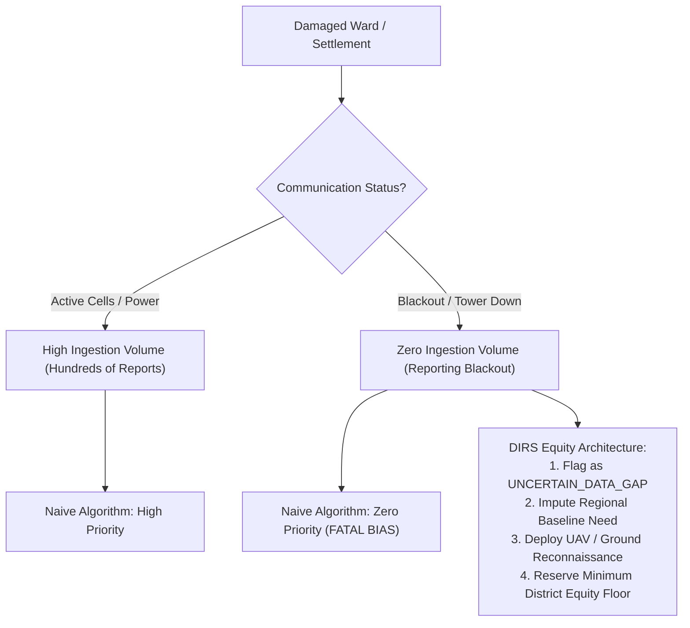

# DIRS Phase 6D-A — Social Equity & Human Governance Architecture

**Document ID:** `DIRS-PHASE6D-DOC-07`  
**Classification:** HUMANITARIAN POLICY & ALGORITHMIC GOVERNANCE  
**Author:** Principal Operations Research Scientist & Humanitarian Data Governance Specialist  
**Date:** November 16, 2026  
**Status:** COMPLETE (PHASE 6D-A DESIGN BASELINE)  

---

## 1. Executive Summary

Algorithmic optimization in public disaster recovery carries immense ethical responsibility. Mathematical optimization models naturally seek efficiency; without explicit constraints, they allocate capital to projects with dense populations, high property values, and easily accessible transport corridors, systematically abandoning rural hamlets, socioeconomically marginalized communities, and persons with disabilities.

This document formulates the social equity safeguards, minimum service guarantees, reporting-bias protections, explainability mechanisms, and human governance gates governing Phase 6D.

---

## 2. The Reporting Bias Trap & Uncertainty Defense

In acute disasters, **absence of evidence is not evidence of absence**:
- Affluent urban neighborhoods with intact cellular connectivity file hundreds of digital damage reports within hours.
- Remote coastal villages and marginalized informal settlements with severed power lines and destroyed mobile towers may submit zero digital reports for days or weeks.
- **The Reporting Bias Trap**: An algorithmic model that calculates need based solely on submitted incident counts will erroneously conclude that the silent remote village suffered zero damage and direct all capital to the vocal urban center.



### 2.1 Algorithmic Protections Against Reporting Bias
1. **Infrastructure Blackout Cross-Referencing**:
   Before prioritizing ward needs, the system queries Phase 3B power and telecom status. If a ward reports zero damage but has 0% power grid or cell tower connectivity, it is tagged as `UNSURVEYED_BLACKOUT_ZONE`.
2. **Precautionary Imputation**:
   Rather than imputing zero, uncontacted wards are assigned the 75th percentile damage profile of neighboring wards subjected to the same hazard intensity footprint.
3. **Emergency Reconnaissance Task Generation**:
   The volunteer and GIS engines automatically schedule high-priority field reconnaissance to eliminate the data void.

---

## 3. Social Equity Constraints & Minimum Service Guarantees

Phase 6D enforces three formal mathematical equity mechanisms:

### 3.1 Demographic Weighting Multiplier
Reusing the Phase 6A/6C demographic conservation breakdown, vulnerable populations are assigned protective humanitarian multipliers:
- Persons requiring accessibility accommodations ($N_{\text{ACC}}$): $2.5\times$ weight.
- Persons requiring active medical support ($N_{\text{MED}}$): $3.0\times$ weight.
- Persons with compound medical and mobility needs ($N_{\text{MED\_ACC}}$): $4.5\times$ weight.

### 3.2 Geographic & Ward Equity Floors
No administrative district or designated backward taluk may be starved of recovery funds:
$$\sum_{j \in \mathcal{P}_d} C_j \cdot w_j \ge \underline{\theta}_d \cdot \sum_{j \in \mathcal{P}} C_j \cdot w_j \quad \forall d \in \mathcal{D}$$
Where $\underline{\theta}_d$ is the statutory equity fraction (e.g. at least 15% of public capital must be spent in rural blocks).

### 3.3 Basic Humanitarian Service Guarantees
Regardless of total capital budget constraints, every affected population node is guaranteed non-deferrable basic survival access within $T_{\text{emergency}} = 1\text{ period}$:
1. Potable water availability $\ge 15\text{ liters/person/day}$.
2. Primary medical access within $\le 5.0\text{ km}$ travel distance.
3. Transitional shelter capacity $\ge 100\%$ of displaced households.

---

## 4. Explainability & Transparent Decision Attribution

For every candidate project $j \in \mathcal{P}$, the optimization engine generates a complete, human-readable Explainability Manifest:

### 4.1 Component Breakdown Card
```text
Project: PRJ-2026-ENNORE-004 (Ennore Community Water Purification Plant)
Overall MCPI Score: 78.4 / 100.0 (Priority Rank: 2 of 45)
--------------------------------------------------------------------------------
Criteria Breakdown:
  - Life-Safety Urgency:        0.90 * 0.30 = 27.0 pts (Severe water contamination threat)
  - Infrastructure Criticality: 0.75 * 0.25 = 18.8 pts (Tier 2 Lifeline Facility)
  - Vulnerability Density:      0.82 * 0.20 = 16.4 pts (High concentration of dialysis/elderly)
  - Network Dependency Cascade: 0.45 * 0.15 =  6.8 pts (Unlocks 3 downstream distribution points)
  - Economic / Livelihood:      0.94 * 0.10 =  9.4 pts (Restores fishing hamlet cold storage)
Data Freshness Multiplier:      1.00 (FRESH - Certified by Govt Engineer within 48h)
--------------------------------------------------------------------------------
Scheduling Recommendation:
  - Scheduled Start: Period 1 (Immediate)
  - Duration: 2 Periods (Planned Finish: Period 2)
  - Required Capital: INR 45.0 Lakhs (Disbursed: [25.0L, 20.0L])
  - Funding Source: STATE_SDRF (Eligible)
  - Binding Constraints: Heavy excavator availability in Period 1 (Tight slack: 1 machine-day)
```

### 4.2 Deferral & Rejection Justification
If a project is deferred or excluded ($w_j = 0$), the engine explicitly states the binding constraints that prevented its inclusion:
- *"Deferred to Period 3 due to upstream Dependency P1 (Access Road Clearance) in Period 1–2."*
- *"Excluded from current portfolio due to Capital Budget Envelope exhaustion in Period 2 (Deficit: INR 12.5L)."*
- *"Exclusion overridden by Government Emergency Sanction Order #TN-REV-2026-881."*

---

## 5. Human-in-the-Loop Governance & Immutable Audit Logging

### 5.1 Non-Autonomous Policy Boundary
To comply with public procurement law and the Disaster Management Act, 2005:
1. **No Autonomous Financial Sanction**: The solver generates proposed schedules (`PROPOSED_SCHEDULE`); it cannot authorize treasury disbursements, bank transfers, or tender releases.
2. **Government Sanction Gate**: A project schedule only transitions to `APPROVED` when signed by an authorized Government Recovery Officer (`role = "GOVT"`) citing a valid administrative Sanction Order Number.
3. **No Autonomous Condemnation or Demolition**: Structural condemnation requires physical structural engineering inspection.

### 5.2 Override Logging Schema
Every manual intervention (score change, project pinning, period shift) is logged to `RecoveryOverrideLog`:
- `project_id`: Target project UUID.
- `user_id`: Officer UUID.
- `action`: `PIN_PROJECT_TO_PERIOD`, `FORCE_SELECT`, `FORCE_EXCLUDE`, `OVERRIDE_MCPI_WEIGHTS`.
- `original_value`: Solver proposed state.
- `new_value`: Officer modified state.
- `justification_reason`: Mandatory explanatory text ($\ge 20$ characters).
- `timestamp`: Immutable UTC timestamp.
