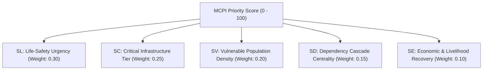

# DIRS Phase 6D-A — Multi-Criteria Recovery Priority Index (MCPI) Research Report

**Document ID:** `DIRS-PHASE6D-DOC-02`  
**Classification:** TECHNICAL RESEARCH & COMPARATIVE ANALYSIS  
**Author:** Principal Operations Research Scientist & Infrastructure Planning Specialist  
**Date:** November 16, 2026  
**Status:** COMPLETE (PHASE 6D-A DESIGN BASELINE)  

---

## 1. Theoretical Foundations & Literature Review

Post-disaster reconstruction planning operates under extreme resource scarcity, political pressure, and competing social demands. Traditional capital budgeting models relying purely on Benefit-Cost Ratios (BCR) or Net Present Value (NPV) fail catastrophically in disaster recovery because they systematically bias investment toward wealthy commercial districts (where property asset values are high) while neglecting socially vulnerable settlements, public health lifelines, and basic human dignity.

To resolve this failure, Phase 6D grounds its recovery prioritization on international humanitarian and infrastructure frameworks:
- **UN Disaster Risk Reduction (UNDRR) & Sendai Framework (Priority 4)**: *"Build Back Better in recovery, rehabilitation and reconstruction"* emphasizing resilience, equity, and multi-hazard reduction.
- **World Bank & EU Post-Disaster Needs Assessment (PDNA)**: Triangulates human impact, infrastructure damage, and macroeconomic losses.
- **Sphere Humanitarian Standards**: Mandates non-negotiable minimum survival thresholds for water supply (15 L/person/day), emergency shelter, and acute trauma care.
- **FEMA National Disaster Recovery Framework (NDRF)**: Establishes Recovery Support Functions (RSFs) prioritizing community lifelines before standard capital restoration.

---

## 2. Multi-Criteria Priority Index (MCPI) Architecture

The Multi-Criteria Recovery Priority Index evaluates every candidate capital project $j \in \mathcal{P}$ across five fundamental criteria:

### 2.1 The Five Core Recovery Criteria

#### 1. Life-Safety Urgency ($S_{L, j} \in [0.0, 1.0]$)
- **Definition**: The degree to which failure to execute project $j$ immediately threatens human life, triggers secondary disasters (e.g. embankment breach, contaminated water epidemics), or traps populations in hazardous zones.
- **Underlying Metrics**: Verified structural damage severity, secondary hazard risk (flood breach, toxic leak), acute medical disruption.
- **Operational Scale**:
  - $1.00$: Immediate life threat (breached flood defense, collapsed primary trauma center, contaminated primary water supply).
  - $0.75$: Severe structural instability risking progressive collapse or acute secondary outbreak.
  - $0.50$: Moderate compromise requiring stabilization within 30–60 days.
  - $0.25$: Superficial non-structural damage without personal injury risk.
  - $0.00$: Cosmetic restoration or non-urgent administrative refurbishments.

#### 2. Critical Infrastructure Tier ($S_{C, j} \in [0.0, 1.0]$)
- **Definition**: The hierarchical classification of the physical asset within national and state lifeline infrastructure frameworks.
- **Categorization**:
  - **Tier 1 ($S_C = 1.00$) — Primary Lifelines**: Regional trauma hospitals, primary municipal water intakes/treatment plants, main electric transmission substations ($230\text{ kV}/110\text{ kV}$), vital evacuation bridges.
  - **Tier 2 ($S_C = 0.75$) — Secondary Lifelines**: District hospitals, arterial ring roads, secondary electrical distribution substations ($33\text{ kV}$), primary stormwater pumping stations.
  - **Tier 3 ($S_C = 0.50$) — Public Service Assets**: Primary health centers, high schools used as relief centers, secondary feeder roads, municipal sanitation depots.
  - **Tier 4 ($S_C = 0.25$) — Community Facilities**: Primary schools, neighborhood community halls, municipal market yards.
  - **Tier 5 ($S_C = 0.05$) — Non-Critical Public Works**: Administrative offices, parks, decorative streetscaping.

#### 3. Vulnerable Population Density ($S_{V, j} \in [0.0, 1.0]$)
- **Definition**: The concentration of marginalized, medically fragile, and socioeconomically vulnerable citizens within the project's service catchment area.
- **Mathematical Grounding**: Reuses the Phase 6C demographic conservation breakdown ($N_{\text{ACC}}, N_{\text{MED}}, N_{\text{MED\_ACC}}$) relative to total affected persons:
  $$S_{V, j} = \min\left(1.0, \; \frac{N_{\text{GEN}} + 2.5 \cdot N_{\text{ACC}} + 3.0 \cdot N_{\text{MED}} + 4.5 \cdot N_{\text{MED\_ACC}}}{\max(1, \text{Catchment Population})}\right)$$
- **Equity Imperative**: Prevents projects in affluent residential zones from out-scoring projects in densely populated, medically vulnerable informal settlements.

#### 4. Network Dependency Cascade Centrality ($S_{D, j} \in [0.0, 1.0]$)
- **Definition**: The extent to which downstream projects and cross-sector lifeline services are blocked until project $j$ is completed.
- **Mathematical Grounding**: Evaluated on the project dependency DAG $G = (\mathcal{V}, \mathcal{E})$:
  - Immediate out-degree: $\text{deg}^+(j) = |\{k \in \mathcal{V} \mid (j, k) \in \mathcal{E}\}|$.
  - Transitive downstream cascade volume: $|\text{Reachable}(j)|$.
  - Cross-sector enablement multiplier: Higher if power restoration unlocks water treatment and hospital operations.

#### 5. Economic & Livelihood Restoration Value ($S_{E, j} \in [0.0, 1.0]$)
- **Definition**: The project's capacity to restore household micro-livelihoods, re-establish agricultural and artisanal supply chains, and mitigate municipal economic hemorrhaging.
- **Metrics**: Number of micro-enterprise households restored per lakh INR invested, market access restoration, commercial feeder reactivation.

---

## 3. Methodological Limitations: Additive Scoring vs Non-Compensatory Safety Invariants

### 3.1 The "Compensatory Trap" in Pure Additive Scoring
In standard Multi-Attribute Utility Theory (MAUT), scores are combined additively:
$$\text{Score}_j = \sum_{k=1}^K w_k S_{k, j}$$
While straightforward, **pure additive compensation contains a fatal flaw**:
> *A luxury waterfront park reconstruction project with high economic value ($S_E = 1.0$) and high out-degree infrastructure links ($S_D = 0.8$) can mathematically out-score a collapsed rural maternity clinic with critical life-safety urgency ($S_L = 1.0$) but low economic output ($S_E = 0.05$).*

In humanitarian operations, **money cannot compensate for preventable death**.

### 3.2 Non-Compensatory Life-Safety Filtering
Phase 6D introduces a **hybrid two-stage prioritization architecture**:
1. **Stage 1: Non-Compensatory Emergency Filter (Lexicographic Gate)**:
   Any candidate project possessing $S_{L, j} \ge 0.85$ (Critical Life-Safety Breach) is automatically designated as a **Mandatory Emergency Lifeline (`TIER_1`)**. These projects bypass additive rank competition and enter the scheduling formulation with non-deferrable emergency flags.
2. **Stage 2: Multi-Criteria Optimization**:
   Remaining eligible projects are prioritized using the calibrated MCPI scoring function within their respective policy envelopes.

---

## 4. Status of Proposed Weights: Research Hypotheses vs Empirical Constants

The baseline weights formulated in Phase 6A:
$$w_L = 0.30, \quad w_C = 0.25, \quad w_V = 0.20, \quad w_D = 0.15, \quad w_E = 0.10$$
are **formally classified as initial research hypotheses**. 

They reflect standard multi-criteria consensus rankings from disaster planning literature, but have **not** been tuned to specific district hazard profiles. Consequently:
- District administrators must be empowered to calibrate weights within strict statutory bounds.
- System outputs must never label priority scores as "objective natural facts" or "predictive probabilities of future success"; they are transparent decision-support indices reflecting specific policy trade-offs.
