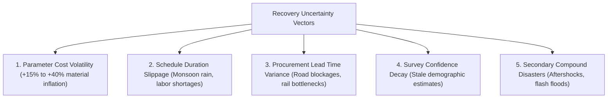

# DIRS Phase 6D-A — Uncertainty Modeling & Scenario Optimization Design

**Document ID:** `DIRS-PHASE6D-DOC-08`  
**Classification:** OPERATIONS RESEARCH & STOCHASTIC SYSTEMS  
**Author:** Principal Operations Research Scientist & Risk Analysis Engineer  
**Date:** November 16, 2026  
**Status:** COMPLETE (PHASE 6D-A DESIGN BASELINE)  

---

## 1. Executive Summary

Post-disaster environments are plagued by deep epistemic and aleatory uncertainty: cyclone aftershocks alter structural damage overnight; inflation spikes cement and steel prices; monsoon inundation delays construction sites; and disrupted census baselines obscure true displacement figures.

This document formulates the uncertainty handling mechanisms, multi-scenario stress-testing framework, and robust sensitivity analysis architecture for Phase 6D.

---

## 2. Taxonomy of Post-Disaster Uncertainty Vectors

### 2.1 Distinction: Deterministic Scenarios vs Probabilistic Forecasts
> [!IMPORTANT]
> The system strictly distinguishes **exploratory synthetic scenarios** from empirical probabilistic forecasts:
> - Scenario stress tests are deterministic "What-If" simulations designed to probe portfolio robustness under stress.
> - They must **never** be presented to public officials as verified weather or macroeconomic forecasts.

---

## 3. Multi-Scenario Stress-Testing Framework

To ensure that the recommended recovery portfolio does not collapse under adverse conditions, the optimization engine evaluates three standardized planning scenarios:

| Scenario Parameter | Scenario 1: Optimistic Profile | Scenario 2: Baseline Calibration | Scenario 3: Adverse Stress-Test |
| :--- | :--- | :--- | :--- |
| **Budget Availability $B_t$** | $100\%$ planned release ($+10\%$ donor surge) | $100\%$ statutory envelope | $-20\%$ fiscal shortfall / delayed release |
| **Capital Costs $C_j$** | Baseline estimated cost | $+10\%$ normal contingency | $+30\%$ severe post-disaster inflation |
| **Project Durations $d_j$** | Design duration $d_j$ | $d_j + 1$ period for complex assets | $1.5 \times d_j$ (Weather/labor delays) |
| **Material Lead Times $\Lambda_m$** | Standard (0–1 period) | Standard (1 period) | Extended ($+2$ periods for heavy equipment) |
| **Weather Impedance** | Favorable (Dry season) | Seasonal showers | Severe monsoon / secondary inundation |
| **Data Freshness Discount** | $\Omega_j \ge 0.90$ | Standard calibrated exponential decay | Accelerated decay ($\lambda \times 1.5$) |

### 3.1 Multi-Scenario Minimax Regret Formulation
Let $\mathcal{S} = \{\text{Opt}, \text{Base}, \text{Adv}\}$ denote the set of scenarios. For each scenario $s \in \mathcal{S}$, let $Z^*(s)$ be the optimal objective value achievable under perfect foresight. For a candidate portfolio schedule $X$, the regret in scenario $s$ is:
$$\text{Regret}(X, s) = Z^*(s) - Z(X, s)$$
The robust solver selects the schedule that minimizes the maximum regret across all evaluated scenarios:
$$\min_{X \in \mathcal{X}} \max_{s \in \mathcal{S}} \text{Regret}(X, s)$$

---

## 4. Sensitivity Analysis & Robust Stability Verification

To verify that the proposed schedule is not brittle to minor parameter perturbations, the engine executes four automated sensitivity passes:

### 4.1 Budget Elasticity Sweep ($\pm 20\%$)
The periodic budget envelopes $B_t$ are scaled by $\kappa \in [0.80, 0.90, 1.00, 1.10, 1.20]$. The system records:
- Which marginal projects enter the portfolio when funding increases by $+10\%$.
- Which projects are dropped first when funding contracts by $-10\%$ (revealing portfolio vulnerability).

### 4.2 Duration Shock Sensitivity
Each critical-path project is perturbed by $+1$ period of delay. The system computes the makespan elongation and records whether secondary lifelines are pushed past statutory deadlines.

### 4.3 MCPI Weight Perturbation Bounds
Criteria weights are perturbed within their lawful intervals:
$$w_k \in [\underline{w}_k, \bar{w}_k]$$
The system computes the rank-order correlation (Kendall's $\tau$ and Spearman's $\rho$). If a project's priority rank shifts by more than $\Delta \text{Rank} > 3$ positions under legal weight variations, it is flagged as **Policy-Sensitive** in the decision review manifest.

---

## 5. Decision Review Output Under Uncertainty

When presenting optimization recommendations to government leadership, the system outputs a unified **Portfolio Robustness Card**:
- **Baseline Makespan**: e.g., 8 Quarters (24 Months).
- **Adverse Makespan**: e.g., 11 Quarters (33 Months under monsoon/inflation stress).
- **Core Resilient Portfolio**: Projects selected across **all three scenarios** (100% scenario consensus). These represent low-risk, high-impact "no-regrets" investments.
- **Vulnerable Portfolio**: Projects selected only in the optimistic scenario. These are flagged as conditional investments contingent on secondary donor disbursement.
