# DIRS Phase 6E vs. Phase 7: Scope Boundary & Demarcation Specification

**Document Reference:** `DIRS-PHASE6E-DOC-05`  
**Security Classification:** Strict Internal Engineering Specification  
**Baseline Parent:** Phase 6D-B Permanent Closure & Gate 2 Certified Baseline  
**Governing Authority:** DIRS Architectural Review Board & Project Ownership  
**Mode:** BOUNDARY SPECIFICATION & ARCHITECTURAL DEMARCATION  
**Governance Status:** PENDING PROJECT-OWNER AUTHORIZATION  

---

## 1. Executive Summary & Purpose

This document establishes the binding architectural and operational boundaries between the post-Phase 6D recovery program (covering remaining responsibilities from original Phases 6E, 6F, and 6G, organized into proposed Work Packages WP1 through WP4) and **Phase 7** (Production Hardening & Multi-Agency Operations).

The purpose of this demarcation is to prevent scope creep, protect existing frozen baselines, and ensure that enterprise-grade operational hardening is not prematurely pulled into application-layer recovery work.

---

## 2. Definitive Scope Demarcation Matrix

| Architectural Domain | In Scope for Phase 6E / Proposed Accelerated Programme | Strictly Deferred to Phase 7 |
| :--- | :--- | :--- |
| **User Interfaces & Portals** | React 18 interfaces for Citizen, Volunteer, NGO, and Command Center. `PrecedenceGraphVisualizer.tsx` and `RecoverySimulationView.tsx`. | External mass-alerting public notification gateways, legacy multi-agency portal federation, white-labeled municipal tenant portals. |
| **Offline Resilience** | Client-side browser IndexedDB caching (`dirs_offline_db`) and background replay for volunteer field assessment surveys. | Hardware packet radio synchronization, P2P mesh network ad-hoc protocols, distributed CRDT peer-to-peer consensus across disconnected nodes. |
| **Infrastructure Intelligence** | In-process CPM-PL calculations, topological sorting, dry-run cycle validation, and visual SVG/Canvas DAG rendering. | Real-time IoT sensor telemetry ingestion, smart-grid automated SCADA trip integration, automated drone photogrammetry pipelines. |
| **Recovery Simulation** | Deterministic in-memory "What-If" parameter perturbation (budget shifts, resource reallocations, recurrence shock) over single municipal datasets. | Stochastic multi-hazard Monte Carlo catastrophe modeling, climate change multi-decade predictive simulation. |
| **Testing & Verification** | Unit, contract, regression (612 tests), Gate 3 E2E (39 tests), and multi-role acceptance workflows. | Concurrency stress testing ($10,000+$ simultaneous users), distributed denial of service (DDoS) resilience, chaotic network partition injection. |
| **Security & Compliance** | Strict RBAC enforcement across FastAPI endpoints and Vue route guards, JWT validation, least-privilege scoping. | External CREST-certified penetration testing, SOC2 / ISO 27001 formal compliance certification, hardware security module (HSM) key management. |
| **Deployment & Ops** | Standard local containerization (`docker-compose`), deterministic demo database seeding, runbook documentation. | Multi-region Kubernetes (EKS/GKE) clusters, automated blue-green/canary deployment pipelines, Geo-DNS failover, live cloud egress filtering. |

---

## 3. Boundary Definitions

```mermaid
flowchart LR
    subgraph P6E["Proposed Accelerated Recovery Programme (6E / 6F / 6G)"]
        direction TB
        A1["Precedence DAG Visualizer (React)"]
        A2["Community Metrics & Simulation"]
        A3["Cross-Role Portals (Citizen/Volunteer/NGO/Gov)"]
        A4["Offline-First Caching (IndexedDB)"]
        A5["Deterministic Demo Scenarios"]
    end

    subgraph P7["Phase 7: Enterprise Production & Hardening"]
        direction TB
        B1["High-Concurrency Stress (10k+ VUs)"]
        B2["Chaos Engineering & Fault Injection"]
        B3["External Multi-Agency Federation (NDRF/IMD)"]
        B4["Cloud Multi-Region Infrastructure (K8s)"]
        B5["Security Penetration Testing & Audits"]
    end

    P6E -->|Formal Capstone Closure & Owner Gate| P7
```

### 3.1 What Belongs in the Proposed Recovery Programme (WP1 - WP4)
1. **Precedence DAG & Critical Path Visualization (WP1 / Original 6E):**
   - Exposing pure math services via `GET /api/v1/recovery/dependencies/graph` and dry-run `POST /api/v1/recovery/dependencies/validate-edge`.
   - Native React SVG/Canvas visualizer (`PrecedenceGraphVisualizer.tsx`).
2. **Community Recovery Monitoring & Simulation (WP2 / Original 6F):**
   - Aggregating ward indicators into sector health scores with exponential confidence decay.
   - Non-mutating "What-If" scenario evaluation (`POST /api/v1/recovery/simulation/what-if`).
3. **Cross-Role Operational Workflows & Offline Field Resilience (WP3 / Original 6G):**
   - Citizen damage claim submissions and ward status tracking (`CitizenRecoveryView.tsx`).
   - Volunteer field surveys with HTML5 IndexedDB draft caching (`VolunteerAssessmentForm.tsx` & `useOfflineDrafts.ts`).
   - NGO resource pledge matching (`NGORecoveryResourcesView.tsx`).
   - Command center recovery health KPI widget (`RecoveryHealthWidget.tsx`).
4. **Capstone Packaging & System Demonstration (WP4 / Original 6G):**
   - Deterministic multi-hazard seed script (`scripts/seed_phase6e_capstone.py`).
   - Full cross-role E2E test suite (`tests/backend/test_phase6e_cross_role.py`).

### 3.2 What Strictly Belongs in Phase 7
The following activities are **strictly prohibited** in the current program and are reserved exclusively for Phase 7:
1. **Distributed System & Chaos Engineering:**
   - Chaos Mesh or Gremlin fault injection (packet loss, split-brain network partitions, killed database masters).
   - Distributed consensus protocols and Raft/Paxos clustering.
2. **High-Concurrency Scale & Load Testing:**
   - Distributed Locust/k6 load testing with thousands of concurrent virtual users.
   - High-throughput message broker benchmarking (Kafka/RabbitMQ clustering).
3. **External Agency Federation:**
   - Live integration with external national disaster portals (e.g., NDMA, NDRF, IMD meteorological feeds, Central Water Commission flood alerts).
   - B2B API gateways with mutual TLS (mTLS) for external third-party agencies.
4. **Cloud Infrastructure & Production Orchestration:**
   - Production Kubernetes manifest management, Helm charts, Terraform infrastructure-as-code scripts.
   - Cloud CDN caching, WAF rules, and multi-region automated database replication.
5. **Formal Security Audits & Red Teaming:**
   - Third-party CREST-certified penetration testing.
   - Automated DAST/SAST enterprise scanning pipelines.

---

## 4. Preservation of Frozen Baselines

During both the proposed programme and Phase 7, the following immutable boundaries must be respected:
1. **The 23 Certified Gate 2 Baseline Files:**
   - Under no circumstances may any of the 23 certified Gate 2 baseline files be modified.
   - All new features must be implemented in new, modular files or approved non-frozen extension points.
2. **Phase 6D-B CP-SAT Solver Implementation:**
   - `backend/app/recovery/services/recovery_optimization_service.py` and its mathematical formulations (Tier 1–Tier 4, budget constraints, resource capacities, precedence cuts) are permanent, certified baselines.
   - Precedence graph visualization reads from the existing service and schema; it must not modify solver formulations.
3. **Database Schema Stability:**
   - The DIRS database currently possesses 40 fully realized tables, covering all recovery projects, dependencies, community metrics, and assessment needs.
   - The core recovery programme avoids schema migrations, using application-layer metadata patterns for NGO pledges and citizen submissions.

---

## 5. Scope Transition Checklist (Gate 6E $\rightarrow$ Phase 7)

Before any Phase 7 task may be authorized, the recovery programme must formally achieve:
- [ ] 100% completion of Work Packages 1 through 4.
- [ ] 0 regressions across the 612 backend tests, 76 contract tests, and 39 Gate 3 E2E tests.
- [ ] Successful execution of the full cross-role acceptance suite (`tests/backend/test_phase6e_cross_role.py` and Playwright suites).
- [ ] Capstone demonstration scenario fully validated and documented.
- [ ] Formal independent closure audit signed off by the Architectural Review Board.
