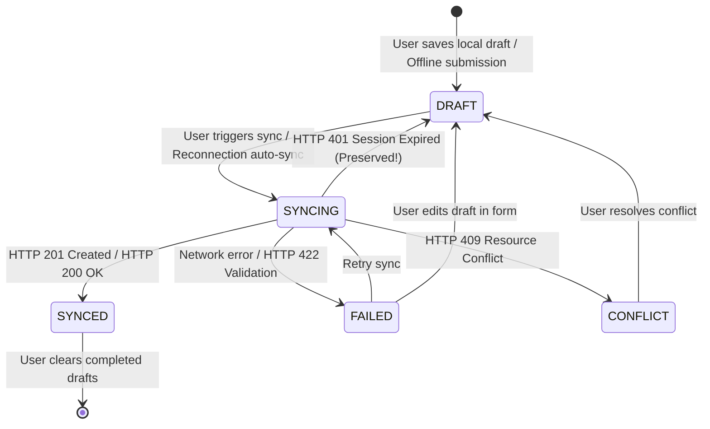

# DIRS Phase 6G Accelerated Programme: Work Package 3
# Client-Side Offline Resilience & IndexedDB Storage Architecture

**Document Identifier:** `DIRS-PH6G-WP3-OFFLINE-ARCH-002`  
**Security Classification:** OFFICIAL / SENSITIVE  
**Target Release:** DIRS v5.2  
**Parent Roadmap Phase:** Phase 6G — Cross-Role UI Integration, E2E Verification & Capstone Forensic Closure  
**Status:** Certified / Completed  

---

## 1. Overview & Operational Need

Disaster response personnel operating in frontline zones (such as post-cyclone coastal districts, submerged urban basins, or landslide-isolated valleys) face severe cellular and broadband disruptions. If field telemetry applications require active HTTP connectivity at the exact moment of form submission, responders lose vital field reports or abandon logging entirely.

Work Package 3 introduces a lightweight, robust client-side offline storage and resilience architecture powered by the native browser **IndexedDB API**. This architecture guarantees zero data loss, supports asynchronous deferred synchronization, isolates multi-user sessions on shared emergency devices, and provides immediate visual feedback.

---

## 2. Storage Engine Specifications

### 2.1 Database Definition & Indexes
* **Database Name:** `dirs_offline_db`
* **Schema Version:** `1`
* **Object Store Name:** `dirs_offline_drafts`
* **Key Path:** `client_draft_id` (String UUIDv4 generated on the client)

```typescript
// Store configuration in offlineDraftStore.ts
const DB_NAME = 'dirs_offline_db';
const DB_VERSION = 1;
const STORE_NAME = 'dirs_offline_drafts';

// Secondary Indexes
store.createIndex('by_user', 'user_id', { unique: false });
store.createIndex('by_type', 'workflow_type', { unique: false });
store.createIndex('by_status', 'sync_status', { unique: false });
store.createIndex('by_user_type', ['user_id', 'workflow_type'], { unique: false });
```

### 2.2 Record Data Transfer Contract (`OfflineDraft<T>`)

Each draft stored in IndexedDB conforms to the following strict contract:

```typescript
export type DraftSyncStatus = 'DRAFT' | 'SYNCING' | 'SYNCED' | 'FAILED' | 'CONFLICT';
export type WorkflowDraftType = 'INCIDENT_REPORT' | 'FIELD_INSPECTION';

export interface OfflineDraft<T = any> {
  client_draft_id: string;        // Client-generated UUIDv4
  workflow_type: WorkflowDraftType;
  user_id: string;                // Authenticated user ID (Principal isolation)
  user_email: string;             // Authenticated user email
  sync_status: DraftSyncStatus;   // Finite state machine status
  created_at: string;             // ISO-8601 creation timestamp
  updated_at: string;             // ISO-8601 last update timestamp
  last_sync_attempt: string | null;
  sync_error: string | null;      // Normalized error message (e.g. 422 validation, network failure)
  server_assigned_id?: string;    // ID returned by backend upon successful commit
  payload: T;                     // Strong typed form data
}
```

---

## 3. Supported Offline Workflows

### 3.1 Incident Reporting Workflow (`INCIDENT_REPORT`)
* **Target Role:** Citizens, Responders, Government Officers
* **Target API Endpoint:** `POST /api/v1/incidents`
* **Payload Structure (`IncidentReportPayload`):**
  * `title`: Incident headline
  * `disaster_type`: `FLOOD | CYCLONE | FIRE | LANDSLIDE | EARTHQUAKE | CHEMICAL HAZARD`
  * `description`: Urgent situation details and observations
  * `latitude`: GPS latitude (EPSG:4326)
  * `longitude`: GPS longitude (EPSG:4326)
  * `location_address`: Human-readable landmark or road junction
  * `people_affected`: Integer count of impacted individuals
  * `injuries`: Integer count of casualties/injured
  * `vulnerable_count`: Count of children, elderly, or bedridden persons
  * `infrastructure_damage`: Qualitative notes on roads, power, or water

### 3.2 Field Damage Inspection Workflow (`FIELD_INSPECTION`)
* **Target Role:** Certified Volunteers, Government Engineers
* **Target API Endpoint:** `POST /api/v1/recovery/damage-assessments/field-inspection`
* **Payload Structure (`FieldInspectionPayload`):**
  * `incident_id`: Target incident UUID
  * `sector`: `HEALTH | EDUCATION | HOUSING | TRANSPORT | WATER | POWER | TELECOM`
  * `facility_name`: Specific facility or structural asset name
  * `damage_level`: `NONE | MINOR | MODERATE | SEVERE | DESTROYED`
  * `is_operational`: Boolean functional state
  * `estimated_reconstruction_cost`: Monetary cost estimate (INR)
  * `structural_notes`: Field structural integrity observations
  * `latitude`: GPS latitude
  * `longitude`: GPS longitude
  * `assessor_confidence`: Assessor confidence rating (0.0 to 100.0)

---

## 4. Finite State Machine & Synchronization Flow



### 4.1 State Definitions
1. **`DRAFT`:** Saved locally on the device. Payload is fully editable. Never dispatched to network while in this state.
2. **`SYNCING`:** Active HTTP POST dispatch in flight via Axios `apiClient`. Background UI indicators spin.
3. **`SYNCED`:** Successfully acknowledged by server (`HTTP 200` or `HTTP 201`). Stores `server_assigned_id`. Payload is frozen. Ready to be purged from client storage.
4. **`FAILED`:** Dispatch failed due to network disruption or HTTP 422 schema validation failure. The draft remains preserved in IndexedDB with `sync_error` detailing the failure.
5. **`CONFLICT`:** Server reported conflicting state (`HTTP 409`). Preserved for manual reviewer resolution.

---

## 5. Security & Multi-User Isolation

In emergency response environments, multiple volunteers or officers may share a single mobile device, rugged tablet, or patrol laptop. The IndexedDB engine enforces multi-user boundaries:

1. **User-Scoped Queries:** All queries (`listDraftsByUser`, `listDraftsByType`, `clearSyncedDrafts`) filter strictly by `user_id` derived from the active authenticated session.
2. **Principal Isolation:** User B cannot view, edit, synchronize, or delete User A's local drafts.
3. **401 Session Expiry Protection:** If an authentication token expires mid-synchronization, the draft is **not deleted or corrupted**. Instead, it transitions to `DRAFT` or `FAILED` with an explicit notice: `"Authentication session expired. Please log in again; your draft remains safely preserved."`

---

## 6. UI Components & Operator Experience

1. **`OfflineBanner.tsx`:**
   * When online with 0 drafts: Renders `null` to minimize screen distraction.
   * When offline: Renders high-visibility amber alert: `"OFFLINE MODE: Disconnected from DIRS Server. Submissions are securely auto-saved locally in IndexedDB."`
   * When reconnected with pending drafts: Renders emerald notification: `"NETWORK RESTORED. X local drafts ready for synchronization"` with a direct `"Sync Now"` trigger.
2. **`DraftSyncManager.tsx`:**
   * Embedded interactive drawer/card displaying all stored drafts for the current workflow.
   * Displays Client Draft UUID, timestamp, sync status badge, and payload summary.
   * Actions: "Load into form for editing", "Synchronize draft to server", "Delete local draft", and "Clear Synced Drafts".
