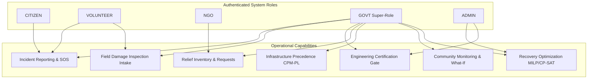

# DIRS Phase 6G Accelerated Programme: Work Package 3
# Security, Privacy & Multi-Tenancy Architecture

**Document Identifier:** `DIRS-PH6G-WP3-SEC-PRIV-004`  
**Security Classification:** OFFICIAL / SENSITIVE  
**Target Release:** DIRS v5.2  
**Parent Roadmap Phase:** Phase 6G — Cross-Role UI Integration, E2E Verification & Capstone Forensic Closure  
**Status:** Certified / Completed  

---

## 1. Overview & Security Mandate

Disaster management platforms operate in high-stakes environments where compromised access, data forgery, or privacy breaches can cause real-world harm. Work Package 3 enforces rigorous least-privilege role boundaries, client-side data isolation, and cryptographic session hygiene across all five system personas.

---

## 2. Least-Privilege Role Matrix & Access Boundaries

The system strictly enforces role-based access control (RBAC) at both frontend route guards and backend API endpoints:

### 2.1 Capability Cross-Reference

| Capability / API Operation | CITIZEN | VOLUNTEER | NGO | GOVT | ADMIN |
| :--- | :---: | :---: | :---: | :---: | :---: |
| **Submit Incident (`POST /incidents`)** | Yes | Yes | Yes | Yes | Yes |
| **Emergency SOS (`POST /incidents/sos`)** | Yes | Yes | No | Yes | No |
| **Submit Field Inspection (`POST /recovery/damage-assessments/field-inspection`)** | No | Yes | No | Yes | Yes |
| **Certify Assessment (`POST /recovery/damage-assessments/{id}/verify`)** | No | No | No | Yes | Yes |
| **Manage Inventory (`POST /resources`)** | No | No | Yes | Yes | Yes |
| **View Relief Demands (`GET /resources/requests`)** | No | Yes | Yes | Yes | Yes |
| **Precedence Network (`GET /recovery/precedence/graph`)** | No | No | No | Yes | Yes |
| **What-If Simulation (`POST /recovery/monitoring/simulate`)** | No | No | No | Yes | No |
| **Portfolio Solver (`POST /recovery/optimization/evaluate`)** | No | No | No | Yes | Yes |

---

## 3. Client-Side Data Privacy & Multi-Tenancy

Shared devices in frontline field operations pose severe multi-tenancy and credential-leakage risks. The WP3 IndexedDB persistence architecture enforces rigorous data isolation:

### 3.1 Principal Isolation in IndexedDB
* Every draft record explicitly captures `user_id` and `user_email` from the active JWT claims.
* The draft store exposes `listDraftsByUser(userId)` and compound index `by_user_type`.
* When User A logs out and User B logs in on the same browser, User B’s UI queries IndexedDB filtering strictly by User B's `user_id`. User A’s pending or draft records are neither displayed nor accessible to User B.
* Store functions `getDraft`, `updateDraftStatus`, and `deleteDraft` enforce mandatory principal verification: passing an `expectedUserId` that fails to match the draft record's stored `user_id` immediately throws a security violation exception and rejects the operation.
* Automated contract tests (`crossRoleOffline.spec.ts`) verify that cross-user queries return zero leakage and security violations on unauthorized mutations.

### 3.2 React Query Cache Partitioning & Stale State Elimination
* In single-page web applications with in-memory caching (e.g. TanStack React Query), logging out and logging in as a different user on the same browser tab can accidentally display the previous user's cached queries if query keys lack principal scoping.
* To guarantee complete account isolation:
  - All role dashboards (`NGODashboard.tsx`, `VolunteerDashboard.tsx`, `CitizenDashboard.tsx`, `CommandCenter.tsx`) bind the authenticated user's ID into their cache query keys (e.g. `['resources-ngo', user?.id]`, `['volunteer-my-tasks', user?.id]`, `['incidents-citizen', user?.id]`).
  - Account switches instantly partition the query cache, preventing cached data from being served to the subsequent user.
  - The `useOfflineDrafts` React hook initiates with an immediate state flush (`setDrafts([])`) upon principal switch before asynchronously fetching the new user's IndexedDB drafts.

### 3.3 Token Hygiene, Expiry Handling & Draft Preservation Across Restarts
* Authentication tokens (`dirs_token`) are stored in `localStorage` and dispatched via Axios Bearer headers.
* When a token expires:
  1. Backend returns `HTTP 401 Unauthorized`.
  2. The client interceptor catches the 401, clears the invalid token from `localStorage`, and preserves any active form draft in IndexedDB.
  3. The user is redirected to `/login`.
  4. Upon re-authentication, the operator is returned to their workflow with all local drafts intact.
* **Browser Restart & Power Loss Resilience:** Because IndexedDB is non-volatile transactional storage, browser restarts, tab closures, and device reboots preserve all un-synchronized drafts with zero data loss. Upon browser restart and subsequent login, the user's drafts are reloaded and ready for immediate synchronization.

---

## 4. Institutional Boundary & Data Integrity Controls

### 4.1 NGO Capital Pledge Demarcation
* In prior roadmaps, ambiguity existed regarding whether NGOs could directly fund or sponsor capital infrastructure projects.
* **Architecture Decision:** The existing database schema (`recovery_projects`, `recovery_resources`) does not contain an `ngo_pledges` table or an organization FK on capital projects.
* **Integrity Guard:** The platform strictly prohibits storing NGO organizational identifiers into arbitrary text fields such as `supplier_info` as a substitute for proper ownership.
* NGO coordinators are formally guided via the **Institutional Governance Notice** in `NGODashboard.tsx`:
  > *"Capital infrastructure restoration projects are administered by Government Command under statutory financial sanctions. Multi-agency capital pledges require formal bilateral framework agreements. Unverified string substitution in contractor/supplier records is strictly prohibited by DIRS data-integrity controls."*

### 4.2 Engineering Verification Audit Trail
* Every damage assessment certified through the Command Center verification modal records:
  1. Certifying engineer's user ID and timestamp (`verified_at`).
  2. Certified damage level (`verified_damage_level`).
  3. Action taken (`VERIFY`, `DISPUTE`, `REJECT`).
  4. Mandatory engineering rationale (`engineering_notes`).
* These records are written to `RecoveryAssessment` and audit log `RecoveryOverrideLog`, providing complete evidentiary traceability for post-disaster audits.
