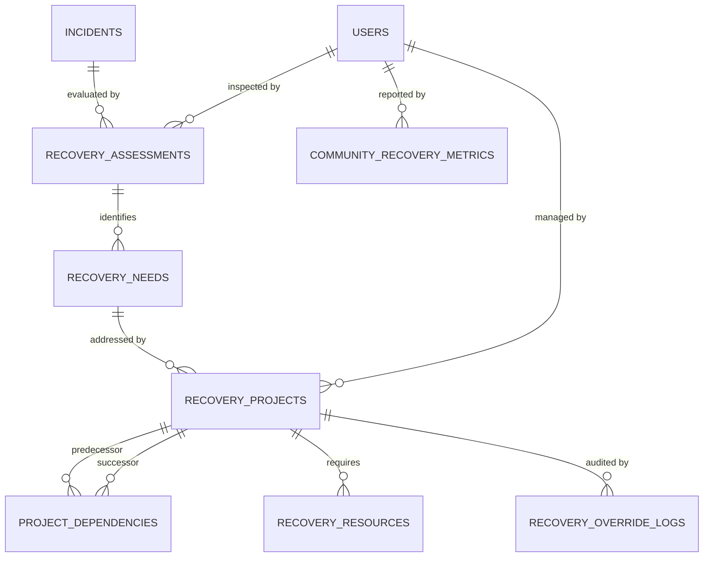

# DIRS Phase 6A — Proposed Recovery Data Model & Schema Specification
## Entity Relational Architecture, Table Definitions, Foreign Keys, and Constraints

**Document ID:** `DIRS-PHASE6A-DOC-05`  
**System:** Disaster Intelligence and Response System (DIRS)  
**Classification:** SCHEMA PROPOSAL / ARCHITECTURAL SPECIFICATION ONLY  
**Author:** Principal Disaster-Management Systems Architect & Database Engineer  
**Date:** November 16, 2026 (Remediated Baseline)  

---

## 1. Schema Design Principles & Environment Baseline

> [!IMPORTANT]
> This document specifies the proposed database schema for Phase 6. In accordance with strict Phase 6A rules, **no database migrations or code modifications are executed during Phase 6A**.

The Phase 6 schema adheres to the following core tenets:
1. **Verified Database Environment:** Targeted and validated on **PostgreSQL 18.6** with **PostGIS 3.6.2** on x86_64-windows operating with least-privilege `NOSUPERUSER` role `dirs_user`. Compatible across PostgreSQL $\ge 15.0$ and PostGIS $\ge 3.3$.
2. **Decoupled Relational Lifecycle:** Acute emergency entities (`incidents`, `shelters`, `resources`) remain completely untouched. Recovery entities anchor to existing incidents and users via foreign keys with cascade restrictions (`RESTRICT` / `SET NULL`), ensuring historical emergency records can never be corrupted.
3. **Personally Identifiable Information (PII) Protection:** Household beneficiary identities are protected by storing salted SHA-256 hashes (`beneficiary_id_hash`) and masked names (`household_head_name_masked`). Dwelling coordinates are masked to ward centroids for public reporting.
4. **Monotonic Assessment Versioning:** Inspections support versioning (`assessment_version`, `superseded_by_id`, `is_current_version`), preserving an immutable historical audit log.
5. **Deduplication & Reconciliation:** Duplicate assessments for the same asset are grouped via `deduplication_cluster_id`.
6. **Freshness Tracking:** Every record captures explicit data freshness (`freshness_status`) and decaying confidence metrics.

---

## 2. Entity-Relationship Overview



---

## 3. Detailed Proposed Table Definitions

### 3.1 `recovery_assessments`
Stores formal post-disaster field engineering damage and loss evaluations with monotonic versioning and duplicate clustering.
```sql
CREATE TABLE recovery_assessments (
    id VARCHAR(36) PRIMARY KEY,
    assessment_code VARCHAR(50) UNIQUE NOT NULL,
    incident_id VARCHAR(36) REFERENCES incidents(id) ON DELETE RESTRICT,
    inspector_id VARCHAR(36) REFERENCES users(id) ON DELETE RESTRICT,
    sector VARCHAR(50) NOT NULL, -- HOUSING, HEALTH, EDUCATION, WASH, TRANSPORT, POWER, TELECOM
    facility_name VARCHAR(255) NOT NULL,
    damage_level VARCHAR(30) NOT NULL, -- NONE, MINOR, MODERATE, SEVERE, DESTROYED
    is_operational BOOLEAN NOT NULL DEFAULT FALSE,
    estimated_reconstruction_cost DOUBLE PRECISION DEFAULT 0.0,
    structural_notes TEXT,
    evidence_media_urls JSON DEFAULT '[]',
    cv_assessment_id VARCHAR(36) REFERENCES cv_damage_assessments(id) ON DELETE SET NULL,
    
    -- Geospatial PostGIS Point (SRID 4326)
    latitude DOUBLE PRECISION NOT NULL,
    longitude DOUBLE PRECISION NOT NULL,
    geom GEOMETRY(POINT, 4326),
    
    -- Versioning & Deduplication
    assessment_version INTEGER NOT NULL DEFAULT 1,
    superseded_by_id VARCHAR(36) REFERENCES recovery_assessments(id) ON DELETE SET NULL,
    is_current_version BOOLEAN NOT NULL DEFAULT TRUE,
    deduplication_cluster_id VARCHAR(36),
    reconciliation_status VARCHAR(30) NOT NULL DEFAULT 'UNRECONCILED', -- UNRECONCILED, RECONCILED_MERGED, SUPERSEDED
    
    -- Provenance & Freshness
    provenance_tier VARCHAR(50) NOT NULL DEFAULT 'TIER_2_GOVT_OFFICIAL',
    data_confidence DOUBLE PRECISION NOT NULL DEFAULT 100.0,
    freshness_status VARCHAR(20) NOT NULL DEFAULT 'FRESH', -- FRESH, MODERATE, STALE_AMBER, EXPIRED_RED
    
    -- Human Verification Gate
    verification_status VARCHAR(30) NOT NULL DEFAULT 'PENDING_VERIFICATION', -- PENDING, VERIFIED, REJECTED
    verified_by_id VARCHAR(36) REFERENCES users(id) ON DELETE SET NULL,
    verified_at TIMESTAMP WITH TIME ZONE,
    
    created_at TIMESTAMP WITH TIME ZONE DEFAULT CURRENT_TIMESTAMP,
    updated_at TIMESTAMP WITH TIME ZONE DEFAULT CURRENT_TIMESTAMP
);
CREATE INDEX idx_rec_assess_sector ON recovery_assessments(sector);
CREATE INDEX idx_rec_assess_incident ON recovery_assessments(incident_id);
CREATE INDEX idx_rec_assess_current ON recovery_assessments(is_current_version);
CREATE INDEX idx_rec_assess_cluster ON recovery_assessments(deduplication_cluster_id);
```

### 3.2 `recovery_needs`
Quantifies multi-sectoral human and community recovery requirements with double-count reconciliation and PII protection.
```sql
CREATE TABLE recovery_needs (
    id VARCHAR(36) PRIMARY KEY,
    assessment_id VARCHAR(36) REFERENCES recovery_assessments(id) ON DELETE CASCADE,
    ward_code VARCHAR(50) NOT NULL,
    district VARCHAR(100) NOT NULL,
    sector VARCHAR(50) NOT NULL,
    
    -- Population & Demographics
    affected_households INTEGER NOT NULL DEFAULT 0,
    displaced_persons INTEGER NOT NULL DEFAULT 0,
    vulnerable_persons INTEGER NOT NULL DEFAULT 0,
    
    -- Household Identity Protection (Masked / Hashed for Privacy)
    beneficiary_id_hash VARCHAR(64), -- Salted SHA-256 hash of national/ration card ID
    household_head_name_masked VARCHAR(100), -- e.g. "R****h K***r"
    
    -- Sectoral Demand Aggregates
    potable_water_demand_liters_day DOUBLE PRECISION DEFAULT 0.0,
    temporary_shelter_units_needed INTEGER DEFAULT 0,
    livelihood_support_households INTEGER DEFAULT 0,
    unmet_need_score DOUBLE PRECISION DEFAULT 50.0, -- 0.0 to 100.0
    
    -- Census Baseline Reconciliation Gate (Double-Count Prevention)
    census_baseline_population INTEGER NOT NULL,
    is_reconciled BOOLEAN DEFAULT FALSE,
    reconciliation_notes VARCHAR(255),
    
    data_timestamp TIMESTAMP WITH TIME ZONE DEFAULT CURRENT_TIMESTAMP
);
CREATE INDEX idx_recovery_needs_ward ON recovery_needs(ward_code);
CREATE INDEX idx_recovery_needs_sector ON recovery_needs(sector);
CREATE INDEX idx_recovery_needs_beneficiary ON recovery_needs(beneficiary_id_hash);
```

### 3.3 `recovery_projects`
Represents an actionable capital reconstruction or rehabilitation project.
```sql
CREATE TABLE recovery_projects (
    id VARCHAR(36) PRIMARY KEY,
    project_code VARCHAR(50) UNIQUE NOT NULL,
    need_id VARCHAR(36) REFERENCES recovery_needs(id) ON DELETE SET NULL,
    title VARCHAR(255) NOT NULL,
    description TEXT,
    sector VARCHAR(50) NOT NULL,
    priority_tier VARCHAR(20) DEFAULT 'TIER_3', -- TIER_1 (Critical), TIER_2 (High), TIER_3 (Medium), TIER_4 (Low)
    priority_score DOUBLE PRECISION DEFAULT 0.0, -- Computed by MCPI algorithm
    status VARCHAR(50) DEFAULT 'PROPOSED', -- PROPOSED, APPROVED, IN_TENDER, IN_PROGRESS, INSPECTION, COMPLETED, SUSPENDED
    
    -- Capital Cost Modeling & Separation
    estimated_cost DOUBLE PRECISION NOT NULL DEFAULT 0.0, -- In local currency units (INR)
    actual_expenditure DOUBLE PRECISION NOT NULL DEFAULT 0.0, -- Audited disbursements only
    funding_source VARCHAR(100), -- STATE_SDRF, NATIONAL_NDRF, MULTILATERAL_WB, NGO_AID
    
    -- Time-Indexed Profile (JSON array of periodic cash-flows [c_{j,1}, ..., c_{j,d}])
    time_indexed_cost_profile JSON DEFAULT '[]',
    estimated_duration_days INTEGER NOT NULL,
    actual_duration_days INTEGER,
    earliest_start_date DATE,
    planned_completion_date DATE,
    actual_completion_date DATE,
    
    lead_agency VARCHAR(100) NOT NULL,
    contractor_name VARCHAR(150),
    assigned_manager_id VARCHAR(36) REFERENCES users(id) ON DELETE SET NULL,
    
    latitude DOUBLE PRECISION,
    longitude DOUBLE PRECISION,
    geom GEOMETRY(GEOMETRY, 4326),
    
    -- Human Approval Gate
    approval_status VARCHAR(30) DEFAULT 'PENDING_APPROVAL',
    approved_by_id VARCHAR(36) REFERENCES users(id) ON DELETE SET NULL,
    sanction_order_number VARCHAR(100),
    approval_timestamp TIMESTAMP WITH TIME ZONE,
    
    created_at TIMESTAMP WITH TIME ZONE DEFAULT CURRENT_TIMESTAMP,
    updated_at TIMESTAMP WITH TIME ZONE DEFAULT CURRENT_TIMESTAMP
);
CREATE INDEX idx_recovery_projects_status ON recovery_projects(status);
CREATE INDEX idx_recovery_projects_sector ON recovery_projects(sector);
CREATE INDEX idx_recovery_projects_priority ON recovery_projects(priority_score DESC);
```

### 3.4 `project_dependencies`
Encodes the Directed Acyclic Graph (DAG) for infrastructure restoration sequencing.
```sql
CREATE TABLE project_dependencies (
    id VARCHAR(36) PRIMARY KEY,
    predecessor_project_id VARCHAR(36) REFERENCES recovery_projects(id) ON DELETE CASCADE,
    successor_project_id VARCHAR(36) REFERENCES recovery_projects(id) ON DELETE CASCADE,
    dependency_type VARCHAR(30) DEFAULT 'FINISH_TO_START', -- FINISH_TO_START, START_TO_START, FINISH_TO_FINISH
    lag_days INTEGER DEFAULT 0,
    is_critical_path BOOLEAN DEFAULT FALSE,
    rationale TEXT,
    created_at TIMESTAMP WITH TIME ZONE DEFAULT CURRENT_TIMESTAMP,
    CONSTRAINT uq_project_dependency UNIQUE (predecessor_project_id, successor_project_id)
);
CREATE INDEX idx_dep_predecessor ON project_dependencies(predecessor_project_id);
CREATE INDEX idx_dep_successor ON project_dependencies(successor_project_id);
```

### 3.5 `recovery_resources`
Tracks specialized, durable reconstruction materials and heavy machinery.
```sql
CREATE TABLE recovery_resources (
    id VARCHAR(36) PRIMARY KEY,
    project_id VARCHAR(36) REFERENCES recovery_projects(id) ON DELETE CASCADE,
    material_category VARCHAR(50) NOT NULL, -- CEMENT, STRUCTURAL_STEEL, PIPING, ASPHALT, TIMBER, HEAVY_MACHINERY, WORKFORCE
    item_description VARCHAR(255) NOT NULL,
    quantity_required DOUBLE PRECISION NOT NULL,
    quantity_delivered DOUBLE PRECISION NOT NULL DEFAULT 0.0,
    unit_of_measure VARCHAR(30) NOT NULL, -- METRIC_TONS, CUBIC_METERS, METERS, MACHINE_DAYS, LABOR_HOURS
    unit_cost_estimate DOUBLE PRECISION NOT NULL,
    actual_unit_cost DOUBLE PRECISION DEFAULT 0.0,
    supplier_info VARCHAR(255),
    delivery_status VARCHAR(30) DEFAULT 'ORDERED', -- PENDING, ORDERED, IN_TRANSIT, DELIVERED, EXHAUSTED
    created_at TIMESTAMP WITH TIME ZONE DEFAULT CURRENT_TIMESTAMP
);
CREATE INDEX idx_recovery_resources_project ON recovery_resources(project_id);
CREATE INDEX idx_recovery_resources_cat ON recovery_resources(material_category);
```

### 3.6 `community_recovery_metrics`
Longitudinal community recovery indicators tracked by ward over time with exponential confidence decay.
```sql
CREATE TABLE community_recovery_metrics (
    id VARCHAR(36) PRIMARY KEY,
    ward_code VARCHAR(50) NOT NULL,
    district VARCHAR(100) NOT NULL,
    metric_date DATE NOT NULL,
    active_shelter_count INTEGER DEFAULT 0,
    remaining_displaced_persons INTEGER DEFAULT 0,
    power_grid_restoration_pct DOUBLE PRECISION DEFAULT 0.0,
    potable_water_access_pct DOUBLE PRECISION DEFAULT 0.0,
    healthcare_facility_operational_pct DOUBLE PRECISION DEFAULT 0.0,
    schools_open_pct DOUBLE PRECISION DEFAULT 0.0,
    livelihoods_resumed_pct DOUBLE PRECISION DEFAULT 0.0,
    overall_recovery_score DOUBLE PRECISION DEFAULT 0.0, -- Composite Index (0 to 100)
    
    -- Confidence & Staleness
    data_confidence DOUBLE PRECISION DEFAULT 100.0, -- Decays exponentially with time (lambda)
    freshness_status VARCHAR(20) DEFAULT 'FRESH', -- FRESH, MODERATE, STALE_AMBER, EXPIRED_RED
    last_verified_at TIMESTAMP WITH TIME ZONE DEFAULT CURRENT_TIMESTAMP,
    verified_by_id VARCHAR(36) REFERENCES users(id) ON DELETE SET NULL,
    
    CONSTRAINT uq_ward_metric_date UNIQUE (ward_code, metric_date)
);
CREATE INDEX idx_comm_metrics_ward ON community_recovery_metrics(ward_code);
CREATE INDEX idx_comm_metrics_date ON community_recovery_metrics(metric_date);
```

### 3.7 `recovery_override_logs`
Mandatory human-in-the-loop audit trail for budget overrides, weight adjustments, and project approvals.
```sql
CREATE TABLE recovery_override_logs (
    id VARCHAR(36) PRIMARY KEY,
    project_id VARCHAR(36) REFERENCES recovery_projects(id) ON DELETE CASCADE,
    user_id VARCHAR(36) REFERENCES users(id) ON DELETE RESTRICT,
    action VARCHAR(50) NOT NULL, -- PROJECT_APPROVE, BUDGET_OVERRIDE, WEIGHT_ADJUSTMENT, DEPENDENCY_BYPASS
    original_value JSONB,
    new_value JSONB,
    justification_reason TEXT NOT NULL,
    ip_address VARCHAR(50),
    timestamp TIMESTAMP WITH TIME ZONE DEFAULT CURRENT_TIMESTAMP
);
CREATE INDEX idx_rec_override_project ON recovery_override_logs(project_id);
CREATE INDEX idx_rec_override_user ON recovery_override_logs(user_id);
```

---

## 4. Pydantic 2.x Schema Standards

All schemas in Phase 6 will be authored using standard Pydantic 2.x syntax (`ConfigDict`, `json_schema_extra`), completely eliminating the deprecation warnings noted in earlier forensic audits.
