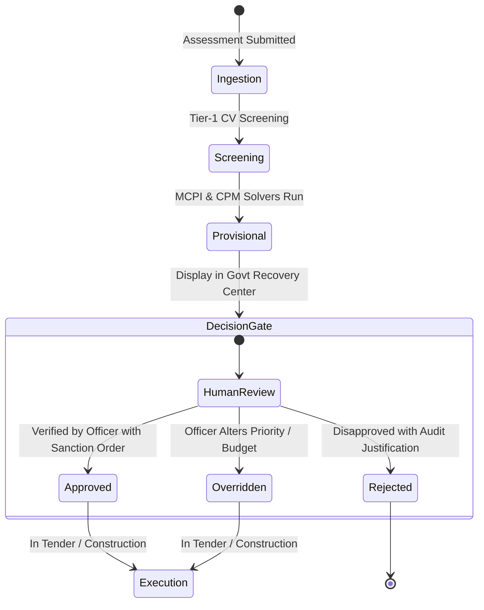

# DIRS Phase 6A — Governance, Application Security & Human Safety Architecture
## Human-in-the-Loop Approval Gates, Non-Autonomous Invariants, and PII Protection

**Document ID:** `DIRS-PHASE6A-DOC-08`  
**System:** Disaster Intelligence and Response System (DIRS)  
**Classification:** SAFETY ARCHITECTURE, ETHICS & COMPLIANCE SPECIFICATION  
**Author:** Principal Disaster-Management Systems Architect & Security Reviewer  

---

## 1. Prime Ethical and Operational Invariant

> [!CAUTION]
> **MANDATORY SYSTEM-WIDE INVARIANT:**  
> DIRS is strictly an **evidence-based decision-support system**. Under no operational circumstances shall an AI model, mathematical optimization algorithm, or automated workflow possess the authority to:
> 1. Autonomously authorize public expenditure or disburse recovery funds.
> 2. Approve, modify, or reject civil engineering reconstruction contracts.
> 3. Certify a damaged building as structurally safe or condemn private property.
> 4. Grant or revoke citizen beneficiary status for government recovery grants.
> 5. Declare a disaster-affected community or ward as "fully recovered."

Every recovery recommendation, prioritization ranking, and resource allocation must remain in a `PROPOSED` state until an authenticated Government Officer (`GOVT` or `ADMIN` role) performs an explicit review, inputs mandatory justification notes, and signs off.

---

## 2. Human-in-the-Loop Governance Gates

### 2.1 The Four Mandatory Approval Gates

| Gate # | Operational Workflow | Input Authority | Required Human Action | Failure / Bypass Protection |
| :---: | :--- | :--- | :--- | :--- |
| **Gate 1** | **Damage Assessment Certification** | Field Inspector / Volunteer | PWD Assistant Executive Engineer logs on, reviews structural photos, verifies damage level, and submits certified cost. | Uncertified assessments cannot generate capital project requests. |
| **Gate 2** | **Prioritization Weight Calibration** | MCPI Algorithm | District Collector / Municipal Commissioner confirms criteria weights ($w_L, w_C, w_V, w_D, w_E$) via digital signature or session authentication. | Custom weights logged in `recovery_override_logs` with reason. |
| **Gate 3** | **Project Sanction & Budget Allocation** | MP-RPSP Optimization Solver | Finance Officer reviews proposed portfolio schedule, inputs official Government Sanction Order Number, and commits budget. | System prohibits funds disbursement without valid sanction voucher code. |
| **Gate 4** | **Reconstruction Completion Sign-Off** | Lead Contractor | Third-party inspection engineer uploads completion certificate and structural safety audit. | Project cannot be marked `COMPLETED` without inspection sign-off. |

---

## 3. Override, Rejection and Audit Provenance

Every decision override is treated as a high-integrity auditable event.

### 3.1 Audit Log Structure
When an officer modifies an algorithmically recommended ranking or budget:
1. **Original Value Capture:** Full JSON snapshot of the solver's recommended state is serialized into `original_value`.
2. **Overridden Value Capture:** The human-selected modification is recorded in `new_value`.
3. **Mandatory Justification:** The UI enforces a minimum 20-character textual justification before the submit action is enabled.
4. **Actor Attribution:** The authenticated officer's `user_id`, role, client IP address, and cryptographic timestamp are appended.
5. **Immutable Persistence:** Stored in `recovery_override_logs` and replicated to central `audit_logs`. The database role prevents `UPDATE` or `DELETE` on audit records.

---

## 4. Personally Identifiable Information (PII) Protection

Post-disaster recovery involves sensitive household vulnerability data (disability status, orphan headcounts, social welfare identifiers).

### 4.1 Data Minimization and Masking Standards
- **Public / NGO Views:** Only aggregated ward-level statistics are exposed (e.g. `remaining_displaced_persons: 42`). Individual beneficiary records, phone numbers, and street-level household coordinates are strictly redacted.
- **Volunteer Field Views:** Volunteers only see the designated inspection waypoint address and structural damage checklist; family demographic profiles are withheld.
- **Government Official Views:** Only authorized officers with explicit welfare clearance can view beneficiary registries, authenticated through strict RBAC scopes (`welfare:read`).

---

## 5. Model Provenance, Confidence Representation, and Staleness

### 5.1 Model Versioning Invariant
All AI and OR recommendations must record:
- `model_name`: e.g. `mcpi-prioritizer`, `or-tools-cp-sat-mprpsp`.
- `model_version`: e.g. `1.0.0`.
- `solver_metadata`: Runtime latency, optimality gap, and constraint relaxation status.

### 5.2 Confidence and Uncertainty Visualization
- Solvers must never report false precision. Priority scores are accompanied by a **Data Confidence Rating** derived from data completeness and survey freshness.
- When survey data exceeds 14 days without re-inspection, the UI applies an **Amber Staleness Warning** (`STALE_DATA: Last verified 18 days ago`). Data older than 30 days is rendered with a **Red Expired Badge**, and excluded from automated priority calculation until re-certified.

### 5.3 Simulation Sandbox Isolation
Any what-if scenario executed via `POST /recovery/simulation/run` operates strictly on in-memory deep-copied objects. It is architecturally impossible for a simulation to commit changes to live government budget records or active contractor project schedules.
