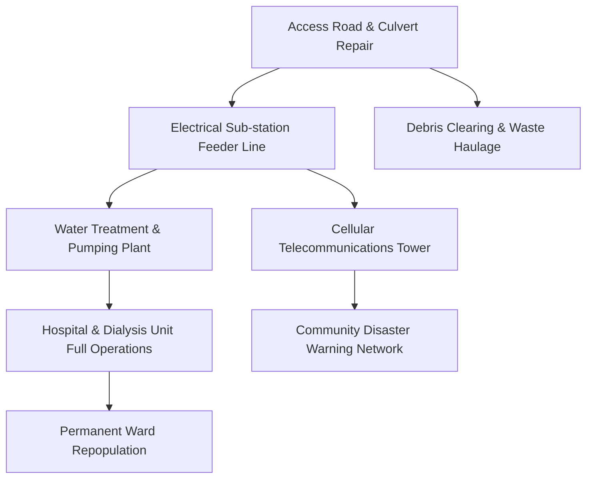

# DIRS Phase 6A — Post-Disaster Recovery Domain Research
## Methodological Principles, Analytical Frameworks, and Sectoral Intelligence

**Document ID:** `DIRS-PHASE6A-DOC-02`  
**System:** Disaster Intelligence and Response System (DIRS)  
**Classification:** DOMAIN RESEARCH & FEASIBILITY ANALYSIS  
**Author:** Principal Disaster-Management Systems Architect & OR Scientist  

---

## 1. Introduction and Scope

Post-disaster recovery is defined by international frameworks (UNDRR, UNDP, World Bank GFDRR) as the process of restoring, rehabilitating, and improving livelihoods, health, physical infrastructure, and the environment of disaster-affected communities, guided by the principle of **"Build Back Better" (BBB)**.

While emergency response operates on minutes-to-hours decision cycles prioritizing life preservation, recovery analytics operates across medium- to long-term cycles (weeks, months, years) prioritizing socio-economic revitalization, structural resilience, and multi-agency resource coordination.

This document investigates the eight core recovery intelligence domains specified for DIRS Phase 6.

---

## 2. Sector-by-Sector Investigation

### Domain A: Post-Disaster Damage Assessment

#### 1. Methodological Foundation
Damage assessment transitions from rapid initial appraisal to detailed engineering damage quantification. In accordance with the Post-Disaster Needs Assessment (PDNA) methodology:
- **Direct Physical Damage:** Total or partial destruction of physical assets (structures, machinery, roads, utilities).
- **Damage Categorization Standard (EMS-98 / FEMA Hazus):**
  - Level 0: No Damage / Operational
  - Level 1: Minor Damage (cosmetic, non-structural, immediate re-entry permitted)
  - Level 2: Moderate Damage (structural element cracked, partial service disruption, conditional entry)
  - Level 3: Severe Damage (load-bearing wall compromised, roof collapse, unsafe for occupancy)
  - Level 4: Complete Destruction / Collapse (structural frame failed, demolition required)

#### 2. Reusability of Phase 3B Computer Vision
The existing DIRS CV service ([`backend/app/ai/computer_vision/service.py`](file:///c:/Users/shubh/Downloads/DIRS/backend/app/ai/computer_vision/service.py)) extracts 6 structural texture and gradient features from field photographs and maps them to five damage tiers.
- **Empirical Boundary:** The classifier is evaluated exclusively on building facades. It **cannot** evaluate subsurface infrastructure (buried water pipes, sewer mains, electrical conduit), road pavement rutting, bridge scour, or high-voltage transformer substations.
- **Role in Phase 6:** Phase 3B CV serves as a **Tier-1 rapid screening tool** for building facades reported by citizens and volunteers. All infrastructure damage assessments for roads, bridges, and utilities must rely on certified civil inspection reports with mandatory human engineering sign-off.
- **Pre- vs. Post-Disaster Comparison:** Where baseline pre-disaster open data exists (e.g., OpenStreetMap building footprints and heights), damage delta is measured against known structural typology and designated replacement costs.

---

### Domain B: Recovery Needs Assessment

#### 1. Population & Sectoral Disaggregation
Recovery needs encompass both physical asset replacement and human welfare restoration:
1. **Housing & Shelter:** Emergency shelter $\rightarrow$ transitional shelter $\rightarrow$ permanent repair or reconstruction.
2. **Water, Sanitation & Hygiene (WASH):** Potable water distribution $\rightarrow$ trunk main repair $\rightarrow$ household connection restoration.
3. **Health & Nutrition:** First-aid stabilization $\rightarrow$ primary health center reopening $\rightarrow$ disease surveillance and cold-chain restoration.
4. **Education:** Temporary learning tents $\rightarrow$ structural safety recertification $\rightarrow$ full curriculum resumption.
5. **Livelihoods & Food Security:** Food ration handouts $\rightarrow$ cash-for-work $\rightarrow$ agricultural land reclamation and market restocking.

#### 2. Double-Count Prevention Framework
A primary risk in disaster data aggregation is multi-reporting inflation across overlapping administrative layers (wards, districts, incident perimeters).
- **DIRS De-duplication Rule:** Recovery assessments are normalized by unique spatial **Census Block / Building Parcel ID** or **Household Ration ID**.
- Spatial buffers and incident clusters are constrained so that population headcounts are reconciled against official census baseline caps ($P_{\text{affected}} \le P_{\text{census}}$).

---

### Domain C: Recovery Priority Intelligence

#### 1. The Multi-Criteria Problem
In a recovery environment, conflicting priorities compete for constrained budgets and equipment:
- Is it more urgent to restore power to a residential ward or repair a bridge connecting rural agricultural supply?
- Should hospital repairs take precedence over drinking water treatment plants?

#### 2. Explainable Prioritization Framework
DIRS formulates recovery priority via the **Multi-Criteria Recovery Priority Index (MCPI)**:
$$\text{MCPI}_j = w_L \cdot S_{\text{LifeSafety}, j} + w_C \cdot S_{\text{Criticality}, j} + w_V \cdot S_{\text{Vulnerability}, j} + w_E \cdot S_{\text{Economic}, j} + w_D \cdot S_{\text{Dependency}, j}$$
- **Weights Invariant:** Weights ($w_L, w_C, w_V, w_E, w_D$) must strictly satisfy $\sum w = 1.0$ and are exposed transparently to Government officials. Preset configurations (e.g., "Humanitarian Focus" vs. "Economic Restoration Focus") allow sensitivity exploration without hidden algorithmic bias.

---

### Domain D: Recovery Resource and Funding Planning

#### 1. Distinction: Estimated Requirements vs. Actual Expenditure
A critical governance requirement is avoiding the conflation of modeled financial requirements with audited financial disbursements.
- **Cost Estimation Model:** Uses standard Scheduled Rates (e.g., CPWD / State PWD Schedule of Rates) parameterizing unit cost per square meter of reconstruction or per kilometer of road resurfacing:
  $$C_{\text{est}, k} = Q_k \cdot \text{Rate}_k \cdot (1 + \text{ContingencyPct})$$
- **Expenditure Tracking:** Encapsulated in distinct audit entities recording committed funds, issued purchase orders, and certified completion milestones.

#### 2. Resource Envelopes
Material tracking expands beyond acute rations to durable reconstruction capital:
- Structural cement (metric tons), TMT reinforcing steel (metric tons), aggregates ($m^3$), structural timber, and potable piping (meters).
- Heavy equipment days (excavators, asphalt pavers, mobile cranes).
- Certified engineering workforce hours (structural engineers, masons, electricians).

---

### Domain E: Infrastructure Restoration Intelligence

#### 1. Interdependency and Precedence Graphs
Infrastructure systems exhibit complex functional interdependencies:
- A water treatment facility cannot pump potable water without electricity from the sub-station.
- The electrical sub-station cannot be repaired until the access road and collapsed culvert are cleared for heavy utility crane trucks.
- The telecommunications cellular tower requires backup diesel delivery via the repaired road network.

#### 2. Directed Acyclic Graph (DAG) Modeling
DIRS models restoration workflows using an augmented Critical Path Method (CPM) with resource constraints (RCPSP), computing earliest start times, latest start times, and project critical paths.

---

### Domain F: Community Recovery Monitoring

#### 1. Longitudinal Recovery Metrics
Community recovery is not a binary switch but a continuous trajectory measured over time:
1. **Shelter Decommissioning Ratio:** $R_{\text{shelter}}(t) = 1 - \frac{\text{Current Occupancy}(t)}{\text{Peak Occupancy}}$.
2. **Utility Restoration Percentage:** $\%$ of households with continuous potable water and grid power.
3. **Primary Health & School Reopening Rate:** Operational vs. baseline facility ratio.
4. **Livelihood Resumption Index:** Operating small businesses and agricultural activity.

#### 2. Representation of Data Staleness
Field surveys age quickly. DIRS enforces a mathematical confidence decay on recovery status indicators:
$$\text{Confidence}(t) = \text{Confidence}_0 \cdot e^{-\lambda (t - t_0)}$$
where $\lambda$ represents the sector volatility decay constant (e.g., rapid decay for food availability, slower decay for structural housing repairs). Indicators older than a defined threshold are tagged with visual staleness warnings.

---

### Domain G: Recovery Scenario Analysis

#### 1. What-If Recovery Simulations
Planners require decision support to evaluate the systemic impacts of external disruptions:
- **Budgetary Curtailment:** What projects must be deferred if recovery grant funding is reduced by 30%?
- **Supply Chain Disruption:** What is the cascading delay if cement supplies from regional hubs are delayed by 4 weeks?
- **Secondary Monsoon Shock:** If a secondary severe storm hits in week 6, which partially repaired embankments are at risk of catastrophic re-failure?

#### 2. Preservation of Base State
Following the Phase 5G simulation architecture, all recovery what-if simulations operate on deep-copied ephemeral project graphs. Base recovery records, government budgets, and contractor commitments are strictly immutable during simulation.

---

### Domain H: Lessons Learned and Recovery Evaluation

#### 1. Post-Recovery Forensic Analytics
Upon completion of recovery milestones, the system generates objective performance analytics:
- **Schedule Slippage:** $\Delta T = T_{\text{actual}} - T_{\text{planned}}$.
- **Budget Variance:** $\Delta B = B_{\text{expended}} - B_{\text{budgeted}}$.
- **Bottleneck Forensics:** Attribution of delays to specific supply shortages, contractor shortages, or dependency delays.

#### 2. Rigorous Avoidance of Spurious Causation
DIRS recovery reports present factual deltas and timing correlations. The platform is explicitly constrained from declaring speculative causal assertions (e.g., claiming "Project X succeeded because of Contractor Y") without verifiable empirical proof and human evaluator attribution.

---

## 3. Summary of Feasibility and Architectural Readiness

All eight domains have been thoroughly analyzed. The required mathematical representations (Multi-Criteria Prioritization, Critical Path Scheduling, Multi-Period Budget Allocation, and Exponential Confidence Decay) can be realized cleanly within the DIRS Python/FastAPI and PostgreSQL/PostGIS stack without introducing external microservices or unproven deep-learning models.
