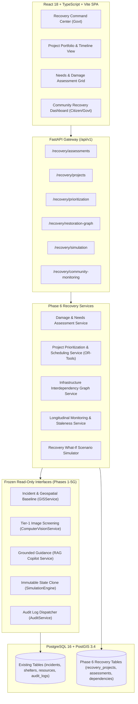

# DIRS Phase 6A — System Architecture & Modular Extension Design
## Component Boundaries, Service Contracts, Monolithic Integration, and Data Flow

**Document ID:** `DIRS-PHASE6A-DOC-04`  
**System:** Disaster Intelligence and Response System (DIRS)  
**Classification:** SYSTEM ARCHITECTURE & INTEGRATION SPECIFICATION  
**Author:** Principal Disaster-Management Systems Architect  

---

## 1. Architectural Strategy: The Modular Monolith

DIRS Phase 6 extends the established **modular monolith** paradigm. Microservices, distributed message brokers (Kafka/RabbitMQ), and auxiliary NoSQL or graph databases are strictly rejected as unnecessary operational overhead for an academic capstone and high-reliability disaster deployment.

The extension introduces three clean, cohesive modules directly within the existing FastAPI backend and React frontend:
1. **`app/recovery/` Subsystem:** Houses domain services for Damage & Needs Assessment, Project Planning, Funding Estimation, and Community Monitoring.
2. **`app/recovery/optimization/` Engine:** Employs Google OR-Tools to solve the Multi-Period Project Scheduling and Budget Allocation formulation.
3. **`app/recovery/graph/` Engine:** Implements the Critical Path Method (CPM) and infrastructure interdependency topology analysis.

---

## 2. Module Boundaries and Service Specifications

### 2.1 Module 1: Assessment Service (`app/recovery/services/assessment_service.py`)
- **Responsibilities:**
  - Ingestion of multi-sectoral damage assessments from certified field inspectors and citizen photo submissions.
  - Aggregation of population recovery needs by sector (Housing, WASH, Health, Education, Livelihoods).
  - Calling `ComputerVisionService.analyze_incident_image()` as a read-only Tier-1 screening tool for structural facade images.
  - Reconciling affected headcounts against census ward populations to prevent double-counting.

### 2.2 Module 2: Infrastructure Graph Service (`app/recovery/graph/dependency_graph.py`)
- **Responsibilities:**
  - Maintaining the Directed Acyclic Graph (DAG) of infrastructure restoration projects: $G = (V, E)$.
  - Calculating topological sorting, earliest start time ($ES$), earliest finish time ($EF$), latest start time ($LS$), latest finish time ($LF$), and total float ($TF$).
  - Identifying the **Critical Path** and structural bottleneck milestones.
  - Validating that no cyclical dependencies are introduced ($A \rightarrow B \rightarrow A$).

### 2.3 Module 3: Recovery Prioritization & Optimization Engine (`app/recovery/optimization/`)
- **Responsibilities:**
  - Formulating and solving the Multi-Period Recovery Project Scheduling Problem (MP-RPSP) using Google OR-Tools CP-SAT or Mixed-Integer Linear Programming (CBC/SCIP).
  - Balancing multi-criteria objectives: life-safety urgency, economic restoration value, vulnerable population coverage, and budget expenditure ceilings.
  - Supporting user-guided weight adjustment with real-time Pareto sensitivity feedback.

### 2.4 Module 4: Community Monitoring Service (`app/recovery/services/monitoring_service.py`)
- **Responsibilities:**
  - Aggregating longitudinal community recovery indicators (shelter decommissioning, utility restoration, clinic reopening).
  - Applying exponential decay functions to survey records to measure and flag data staleness.
  - Providing district- and ward-level recovery progress metrics for public and executive dashboards.

### 2.5 Module 5: Recovery What-If Simulator (`app/recovery/services/simulation_service.py`)
- **Responsibilities:**
  - Interfacing with the frozen `SimulationScenario` structure to model recovery supply shocks, budget reductions, and extreme weather delays.
  - Performing in-memory graph mutations on deep-copied project states without altering live operational project records.

---

## 3. Integration with Frozen Phase 1–5G Subsystems

All interactions with frozen subsystems occur strictly via documented, stable interfaces:

1. **Incident Data:** Read via `db.query(Incident).filter(...)` or `GISService.get_nearby_incidents()`. Zero writes to `incidents` table.
2. **Computer Vision:** Calls `ComputerVisionService.analyze_incident_image(db, incident, media)`. Uses returned `damage_class` and `confidence` without modifying the underlying Random Forest model.
3. **RAG Copilot:** Calls `RAGService.query(db, user_id, query_text, mode="GENERAL_COPILOT")` to retrieve grounded reconstruction guidelines and disaster recovery frameworks.
4. **Audit Logging:** Employs `AuditService.log_action(db, user_id, action, target_entity, details)` for every recovery approval, project status change, and budget override.

---

## 4. Security, Authentication & Role Isolation

- **Role Authorization:**
  - `GOVT` / `ADMIN`: Exclusive authority to create recovery projects, approve budget allocations, adjust prioritization weights, and certify project completion.
  - `VOLUNTEER`: Authorized to submit field inspection checklists and ground-truth survey updates.
  - `CITIZEN`: Read-only access to community recovery dashboards, ward utility status, and authorized to submit household recovery assistance requests.
  - `NGO`: Authorized to adopt and fund specific recovery sub-projects and log material contributions.
- **Data Protection:** Household-level identity records (e.g. ration cards, family beneficiary lists) are strictly restricted from public views. All public dashboard metrics are aggregated to ward or district levels.
