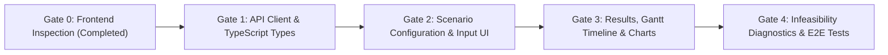

# DIRS PHASE 6D-B — MILESTONE 4
# GATE 0: FRONTEND ARCHITECTURE INSPECTION & READ-ONLY AUDIT REPORT
## Pre-Integration Assessment for Recovery Portfolio Optimization UI

- **Project:** Disaster Intelligence and Response System (DIRS)
- **Phase:** 6D-B (Mathematical Recovery Portfolio Optimization)
- **Milestone:** 4 (Frontend UI Integration & Decision Support)
- **Gate:** Gate 0 (Read-Only Frontend Architecture Inspection)
- **Audit Date:** 2026-11-17
- **Audit Status:** **STRICTLY READ-ONLY AUDIT COMPLETE — ZERO CODE MODIFICATIONS**
- **Authoritative Report File:** `DIRS_MILESTONE_4_GATE0_FRONTEND_ARCHITECTURE_INSPECTION.md`

---

## 1. Executive Summary

DIRS Milestone 3 has been formally concluded and accepted by the Project Owner. Milestone 3 Gate 2 delivered the authoritative, stateless recovery portfolio optimization REST endpoint:
```http
POST /api/v1/recovery/optimization/evaluate
```
Under Owner Decision Option A, the backend architecture remains **synchronously evaluated and strictly stateless** (zero database writes, zero schedule persistence, zero background queues/workers, and an inviolable 120.0-second execution timeout cap).

This Gate 0 inspection delivers an exhaustive, evidence-backed architectural audit of the existing DIRS frontend codebase (`frontend/`) to establish the integration baseline for Milestone 4 (Frontend UI Integration & Decision Support).

### Key Audit Findings
1. **Frontend Architecture & Tooling:** The frontend is a React 18.2 single-page application (SPA) bundled with Vite 5.1.6, TypeScript 5.2.2, Tailwind CSS 3.4.1, Lucide React icons, and TanStack React Query 5.28.9.
2. **Visual Design System:** A highly polished "Obsidian & Operational Amber" dark-theme design system is established in `tailwind.config.js` and `frontend/src/components/design-system/`, featuring monospace telemetry fonts, semantic severity badges, KPI cards, and operational container cards.
3. **Existing Recovery UI Presence:** **Zero recovery optimization views exist in the frontend.** Existing admin pages (`CommandCenter.tsx`, `DisasterSimulationView.tsx`) address Phase 2 incident triage and Phase 5 immediate emergency response simulations.
4. **Integration Feasibility:** The accepted Gate 2 API can be cleanly integrated without new external dependencies using standard React components, Tailwind styling, TanStack React Query mutations, and Recharts financial/solvency visualizations.
5. **Critical Governance Blockers:**
   - **RSK-M2-07 Period Indexing:** The authoritative M2B engine and Gate 1 DTOs strictly enforce 1-based indexing ($1 \le T_{\text{safety\_max}} \le T$). The frontend must adopt 1-based period labeling to prevent off-by-one constraint violations.
   - **Scenario Builder Source:** The backend endpoint evaluates user-supplied JSON scenarios. The Project Owner must decide whether the UI evaluates pre-packaged scenario templates or builds scenarios by selecting database projects from `GET /api/v1/recovery/projects`.
   - **JavaScript Number Precision:** Optimization objectives exceeding $2^{53} - 1$ and 18-digit financial Decimals risk silent float truncation if parsed by standard JavaScript `JSON.parse`.

---

## 2. Frontend Repository & Technology Inventory

Direct source inspection of `frontend/package.json`, `frontend/vite.config.ts`, and configuration files confirms the following exact versions:

| Category | Technology / Package | Exact Version | Configuration File / File Path | Evidence / Role |
| :--- | :--- | :--- | :--- | :--- |
| **Framework** | React | `18.2.0` | `frontend/package.json:18` | Core UI library (`react`, `react-dom`) |
| **Language** | TypeScript | `5.2.2` | `frontend/package.json:34` | Strict typed frontend architecture |
| **Build Tool** | Vite | `5.1.6` | `frontend/vite.config.ts:4` | Dev server port 5173, `@vitejs/plugin-react: 4.2.1` |
| **Routing** | React Router DOM | `6.22.3` | `frontend/package.json:21` | Client-side routing, protected routes (`App.tsx`) |
| **State / Cache** | TanStack React Query | `5.28.9` | `frontend/package.json:13` | Server state management, `useQuery`, `useMutation` |
| **HTTP Client** | Axios | `1.6.8` | `frontend/src/api/client.ts:1` | Intercepted HTTP client with JWT injection |
| **Styling** | Tailwind CSS | `3.4.1` | `frontend/tailwind.config.js` | Utility CSS with custom dark operational palette |
| **CSS Utilities** | `clsx`, `tailwind-merge` | `2.1.0`, `2.2.2` | `frontend/package.json:15,23` | Class merging in design-system components |
| **Icons** | Lucide React | `0.359.0` | `frontend/package.json:17` | Semantic icons (`Sliders`, `Activity`, `ShieldAlert`, etc.) |
| **Charts** | Recharts | `2.12.3` | `frontend/package.json:22` | Declarative SVG charting |
| **GIS / Maps** | Leaflet, React-Leaflet | `1.9.4`, `4.2.1` | `frontend/package.json:16,20` | Interactive spatial maps |
| **Testing** | Playwright | `1.63.0` | `frontend/playwright.config.ts` | End-to-end integration test runner |

### Important Dependency Absences
- **Form Libraries:** Neither `react-hook-form` nor `formik` is installed. Forms rely on native React controlled components (`useState`).
- **Client Validation Libraries:** Neither `zod` nor `yup` is installed in `package.json`. Validation is handled manually or delegated to backend HTTP 422 responses.
- **Unit Testing Framework:** Neither `vitest` nor `jest` nor `@testing-library/react` is installed. Frontend testing relies exclusively on Playwright E2E tests.

---

## 3. Frontend Architecture and Folder Map

```
frontend/
├── index.html
├── package.json
├── playwright.config.ts
├── postcss.config.js
├── tailwind.config.js
├── tsconfig.json
├── vite.config.ts
├── public/
└── src/
    ├── App.tsx                      # Root component, QueryClientProvider, Router, ProtectedRoutes
    ├── index.css                    # Tailwind directives and global dark theme background
    ├── main.tsx                     # React DOM entry point rendering <App />
    ├── api/
    │   └── client.ts                # Axios instance (baseURL: VITE_API_BASE_URL, JWT auth interceptor)
    ├── components/
    │   ├── AICopilotPanel.tsx       # AI Copilot assistant panel (RAG query & recommendations)
    │   ├── NavigationModal.tsx      # Emergency navigation & route modal
    │   ├── design-system/           # Standardized DIRS UI component library
    │   │   ├── ConfirmDialog.tsx    # Modal confirmation dialog
    │   │   ├── DIRSLogo.tsx         # SVG operational logo with radar animation
    │   │   ├── EmptyState.tsx       # Empty placeholder view
    │   │   ├── KPIStat.tsx          # Stat metric card with color accents & delta indicators
    │   │   ├── LoadingSkeleton.tsx  # Pulsing placeholder loader
    │   │   ├── OperationalCard.tsx  # Standard elevated container card with header actions
    │   │   ├── PageHeader.tsx       # Standard page header with breadcrumbs & action buttons
    │   │   ├── SeverityBadge.tsx    # Semantic emergency severity badge (CRITICAL, HIGH, etc.)
    │   │   ├── StatusBadge.tsx      # Lifecycle status badge (PROPOSED, APPROVED, etc.)
    │   │   └── index.ts             # Barrel export file
    │   └── layout/
    │       ├── Layout.tsx           # Application shell (Sidebar + Navbar + Content viewport)
    │       ├── Navbar.tsx           # Top navigation bar (System status, active user, logout)
    │       └── Sidebar.tsx          # Role-based navigational sidebar with solver telemetry
    ├── context/
    │   └── AuthContext.tsx          # JWT authentication context, login/register/logout methods
    └── pages/
        ├── admin/
        │   ├── CommandCenter.tsx         # Emergency HQ command center (Incidents, Shelters)
        │   └── DisasterSimulationView.tsx # What-if GIS sandbox & response simulation
        ├── auth/
        │   ├── Login.tsx                 # Login view (x-www-form-urlencoded OAuth2 flow)
        │   └── Register.tsx              # User registration view
        ├── citizen/
        │   ├── CitizenDashboard.tsx      # Public citizen feed & emergency alerts
        │   ├── ReportIncident.tsx        # Incident reporting form
        │   └── ShelterFinder.tsx         # Leaflet shelter locator
        ├── ngo/
        │   └── NGODashboard.tsx          # NGO relief inventory & supply dispatch
        └── volunteer/
            └── VolunteerDashboard.tsx    # Field volunteer tasks & incident response
```

---

## 4. Existing Reusable Design-System Components

The frontend design system in `frontend/src/components/design-system/` is mature, modular, and directly applicable to the Recovery Optimization UI:

| Component | Repository Path | Props & Capabilities | Reusability for Milestone 4 Recovery |
| :--- | :--- | :--- | :--- |
| **`PageHeader`** | `src/components/design-system/PageHeader.tsx` | `title`, `subtitle`, `badge`, `breadcrumbs`, `actions` | **EXISTS AND REUSABLE.** Can serve as the primary header for the Recovery Portfolio Optimization view. |
| **`OperationalCard`** | `src/components/design-system/OperationalCard.tsx` | `title`, `subtitle`, `headerAction`, `footer`, `statusIndicator` | **EXISTS AND REUSABLE.** Standard container for scenario configuration, financial bounds, and solver results. |
| **`KPIStat`** | `src/components/design-system/KPIStat.tsx` | `label`, `value`, `subtext`, `icon`, `variant`, `delta` | **EXISTS AND REUSABLE.** Ideal for displaying total cost, exact objective, selected project count, solve time, and optimality gap. |
| **`StatusBadge`** | `src/components/design-system/StatusBadge.tsx` | `status`, `size`, `dot` | **EXISTS AND REUSABLE.** Renders solver status (`OPTIMAL`, `FEASIBLE`, `INFEASIBLE`, etc.) with theme colors. |
| **`SeverityBadge`** | `src/components/design-system/SeverityBadge.tsx` | `severity`, `size` | **EXISTS AND REUSABLE.** Visual badge for Tier-1 Mandatory life-safety projects. |
| **`LoadingSkeleton`**| `src/components/design-system/LoadingSkeleton.tsx` | `variant`, `lines`, `className` | **EXISTS AND REUSABLE.** Pulsing loader for scenario evaluation waiting state. |
| **`ConfirmDialog`** | `src/components/design-system/ConfirmDialog.tsx` | `isOpen`, `title`, `message`, `confirmText`, `onConfirm` | **EXISTS AND REUSABLE.** Confirmation modal before executing large scenario solves or resetting parameters. |
| **`EmptyState`** | `src/components/design-system/EmptyState.tsx` | `icon`, `title`, `description`, `action` | **EXISTS AND REUSABLE.** Default placeholder before scenario evaluation is triggered. |

---

## 5. Backend API Contract Verification

Inspection of `backend/app/schemas/recovery_optimization.py` and `backend/app/routers/recovery_optimization.py` defines the exact API contract:

### 5.1 Endpoint Specification
- **Method / Path:** `POST /api/v1/recovery/optimization/evaluate`
- **Authentication:** HTTP Bearer Header (`Authorization: Bearer <JWT>`)
- **Required Roles:** `GOVT` or `ADMIN`
- **Execution Mode:** Synchronous AnyIO threadpool execution (non-blocking to event loop)
- **Timeout Policy:** Enforced cap of `120.0` seconds (HTTP 422 if `max_solve_time_seconds > 120.0`)
- **Candidate Limit:** Maximum 500 candidate projects (HTTP 422 if exceeded)
- **Telemetry Header:** Emits `X-Correlation-ID: <UUID v4>` on every response

### 5.2 Request DTO Contract (`RecoveryOptimizationScenarioRequest`)
```typescript
interface RecoveryOptimizationScenarioRequest {
  scenario_name: string;                     // 1..100 chars
  planning_horizon_periods: number;           // 1..120 discrete periods
  period_length_days?: number;                // default: 30.0
  initial_cash?: string | number;             // Decimal string, default: "0.0"
  cash_currency?: "INR" | "CCU";              // default: "INR"
  periodic_budgets?: Record<number, string>;  // period (1..T) -> Decimal string
  budget_currency?: "INR" | "CCU";            // default: "INR"
  district_equity_targets?: Record<string, number>; // district -> quota in [0.0, 1.0]
  blackout_districts?: string[];              // list of blacklisted district IDs
  candidates: ProjectOptimizationCandidateDTO[]; // <= 500 candidates
  dependencies?: DependencyEdgeDTO[];         // DAG precedence edges
  resource_capacities?: Record<string, Record<number, number>>; // resource -> period -> int cap
  funding_sources?: FundingSourceSpecDTO[];   // Model B indivisible funding specs
  fiscal_retention_rate?: number;             // default: 1.0, range [0.0, 1.0]
  enable_early_start_bonus?: boolean;         // default: true
  max_safety_start_period?: number | null;    // MANDATORY if any is_tier1_mandatory=true (1..T)
  max_solve_time_seconds?: number;            // default: 60.0, max: 120.0 (API cap)
  deterministic_seed?: number;                // default: 42
  num_workers?: number;                       // 1..16, default: 1
  allow_uniform_weight_fallback?: boolean;    // default: false
}
```

### 5.3 Nested Candidate Contract (`ProjectOptimizationCandidateDTO`)
```typescript
interface ProjectOptimizationCandidateDTO {
  project_id: string;                         // 1..100 chars
  project_code: string;                       // 1..100 chars
  district_id: string;                        // 1..100 chars
  estimated_cost: string | number;            // Decimal string (>= 0)
  duration_periods: number;                   // >= 1
  cost_currency?: "INR" | "CCU";              // default: "INR"
  release_period?: number;                    // >= 1, default: 1
  deadline_period?: number | null;            // optional, >= release + duration - 1
  is_tier1_mandatory?: boolean;               // default: false
  raw_mcpi_score?: number;                    // [0.0, 1.0], default: 0.0
  expenditure_weights?: number[] | null;      // length == duration_periods, sum > 0
  resource_demands?: Record<string, number>;  // resource -> integer demand
  eligible_funds?: string[];                  // funding source IDs
}
```

### 5.4 Response DTO Contract (`RecoveryOptimizationScenarioResponse`)
```typescript
interface RecoveryOptimizationScenarioResponse {
  scenario_name: string;
  solver_status: "OPTIMAL" | "FEASIBLE" | "INFEASIBLE" | "UNKNOWN" | "MODEL_INVALID" | "POST_SOLVE_RECONCILIATION_FAILED";
  is_optimal: boolean;
  exact_objective_value: number | null;       // 64-bit integer
  exact_best_bound: number | null;            // 64-bit integer
  conservative_best_bound: number | null;     // 64-bit integer
  objective_value: number | null;             // float approximation
  best_bound: number | null;                  // float approximation
  optimality_gap: number | null;              // float (0.0 for OPTIMAL)
  solve_time_seconds: number;
  selected_project_count: number;
  total_cost_ccu: number;
  total_cost_inr: string;                     // Decimal string
  scheduled_projects: ScheduledProjectResultDTO[];
  periodic_solvency: PeriodSolvencyResultDTO[];
  district_equity_allocation_ccu: Record<string, number>;
  district_equity_allocation_inr: Record<string, string>; // Decimal strings
  input_fingerprint_sha256: string;
  ortools_version: string;
  solver_parameters: Record<string, any>;
  infeasibility_diagnostics: InfeasibilityDiagnosticReportDTO | null;
}
```

### 5.5 Solver Outcome Behavior Matrix
| Solver Status | `is_optimal` | `exact_objective_value` | `scheduled_projects` | `infeasibility_diagnostics` | Required UI Experience |
| :--- | :---: | :---: | :---: | :---: | :--- |
| **`OPTIMAL`** | `true` | Integer ($> 0$) | Populated with selections | `null` | Render full schedule, Gantt timeline, financial solvency curves, and optimality badge. |
| **`FEASIBLE`** | `false` | Integer ($> 0$) | Populated with selections | `null` | Render schedule with "Suboptimal Incumbent" warning badge and optimality gap percentage. |
| **`INFEASIBLE`** | `false` | `null` | Selected count = 0 | **Populated** | Hide schedule; render diagnostic conflict cards, proven causes, and affected project lists. |
| **`UNKNOWN`** | `false` | `null` | Selected count = 0 | `null` | Render "Solver Search Exhausted" card (time limit reached without finding any feasible solution). |
| **`MODEL_INVALID`**| `false` | `null` | Selected count = 0 | **Populated** (Errors) | Render "Pre-Solve Formulation Error" panel (e.g. cyclic dependency or out-of-bounds period). |
| **`POST_SOLVE_RECONCILIATION_FAILED`**| `false` | Integer/Null | Retained as emitted | **Populated** (Failed) | Render "Integrity Verification Failure" alert; do not display schedule as actionable. |

---

## 6. Existing Frontend Capability Mapping

| Capability | Repository Status | Evidence (File & Line) | Action Required in Milestone 4 |
| :--- | :---: | :--- | :--- |
| **Recovery Project Listing & Details** | **DOES NOT EXIST** | Checked `frontend/src/pages/`: zero recovery project views. | Create `RecoveryPortfolioView` with candidate project table. |
| **Precedence Dependency Visualization** | **DOES NOT EXIST** | No DAG / graph visualizer in `src/components/`. | Build lightweight visual dependency list / edge indicator. |
| **Recovery Resource Management** | **DOES NOT EXIST** | `NGODashboard.tsx:58` only manages Phase 2 relief commodities. | Implement resource capacity & demand period-table. |
| **Planning Horizon / Period Selection** | **DOES NOT EXIST** | No multi-period selection component exists. | Implement horizon slider / input control ($T \in [1, 120]$). |
| **Portfolio / Scenario Selection** | **EXISTS BUT REQUIRES ADAPTATION** | `DisasterSimulationView.tsx:48` has scenario dropdowns. | Adapt pattern for recovery optimization scenarios. |
| **Project Priority / Life-Safety Badges** | **EXISTS AND REUSABLE** | `SeverityBadge.tsx`, `StatusBadge.tsx`. | Reuse `SeverityBadge` (`CRITICAL`) for Tier-1 Mandatory. |
| **Schedule / Gantt Visualization** | **DOES NOT EXIST** | No timeline/Gantt component in repository. | Build period-indexed CSS grid / timeline bar visualizer. |
| **Financial Solvency Visualization** | **EXISTS BUT REQUIRES ADAPTATION** | Recharts is installed (`package.json:22`). | Build solvency balance & expenditure area/line chart. |
| **Optimization Result Summaries** | **EXISTS BUT REQUIRES ADAPTATION** | `KPIStat.tsx`, `OperationalCard.tsx`. | Assemble recovery KPI grid (Cost, Projects, Bound, Gap). |
| **Infeasibility Diagnostics Panel** | **DOES NOT EXIST** | No diagnostic report viewer in repository. | Build diagnostic report viewer for proven causes & conflicts. |
| **Role-Specific Dashboards** | **EXISTS AND REUSABLE** | `App.tsx:67`, `Sidebar.tsx:37` (`GOVT` command center). | Add `/admin/recovery` route under `GOVT` navigation. |
| **Export / Report Functionality** | **DOES NOT EXIST** | `FileSpreadsheet` icon imported, but no export logic. | Implement JSON / CSV schedule export utility. |

---

## 7. Proposed Frontend Integration Architecture

### 7.1 Architecture Overview
The integration will reside in a dedicated, cohesive administrative module under `frontend/src/pages/admin/` and `frontend/src/components/recovery/`:

```
frontend/src/
├── api/
│   ├── client.ts                          # Existing Axios client (reused)
│   └── recoveryOptimization.ts            # NEW: Typed API caller for POST /recovery/optimization/evaluate
├── components/
│   └── recovery/                          # NEW: Recovery optimization sub-components
│       ├── ScenarioConfigPanel.tsx        # Horizon, budget, equity quota, and parameter controls
│       ├── CandidateProjectsTable.tsx     # Filterable candidate table with Tier-1 safety toggles
│       ├── ScheduleGanttView.tsx          # Discrete period-indexed project execution timeline
│       ├── SolvencyChart.tsx              # Recharts multi-period cash balance & expenditure curves
│       └── InfeasibilityReportView.tsx    # Diagnostic conflict card & proven causes viewer
└── pages/
    └── admin/
        └── RecoveryOptimizationView.tsx   # NEW: Primary management dashboard combining all components
```

### 7.2 API Client Integration Layer (`src/api/recoveryOptimization.ts`)
- Utilizes the existing `apiClient` instance (`src/api/client.ts`).
- Injects JWT bearer token automatically via Axios interceptor.
- Sets request timeout to `130000` ms (130 seconds) to accommodate the server-side 120-second cap.
- Extracts `X-Correlation-ID` from response headers and preserves it in the client state.
- Normalizes Axios errors into `OptimizationErrorDetailDTO` format.

### 7.3 State Management & Mutation Flow
- Utilizes TanStack React Query’s `useMutation` hook:
  ```typescript
  const optimizeMutation = useMutation({
    mutationFn: (request: RecoveryOptimizationScenarioRequest) => evaluateOptimizationScenario(request),
    onSuccess: (data) => setResponse(data),
    onError: (error) => setError(error)
  });
  ```
- **Execution Protection:** The "Run Portfolio Optimization" button is disabled during `isPending`. A pulsing countdown progress bar is displayed with step-level state indicators.

### 7.4 Screen Layout & User Experience
The view follows the 12-column operational grid established in `DisasterSimulationView.tsx`:
- **Left Column (4 cols):** Scenario Configuration & Parameter Controls
  - Scenario Name, Horizon $T$, Period Length (days), Initial Cash (INR).
  - Periodic budget inputs (inline table or uniform generator).
  - District equity quota sliders ($\sum \theta_d \le 1.0$).
  - Mandatory Safety Deadline input ($T_{\text{safety\_max}}$) highlighted when Tier-1 projects exist.
  - Solve controls: Max Solve Time (default 60s, capped at 120s), Solver Workers (1..16), Random Seed.
- **Right Column (8 cols):** Candidate Selection & Results Canvas
  - **Tab 1: Candidate Portfolio:** Table of candidate projects with selection checkboxes, cost, duration, and priority tier.
  - **Tab 2: Schedule & Gantt:** Rendered conditionally on `OPTIMAL` or `FEASIBLE` status. Shows discrete timeline bars for each selected project $[S_j, C_j]$.
  - **Tab 3: Financial & Solvency:** Recharts multi-line chart tracking period cash balances, periodic inflows, and expenditures.
  - **Tab 4: Infeasibility Diagnostics:** Rendered conditionally on `INFEASIBLE`, `MODEL_INVALID`, or `POST_SOLVE_RECONCILIATION_FAILED`. Shows proven causes and conflicting periods.

---

## 8. Authentication and Authorization Analysis

### Current Implementation in `AuthContext.tsx`
```typescript
// frontend/src/context/AuthContext.tsx:8
export interface UserProfile {
  id: string;
  email: string;
  full_name: string;
  role: 'CITIZEN' | 'VOLUNTEER' | 'NGO' | 'GOVT';
  phone?: string;
}
```

### Role Discrepancy
- The backend route explicitly allows `GOVT` and `ADMIN` roles (`require_any_role(["GOVT", "ADMIN"])`).
- The frontend `UserProfile.role` union currently omits `'ADMIN'`.
- In `frontend/src/App.tsx:22`:
  ```typescript
  if (allowedRoles && !allowedRoles.includes(user.role) && user.role !== 'GOVT') {
    return <Navigate to="/citizen" replace />;
  }
  ```
  If a user has role `ADMIN`, `user.role !== 'GOVT'` evaluates to `true`, redirecting them to `/citizen` unless `ADMIN` is explicitly included in `allowedRoles`.
- **Recommendation:** Add `'ADMIN'` to `UserProfile.role` in `AuthContext.tsx` and configure the new route with `allowedRoles={['GOVT', 'ADMIN']}`.

---

## 9. Critical Governance Analysis: RSK-M2-07

### The Period Indexing Discrepancy
- **Authoritative M2B Engine (`recovery_optimization_orchestrator.py:189`):**
  $$1 \le T_{\text{safety\_max}} \le T$$
  Strictly validates that `max_safety_start_period` is between 1 and `planning_horizon_periods`. Period 1 is the first active period.
- **Gate 1 Pydantic DTO (`recovery_optimization.py:293`):**
  `max_safety_start_period: Optional[int] = Field(default=None, ge=1)`
  Rejects values $< 1$.
- **Prior Gate 1 Audit Report Narrative:** Stated periods as $0 \dots H-1$.

### Frontend Resolution & Determination
The frontend must strictly align with the **executable code contracts** of M2B and Gate 1:
1. **Frontend Period Labeling:** All periods in the UI must be presented as **1-based** ($1, 2, \dots, T$).
2. **Safety Deadline Input:** When Tier-1 mandatory projects exist, the UI input control must enforce $1 \le \text{input} \le T$.
3. **Timeline Grid:** The Gantt/schedule grid columns must be labeled `Period 1, Period 2, ..., Period T` (or mapped to calendar dates starting from Period 1). Zero-based indexing must never be transmitted to the API.

---

## 10. Integration Risk Register

| Risk ID | Severity | Category | Risk Description | Technical Consequence | Mitigation Strategy |
| :--- | :---: | :---: | :--- | :--- | :--- |
| **RSK-FE-01** | **CRITICAL** | Data Type | Large integer objective truncation in JS IEEE-754 ($> 2^{53}-1$). | `exact_objective_value` loses precision in `JSON.parse`. | Treat objective values as strings or format using BigInt. |
| **RSK-FE-02** | **CRITICAL** | Data Type | Decimal financial rounding in JS floating point. | INR paise precision lost in budgets and expenditures. | Keep INR amounts as strings; use formatted display helpers without `parseFloat`. |
| **RSK-FE-03** | **HIGH** | UX / Network | Long-running solve request times out at proxy or gateway. | Reverse proxy returns 504 while backend is still solving. | Set client timeout to 130s; display real-time solving progress indicator. |
| **RSK-FE-04** | **HIGH** | Concurrency | User double-clicks "Evaluate", launching concurrent CP-SAT solves. | Server CPU saturation; multiple 16-worker threads spawned. | UI disables submit button and acquires local mutex lock on pending mutation. |
| **RSK-FE-05** | **HIGH** | Governance | Off-by-one error on RSK-M2-07 safety deadline submission. | Backend rejects request with `MODEL_INVALID` (HTTP 422). | Enforce $1 \le T_{\text{safety\_max}} \le T$ on frontend number input with helper text. |
| **RSK-FE-06** | **MEDIUM** | Auth / Access | `ADMIN` role blocked by frontend `ProtectedRoute`. | Admin users cannot access recovery optimization dashboard. | Add `'ADMIN'` to `UserProfile.role` and `allowedRoles`. |
| **RSK-FE-07** | **MEDIUM** | Visualization | Recharts lacks native Gantt chart component. | Project execution schedule cannot be rendered with standard charts. | Build custom CSS grid / SVG timeline bar component for periods $[S_j, C_j]$. |
| **RSK-FE-08** | **MEDIUM** | Domain Model | Candidate project list requires tedious manual JSON construction. | Poor UX if user has to manually type 500 candidate projects. | Provide pre-packaged template scenarios (Demo Surge, District Quota, Infeasible). |

---

## 11. Missing Prerequisites & Required Owner Decisions

Before implementing Milestone 4 Gate 1, the Project Owner must decide:

1. **Scenario Candidate Input Source:**
   - *Option 1 (Pre-Packaged Scenarios):* UI loads curated scenario presets (e.g. "Flood Recovery Portfolio A", "District Capital Reconstruction Plan B") with editable parameters.
   - *Option 2 (Live Database Ingestion):* UI queries `GET /api/v1/recovery/projects` and converts database project entities into `ProjectOptimizationCandidateDTO` items.
   - *Recommendation:* Support Option 1 initially, with an opt-in toggle to import approved projects from the database.
2. **Schedule Actionability Policy:**
   - Confirm that the UI remains **decision-support only** and cannot automatically mutate or overwrite database `recovery_projects` records.
3. **Period Display Convention:**
   - Confirm 1-based indexing ($1 \dots T$) with optional calendar date mapping (e.g., Period 1 = Month of Disaster).

---

## 12. Recommended Milestone 4 Implementation Gate Structure



- **Gate 1 — Typed API Client & Contract Interfaces:** TypeScript interfaces for all DTOs, Axios caller, error normalizer, and mock fixture unit tests.
- **Gate 2 — Scenario Configuration & Candidate Builder:** Form controls for horizon, budget, equity targets, and candidate tables with RSK-M2-07 validation.
- **Gate 3 — Results Dashboard & Gantt Schedule:** KPI stat cards, period-indexed timeline bars, and Recharts solvency curves.
- **Gate 4 — Infeasibility Viewer & Forensic E2E Verification:** Diagnostic conflict explorer, error states, and Playwright integration tests.

---

## 13. Audit Verification & Confirmation

### Files Inspected During Audit:
- `frontend/package.json`
- `frontend/vite.config.ts`
- `frontend/tailwind.config.js`
- `frontend/src/App.tsx`
- `frontend/src/api/client.ts`
- `frontend/src/context/AuthContext.tsx`
- `frontend/src/components/layout/Layout.tsx`
- `frontend/src/components/layout/Sidebar.tsx`
- `frontend/src/components/layout/Navbar.tsx`
- `frontend/src/components/design-system/index.ts`
- `frontend/src/components/design-system/KPIStat.tsx`
- `frontend/src/components/design-system/OperationalCard.tsx`
- `frontend/src/components/design-system/PageHeader.tsx`
- `frontend/src/components/design-system/SeverityBadge.tsx`
- `frontend/src/components/design-system/StatusBadge.tsx`
- `frontend/src/pages/admin/CommandCenter.tsx`
- `frontend/src/pages/admin/DisasterSimulationView.tsx`
- `backend/app/schemas/recovery_optimization.py`
- `backend/app/routers/recovery_optimization.py`
- `backend/app/recovery/services/recovery_optimization_service.py`
- `backend/app/routers/recovery.py`

### Final Source Integrity Statement:
- **Source files modified:** **ZERO (0)**
- **Source files created:** **ZERO (0)** (Excluding this report)
- **Files deleted or renamed:** **ZERO (0)**
- **Dependencies installed or modified:** **ZERO (0)**
- **Database migrations executed:** **ZERO (0)**
- **Database DML executed:** **ZERO (0)**

---

## 14. Stop Condition

The read-only frontend architecture inspection is complete.

**GOVERNANCE STOP:**
- No frontend implementation code has been written.
- No packages have been installed.
- No source or test files have been modified.
- Awaiting explicit Project Owner review, architectural decisions on scenario input sourcing, and authorization to proceed to Milestone 4 Gate 1.
