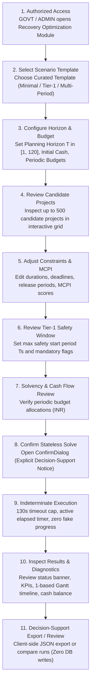
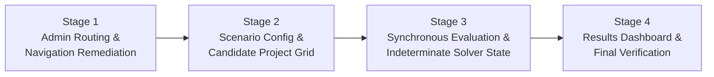

# DIRS Milestone 4 — Gate 2 Phase A: Read-Only UI Architecture Inspection & Implementation Preflight

**Date:** 2026-11-17T14:10:00+05:30  
**Project:** Disaster Intelligence and Response System (DIRS)  
**Phase:** 6D-B — Mathematical Recovery Portfolio Optimization  
**Milestone:** 4 — Frontend UI Integration & Decision Support  
**Gate:** Gate 2 — Frontend UI Integration & Navigation  
**Stage:** Phase A — Read-Only UI Architecture Inspection & Implementation Preflight  
**Status:** **PHASE A PREFLIGHT COMPLETE — AWAITING PROJECT OWNER REVIEW**

---

## 1. Executive Summary

The Project Owner has authorized **Milestone 4 Gate 2 Phase A** following the formal closure and acceptance with conditions of Gate 1. In strict compliance with governance rules, **this preflight is exclusively READ-ONLY**. Zero source code modifications, zero dependency installations, zero database operations, and zero premature UI implementations were performed.

### Key Inspection Outcomes:
1. **Frontend Architecture Readiness:** The existing DIRS React 18.2.0 + Vite 5.1.6 SPA architecture provides all necessary primitives (`@tanstack/react-query` v5.28.9, `axios` v1.6.8, `lucide-react` v0.359.0, `tailwindcss` v3.4.1, `recharts` v2.12.3, and a mature `components/design-system` library) to implement the Recovery Portfolio Optimization decision-support UI with **zero new dependencies**.
2. **ADMIN Navigation Defect Diagnosis:** The known downstream TypeScript errors (`TS7053` on line 46 and `TS7006` on line 73 in `Sidebar.tsx`) and the role-handling logic in `App.tsx` (`user.role !== 'GOVT'`) have been forensically diagnosed. Currently, an authenticated `ADMIN` user is erroneously treated as `CITIZEN` in the Sidebar and blocked/redirected from administrative routes in `App.tsx`. A minimal, non-disruptive remediation is designed.
3. **Stateless Decision-Support Workflow:** A complete 11-step user journey has been designed that adheres to all frozen domain invariants: curated editable templates, no initial database ingestion, discrete 1-based period indexing ($[1, T]$), strict 500-candidate and 120-period limits, lossless IEEE-754 numerical parsing, 130-second client timeout, indeterminate solver execution display without fabricated progress counters, and zero automatic schedule application or database persistence.
4. **Staged Implementation Plan:** A rigorous, 4-stage implementation plan (Stage 1: Admin Routing & Navigation, Stage 2: Scenario Configuration & Project Grid, Stage 3: Synchronous Evaluation & Indeterminate Solver State, Stage 4: Results Dashboard & Verification) is formulated with clear acceptance criteria and zero scope creep.

---

## 2. Existing Frontend Architecture Inspection

The DIRS frontend repository is an enterprise-grade Single Page Application (SPA) located at `frontend/`.

### 2.1 Core Technology Stack & Versions (`frontend/package.json`)
- **Runtime & Bundler:** React `^18.2.0`, React DOM `^18.2.0`, Vite `^5.1.6`.
- **Language & Type System:** TypeScript `^5.2.2`.
- **Routing:** `react-router-dom` `^6.22.3` using HTML5 history API (`BrowserRouter`, `Routes`, `Route`, `Navigate`, `NavLink`).
- **Data Fetching & Cache:** `@tanstack/react-query` `^5.28.9` (`QueryClient`, `QueryClientProvider`, `useQuery`, `useMutation`).
- **HTTP Client:** `axios` `^1.6.8` with global instance and request interceptors.
- **Styling:** `tailwindcss` `^3.4.1`, `postcss` `^8.4.38`, `autoprefixer` `^10.4.19`, `clsx` `^2.1.0`, `tailwind-merge` `^2.2.2`.
  - Custom dark theme: `obsidian-950` (`#030712`), `obsidian-900` (`#0b0f19`), `obsidian-850` (`#111827`), `obsidian-800` (`#1f2937`), `obsidian-700` (`#374151`).
  - Tactical color accents: `amber-ops` (`#f59e0b`), `amber-ops-bright` (`#fbbf24`), `cyan-ops` (`#06b6d4`), `emerald-500` (`#10b981`), `red-500` (`#ef4444`).
- **Icons:** `lucide-react` `^0.359.0`.
- **Data Visualization & GIS:**
  - `recharts` `^2.12.3`: Pre-installed in `package.json` dependencies; immediately available for timeline/budget charting without installation.
  - `leaflet` `^1.9.4`, `react-leaflet` `^4.2.1`.
- **Testing Infrastructure:** `@playwright/test` `^1.63.0` supporting Node-mode contract tests (`playwright.contract.config.ts`) and browser e2e tests (`playwright.config.ts`).

### 2.2 Reusable Design System Primitives (`frontend/src/components/design-system/`)
The frontend contains an existing, battle-tested design system that perfectly matches the tactical operational aesthetic required for Phase 6D-B:
1. [`PageHeader.tsx`](file:///C:/Users/shubh/Downloads/DIRS/frontend/src/components/design-system/PageHeader.tsx): Standard operational header supporting title, subtitle, icon, status badges, and action buttons.
2. [`OperationalCard.tsx`](file:///C:/Users/shubh/Downloads/DIRS/frontend/src/components/design-system/OperationalCard.tsx): Styled card container with header slot, border accents, and padding variants.
3. [`KPIStat.tsx`](file:///C:/Users/shubh/Downloads/DIRS/frontend/src/components/design-system/KPIStat.tsx): Monospaced metric cards with title, value, subtext, trend indicator, and color themes (`cyan`, `emerald`, `amber`, `red`).
4. [`StatusBadge.tsx`](file:///C:/Users/shubh/Downloads/DIRS/frontend/src/components/design-system/StatusBadge.tsx) & [`SeverityBadge.tsx`](file:///C:/Users/shubh/Downloads/DIRS/frontend/src/components/design-system/SeverityBadge.tsx): Standardized monospaced status badges for operational indicators.
5. [`LoadingSkeleton.tsx`](file:///C:/Users/shubh/Downloads/DIRS/frontend/src/components/design-system/LoadingSkeleton.tsx): Animated pulse skeletons supporting `card`, `table`, and `text` layouts.
6. [`EmptyState.tsx`](file:///C:/Users/shubh/Downloads/DIRS/frontend/src/components/design-system/EmptyState.tsx): Empty state placeholder with Lucide icon, uppercase title, description, and action button.
7. [`ConfirmDialog.tsx`](file:///C:/Users/shubh/Downloads/DIRS/frontend/src/components/design-system/ConfirmDialog.tsx): Portal-based human-in-the-loop modal dialog with danger, warning, and primary action styles.
8. [`DIRSLogo.tsx`](file:///C:/Users/shubh/Downloads/DIRS/frontend/src/components/design-system/DIRSLogo.tsx): Standard SVG logo component.

### 2.3 Application Shell & Layout
- [`Layout.tsx`](file:///C:/Users/shubh/Downloads/DIRS/frontend/src/components/layout/Layout.tsx): Top-level wrapper providing sticky [`Navbar.tsx`](file:///C:/Users/shubh/Downloads/DIRS/frontend/src/components/layout/Navbar.tsx) at the top, collapsible/fixed [`Sidebar.tsx`](file:///C:/Users/shubh/Downloads/DIRS/frontend/src/components/layout/Sidebar.tsx) on the left, and an `overflow-y-auto` `<main>` content viewport.

---

## 3. Current Route & Authorization Behavior

### 3.1 Route Definition & Access Control ([`frontend/src/App.tsx`](file:///C:/Users/shubh/Downloads/DIRS/frontend/src/App.tsx))
Existing route hierarchy:
- `/login`: Public login page.
- `/register`: Public registration page.
- `/citizen`: `allowedRoles={['CITIZEN', 'GOVT']}` -> `CitizenDashboard`.
- `/citizen/report`: `allowedRoles={['CITIZEN', 'VOLUNTEER', 'GOVT']}` -> `ReportIncident`.
- `/citizen/shelters`: Authenticated (no role filter) -> `ShelterFinder`.
- `/volunteer`: `allowedRoles={['VOLUNTEER', 'GOVT']}` -> `VolunteerDashboard`.
- `/ngo`: `allowedRoles={['NGO', 'GOVT']}` -> `NGODashboard`.
- `/admin`: `allowedRoles={['GOVT']}` -> `CommandCenter`.
- `/admin/simulation`: `allowedRoles={['GOVT']}` -> `DisasterSimulationView`.

### 3.2 Security Guard Inspection (`ProtectedRoute` in `App.tsx` Lines 18-26)
```typescript
const ProtectedRoute: React.FC<{ children: React.ReactNode; allowedRoles?: string[] }> = ({ children, allowedRoles }) => {
  const { user, loading } = useAuth();
  if (loading) return <div className="p-8 text-center text-xs font-mono text-slate-500">Loading DIRS Security Context...</div>;
  if (!user) return <Navigate to="/login" replace />;
  if (allowedRoles && !allowedRoles.includes(user.role) && user.role !== 'GOVT') {
    return <Navigate to="/citizen" replace />;
  }
  return <Layout>{children}</Layout>;
};
```
#### Defect Identification:
1. **Asymmetric Role Bypass:** Line 22 checks `user.role !== 'GOVT'`. This grants `GOVT` automatic bypass for all role checks. However, `'ADMIN'` was added to `UserProfile.role` in Gate 1 Stage B, but line 22 was not authorized to be touched. Consequently, `ADMIN` does NOT receive the administrative bypass.
2. **Erroneous Admin Rejection & Loop:** When an `ADMIN` user attempts to access `/admin` (`allowedRoles={['GOVT']}`):
   - `allowedRoles.includes('ADMIN')` evaluates to `false`.
   - `user.role !== 'GOVT'` evaluates to `true`.
   - The route guard triggers `<Navigate to="/citizen" replace />`.
   - At `/citizen`, `allowedRoles` is `['CITIZEN', 'GOVT']`.
   - Again, `'ADMIN'` is not in `['CITIZEN', 'GOVT']`, so it attempts to redirect to `/citizen` again, creating an infinite redirect or trapped state where `ADMIN` can access nothing.

### 3.3 Auth Context Inspection ([`frontend/src/context/AuthContext.tsx`](file:///C:/Users/shubh/Downloads/DIRS/frontend/src/context/AuthContext.tsx))
- Lines 4-10:
  ```typescript
  export interface UserProfile {
    id: string;
    email: string;
    full_name: string;
    role: 'CITIZEN' | 'VOLUNTEER' | 'NGO' | 'GOVT' | 'ADMIN';
    phone?: string;
  }
  ```
- Authentication is token-based. `localStorage.getItem('dirs_token')` is sent on `/auth/me` to fetch `user: UserProfile`.
- The `AuthContext` is clean, robust, and correctly accepts `ADMIN`.

---

## 4. ADMIN Navigation Defect Analysis

### 4.1 TypeScript Compiler Errors in [`Sidebar.tsx`](file:///C:/Users/shubh/Downloads/DIRS/frontend/src/components/layout/Sidebar.tsx)
When running `tsc --noEmit`, two compilation errors occur in `Sidebar.tsx`:
1. **TS7053 (Line 46):**
   ```typescript
   // Line 46:
   const navs = roleNavItems[user.role] || roleNavItems.CITIZEN;
   ```
   *Compiler Diagnostic:* `Element implicitly has an 'any' type because expression of type '"CITIZEN" | "VOLUNTEER" | "NGO" | "GOVT" | "ADMIN"' can't be used to index type '{ CITIZEN: ...; VOLUNTEER: ...; NGO: ...; GOVT: ...; }'. Property 'ADMIN' does not exist on type '{ CITIZEN: ...; VOLUNTEER: ...; NGO: ...; GOVT: ...; }'.`
2. **TS7006 (Line 73):**
   ```typescript
   // Line 73:
   {navs.map((item) => {
   ```
   *Compiler Diagnostic:* `Parameter 'item' implicitly has an 'any' type.`

### 4.2 Runtime Fallback Defect
Because `roleNavItems` does not contain the key `'ADMIN'`:
- `roleNavItems['ADMIN']` evaluates to `undefined` at runtime.
- The logical OR (`|| roleNavItems.CITIZEN`) evaluates to `roleNavItems.CITIZEN`.
- Consequently, an administrator logging in with `ADMIN` role is shown the Citizen navigation items (Citizen Dashboard, Report Incident, Nearby Shelters) instead of command center and simulation links.

### 4.3 Badge Styling Defect (Lines 48-55)
```typescript
const getRoleBadgeStyle = (role?: string) => {
  switch (role) {
    case 'GOVT': return 'bg-red-950/70 text-red-400 border-red-800/80';
    case 'NGO': return 'bg-purple-950/70 text-purple-300 border-purple-800/80';
    case 'VOLUNTEER': return 'bg-emerald-950/70 text-emerald-300 border-emerald-800/80';
    default: return 'bg-cyan-950/70 text-cyan-300 border-cyan-800/80';
  }
};
```
For `ADMIN`, the badge falls through to the default cyan style rather than a dedicated administrative badge style.

### 4.4 Recommended Integration Approach
To resolve these issues cleanly in Gate 2 Stage 1:
1. **`Sidebar.tsx`:**
   - Define a shared navigation array `ADMIN_GOVT_NAV_ITEMS` that includes Command Center, GIS & Simulation Lab, Recovery Optimization, Citizen Overview, Responder Fleet, and NGO Logistics.
   - Add `ADMIN: ADMIN_GOVT_NAV_ITEMS` and `GOVT: ADMIN_GOVT_NAV_ITEMS` to `roleNavItems`.
   - Update `getRoleBadgeStyle` to style `ADMIN` (e.g. `bg-amber-950/70 text-amber-400 border-amber-800/80` or `bg-red-950/70 text-red-400 border-red-800/80`).
2. **`App.tsx`:**
   - Update `ProtectedRoute` line 22:
     ```typescript
     if (allowedRoles && !allowedRoles.includes(user.role) && user.role !== 'GOVT' && user.role !== 'ADMIN') {
       return <Navigate to="/citizen" replace />;
     }
     ```
   - Update route definitions for `/admin`, `/admin/simulation`, and the new `/admin/recovery-optimization` to specify `allowedRoles={['GOVT', 'ADMIN']}`.
   - Align with backend router security: `current_user: Annotated[User, Security(get_current_user, scopes=["GOVT", "ADMIN"])]`.

---

## 5. Recovery Optimization User Journey

The proposed decision-support journey for authorized government planners and administrators:



### Detailed Journey Steps:
1. **Authorized Navigation:** User clicks "Recovery Optimization" under the Admin / GOVT navigation section in `Sidebar.tsx`, navigating to `/admin/recovery-optimization`.
2. **Template Selection:** User is presented with curated template options (e.g. "Minimal Valid Scenario", "Tier-1 Seismic Retrofit", "Multi-District Infrastructure Portfolio") populated from typed fixtures.
3. **Horizon & Financial Parameter Setup:** User tunes planning horizon $T$ ($1 \le T \le 120$ periods), period length in days (e.g. 30.0), initial cash balance, and periodic budget allocations $B_t$ ($t \in [1, T]$).
4. **Candidate Projects Review:** Candidate table renders up to 500 projects with pagination and sorting. Each row displays project ID, code, district, estimated cost, duration ($d_j$), release period ($r_j$), deadline period ($d_j^{max}$), Tier-1 mandatory flag, and MCPI score ($[0, 1]$).
5. **Constraint Tuning:** User can toggle Tier-1 status, adjust durations, costs, or release/deadline constraints.
6. **Tier-1 Mandatory Safety Window:** If mandatory projects exist, user configures `max_safety_start_period` $T_s \le T$. Form validates $1 \le r_j \le s_j \le T_s$.
7. **Solvency Verification:** User inspects the periodic cash inflows to ensure funding covers projected capital deployment.
8. **Stateless Solve Trigger:** User clicks "Run Optimization Evaluation". A `ConfirmDialog` reminds the user: *"Stateless MILP evaluation will execute via Google OR-Tools CP-SAT. This is decision-support only; no schedules will be written to the database."*
9. **Indeterminate Solver Execution:** The UI transitions into an indeterminate solving state. An active stopwatch displays elapsed seconds ($0.0s \dots 130.0s$). No fabricated progress bars or estimated completion countdowns are rendered.
10. **Results & Diagnostic Inspection:**
    - Status Banner: Clear indicator of solver outcome (`OPTIMAL`, `FEASIBLE`, `INFEASIBLE`, `UNKNOWN`, `MODEL_INVALID`, `POST_SOLVE_RECONCILIATION_FAILED`) with server-assigned `X-Correlation-ID`.
    - KPI Grid: Total Objective Value (exact integer string), Scheduled Project Count / Total Candidates, Capital Utilized vs Budget, Total Solve Time.
    - Interactive 1-based Gantt Timeline: Visual schedule showing active execution windows $[s_j, s_j + d_j - 1]$ across periods $1 \dots T$.
    - Financial Solvency Chart: Periodic cash balance, capital expenditures, and revenues across periods $1 \dots T$.
    - Infeasibility Diagnostics Panel: If status is `INFEASIBLE`, renders conflicting constraints, violated safety deadlines, or budget shortfalls.
11. **Client-Side Export / Decision Support:** User can export the scenario request or solver response as a JSON file or copy the correlation ID for audit. Zero database writes occur.

---

## 6. Proposed Screen & Component Architecture

To minimize cognitive overhead and maintain architectural consistency with `CommandCenter.tsx` and `DisasterSimulationView.tsx`, the Recovery Optimization module will be implemented as a unified view located at:
`frontend/src/pages/admin/RecoveryOptimizationView.tsx`

### 6.1 Component Hierarchy

```
RecoveryOptimizationView (Page Container)
├── PageHeader (DIRS Design System)
├── Tab Navigation ("Configuration & Candidates" | "Evaluation & Schedule" | "Diagnostics & Solvency")
│
├── Tab 1: Configuration & Candidates
│   ├── ScenarioTemplateSelector (Loads fixtures or resets to defaults)
│   ├── ScenarioParametersCard (Horizon T, Period Days, Initial Cash, Currency)
│   ├── PeriodicBudgetsEditor (Grid editor for B_t across t = 1..T)
│   └── CandidateProjectsGrid (Table of candidate projects with Tier-1 badges, pagination)
│       └── CandidateProjectModal (Add / Edit single candidate project)
│
├── Tab 2: Evaluation & Schedule
│   ├── SolverConfigBar (Seed, Max Solve Time, Workers, "Run Optimization" action)
│   ├── IndeterminateSolverOverlay (Elapsed timer, pulse animation, cancel/abort)
│   ├── SolverStatusBanner (OPTIMAL / FEASIBLE / INFEASIBLE badge, Correlation ID)
│   ├── OptimizationKPIStats (Objective value, Scheduled count, Total Cost, Solve Duration)
│   └── ProjectScheduleTimeline (1-based Gantt matrix: periods 1..T vs scheduled projects)
│
└── Tab 3: Diagnostics & Solvency
    ├── FinancialSolvencyMatrix (Table / Recharts bar chart of periodic cash & expenditure)
    ├── Tier1ComplianceCard (Verification of safety window s_j <= T_s)
    └── InfeasibilityDiagnosticsView (Rendered only on INFEASIBLE / UNKNOWN / MODEL_INVALID)
```

### 6.2 Component Specification Table

| Component Name | File Path | Existing or New | Purpose | State Management | Reused Design Primitives |
| :--- | :--- | :---: | :--- | :--- | :--- |
| `RecoveryOptimizationView` | `frontend/src/pages/admin/RecoveryOptimizationView.tsx` | **NEW** | Main page container and tab orchestrator | Active tab, scenario request state, evaluated response state | `PageHeader`, `Layout` |
| `ScenarioParametersCard` | `frontend/src/components/recovery/ScenarioParametersCard.tsx` | **NEW** | Inputs for scenario name, horizon $T$, period length, initial cash | Controlled form inputs with validation | `OperationalCard`, `StatusBadge` |
| `PeriodicBudgetsEditor` | `frontend/src/components/recovery/PeriodicBudgetsEditor.tsx` | **NEW** | Visual grid for configuring periodic budgets $B_t$ ($t \in [1, T]$) | Map of `number -> string` (period to Decimal) | `OperationalCard` |
| `CandidateProjectsGrid` | `frontend/src/components/recovery/CandidateProjectsGrid.tsx` | **NEW** | Interactive table of candidate projects (up to 500) | Candidate array, search/filter, sort, page | `OperationalCard`, `SeverityBadge`, `EmptyState` |
| `SolverControlBar` | `frontend/src/components/recovery/SolverControlBar.tsx` | **NEW** | Controls solver params and triggers execution | Seed, workers, time limit, mutation trigger | `ConfirmDialog` |
| `IndeterminateSolverOverlay` | `frontend/src/components/recovery/IndeterminateSolverOverlay.tsx` | **NEW** | Indeterminate loading indicator with stopwatch | Elapsed time ticker (ms/s) | `LoadingSkeleton` |
| `SolverStatusBanner` | `frontend/src/components/recovery/SolverStatusBanner.tsx` | **NEW** | Displays solver status, solve time, and correlation ID | Props from evaluated response | `StatusBadge` |
| `OptimizationKPIStats` | `frontend/src/components/recovery/OptimizationKPIStats.tsx` | **NEW** | Renders 4 tactical KPI cards for objective, cost, count | Props from evaluated response | `KPIStat` |
| `ProjectScheduleTimeline` | `frontend/src/components/recovery/ProjectScheduleTimeline.tsx` | **NEW** | Discrete 1-based Gantt timeline visualization | Props: scheduled projects, horizon $T$ | Monospace table / CSS bar matrix |
| `FinancialSolvencyMatrix` | `frontend/src/components/recovery/FinancialSolvencyMatrix.tsx` | **NEW** | Displays periodic cash balance and expenditure | Props: financial summary from response | `recharts` / Tailwind bar table |
| `InfeasibilityDiagnosticsView` | `frontend/src/components/recovery/InfeasibilityDiagnosticsView.tsx` | **NEW** | Infeasibility diagnostic breakdown | Props: `infeasibility_diagnostics` DTO | `OperationalCard`, `EmptyState` |

---

## 7. Proposed File-Level Implementation Plan

All changes are strictly segregated into distinct logical concerns:

### Category A: Navigation & Authorization Changes
1. [`frontend/src/components/layout/Sidebar.tsx`](file:///C:/Users/shubh/Downloads/DIRS/frontend/src/components/layout/Sidebar.tsx)
   - **Type:** Existing (MODIFIED).
   - **Purpose:** Resolve TS7053/TS7006 by adding `ADMIN` to `roleNavItems`; add navigation entry for Recovery Optimization (`/admin/recovery-optimization`) with tactical icon (`Cpu` or `Sliders`).
   - **Risk:** Very low; purely resolves type errors and adds route navigation.
2. [`frontend/src/App.tsx`](file:///C:/Users/shubh/Downloads/DIRS/frontend/src/App.tsx)
   - **Type:** Existing (MODIFIED).
   - **Purpose:** Update `ProtectedRoute` to recognize `ADMIN` alongside `GOVT`; register `/admin/recovery-optimization` route.
   - **Risk:** Low; ensures non-regression for existing citizen/volunteer/ngo/admin routes.

### Category B: Scenario Configuration & Project Grid UI
3. `frontend/src/pages/admin/RecoveryOptimizationView.tsx`
   - **Type:** **NEW**.
   - **Purpose:** Main page container orchestrating scenario state, template loading, and tab switching.
   - **Risk:** Low; self-contained page.
4. `frontend/src/components/recovery/ScenarioParametersCard.tsx`
   - **Type:** **NEW**.
   - **Purpose:** Form for planning horizon $T \in [1, 120]$, period length, initial cash, safety deadline.
   - **Risk:** Low; standard controlled inputs.
5. `frontend/src/components/recovery/PeriodicBudgetsEditor.tsx`
   - **Type:** **NEW**.
   - **Purpose:** Dynamic grid editor for 1-based periodic budget allocations $B_t$.
   - **Risk:** Low.
6. `frontend/src/components/recovery/CandidateProjectsGrid.tsx`
   - **Type:** **NEW**.
   - **Purpose:** Table showing candidates with pagination, Tier-1 badges, MCPI indicators, and candidate count limiter ($\le 500$).
   - **Risk:** Low.

### Category C: Evaluation Submission & API Integration
7. `frontend/src/hooks/useRecoveryOptimization.ts`
   - **Type:** **NEW**.
   - **Purpose:** Custom React hook encapsulating `@tanstack/react-query` `useMutation` for `evaluateRecoveryOptimizationScenario`, stopwatch timer for indeterminate execution, and error normalization.
   - **Risk:** Low; delegates directly to frozen `frontend/src/api/recoveryOptimization.ts`.
8. `frontend/src/components/recovery/SolverControlBar.tsx`
   - **Type:** **NEW**.
   - **Purpose:** Execution trigger bar with `ConfirmDialog` integration.
   - **Risk:** Low.
9. `frontend/src/components/recovery/IndeterminateSolverOverlay.tsx`
   - **Type:** **NEW**.
   - **Purpose:** Modal/banner showing active elapsed timer during solve, strictly avoiding fake progress bars.
   - **Risk:** Low.

### Category D: Results & Diagnostics UI
10. `frontend/src/components/recovery/SolverStatusBanner.tsx`
    - **Type:** **NEW**.
    - **Purpose:** Outcome banner rendering status, correlation ID, and solve duration.
    - **Risk:** Low.
11. `frontend/src/components/recovery/OptimizationKPIStats.tsx`
    - **Type:** **NEW**.
    - **Purpose:** KPI metrics grid for exact objective value, candidate coverage, and total expenditure.
    - **Risk:** Low.
12. `frontend/src/components/recovery/ProjectScheduleTimeline.tsx`
    - **Type:** **NEW**.
    - **Purpose:** Discrete 1-based Gantt chart rendering periods $1 \dots T$ and project active windows $[s_j, s_j + d_j - 1]$.
    - **Risk:** Low.
13. `frontend/src/components/recovery/FinancialSolvencyMatrix.tsx`
    - **Type:** **NEW**.
    - **Purpose:** Periodic solvency and cash flow breakdown table / chart.
    - **Risk:** Low.
14. `frontend/src/components/recovery/InfeasibilityDiagnosticsView.tsx`
    - **Type:** **NEW**.
    - **Purpose:** Formatted presentation of infeasibility diagnostics, conflict sets, and validation failures.
    - **Risk:** Low.

### Category E: Verification Tests
15. `frontend/tests/contract/*.spec.ts` (3 files)
    - **Type:** **FROZEN (DO NOT TOUCH)**.
    - **Purpose:** Contract suites remain authoritative baselines.
16. `frontend/tests/e2e/recoveryOptimizationUi.spec.ts`
    - **Type:** **NEW**.
    - **Purpose:** Playwright UI test suite verifying navigation, template loading, form validation, execution trigger, and results rendering.
    - **Risk:** Low.

---

## 8. API Integration Design

The UI will interface exclusively with the accepted Milestone 4 Gate 1 client function:
[`evaluateRecoveryOptimizationScenario(request)`](file:///C:/Users/shubh/Downloads/DIRS/frontend/src/api/recoveryOptimization.ts#L552-L590)

```typescript
// Integration Pattern in useRecoveryOptimization hook:
const mutation = useMutation<EvaluatedScenarioResult, OptimizationApiError, RecoveryOptimizationScenarioRequest>({
  mutationFn: async (request: RecoveryOptimizationScenarioRequest) => {
    return await evaluateRecoveryOptimizationScenario(request);
  },
  onMutate: () => {
    // Start stopwatch timer
  },
  onSuccess: (result) => {
    // Stop stopwatch timer, record correlation ID, populate result state
  },
  onError: (error: OptimizationApiError) => {
    // Stop stopwatch timer, capture correlation ID and typed error details
  }
});
```

### Exact Numerical Field Handling:
- Category 1 (Exact 64-bit integers): `exact_objective_value`, `cost_ccu`, etc. are stored as exact strings. Display formatting uses locale separators without parsing into IEEE-754 `Number` (e.g. `formatExactIntegerString(val)`).
- Category 2 (Non-monetary floats): `solve_time_seconds`, `solver_gap`, `raw_mcpi_score` are formatted using `toFixed(2)`.
- Category 3 (Monetary Decimals): `initial_cash`, `estimated_cost`, `periodic_budgets` are treated as decimal strings (e.g. `"10000000.00"`).
- Category 4 (Discrete period indices): $T$, $s_j$, $d_j$, $r_j$, $d_j^{max}$ are strictly 1-based integers in $[1, T]$.

---

## 9. State Management Approach

1. **Local Scenario State:** Controlled in `RecoveryOptimizationView` using React state:
   - `scenarioRequest: RecoveryOptimizationScenarioRequest`: Holds the current working scenario. Initialized from `minimalValidScenarioRequestFixture`.
   - `evaluatedResult: EvaluatedScenarioResult | null`: Holds the latest evaluated solver response and correlation ID.
   - `activeTab: 'config' | 'results' | 'diagnostics'`: Governs the active sub-view.
2. **Template Loading:** Users can click "Load Minimal Template", "Load Tier-1 Safety Template", or "Clear / Custom" which replaces `scenarioRequest` with deep copies of the fixtures in `frontend/src/fixtures/recoveryOptimizationFixtures.ts`.
3. **Execution State:** Managed via TanStack `useMutation`:
   - `isPending`: Controls the indeterminate loading overlay.
   - `error`: Contains the normalized `OptimizationApiError`.
   - `elapsedSeconds`: Controlled by an internal `setInterval` hook when `isPending === true`.
4. **Zero Persistence Guarantee:** Scenario edits and evaluation results live strictly in browser memory. Reloading the page resets to default templates. No `localStorage`, `sessionStorage`, or backend database writes are used.

---

## 10. Error, Loading, and Empty-State Behavior

### 10.1 Loading State (Indeterminate Solver Execution)
- **Constraint:** The backend solver takes between 0.1s and 120.0s depending on portfolio complexity. Fabricating a progress percentage or a countdown is strictly prohibited.
- **Implementation:**
  - Submit button shows a spinning Lucide `Loader2` icon and text *"Evaluating Portfolio (CP-SAT MILP)..."*.
  - A subtle operational banner displays:
    ```
    SOLVER KERNEL ACTIVE | OR-Tools CP-SAT | Elapsed: 14.2s (Cap: 130.0s)
    Indeterminate Synchronous Evaluation — Do not refresh page
    ```
  - Inputs and buttons are disabled during execution to prevent duplicate concurrent requests.

### 10.2 Empty States
- When no candidate projects are added: renders [`EmptyState`](file:///C:/Users/shubh/Downloads/DIRS/frontend/src/components/design-system/EmptyState.tsx) with Lucide `Inbox` icon, message *"No Candidate Projects Configured"*, and a *"Load Sample Candidates"* action button.
- Before evaluation: Tab 2 (Schedule) displays an `EmptyState` with Lucide `Sliders` icon, message *"Evaluation Required"*, and button *"Run Optimization"*.

### 10.3 Error Handling
- **HTTP 401 Unauthorized:** Redirects to `/login`.
- **HTTP 403 Forbidden:** Renders an operational warning card: *"Access Denied: Phase 6D-B Recovery Portfolio Optimization requires GOVT or ADMIN role credentials."*
- **HTTP 422 Unprocessable Entity:** Renders validation breakdown highlighting offending fields (e.g. *"Planning horizon must be between 1 and 120"*, *"Candidates count exceeds 500"*).
- **HTTP 500 / Network Timeout:** Displays error banner with `X-Correlation-ID` (for server log tracing) and sanitized message from `OptimizationErrorDetailDTO`.

---

## 11. Security & Authorization Analysis

1. **Role Verification:**
   - Frontend route protection enforces `user.role === 'GOVT' || user.role === 'ADMIN'`.
   - All other roles (`CITIZEN`, `VOLUNTEER`, `NGO`) are redirected to `/citizen` or access denied.
2. **Bearer Token Forwarding:**
   - The Axios client in `frontend/src/api/client.ts` automatically attaches `Authorization: Bearer <token>` from `localStorage.getItem('dirs_token')`.
   - Backend endpoint strictly validates this JWT against the `User` table and verifies `role in ["GOVT", "ADMIN"]`.
3. **Data Sanitization & XSS Prevention:**
   - All scenario fields (strings, IDs, numbers) are rendered via standard React JSX escaping, preventing script injection.
   - Lossless JSON parser enforces strict structural parsing without `eval()` or dangerous deserialization.

---

## 12. Testing Strategy

Gate 2 validation will encompass a three-tier testing regime:

### Tier 1: Preserved Contract Suite (Fast Node-Mode)
- Run `npx playwright test --config=playwright.contract.config.ts`.
- Validates all 52 existing contract tests in 2.1s with 0 regressions.

### Tier 2: TypeScript & Vite Production Build Validation
- Run `npx tsc --noEmit` across the entire project.
- Must exit with `0` errors (verifying resolution of TS7053 and TS7006).
- Run `npx vite build` to ensure all 1600+ modules bundle cleanly into production assets without bundling or syntax failures.

### Tier 3: Frontend UI & Route Integration Tests (`tests/e2e/recoveryOptimizationUi.spec.ts`)
- Automated Playwright browser tests covering:
  1. **Admin Access:** Login as `ADMIN` -> verify Sidebar displays "Recovery Optimization" and navigates to `/admin/recovery-optimization` without redirect loops.
  2. **Govt Access:** Login as `GOVT` -> verify access to `/admin/recovery-optimization`.
  3. **Unauthorized Access:** Login as `CITIZEN` or `NGO` -> verify access to `/admin/recovery-optimization` is blocked.
  4. **Template Population:** Select "Tier-1 Mandatory Safety Scenario" -> verify fields and candidate table populate with fixture data.
  5. **1-Based Period Validation:** Verify validation error when period index $0$ is entered.
  6. **Upper Limit Validation:** Verify validation error when horizon $> 120$ or candidate count $> 500$.
  7. **Indeterminate State Verification:** Mock delayed API response -> verify elapsed timer increments and submit button disables without progress bars.
  8. **Outcome Rendering:** Mock `OPTIMAL` response -> verify status badge, KPI cards, and Gantt timeline render.
  9. **Infeasible Outcome Rendering:** Mock `INFEASIBLE` response -> verify diagnostic card displays conflict details.

---

## 13. Mathematical & Domain Invariants

The Gate 2 UI will enforce and preserve all previously frozen mathematical decisions:

1. **Discrete 1-Based Indexing:** Periods are numbered $1, 2, \dots, T$. Zero-based period indexing ($0$) is strictly rejected in inputs and displays.
2. **IEEE-754 Safe Integer Preservation:** All Category 1 exact integers (e.g. $2^{54} + 9999$) and Category 3 monetary Decimals are received, processed, and displayed as exact strings.
3. **Candidate Project Limit:** Hard cap of $\le 500$ candidate projects enforced in the UI before API dispatch.
4. **Planning Horizon Limit:** Hard cap of $1 \le T \le 120$ periods.
5. **Period Duration:** $1.0 \le \Delta t \le 365.0$ days.
6. **Stateless Decision Support:** No automatic schedule execution, database writes, or persistent state transitions.
7. **Timeout Cap:** 130,000 ms at the frontend client ($> 120.0s$ server execution cap).
8. **Deterministic Seed:** Seed input provided for exact reproducibility.

---

## 14. Scope & Dependency Risks

| Risk Factor | Severity | Mitigation Strategy |
| :--- | :---: | :--- |
| **New NPM Dependencies** | High | **PROHIBITED:** Recharts, Lucide, Tailwind, and TanStack Query are already installed in `package.json`. No new dependencies will be installed. |
| **Breaking Existing Routes** | Medium | Updates to `Sidebar.tsx` and `App.tsx` will add `ADMIN` and the new route without modifying existing routes or layouts. |
| **Large Integer Distortion** | Medium | Format utilities will treat Category 1 numbers as strings without converting to JavaScript `Number`. |
| **Browser Freezing on 500 Candidates** | Low | Virtualized or paginated rendering in `CandidateProjectsGrid` ensures high framerate. |
| **Solver Timeout UI Hang** | Low | 130s client timeout and cancel/reset button allow user to recover if server execution exceeds timeout. |

---

## 15. task.md & Governance Audit

Inspection of root [`task.md`](file:///C:/Users/shubh/.gemini/antigravity/brain/862d6764-c898-447f-bb84-f3ccb1a061fc/task.md):
- **Exact Changes Associated with Gate 1 Closure:**
  - Gate 0, Gate 1 Stage A, Gate 1 Stage B, Gate 1 Stage C Phase A, and Gate 1 Stage C Phase B are all marked complete (`[x]`).
  - Formal closure section added documenting acceptance of conditions (`test-results/.last-run.json` and deferred `Sidebar.tsx` TS errors).
  - Gate 2 checklist added and explicitly marked:
    `- [ ] **Milestone 4 Gate 2: Frontend UI Integration & Decision Support (AWAITING OWNER AUTHORIZATION)**`
- **Milestone & Authorization Boundaries:** All milestones remain strictly bounded. Gate 1 is closed; Gate 2 is marked as awaiting authorization.
- **Gate 2 Implementation Status:** Confirmed marked **NOT AUTHORIZED**.
- **Contradiction Analysis:** Zero contradictions found between `task.md` and [`DIRS_MILESTONE_4_GATE1_COMPLETION_REPORT.md`](file:///C:/Users/shubh/Downloads/DIRS/DIRS_MILESTONE_4_GATE1_COMPLETION_REPORT.md).

---

## 16. Proposed Implementation Stages

To maintain rigorous control, Gate 2 implementation should be partitioned into four sequential stages:



### Stage 1: Admin Routing & Navigation Remediation
- **Scope:** Modify `Sidebar.tsx` and `App.tsx` to resolve TS7053/TS7006 and grant `ADMIN` proper routing and navigation parity with `GOVT`.
- **Files Modified:** `frontend/src/components/layout/Sidebar.tsx`, `frontend/src/App.tsx`.
- **Acceptance Criteria:** `npx tsc --noEmit` passes with 0 errors; `ADMIN` user logging in sees administrative navigation and can access `/admin`.

### Stage 2: Scenario Configuration & Candidate Project Grid
- **Scope:** Implement `RecoveryOptimizationView.tsx`, `ScenarioParametersCard.tsx`, `PeriodicBudgetsEditor.tsx`, and `CandidateProjectsGrid.tsx`.
- **Files Modified / Created:** `frontend/src/pages/admin/RecoveryOptimizationView.tsx` and child configuration components in `frontend/src/components/recovery/`.
- **Acceptance Criteria:** Template selector successfully loads fixtures; form enforces $1 \le T \le 120$ and candidates $\le 500$; 1-based indexing validated.

### Stage 3: Synchronous Evaluation & Indeterminate Solver State
- **Scope:** Implement `useRecoveryOptimization.ts`, `SolverControlBar.tsx`, and `IndeterminateSolverOverlay.tsx`.
- **Files Modified / Created:** Hook and solver control components in `frontend/src/components/recovery/`.
- **Acceptance Criteria:** Submits valid request payload via `evaluateRecoveryOptimizationScenario`; shows indeterminate overlay with live stopwatch timer; handles 130s timeout; zero fake progress bars.

### Stage 4: Results Dashboard & Verification
- **Scope:** Implement `SolverStatusBanner.tsx`, `OptimizationKPIStats.tsx`, `ProjectScheduleTimeline.tsx`, `FinancialSolvencyMatrix.tsx`, `InfeasibilityDiagnosticsView.tsx`, and UI verification test suite.
- **Files Modified / Created:** Result components in `frontend/src/components/recovery/` and `frontend/tests/e2e/recoveryOptimizationUi.spec.ts`.
- **Acceptance Criteria:** Accurately renders all 6 solver statuses, 1-based Gantt timeline, financial breakdown, and infeasibility diagnostics; `npm run build` succeeds; all contract tests pass.

---

## 17. Acceptance Criteria for Each Proposed Stage

### Stage 1 Acceptance Criteria:
1. `Sidebar.tsx` defines `ADMIN` navigation items identical to `GOVT` administrative tools plus the new Recovery Optimization link.
2. `Sidebar.tsx` line 46 indexes `roleNavItems` cleanly with zero `TS7053` or `TS7006` compiler errors.
3. `App.tsx` `ProtectedRoute` permits `ADMIN` users to access administrative routes.
4. `npx tsc --noEmit` exits with code `0`.

### Stage 2 Acceptance Criteria:
1. Selecting "Minimal Valid Scenario" or "Tier-1 Mandatory Scenario" populates form inputs and candidate table accurately from fixtures.
2. Form validation prevents input of $T < 1$ or $T > 120$.
3. Candidate project table displays up to 500 candidate projects with pagination and search.
4. Candidate projects display Tier-1 badges, MCPI benefit scores, duration, and release/deadline constraints.

### Stage 3 Acceptance Criteria:
1. Clicking "Run Optimization" opens `ConfirmDialog` emphasizing decision-support nature of the run.
2. Triggering solve initiates `evaluateRecoveryOptimizationScenario` with 130,000 ms timeout.
3. Live stopwatch displays elapsed seconds without progress percentage or estimated time-to-finish countdown.
4. Inputs and buttons are disabled during active execution.
5. Catches and normalizes `OptimizationApiError` on HTTP 401, 403, 422, 500.

### Stage 4 Acceptance Criteria:
1. Accurately renders outcomes for all 6 solver statuses (`OPTIMAL`, `FEASIBLE`, `INFEASIBLE`, `UNKNOWN`, `MODEL_INVALID`, `POST_SOLVE_RECONCILIATION_FAILED`).
2. Exact integer strings (Category 1) and monetary Decimals (Category 3) are preserved without floating-point truncation.
3. 1-based Gantt chart correctly visualizes schedule intervals $[s_j, s_j + d_j - 1]$.
4. Infeasible runs display diagnostic conflict findings and unmet constraints.
5. Whole-project production build `npm run build` passes with zero errors.
6. All 52 Gate 1 contract tests pass with zero regressions.

---

## 18. Exact Files Modified/Created in Each Stage

### Stage 1 Files:
- `frontend/src/components/layout/Sidebar.tsx` (MODIFIED)
- `frontend/src/App.tsx` (MODIFIED)

### Stage 2 Files:
- `frontend/src/pages/admin/RecoveryOptimizationView.tsx` (NEW)
- `frontend/src/components/recovery/ScenarioParametersCard.tsx` (NEW)
- `frontend/src/components/recovery/PeriodicBudgetsEditor.tsx` (NEW)
- `frontend/src/components/recovery/CandidateProjectsGrid.tsx` (NEW)

### Stage 3 Files:
- `frontend/src/hooks/useRecoveryOptimization.ts` (NEW)
- `frontend/src/components/recovery/SolverControlBar.tsx` (NEW)
- `frontend/src/components/recovery/IndeterminateSolverOverlay.tsx` (NEW)

### Stage 4 Files:
- `frontend/src/components/recovery/SolverStatusBanner.tsx` (NEW)
- `frontend/src/components/recovery/OptimizationKPIStats.tsx` (NEW)
- `frontend/src/components/recovery/ProjectScheduleTimeline.tsx` (NEW)
- `frontend/src/components/recovery/FinancialSolvencyMatrix.tsx` (NEW)
- `frontend/src/components/recovery/InfeasibilityDiagnosticsView.tsx` (NEW)
- `frontend/tests/e2e/recoveryOptimizationUi.spec.ts` (NEW)

---

## 19. Explicit List of Prohibited Changes

During Milestone 4 Gate 2 execution, the following actions remain **STRICTLY PROHIBITED**:

1. **NO Dependency Installations:** Modifying `package.json` or installing any new NPM packages (e.g. no new chart libraries, UI component kits, or utilities).
2. **NO Backend Modifications:** Modifying any file in `backend/` or `tests/backend/`.
3. **NO Database Modifications:** Running Alembic migrations, creating optimization job tables, or writing to SQLite/PostGIS databases.
4. **NO Gate 1 File Modifications:** Modifying any of the 8 accepted Gate 1 deliverables.
5. **NO Automatic Schedule Persistence:** Automatically persisting or committing solver schedule recommendations into production project tables.
6. **NO Background Polling / Queues:** Adding Celery, Redis, background polling endpoints, or WebSocket job channels for recovery optimization.
7. **NO Fabricated Progress Bars:** Showing fake solver completion percentages or countdown clocks during the indeterminate CP-SAT solve.
8. **NO Floating-Point Coercion:** Coercing Category 1 large integers or Category 3 monetary Decimals into standard JavaScript floating-point numbers.

---

## 20. Final Recommendation

The frontend architecture and design system are completely prepared for Milestone 4 Gate 2 implementation. The proposed 4-stage roadmap enables a methodical, test-verified integration that resolves the deferred TypeScript errors first, establishes the configuration UI, connects the synchronous API client, and delivers an intuitive decision-support dashboard for government recovery planners.

It is strongly recommended that the Project Owner authorize **Milestone 4 Gate 2 Stage 1 (Admin Routing & Navigation Remediation)** as the initial implementation step.

---

*(Preflight Inspection Complete — Zero Implementation Performed)*
