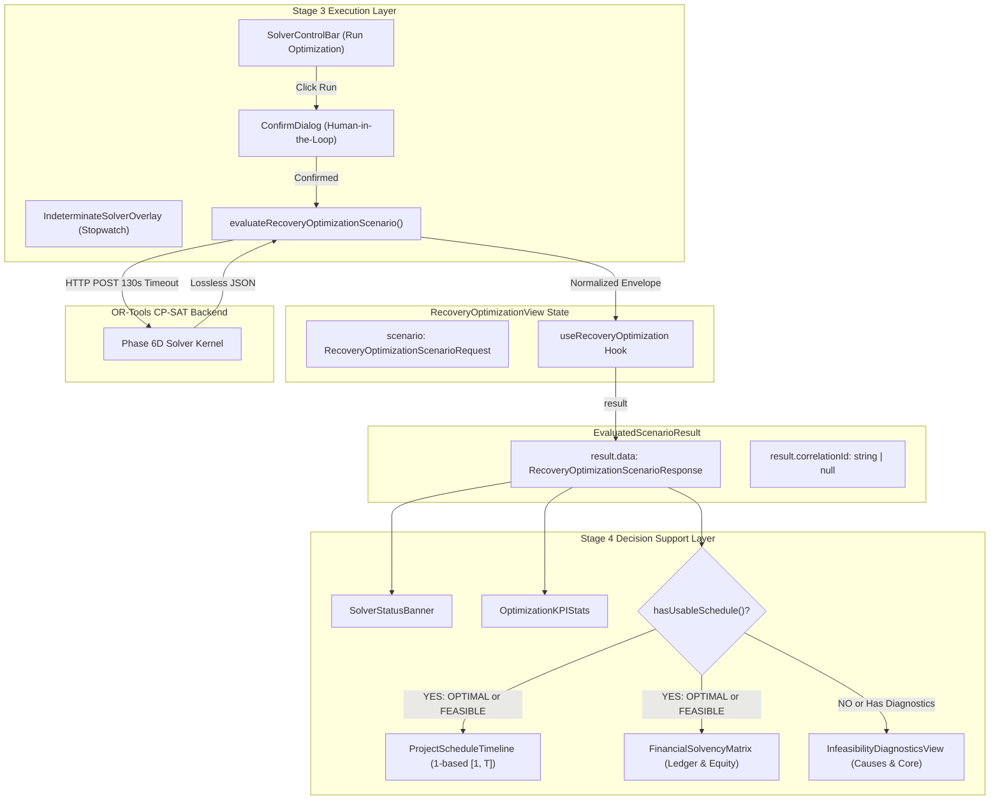

# DIRS — MILESTONE 4, GATE 2, STAGE 4
## READ-ONLY PREFLIGHT & IMPLEMENTATION SCOPE DEFINITION
### Results Visualization & Decision Support Dashboards

**Project:** Disaster Intelligence and Response System (DIRS)  
**Phase:** 6D-B — Mathematical Recovery Portfolio Optimization  
**Milestone:** 4 — Frontend UI Integration & Decision Support  
**Gate:** Gate 2 — Optimization User Interface & Workflow  
**Stage:** Stage 4 — Results Visualization & Decision Support  
**Preflight Mode:** STRICT READ-ONLY INSPECTION & SCOPE DEFINITION  
**Implementation Authorization Status:** NOT AUTHORIZED (Preflight Only)  
**Date:** 2026-11-17  
**Target File:** `DIRS_MILESTONE_4_GATE2_STAGE4_PREFLIGHT.md`

---

## 1. EXECUTIVE SUMMARY

The Disaster Intelligence and Response System (DIRS) Milestone 4 Gate 2 has progressed through three successfully completed and accepted stages:
- **Gate 0:** System Architecture & Requirements (Accepted with conditions).
- **Gate 1:** Backend Schema, Lossless JSON Parser & Contract Test Suite (Accepted with conditions; all 8 baseline files immutable).
- **Gate 2 Stage 1:** Role-Based Navigation & Strict Least Privilege Routing (Accepted; `ADMIN` restricted to `/admin/recovery-optimization`; `/admin` and `/admin/simulation` reserved for `GOVT`).
- **Gate 2 Stage 2:** Scenario Configuration, Periodic Budgets Editor & Candidate Projects Grid (Accepted and closed).
- **Gate 2 Stage 3:** Synchronous Solver API Integration, Monotonic Stopwatch & Indeterminate Solver Overlay (Accepted and closed; verified by final forensic audit `DA560BCA35D1A6446CEB7E7EF7DD64B5DC7A13B9F48AFBB6903DC186C92E896C`).

Stage 4 represents the final user-facing delivery of Milestone 4 Gate 2: **Results Visualization and Decision Support Dashboards**. Its objective is to consume the validated, lossless API response payload returned by the accepted synchronous backend solver and render an intuitive, mathematically rigorous, and auditable visualization suite for authorized `GOVT` and `ADMIN` decision-makers.

This document establishes the preflight architectural inspection, data contract audit, numerical safety invariants, component hierarchy, test strategy, and implementation roadmap. **No source code implementation, package installation, manifest mutation, or database interaction has been performed during this preflight.**

---

## 2. CURRENT REPOSITORY & DEPENDENCY INVENTORY

An exhaustive audit of the frontend repository configuration, package manifests, and dependency trees was conducted:

### 2.1 Runtime & Environment Baseline
- **Node.js Environment:** Node v20 / v22 (conforms to RFC 8259 lossless numeric transport).
- **Build System:** Vite v5.1.6 (`@vitejs/plugin-react` v4.2.1).
- **TypeScript Compiler:** TypeScript v5.2.2 with `strict: true`, `noImplicitAny: true`, and `target: ES2020`.
- **Styling Framework:** Tailwind CSS v3.4.1, PostCSS v8.4.38, Autoprefixer v10.4.19.

### 2.2 Installed Application Dependencies (`frontend/package.json`)
| Dependency | Installed Version | Permitted Stage 4 Usage |
| :--- | :--- | :--- |
| `react` / `react-dom` | `^18.2.0` | Core component lifecycle, hooks, and reconciliation. |
| `@tanstack/react-query` | `^5.28.9` | Mutation state consumption via `useRecoveryOptimization`. |
| `axios` | `^1.6.8` | HTTP client (frozen in Gate 1 API client layer). |
| `lucide-react` | `^0.359.0` | UI iconography across status badges, timeline bars, and diagnostic panels. |
| `clsx` / `tailwind-merge` | `^2.1.0` / `^2.2.2` | Dynamic styling and deterministic class conflict resolution. |
| `recharts` | `^2.12.3` | SVG chart primitives (available if needed; however, CSS Grid/Flex is preferred for exact-boundary discrete timeline rendering). |
| `react-router-dom` | `^6.22.3` | Application routing (frozen in Stage 1). |
| `leaflet` / `react-leaflet`| `^1.9.4` / `^4.2.1` | Geospatial mapping (retained for incident views; not required for Stage 4). |

### 2.3 Installed Test & Dev Dependencies
| Dependency | Installed Version | Role in Stage 4 |
| :--- | :--- | :--- |
| `@playwright/test` | `^1.63.0` | Test runner executing contract and UI component logic specs via `playwright.contract.config.ts`. |
| `@types/react` / `@types/react-dom` | `^18.2.66` / `^18.2.22` | Strict compile-time typing. |

> [!IMPORTANT]
> **Zero New Dependencies:** Stage 4 requires **zero additional npm packages**. No graphing, table, or utility libraries will be installed. The existing package manifest (`frontend/package.json`) and lockfile (`frontend/package-lock.json`) will remain strictly untouched.

---

## 3. ACTUAL RESPONSE DTO FIELD INVENTORY

The Stage 4 visualization layer interacts exclusively with the typed API response contract defined in [`frontend/src/types/recoveryOptimization.ts`](file:///C:/Users/shubh/Downloads/DIRS/frontend/src/types/recoveryOptimization.ts) (mirrored from backend Pydantic schema [`backend/app/schemas/recovery_optimization.py`](file:///C:/Users/shubh/Downloads/DIRS/backend/app/schemas/recovery_optimization.py)).

### Top-Level Contract: `RecoveryOptimizationScenarioResponse`
| Field Name | TypeScript Type | Category & Precision Policy | Description |
| :--- | :--- | :--- | :--- |
| `scenario_name` | `string` | Text | Human-readable scenario identifier. |
| `solver_status` | `SolverOutcomeStatus` | Enum Union | Outcome classification (`OPTIMAL`, `FEASIBLE`, `INFEASIBLE`, `UNKNOWN`, `MODEL_INVALID`, `POST_SOLVE_RECONCILIATION_FAILED`). |
| `is_optimal` | `boolean` | Boolean | True if and only if global mathematical optimality was proven. |
| `exact_objective_value` | `string \| null` | Category 1 (Exact 64-bit int string) | Exact integer objective value. **Must remain string; never parsed to float.** |
| `exact_best_bound` | `string \| null` | Category 1 (Exact 64-bit int string) | Exact mathematical dual bound. |
| `conservative_best_bound`| `string \| null` | Category 1 (Exact 64-bit int string) | Conservative ceiling bound. |
| `objective_value` | `number \| null` | Category 4 (Approximate float) | Floating-point objective for display. |
| `best_bound` | `number \| null` | Category 4 (Approximate float) | Dual bound float. |
| `optimality_gap` | `number \| null` | Category 4 (Approximate float) | Relative optimality gap in $[0.0, 1.0]$ ($0.0$ for `OPTIMAL`). |
| `solve_time_seconds` | `number` | Category 4 (Approximate float) | Kernel solve duration in seconds. |
| `selected_project_count` | `number` | Category 2 (Safe bounded integer) | Count of funded/scheduled projects in $[0, 500]$. |
| `total_cost_ccu` | `string` | Category 1 (Exact 64-bit int string) | Total portfolio reconstruction cost in CCU. |
| `total_cost_inr` | `string` | Category 3 (Exact Decimal string) | Total portfolio cost in INR (e.g., `"5000000.00"`). |
| `scheduled_projects` | `ScheduledProjectResultDTO[]` | Array of objects | Detailed scheduling outcomes for all candidate projects. |
| `periodic_solvency` | `PeriodSolvencyResultDTO[]` | Array of objects | Period-by-period solvency and liquidity breakdown. |
| `district_equity_allocation_ccu` | `Record<string, string>` | Category 1 dictionary | District ID $\to$ exact CCU expenditure string. |
| `district_equity_allocation_inr` | `Record<string, string>` | Category 3 dictionary | District ID $\to$ exact INR decimal string. |
| `input_fingerprint_sha256` | `string` | Hex string (64 chars) | Cryptographic hash of input parameters. |
| `ortools_version` | `string` | Text | Solver engine version string (e.g., `"9.8.3296"`). |
| `solver_parameters` | `Record<string, any>` | Generic dictionary | Parameter echo (`seed`, `num_workers`, `max_time_in_seconds`). |
| `infeasibility_diagnostics` | `InfeasibilityDiagnosticReportDTO \| null` | Structured report | Root-cause analysis report for infeasible or conflicting runs. |

### Nested Contract: `ScheduledProjectResultDTO`
| Field Name | TypeScript Type | Category & Precision Policy | Description |
| :--- | :--- | :--- | :--- |
| `project_id` | `string` | Identifier | Unique project identifier (e.g., `"P-001"`). |
| `project_code` | `string` | Identifier | Human-readable code (e.g., `"ROAD-REPAIR-01"`). |
| `district_id` | `string` | Identifier | District code. |
| `is_selected` | `boolean` | Boolean | Selection outcome. `true` if scheduled; `false` if rejected. |
| `scheduled_start_period` | `number \| null` | Category 2 (1-based int in $[1, T]$) | Discrete start period ($1 \dots T$). `null` if unselected. |
| `scheduled_completion_period` | `number \| null` | Category 2 (1-based int in $[1, T]$) | Discrete completion period. `null` if unselected. |
| `assigned_funding_source`| `string \| null` | Identifier | Assigned fund ID under Model B assignment. |
| `cost_ccu` | `string` | Category 1 string | Project cost in CCU. |
| `cost_inr` | `string` | Category 3 string | Project cost in INR. |
| `periodic_expenditures_ccu` | `Record<string, string>` | Category 1 dictionary | Period index string $\to$ CCU expenditure string. |
| `periodic_expenditures_inr` | `Record<string, string>` | Category 3 dictionary | Period index string $\to$ INR decimal string. |
| `mcpi_score` | `number` | Category 4 float | Priority score. |
| `raw_mcpi_score` | `number` | Category 4 float in $[0.0, 1.0]$ | Input priority index. |
| `quantized_mcpi_coefficient` | `number` | Category 2 safe integer | Integer coefficient in objective function. |
| `is_tier1_mandatory` | `boolean` | Boolean | Life-safety critical flag. |

### Nested Contract: `PeriodSolvencyResultDTO`
| Field Name | TypeScript Type | Category & Precision Policy | Description |
| :--- | :--- | :--- | :--- |
| `period` | `number` | 1-based int in $[1, T]$ | Discrete calendar period index ($1 \dots T$). |
| `revenue_receipt_ccu` | `string` | Category 1 string | Periodic revenue/budget inflow in CCU. |
| `expenditure_ccu` | `string` | Category 1 string | Total disbursement in period in CCU. |
| `cash_balance_ccu` | `string` | Category 1 string | Cumulative cash reserve balance in CCU. |
| `cash_balance_inr` | `string` | Category 3 Decimal string | Cumulative cash reserve balance in INR. |
| `is_solvent` | `boolean` | Boolean | True if $\text{cash\_balance} \ge 0$; false if deficit. |

### Nested Contract: `InfeasibilityDiagnosticReportDTO`
| Field Name | TypeScript Type | Description |
| :--- | :--- | :--- |
| `has_proven_infeasibility` | `boolean` | True if mathematical infeasibility was proven. |
| `proven_causes` | `InfeasibilityFindingDTO[]` | Definitive mathematical contradictions (e.g., release > deadline). |
| `necessary_condition_violations` | `InfeasibilityFindingDTO[]` | High-level feasibility bound violations (e.g., mandatory cost > total budget). |
| `solver_hypotheses` | `InfeasibilityFindingDTO[]` | Inferred conflict sets from IIS / core relaxation. |
| `warnings` | `InfeasibilityFindingDTO[]` | Bounded warnings and near-constraint notices. |
| `is_assumption_core_minimal` | `boolean` | Irreducible Inconsistent Subsystem (IIS) minimality guarantee. |
| `is_assumption_core_sufficient` | `boolean` | IIS sufficiency guarantee. |

---

## 4. SOLVER STATUS & DIAGNOSTIC FIELD MAPPING

The solver emits one of six deterministic outcome statuses. The frontend UI must strictly adhere to backend invariant semantics and never misrepresent non-solution states as feasible schedules:

| Solver Outcome Status | Usable Schedule Exists? | Objective / Bound Fields | Diagnostic Findings Expected? | UI Presentation Directive |
| :--- | :--- | :--- | :--- | :--- |
| **`OPTIMAL`** | **YES** | Non-null, exact match, gap $= 0.0$ | None (`null` or empty) | Emerald badge: Global optimum reached. Full timeline, solvency matrix, and KPI cards rendered. |
| **`FEASIBLE`** | **YES** | Non-null, gap $\ge 0.0$ | Optional warnings | Amber badge: Feasible solution within timeout. Usable schedule rendered with optimality gap highlighted. |
| **`INFEASIBLE`** | **NO** | Strictly `null` | Must contain `proven_causes` or `necessary_condition_violations` | Red badge: Proven infeasible. Suppress timeline/solvency matrix; render `InfeasibilityDiagnosticsView` prominently. |
| **`UNKNOWN`** | **NO** | Strictly `null` | Optional timeout or kernel warnings | Slate/Amber badge: Solver timed out before establishing feasibility. Provide retry advice and horizon relaxation tips. |
| **`MODEL_INVALID`** | **NO** | Strictly `null` | Parameter error diagnostics | Red badge: Model construction failure. Highlight invalid input parameters. |
| **`POST_SOLVE_RECONCILIATION_FAILED`** | **NO** | May retain engine values; rejected by safety check | Contains reconciliation failure diagnostics | Critical Red badge: Backend post-solve verification failed. Schedule explicitly rejected; warnings surfaced. |

### Usability Helper Predicate
```typescript
export const hasUsableSchedule = (status: SolverOutcomeStatus): boolean => {
  return status === 'OPTIMAL' || status === 'FEASIBLE';
};
```

---

## 5. PROPOSED COMPONENT ARCHITECTURE

The Stage 4 visualization layer will be structured as modular, encapsulated components placed directly within `frontend/src/components/recovery/`. They will dock cleanly into `RecoveryOptimizationView.tsx` when `result?.data` is available:

```
frontend/src/
├── components/
│   ├── design-system/                  [EXISTING - Read Only]
│   │   ├── KPIStat.tsx
│   │   ├── StatusBadge.tsx
│   │   ├── OperationalCard.tsx
│   │   └── ConfirmDialog.tsx
│   └── recovery/
│       ├── ScenarioParametersCard.tsx    [STAGE 2 - FROZEN]
│       ├── PeriodicBudgetsEditor.tsx     [STAGE 2 - FROZEN]
│       ├── CandidateProjectsGrid.tsx     [STAGE 2 - FROZEN]
│       ├── SolverControlBar.tsx          [STAGE 3 - FROZEN]
│       ├── IndeterminateSolverOverlay.tsx[STAGE 3 - FROZEN]
│       │
│       ├── SolverStatusBanner.tsx        [STAGE 4 - PROPOSED NEW]
│       ├── OptimizationKPIStats.tsx      [STAGE 4 - PROPOSED NEW]
│       ├── ProjectScheduleTimeline.tsx   [STAGE 4 - PROPOSED NEW]
│       ├── FinancialSolvencyMatrix.tsx   [STAGE 4 - PROPOSED NEW]
│       └── InfeasibilityDiagnosticsView.tsx [STAGE 4 - PROPOSED NEW]
└── pages/
    └── admin/
        └── RecoveryOptimizationView.tsx  [STAGE 4 - PROPOSED MODIFICATION]
```

### Component Breakdown & Responsibilities

#### 1. `SolverStatusBanner.tsx`
- **Props:** `{ result: RecoveryOptimizationScenarioResponse; correlationId: string | null }`
- **Visual Design:** Full-width operational card with status-specific border accent (Emerald for `OPTIMAL`, Amber for `FEASIBLE`, Red for `INFEASIBLE`/`MODEL_INVALID`/`POST_SOLVE_RECONCILIATION_FAILED`, Slate for `UNKNOWN`).
- **Elements:**
  - Status Badge with explicit label.
  - Usability declaration: `"USABLE SCHEDULE AVAILABLE"` vs `"NO USABLE SCHEDULE GENERATED"`.
  - Kernel execution time (`solve_time_seconds.toFixed(2)`s).
  - OR-Tools version echo and input fingerprint SHA-256.
  - Correlation ID tag when present.

#### 2. `OptimizationKPIStats.tsx`
- **Props:** `{ result: RecoveryOptimizationScenarioResponse; currency: CurrencyUnit }`
- **Visual Design:** 4-column responsive grid utilizing existing `KPIStat` design-system components.
- **KPI Metrics Displayed:**
  1. **Exact Objective Value:** Rendered verbatim from `result.exact_objective_value ?? 'N/A'` in `font-mono`.
  2. **Selected Projects:** Count of funded projects formatted as `${result.selected_project_count} / ${result.scheduled_projects.length}` candidates.
  3. **Total Portfolio Cost:** Formatted exact string from `result.total_cost_inr` with currency symbol (e.g., `₹5,000,000.00`).
  4. **Optimality Gap / Bound:** Formatted as `${(result.optimality_gap * 100).toFixed(2)}%` for `FEASIBLE`, `"0.00% (PROVEN)"` for `OPTIMAL`, or `'N/A'`.

#### 3. `ProjectScheduleTimeline.tsx`
- **Props:** `{ horizon: number; scheduledProjects: ScheduledProjectResultDTO[]; currency: CurrencyUnit }`
- **Visual Design:** Discrete Gantt-style periodic timeline rendered with CSS Grid.
- **Period Columns:** Strictly 1-based header columns labeled `P1, P2, ... PT`.
- **Scheduled Section:**
  - Projects where `is_selected === true`.
  - Horizontal bar spanning grid columns `[scheduled_start_period, scheduled_completion_period + 1]`.
  - Color-coded: Indigo/Cyan for standard recovery projects; Amber/Red with Shield icon for `is_tier1_mandatory`.
  - Project code, district badge, duration, and cost badge.
- **Unscheduled Section:**
  - Collapsible drawer listing rejected candidates (`is_selected === false`) with release/deadline bounds and raw MCPI score.
  - Explicitly states: *"Not selected under budget or precedence constraints."*

#### 4. `FinancialSolvencyMatrix.tsx`
- **Props:** `{ horizon: number; periodicSolvency: PeriodSolvencyResultDTO[]; districtAllocations: Record<string, string>; currency: CurrencyUnit }`
- **Visual Design:** Tabular solvency audit ledger and district equity distribution breakdown.
- **Solvency Table Columns:**
  - Period index $p \in [1, T]$.
  - Revenue Receipt (`revenue_receipt_ccu` or periodic budget).
  - Periodic Expenditure (`expenditure_ccu`).
  - Cash Balance (`cash_balance_inr` verbatim).
  - Solvency Status: Emerald `"SOLVENT"` badge or Red `"DEFICIT"` badge (`is_solvent`).
- **District Equity Ledger:**
  - Table mapping District ID $\to$ allocated expenditure string (`district_equity_allocation_inr`).
  - Verifies geographical disbursement fairness without floating-point conversion.

#### 5. `InfeasibilityDiagnosticsView.tsx`
- **Props:** `{ diagnostics: InfeasibilityDiagnosticReportDTO | null; solverStatus: SolverOutcomeStatus }`
- **Visual Design:** High-contrast diagnostic alert card styled for crisis decision-makers.
- **Sections:**
  - **Proven Causes:** Red card with mathematical conditions (e.g., `release_period (3) > max_safety_start_period (1)`), affected projects, and conflicting period tags.
  - **Necessary Violations:** Amber card detailing global budget or capacity deficits.
  - **Solver Hypotheses:** Explanatory conflict sets derived from solver relaxation.
  - **Minimality & Sufficiency Badges:** Displays whether the assumption core is minimal and sufficient for infeasibility analysis.

---

## 6. PROPOSED EXACT FILE CREATION / MODIFICATION LIST

### 6.1 Files Proposed for Creation (6 Files)
1. `frontend/src/components/recovery/SolverStatusBanner.tsx` — Status, usability indicator, and solver metadata banner.
2. `frontend/src/components/recovery/OptimizationKPIStats.tsx` — 4-card metric overview preserving exact strings.
3. `frontend/src/components/recovery/ProjectScheduleTimeline.tsx` — Discrete 1-based periodic Gantt timeline.
4. `frontend/src/components/recovery/FinancialSolvencyMatrix.tsx` — Solvency audit ledger and district allocations.
5. `frontend/src/components/recovery/InfeasibilityDiagnosticsView.tsx` — Structured root-cause conflict analysis.
6. `frontend/tests/contract/stage4Visualizations.spec.ts` — Playwright contract and component logic test suite.

### 6.2 Files Proposed for Modification (1 File)
1. `frontend/src/pages/admin/RecoveryOptimizationView.tsx` — Docking Stage 4 visualization components below `SolverControlBar` when `result?.data` is present.

### 6.3 Strict Frozen File Boundaries (ZERO MODIFICATIONS PERMITTED)
- `frontend/src/components/layout/Sidebar.tsx` (FROZEN — Stage 1)
- `frontend/src/App.tsx` (FROZEN — Stage 1)
- `frontend/src/context/AuthContext.tsx` (FROZEN — Gate 1)
- `frontend/src/types/recoveryOptimization.ts` (FROZEN — Gate 1)
- `frontend/src/api/recoveryOptimization.ts` (FROZEN — Gate 1)
- `frontend/src/fixtures/recoveryOptimizationFixtures.ts` (FROZEN — Gate 1)
- `frontend/src/hooks/useRecoveryOptimization.ts` (FROZEN — Stage 3)
- `frontend/src/components/recovery/SolverControlBar.tsx` (FROZEN — Stage 3)
- `frontend/src/components/recovery/IndeterminateSolverOverlay.tsx` (FROZEN — Stage 3)
- `frontend/src/components/recovery/ScenarioParametersCard.tsx` (FROZEN — Stage 2)
- `frontend/src/components/recovery/PeriodicBudgetsEditor.tsx` (FROZEN — Stage 2)
- `frontend/src/components/recovery/CandidateProjectsGrid.tsx` (FROZEN — Stage 2)

---

## 7. DATA-FLOW DIAGRAM



---

## 8. NUMERICAL PRECISION & MATHEMATICAL SAFETY ANALYSIS

Stage 4 must uphold the strict numerical governance established in Gate 1:

1. **Category 1 Exact 64-bit Integers (`exact_objective_value`, `total_cost_ccu`, `cost_ccu`):**
   - In standard JavaScript, integers $> 2^{53} - 1$ ($9,007,199,254,740,991$) suffer IEEE-754 mantissa truncation.
   - Stage 4 components must **never** execute `Number(exact_objective_value)` or `parseInt(exact_objective_value)`.
   - Category 1 fields must be rendered verbatim as string literals wrapped in `<span className="font-mono">{val}</span>`.

2. **Category 3 Exact Monetary Decimals (`total_cost_inr`, `cost_inr`, `cash_balance_inr`):**
   - Monetary values represent sovereign disaster relief funds (e.g., `"5000000.00"`).
   - In components, comma-formatting must be implemented via string manipulation / regex (e.g., splitting integer and decimal parts at `.` and applying Indian numbering format `en-IN` to the integer string), **never** via `parseFloat(cost).toLocaleString()`.
   - Never perform floating-point arithmetic on cash balances. Display the exact balance returned by backend `PeriodSolvencyResultDTO.cash_balance_inr`.

3. **1-Based Discrete Period Convention ($[1, T]$):**
   - Planning horizon periods are strictly 1-based: $p \in \{1, 2, \dots, T\}$.
   - Array index mapping must explicitly account for offset: `period = index + 1`.
   - In the Gantt timeline, grid column start is `scheduled_start_period`, and grid column end is `scheduled_completion_period + 1` (since CSS grid lines are 1-based and completion period is inclusive).
   - Project duration calculation: $\text{Duration} = p_{\text{completion}} - p_{\text{start}} + 1$.

4. **Absence Safety Invariant:**
   - Missing or null response fields (e.g., `exact_objective_value: null` when `INFEASIBLE`) must **never** be coerced to `0` or `""`.
   - The UI must render explicit sentinel indicators (`"N/A"`, `"—"`, or `"None"`) so users understand data was intentionally absent from the solver kernel.

---

## 9. AUTHORIZATION & ROLE-ACCESS ANALYSIS

### Strict Least Privilege Policy
Stage 1 established the formal security baseline:
- **`ADMIN`:** Permitted access **exclusively** to `/admin/recovery-optimization`.
  - Blocked with immediate redirect from `/admin` (System Overview) and `/admin/simulation` (Disaster Simulation).
- **`GOVT`:** Full administrative access to `/admin`, `/admin/simulation`, and `/admin/recovery-optimization`.
- **`CITIZEN` / `VOLUNTEER` / `NGO`:** Barred from all `/admin/*` routes.

### Stage 4 Impact
- Stage 4 components are rendered entirely inside `RecoveryOptimizationView.tsx`.
- Because `RecoveryOptimizationView` is protected at the route level in `App.tsx` by `RoleProtectedRoute(['GOVT', 'ADMIN'])`, Stage 4 components automatically inherit the established authorization boundary.
- **Zero modification to `App.tsx`, `Sidebar.tsx`, or `AuthContext.tsx` is required or authorized.**

---

## 10. PROPOSED TEST PLAN

To verify Stage 4 without introducing external test runners or browser drivers during preflight, the following four-pillar test suite is proposed:

### Pillar 1: Static Type Check (`npx tsc --noEmit`)
- Verifies that all Stage 4 component props, callbacks, and DTO contracts conform strictly to `recoveryOptimization.ts`.
- Guarantees zero TypeScript compilation errors.

### Pillar 2: Contract & Component Logic Test Suite (`playwright.contract.config.ts`)
- Target File: `frontend/tests/contract/stage4Visualizations.spec.ts`
- Tests to execute in Node-mode Playwright runner:
  1. **Status Mapping:** Verifies all 6 `SolverOutcomeStatus` values map to the correct usability flag and badge variant.
  2. **Usability Predicate:** Verifies `hasUsableSchedule` returns `true` only for `OPTIMAL` and `FEASIBLE`.
  3. **Lossless String Preservation:** Verifies that exact objective strings (including values $> 2^{53}-1$) and decimal monetary strings are passed verbatim without numerical alteration.
  4. **Timeline Coordinate Math:** Verifies 1-based grid column indices, inclusive duration calculations, and scheduled vs unscheduled partitioning.
  5. **Solvency Ledger Alignment:** Verifies period indexing from $1 \dots T$, solvency flag assertions, and district equity mappings.
  6. **Infeasibility Diagnostics Categorization:** Verifies grouping of proven causes, necessary violations, solver hypotheses, and warnings.
  7. **Edge Cases:** Verifies graceful handling of empty scheduled projects, single-period horizons, and missing optional diagnostics.

### Pillar 3: Production Build Compilation (`npm run build`)
- Executes `tsc && vite build`.
- Validates CSS bundling, tree-shaking, and Rollup chunk generation with zero errors.

### Pillar 4: Backend Integration Verification (`pytest`)
- Executes `python -m pytest tests/backend/test_phase6d_api_route.py`.
- Re-verifies backend API parity with the DTO fixtures utilized by frontend tests.

---

## 11. HASH VERIFICATION RESULTS FOR FROZEN FILES

All 17 files across Gate 1, Gate 2 Stage 1, Stage 2, and Stage 3 were independently hashed using SHA-256 during this preflight. Every file matches its accepted baseline:

| File Path | Byte Size | SHA-256 Checksum | Governance Status |
| :--- | :--- | :--- | :--- |
| `frontend/src/hooks/useRecoveryOptimization.ts` | 2,894 | `5CBB48DA478BD7D9F0261B882B27252D0E54F5559BDC8AA5E0D23D279961E748` | **FROZEN (Stage 3)** |
| `frontend/src/components/recovery/SolverControlBar.tsx` | 12,533 | `88526F47B2D3FF50A8191167E233865EC9A2E4C0DC7D70A6C121A41BDC8574A8` | **FROZEN (Stage 3)** |
| `frontend/src/components/recovery/IndeterminateSolverOverlay.tsx` | 5,811 | `11FF542BCFC9DC0C358C45AE6180529568977B33D5566E6EED27BD0EFBC6A534` | **FROZEN (Stage 3)** |
| `frontend/src/pages/admin/RecoveryOptimizationView.tsx` | 14,810 | `621AE9A92F79EBE5D4459758AB99E5EC54E741918A59D27B5FC7A65C7326CBB2` | **STAGE 4 DOCKING TARGET** |
| `frontend/src/components/recovery/ScenarioParametersCard.tsx` | 10,470 | `09A2F32145E95A37C6C38445DF6CA3ACEDE217FEE25D99FB48246D57233FFDE8` | **FROZEN (Stage 2)** |
| `frontend/src/components/recovery/PeriodicBudgetsEditor.tsx` | 9,683 | `CE14A27AC3398A3BE3E38131EFAA278B90F35529CB22D3E291C91C6ED8618860` | **FROZEN (Stage 2)** |
| `frontend/src/components/recovery/CandidateProjectsGrid.tsx` | 30,153 | `F8D70713C2A43AFC9F42762F53E86DD951C7E223F7DB45289BE1537E1DA0D2E1` | **FROZEN (Stage 2)** |
| `frontend/src/components/layout/Sidebar.tsx` | 6,171 | `9FFB6387843681D2FBF3C3595E98090ABE2575B54CF7C02657784182F1FA5D4A` | **FROZEN (Stage 1)** |
| `frontend/src/App.tsx` | 3,649 | `B7B54FB30ADB628B2C5DDA89B8C5F8C1A2D29E4E6A5B212F169D2BE4EF44F404` | **FROZEN (Stage 1)** |
| `frontend/src/types/recoveryOptimization.ts` | 11,147 | `A357559AF61BB48E97F3657D6389EAC3EA622369BD5BDC3D04D1E2A0548F77C9` | **FROZEN (Gate 1 Baseline)** |
| `frontend/src/api/recoveryOptimization.ts` | 17,640 | `8CD51571D2319A8A1458695465598CD439C7423AE2E890FAF2E068BA0BBDC404` | **FROZEN (Gate 1 Baseline)** |
| `frontend/src/fixtures/recoveryOptimizationFixtures.ts` | 6,846 | `F7DBC0FC9C250EF4F35FA1167D834FBAC2EDF6D376E9C4C9EA2DB1F46CE28BC7` | **FROZEN (Gate 1 Baseline)** |
| `frontend/src/context/AuthContext.tsx` | 2,252 | `9B08EA97E4A8B37C1B3BD84E8FED19471F864C30634F0CD86ECB2376C90596BE` | **FROZEN (Gate 1 Baseline)** |
| `frontend/playwright.contract.config.ts` | 555 | `0AA3127FBC05E82C74799614CA4A84AA83B69CACEFD54BE09A3BC6401F4A578D` | **FROZEN (Gate 1 Baseline)** |
| `frontend/tests/contract/losslessParser.spec.ts` | 17,971 | `979F498B1D1D04C47BD743CF343A249D582EB2C152B94623391106D8FDE8DEE9` | **FROZEN (Gate 1 Baseline)** |
| `frontend/tests/contract/dtoContracts.spec.ts` | 9,963 | `463E1F6965217D7DBC79FC7DA9B85BEE7C8923921A6FAB1A0D7FD93156397CC4` | **FROZEN (Gate 1 Baseline)** |
| `frontend/tests/contract/apiClient.spec.ts` | 12,646 | `3EF54394709E5FCC583DD1890A57485473679B1C733489E63C12739F47564FBB` | **FROZEN (Gate 1 Baseline)** |

---

## 12. IDENTIFIED RISKS, UNKNOWNS & DEPENDENCIES

| Risk ID | Category | Description | Mitigation Strategy in Stage 4 |
| :--- | :--- | :--- | :--- |
| **RSK-S4-01** | UI Layout | Extended planning horizons (e.g., $T = 60 \dots 120$) can cause horizontal overflow in timeline and solvency grids. | Implement container `overflow-x-auto` with a sticky left column for project identifiers and codes. |
| **RSK-S4-02** | Numerical Safety | Accidental coercion of large integers or currency strings via third-party chart tooltips. | Use custom CSS Grid/Flexbox for the timeline and solvency matrices rather than Recharts bar charts for discrete integer periods. |
| **RSK-S4-03** | Data Invariant | Backend may return `null` for `infeasibility_diagnostics` even when status is `INFEASIBLE`. | UI must display fallback explanation derived from `solver_status` when structured findings are null. |
| **RSK-S4-04** | Candidate Scale | High candidate project counts (up to 500) could cause excessive DOM node generation in timeline. | Implement compact grouped rows with pagination or virtualized scrolling for unscheduled candidates. |
| **RSK-S4-05** | Currency Uniformity | Requests may mix INR and CCU currencies. | Pass currency dynamically from scenario configuration to all visualization child components. |

---

## 13. EXPLICIT EXCLUSIONS

The following capabilities and behaviors are strictly **EXCLUDED** from Stage 4:
1. **Zero Backend API Changes:** No modifications to FastAPI endpoints, OR-Tools solver parameters, or Pydantic DTOs.
2. **Zero Database Modifications:** No writes to `dirs_dev.db`, `demo_dirs.db`, or any SQL schema.
3. **Zero Automated Schedule Application:** The UI provides decision support only. It must never commit schedules to live incident tables or trigger execution pipelines.
4. **Zero State Persistence:** Results remain purely in-memory in React state and clear on reset, scenario switch, or page navigation.
5. **Zero Date Fabrication:** Discrete periods $[1, T]$ must never be translated into arbitrary calendar dates (e.g. "October 14, 2026") because no anchor date exists in the request schema.
6. **Zero Floating-Point Monetary Calculations:** No `sum()` or subtraction operations on monetary strings in JavaScript.

---

## 14. RECOMMENDED IMPLEMENTATION SEQUENCE

Upon receiving explicit Project Owner implementation authorization, Stage 4 should proceed in the following controlled sequence:

1. **Phase 1 — Core Status & KPI Components:**
   - Author `frontend/src/components/recovery/SolverStatusBanner.tsx`.
   - Author `frontend/src/components/recovery/OptimizationKPIStats.tsx`.
2. **Phase 2 — Project Schedule Timeline:**
   - Author `frontend/src/components/recovery/ProjectScheduleTimeline.tsx` with 1-based CSS Grid, scheduled/unscheduled partitions, and Tier-1 highlighting.
3. **Phase 3 — Financial Solvency & Diagnostics:**
   - Author `frontend/src/components/recovery/FinancialSolvencyMatrix.tsx`.
   - Author `frontend/src/components/recovery/InfeasibilityDiagnosticsView.tsx`.
4. **Phase 4 — View Docking Integration:**
   - Update `frontend/src/pages/admin/RecoveryOptimizationView.tsx` to conditionally render Stage 4 components when evaluation results exist.
5. **Phase 5 — Test Suite & Contract Verification:**
   - Author `frontend/tests/contract/stage4Visualizations.spec.ts`.
   - Execute `npx tsc --noEmit` and `npx playwright test --config=playwright.contract.config.ts`.
   - Execute `npm run build` to confirm production bundle integrity.
6. **Phase 6 — Completion Documentation:**
   - Produce `DIRS_MILESTONE_4_GATE2_STAGE4_COMPLETION_REPORT.md` and await independent forensic audit.

---

## 15. FINAL PREFLIGHT RECOMMENDATION

**`READY FOR IMPLEMENTATION WITH CONDITIONS`**

### Binding Preconditions:
1. **Implementation Authorization Required:** Implementation must not commence until explicit, separate Project Owner authorization is provided.
2. **Strict File Scope:** Implementation must be strictly confined to creating the 5 recovery components, 1 test file, and modifying `RecoveryOptimizationView.tsx`. All other files remain frozen.
3. **Preservation of Numerical Invariants:** Exact Category 1 64-bit integer strings and Category 3 Decimal monetary strings must remain unparsed and lossless.
4. **Zero Dependency Installation:** No modifications to `package.json` or `package-lock.json`.

---
*Report prepared by Antigravity Agentic Assistant on behalf of the DIRS Project Governance Team.*
