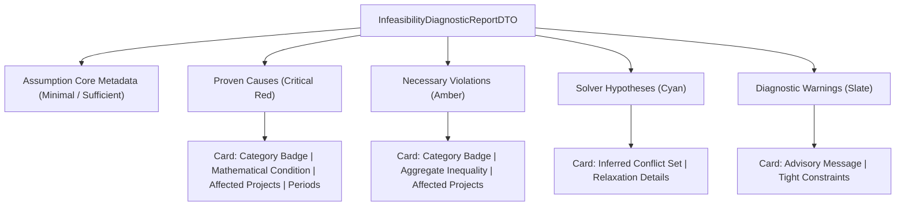

# DIRS — MILESTONE 4, GATE 2, STAGE 4
## REVISED IMPLEMENTATION SPECIFICATION
### Results Visualization & Decision Support Dashboards

**Project:** Disaster Intelligence and Response System (DIRS)  
**Phase:** 6D-B — Mathematical Recovery Portfolio Optimization  
**Milestone:** 4 — Frontend UI Integration & Decision Support  
**Gate:** Gate 2 — Optimization User Interface & Workflow  
**Stage:** Stage 4 — Results Visualization & Decision Support  
**Document Status:** REVISED IMPLEMENTATION SPECIFICATION  
**Authorization Mode:** READ-ONLY INSPECTION & SPECIFICATION DEFINITION  
**Implementation Authorization Status:** NOT AUTHORIZED (Awaiting Project Owner Authorization)  
**Date:** 2026-11-17  
**Target File:** `DIRS_MILESTONE_4_GATE2_STAGE4_REVISED_IMPLEMENTATION_SPECIFICATION.md`

---

## 1. EXECUTIVE SUMMARY

Following review of the initial Stage 4 Preflight Report (`DIRS_MILESTONE_4_GATE2_STAGE4_PREFLIGHT.md`), the Project Owner identified five critical conditions requiring pre-implementation resolution:
1. **Financial Unit Consistency:** Reconcile CCU vs. INR representations, prevent cross-unit arithmetic, and eliminate derived fields.
2. **Unscheduled Project Explanations:** Restrict unselected candidate UI strictly to backend-provided fields and eliminate fabricated rejection reasons or inferred constraint bounds.
3. **Complete Infeasibility Finding Schema:** Produce an exhaustive field-by-field mapping of `InfeasibilityDiagnosticReportDTO` and `InfeasibilityFindingDTO`, explicitly flagging unprovided fields.
4. **UNKNOWN Status and Unsupported Recommendations:** Ground non-solution status handling strictly in solver semantics, eliminating unsupported heuristics (such as automated horizon relaxation) and ensuring rejected schedules under post-solve reconciliation failure are never displayed as usable.
5. **Frozen Hash & Docking Target Baseline:** Independently verify the bit-for-bit SHA-256 hash of `RecoveryOptimizationView.tsx` (`621AE9A92F79EBE5D4459758AB99E5EC54E741918A59D27B5FC7A65C7326CBB2`) and all 16 other frozen baseline files.

This document formally resolves each condition, presents the corrected component architecture, specifies the exact seven-file implementation scope, and establishes the formal acceptance criteria for Stage 4.

**No application source code or tests have been created or modified under this specification. Stage 4 remains strictly read-only awaiting Project Owner authorization.**

---

## 2. FIVE CONDITION RESOLUTIONS

### Condition 1: Financial Unit Consistency
- **Backend Model Audit:** Inspected `backend/app/schemas/recovery_optimization.py` (`PeriodSolvencyResultDTO`) and `app/recovery/optimization/schemas.py`.
- **Field Relationships Established:**
  - `revenue_receipt_ccu`: Exact 64-bit integer inflow in internal solver currency units ($CCU$).
  - `expenditure_ccu`: Exact 64-bit integer project disbursements in $CCU$.
  - `cash_balance_ccu`: Exact 64-bit integer cumulative liquidity reserve in $CCU$:
    $$\text{cash\_balance\_ccu}_t = \lfloor \text{cash\_balance\_ccu}_{t-1} \times \text{fiscal\_retention\_rate} \rfloor + \text{revenue\_receipt\_ccu}_t - \text{expenditure\_ccu}_t$$
  - `cash_balance_inr`: Exact Decimal string representation of cumulative cash balance denominated in Indian Rupees ($INR$).
  - `is_solvent`: Authoritative boolean evaluated by the backend solver: $\text{cash\_balance\_ccu}_t \ge 0$.
- **Resolution Rules Applied to UI:**
  1. **Dual-Ledger Separation:** `revenue_receipt_ccu`, `expenditure_ccu`, and `cash_balance_ccu` form an internal accounting unit and are presented together in a dedicated **CCU Solvency Ledger**.
  2. **INR Presentation:** `cash_balance_inr` is presented in a separate **INR Liquidity Ledger** (or dedicated column with unambiguous $INR$ currency labeling).
  3. **Zero Cross-Currency Arithmetic:** The frontend will **never** compare, subtract, add, or convert between CCU and INR values.
  4. **Zero Derived Fields:** The DTO does **not** provide `revenue_receipt_inr` or `expenditure_inr`. The UI will **not** derive, estimate, or invent INR periodic revenues or disbursements.
  5. **Authoritative Solvency Indicator:** The backend-provided `is_solvent` boolean is the sole determinant of solvent vs. deficit periods. The UI will **not** independently recalculate solvency.
  6. **District Equity Allocations:** `district_equity_allocation_ccu` and `district_equity_allocation_inr` are presented as separate ledgers/columns with explicit unit badges.

---

### Condition 2: Unscheduled Project Explanations
- **Backend DTO Audit:** Inspected `ScheduledProjectResultDTO` across backend schemas and frontend TypeScript types.
- **Field Inventory for Unselected Projects:**
  When `is_selected === false`, the DTO provides:
  - `project_id: string`
  - `project_code: string`
  - `district_id: string`
  - `is_selected: false`
  - `scheduled_start_period: null`
  - `scheduled_completion_period: null`
  - `assigned_funding_source: null`
  - `cost_ccu: string`
  - `cost_inr: string`
  - `periodic_expenditures_ccu: {}` (empty dictionary)
  - `periodic_expenditures_inr: {}` (empty dictionary)
  - `mcpi_score: number`
  - `raw_mcpi_score: number`
  - `quantized_mcpi_coefficient: number`
  - `is_tier1_mandatory: boolean`
- **Critical Finding:** The DTO contains **zero** rejection reasons, exclusion causes, or constraint attribution fields. Furthermore, `release_period` and `deadline_period` belong to the request DTO (`ProjectOptimizationCandidateDTO`), **not** to `ScheduledProjectResultDTO`.
- **Resolution Rules Applied to UI:**
  1. The unselected project table will display strictly: **"Not selected"**.
  2. The UI will **never** attribute rejection to "budget constraints", "precedence edges", "capacity limits", or "deadline violations" without explicit backend finding evidence.
  3. The UI will **not** fabricate release or deadline dates in the results view.
  4. Permitted display fields in the unselected drawer are limited to: `project_id`, `project_code`, `district_id`, `cost_inr`, `cost_ccu`, `raw_mcpi_score`, `is_tier1_mandatory`, and status `"Not selected"`.

---

### Condition 3: Complete Infeasibility Finding Schema
- **Backend Model Audit:** Inspected `InfeasibilityDiagnosticReportDTO` and `InfeasibilityFindingDTO` in both Pydantic schemas and `app/recovery/optimization/schemas.py`.
- **Field-by-Field Schema Mapping:**

| Schema Element | Field Name | Data Type | Field Status in DTO | Semantics & UI Handling |
| :--- | :--- | :--- | :--- | :--- |
| Finding Identifier | `finding_id` | `string` | **NOT PROVIDED BY DTO** | No backend ID exists. The UI must construct a composite React key (e.g., `${category}-${classification}-${idx}`). |
| Category | `category` | `string` | **PRESENT** | Functional domain of conflict (`BUDGET`, `SOLVENCY`, `RESOURCE`, `PRECEDENCE`, `HORIZON`, `FUNDING`, `MANDATORY_PROJECT_SAFETY_WINDOW`). Rendered as uppercase badge. |
| Classification | `classification` | `string` | **PRESENT** | Evidentiary grade: `PROVEN_CAUSE` (or `PROVEN_INFEASIBILITY`), `NECESSARY_CONDITION_VIOLATION`, `SOLVER_HYPOTHESIS` (or `SOLVER_ASSISTED_HYPOTHESIS`), `WARNING`. |
| Message | `message` | `string` | **PRESENT** | Authoritative human-readable conflict statement provided by backend presolve or IIS engine. |
| Constraint Reference | `constraint_ref` | `string` | **NOT PROVIDED BY DTO** | No structured constraint ID is supplied. |
| Mathematical Condition | `mathematical_condition`| `string` | **PRESENT** | Formal inequality or equality defining the conflict (e.g., `release_period (3) > max_safety_start_period (1)`). Rendered verbatim in `font-mono`. |
| Affected Projects | `affected_projects` | `List[str]` | **PRESENT** | Array of project IDs involved in the conflict set. Rendered as tags. |
| Conflicting Periods | `conflicting_periods` | `List[int]` | **PRESENT** | 1-based planning periods ($[1, T]$) where violation manifests. |
| Severity | `severity` | `string` | **NOT PROVIDED BY DTO** | Implied strictly by array membership: `proven_causes` (Critical), `necessary_condition_violations` (High), `solver_hypotheses` (Medium), `warnings` (Low). |
| Evidence / Provenance | `provenance` / `source` | `string` | **NOT PROVIDED BY DTO** | No log/engine trace metadata provided in finding. |
| Details | `details` | `Dict[str, Any]` | **PRESENT** | Raw key-value metadata. Rendered in a structured expandable details block. |
| Report Metadata | `has_proven_infeasibility` | `boolean` | **PRESENT** | Top-level indicator that feasibility has been mathematically refuted. |
| Report Metadata | `is_assumption_core_minimal` | `boolean` | **PRESENT** | Irreducible Inconsistent Subsystem (IIS) minimality guarantee. |
| Report Metadata | `is_assumption_core_sufficient` | `boolean` | **PRESENT** | IIS sufficiency guarantee. |

- **Taxonomy Distinction:**
  - **A. Proven Mathematical Causes (`proven_causes`):** Mathematically closed contradictions where no possible assignment exists (e.g., release period exceeds mandatory safety start deadline).
  - **B. Necessary-Condition Violations (`necessary_condition_violations`):** Global infeasibility proofs derived without solving (e.g., sum of mandatory costs exceeds cumulative horizon budget).
  - **C. Solver Hypotheses (`solver_hypotheses`):** Conflict sets identified through solver relaxation heuristics.
  - **D. Warnings (`warnings`):** Near-capacity warnings, high utilization, or solver timeouts without proven infeasibility.

---

### Condition 4: UNKNOWN Status and Unsupported Recommendations
- **Backend Status Semantics Audit:** Inspected status validators in `backend/app/schemas/recovery_optimization.py` and solver execution contracts.
- **Corrected Status Handling Rules:**
  1. **`OPTIMAL`:**
     - Usable schedule: **YES**.
     - Objective values: Non-null, exact match with best bound, gap $= 0.0$.
     - Visualizations: Full decision support suite (`SolverStatusBanner`, `OptimizationKPIStats`, `ProjectScheduleTimeline`, `FinancialSolvencyMatrix`).
     - Claim: Global mathematical optimum reached.
  2. **`FEASIBLE`:**
     - Usable schedule: **YES**.
     - Objective values: Non-null, relative optimality gap reported.
     - Visualizations: Full decision support suite with optimality gap highlighted.
     - Claim: Feasible schedule identified within solver execution cap.
  3. **`INFEASIBLE`:**
     - Usable schedule: **NO**.
     - Objective values: Strictly `null`.
     - Visualizations: `SolverStatusBanner` (Red), `InfeasibilityDiagnosticsView` (Prominent). Timeline and solvency matrices suppressed with an explicit notice: *"No schedule generated: scenario is mathematically infeasible."*
     - Claim: Solver has proven that no schedule satisfies all constraints simultaneously.
  4. **`UNKNOWN`:**
     - Usable schedule: **NO**.
     - Objective values: Strictly `null`.
     - Visualizations: `SolverStatusBanner` (Slate/Amber), `InfeasibilityDiagnosticsView` (only if diagnostics were returned). Timeline and solvency matrices suppressed with: *"No schedule available: solver terminated in an indeterminate state."*
     - **Prohibited Claims:**
       - Do **NOT** automatically recommend horizon relaxation.
       - Do **NOT** claim that timeout was the definitive cause unless the backend returns an explicit `SOLVER_TIMEOUT` error.
       - Do **NOT** imply that the model is infeasible.
  5. **`MODEL_INVALID`:**
     - Usable schedule: **NO**.
     - Objective values: Strictly `null`.
     - Visualizations: `SolverStatusBanner` (Red), parameter diagnostic error list.
     - Claim: Problem formulation contains contradictory or degenerate parameters.
  6. **`POST_SOLVE_RECONCILIATION_FAILED`:**
     - Usable schedule: **NO** (Strictly prohibited).
     - Engine Schedule Handling: The solver payload may retain raw engine project schedules, but the post-solve reconciliation validator has explicitly rejected them.
     - Visualizations: `SolverStatusBanner` (Critical Red, *"Reconciliation Failed — Schedule Rejected"*), `InfeasibilityDiagnosticsView` (reconciliation conflict findings). Timeline and solvency matrices **must never** render the rejected schedule.
     - Claim: Backend safety reconciliation detected an invariant violation after solve completion. Schedule is rejected.

---

### Condition 5: Frozen Hash & Docking Target Baseline
- **Audit Execution:** An independent SHA-256 and byte-size verification of `frontend/src/pages/admin/RecoveryOptimizationView.tsx` and all 16 other frozen baseline files was executed on 2026-11-17.
- **Docking Target Verification Result:**
  - File: `frontend/src/pages/admin/RecoveryOptimizationView.tsx`
  - Byte Size: `14,810 bytes`
  - SHA-256: `621AE9A92F79EBE5D4459758AB99E5EC54E741918A59D27B5FC7A65C7326CBB2`
  - **Verdict:** Bit-for-bit exact match with the accepted Stage 3 baseline. Confirmed as the authoritative Stage 4 pre-modification baseline.
- **Frozen Baselines Verification Result:**
  - All 16 other frozen files match their reference hashes exactly. Zero unauthorized drift detected.

---

## 3. EXACT DTO FIELD MAPPING

The following matrix documents the exact response fields consumed by each Stage 4 component:

| Stage 4 Component | Consumed DTO Fields | Category & Type | Null / Missing Handling |
| :--- | :--- | :--- | :--- |
| **`SolverStatusBanner`** | `solver_status`<br>`is_optimal`<br>`solve_time_seconds`<br>`ortools_version`<br>`input_fingerprint_sha256`<br>`correlationId` (envelope) | `SolverOutcomeStatus`<br>`boolean`<br>`number` (float)<br>`string`<br>`string`<br>`string \| null` | Mandatory fields populated on all valid responses.<br>`correlationId` rendered if non-null. |
| **`OptimizationKPIStats`** | `exact_objective_value`<br>`selected_project_count`<br>`scheduled_projects.length`<br>`total_cost_inr`<br>`total_cost_ccu`<br>`optimality_gap` | `string \| null` (Cat 1)<br>`number` (Cat 2)<br>`number`<br>`string` (Cat 3)<br>`string` (Cat 1)<br>`number \| null` (Cat 4) | If `exact_objective_value` is `null`, renders `"N/A"`.<br>If `optimality_gap` is `null`, renders `"N/A"`.<br>If `selected_project_count` is 0, renders `"0 / N"`. |
| **`ProjectScheduleTimeline`** | `scheduled_projects`<br>— `project_id`<br>— `project_code`<br>— `district_id`<br>— `is_selected`<br>— `scheduled_start_period`<br>— `scheduled_completion_period`<br>— `cost_inr`<br>— `raw_mcpi_score`<br>— `is_tier1_mandatory` | `ScheduledProjectResultDTO[]`<br>`string`<br>`string`<br>`string`<br>`boolean`<br>`number \| null`<br>`number \| null`<br>`string` (Cat 3)<br>`number` (Cat 4)<br>`boolean` | Partitioned strictly by `is_selected`.<br>Scheduled projects require non-null `start`/`completion`.<br>Unselected projects render in drawer with status `"Not selected"`. |
| **`FinancialSolvencyMatrix`** | `periodic_solvency`<br>— `period`<br>— `revenue_receipt_ccu`<br>— `expenditure_ccu`<br>— `cash_balance_ccu`<br>— `cash_balance_inr`<br>— `is_solvent`<br>`district_equity_allocation_ccu`<br>`district_equity_allocation_inr` | `PeriodSolvencyResultDTO[]`<br>`number` ($1 \dots T$)<br>`string` (Cat 1)<br>`string` (Cat 1)<br>`string` (Cat 1)<br>`string` (Cat 3)<br>`boolean`<br>`Record<string, string>`<br>`Record<string, string>` | If `periodic_solvency` is empty, renders empty state.<br>`is_solvent` controls row styling.<br>CCU and INR presented in distinct ledgers. |
| **`InfeasibilityDiagnosticsView`** | `infeasibility_diagnostics`<br>— `has_proven_infeasibility`<br>— `proven_causes`<br>— `necessary_condition_violations`<br>— `solver_hypotheses`<br>— `warnings`<br>— `is_assumption_core_minimal`<br>— `is_assumption_core_sufficient` | `InfeasibilityDiagnosticReportDTO \| null`<br>`boolean`<br>`InfeasibilityFindingDTO[]`<br>`InfeasibilityFindingDTO[]`<br>`InfeasibilityFindingDTO[]`<br>`InfeasibilityFindingDTO[]`<br>`boolean`<br>`boolean` | If `infeasibility_diagnostics` is `null` but status is `INFEASIBLE`, renders generic infeasibility notice.<br>Empty finding categories are cleanly omitted or collapsed. |

---

## 4. CORRECTED FINANCIAL VISUALIZATION DESIGN

To ensure strict financial unit integrity, `FinancialSolvencyMatrix.tsx` is divided into two distinct sections:

```
+-----------------------------------------------------------------------------------------+
| FINANCIAL SOLVENCY & LIQUIDITY ANALYSIS                                                 |
|                                                                                         |
| [Tab: Periodic CCU Solvency Ledger]            [Tab: INR Cash Balance & District Equity]|
+-----------------------------------------------------------------------------------------+
```

### 4.1 Section A: CCU Periodic Solvency Ledger
- **Header:** Discrete Planning Periods ($P_1 \dots P_T$).
- **Columns:**
  1. **Period ($t$):** Discrete 1-based index $1 \dots T$.
  2. **Revenue Inflow (CCU):** Exact integer string `revenue_receipt_ccu`.
  3. **Disbursement (CCU):** Exact integer string `expenditure_ccu`.
  4. **Reserve Balance (CCU):** Exact integer string `cash_balance_ccu`.
  5. **Status:** Authoritative badge derived strictly from `is_solvent` (Emerald `"SOLVENT"` if `true`, Red `"DEFICIT"` if `false`).
- **Footer Guarantee:** Explicit notice: *"Accounting figures denominated in internal solver Cost Currency Units (CCU). Solvency status verified by OR-Tools engine."*

### 4.2 Section B: INR Liquidity & District Equity Ledgers
- **Sub-panel 1 (INR Cumulative Cash Balance):**
  - Table of Period ($t$) vs. `cash_balance_inr` (formatted with Indian currency formatting `₹XX,XX,XXX.XX` using string splitting, preserving cents without float arithmetic).
- **Sub-panel 2 (District Equity Allocation):**
  - Dual columns: District ID, Allocated Amount (CCU), Allocated Amount (INR).
  - Both columns displayed side-by-side with clear unit headers. Zero cross-multiplication or exchange-rate derivations.

---

## 5. CORRECTED UNSCHEDULED-PROJECT DESIGN

In `ProjectScheduleTimeline.tsx`, unselected candidates are handled via a dedicated **Unscheduled Candidate Registry** drawer located below the active timeline grid:

```
+-----------------------------------------------------------------------------------------+
| UNSCHEDULED CANDIDATES (3 Projects Excluded)                                    [Toggle]|
+-----------------------------------------------------------------------------------------+
| Project Code       | District      | Cost (INR)      | Priority (MCPI) | Outcome Status |
|--------------------+---------------+-----------------+-----------------+----------------|
| ROAD-RESURF-04     | DIST-SOUTH    | ₹3,200,000.00   | 0.62            | Not selected   |
| WATER-WELLS-02     | DIST-WEST     | ₹1,800,000.00   | 0.54            | Not selected   |
| CLINIC-POWER-01    | DIST-EAST     | ₹4,500,000.00   | 0.71            | Not selected   |
+-----------------------------------------------------------------------------------------+
```

### Strict Unscheduled Design Rules:
1. **Outcome Column:** Renders the static badge `"Not selected"`.
2. **Zero Inferred Causes:** No text asserting "rejected due to budget", "precedence failure", or "window expiry".
3. **No Fabricated Bounds:** The response DTO does not contain release/deadline periods; therefore, no release/deadline columns appear in this table.
4. **Mandatory Project Warning:** If an unselected project has `is_tier1_mandatory === true`, an amber warning badge indicates `"Mandatory Project Excluded"`, but does not hypothesize why the solver excluded it.

---

## 6. COMPLETE DIAGNOSTIC SCHEMA MAPPING

When `infeasibility_diagnostics` is non-null, `InfeasibilityDiagnosticsView.tsx` organizes findings into distinct diagnostic tiers:



### Finding Card Visual Specification:
- **Badge:** `${finding.category}` in uppercase monospace.
- **Message:** `${finding.message}` in clear, legible prose.
- **Mathematical Expression:** Verbatim `${finding.mathematical_condition}` displayed in a styled code block (`bg-obsidian-950 font-mono text-xs text-red-300 p-2.5 rounded border border-red-900/60`).
- **Entity Tags:**
  - Affected Projects: `${finding.affected_projects.map(p => <Badge key={p}>{p}</Badge>)}`.
  - Conflicting Periods: `${finding.conflicting_periods.map(t => <Badge key={t}>Period {t}</Badge>)}`.
- **Raw Details Block:** When `Object.keys(finding.details).length > 0`, an expandable `<details>` element exposes formatted JSON parameters.

---

## 7. SIX-STATUS RENDERING MATRIX

| Solver Outcome Status | Usable Schedule? | Objectives & Bounds | Primary UI Components Rendered | Suppressed Components & Rationale |
| :--- | :---: | :---: | :--- | :--- |
| **`OPTIMAL`** | **YES** | Exact int string,<br>gap $= 0.0$ | • `SolverStatusBanner` (Emerald)<br>• `OptimizationKPIStats`<br>• `ProjectScheduleTimeline`<br>• `FinancialSolvencyMatrix` | • `InfeasibilityDiagnosticsView` suppressed (absent in optimal runs). |
| **`FEASIBLE`** | **YES** | Exact int string,<br>gap $\ge 0.0$ | • `SolverStatusBanner` (Amber)<br>• `OptimizationKPIStats` (Gap highlighted)<br>• `ProjectScheduleTimeline`<br>• `FinancialSolvencyMatrix`<br>• `InfeasibilityDiagnosticsView` (if warnings exist) | None. Usable schedule rendered with optimality gap disclaimer. |
| **`INFEASIBLE`** | **NO** | Strictly `null` | • `SolverStatusBanner` (Red)<br>• `OptimizationKPIStats` (`exact_objective_value: 'N/A'`)<br>• `InfeasibilityDiagnosticsView` (Prominent) | • `ProjectScheduleTimeline` suppressed.<br>• `FinancialSolvencyMatrix` suppressed.<br>*Notice: "No schedule generated for infeasible scenario."* |
| **`UNKNOWN`** | **NO** | Strictly `null` | • `SolverStatusBanner` (Slate/Amber)<br>• `OptimizationKPIStats` (`exact_objective_value: 'N/A'`)<br>• `InfeasibilityDiagnosticsView` (if diagnostics present) | • `ProjectScheduleTimeline` suppressed.<br>• `FinancialSolvencyMatrix` suppressed.<br>*Notice: "Solver terminated in an indeterminate state."* |
| **`MODEL_INVALID`** | **NO** | Strictly `null` | • `SolverStatusBanner` (Red)<br>• `OptimizationKPIStats` (`exact_objective_value: 'N/A'`)<br>• `InfeasibilityDiagnosticsView` (Parameter errors) | • `ProjectScheduleTimeline` suppressed.<br>• `FinancialSolvencyMatrix` suppressed.<br>*Notice: "Model configuration invalid."* |
| **`POST_SOLVE_RECONCILIATION_FAILED`**| **NO** | Retained engine values rejected | • `SolverStatusBanner` (Critical Red)<br>• `InfeasibilityDiagnosticsView` (Reconciliation failures) | • `ProjectScheduleTimeline` **STRICTLY SUPPRESSED**.<br>• `FinancialSolvencyMatrix` **STRICTLY SUPPRESSED**.<br>*Notice: "Backend reconciliation rejected schedule. Not usable."* |

---

## 8. CORRECTED COMPONENT ARCHITECTURE

The revised component architecture docks cleanly into `RecoveryOptimizationView.tsx` without mutating existing state management or execution hooks:

```
RecoveryOptimizationView.tsx (Main View Container)
│
├── PageHeader (DIRS Design System)
├── Scenario Configuration Tabs (Stage 2: Parameters, Budgets, Candidates)
├── SolverControlBar (Stage 3: Run Optimization, Reset, Error Display)
├── IndeterminateSolverOverlay (Stage 3: Monotonic Elapsed Stopwatch)
│
└── [Conditional: isSuccess && result?.data] (Stage 4 Visualization Layer)
    │
    ├── SolverStatusBanner
    │     ├── Outcome Status Badge
    │     ├── Usability Assertion ("USABLE SCHEDULE" vs "NO SCHEDULE")
    │     ├── Kernel Timing & Engine Metadata (solve_time_seconds, ortools_version)
    │     └── Correlation ID / SHA-256 Input Fingerprint
    │
    ├── OptimizationKPIStats
    │     ├── Exact Objective Value (Category 1 string verbatim)
    │     ├── Funded Candidates Count (selected_project_count / total)
    │     ├── Total Portfolio Cost (total_cost_inr with formatting)
    │     └── Optimality Gap / Bound Metric (Category 4 float formatted)
    │
    ├── [Conditional: hasUsableSchedule(status)]
    │     │
    │     ├── ProjectScheduleTimeline
    │     │     ├── Discrete 1-based Period Header (P1 .. PT)
    │     │     ├── Active Timeline Grid (Scheduled Projects [start, completion])
    │     │     │     └── Tier-1 Mandatory Badges & Priority Scores
    │     │     └── Unscheduled Candidates Drawer (Status: "Not selected")
    │     │
    │     └── FinancialSolvencyMatrix
    │           ├── CCU Periodic Solvency Ledger (Revenue, Expenditure, Balance, is_solvent)
    │           ├── INR Cash Balance Ledger (Exact Decimal strings)
    │           └── District Equity Distribution (CCU & INR separate columns)
    │
    └── [Conditional: hasDiagnostics || !hasUsableSchedule(status)]
          └── InfeasibilityDiagnosticsView
                ├── Assumption Core Minimality & Sufficiency Badges
                ├── Proven Mathematical Causes (Category, Condition, Projects, Periods)
                ├── Necessary-Condition Violations (Budget / Capacity Infeasibility)
                ├── Solver Hypotheses & Relaxation Sets
                └── Advisory Warnings & Tight Constraint Notices
```

---

## 9. EXACT SEVEN-FILE SCOPE

The implementation scope for Stage 4 is strictly confined to seven files (5 new components, 1 new test file, 1 modified page container):

### 9.1 New Component Files (5 Files)

#### 1. `frontend/src/components/recovery/SolverStatusBanner.tsx`
- **Responsibilities:** Renders top-level solver execution outcome, usability determination, solve duration, input fingerprint, and correlation ID.
- **Props:**
  ```typescript
  interface SolverStatusBannerProps {
    result: RecoveryOptimizationScenarioResponse;
    correlationId: string | null;
  }
  ```
- **Invariants:** Accurately reflects `hasUsableSchedule()` predicate; never displays `"USABLE SCHEDULE"` for non-solution statuses.

#### 2. `frontend/src/components/recovery/OptimizationKPIStats.tsx`
- **Responsibilities:** Renders a 4-card metric summary utilizing design-system `KPIStat`.
- **Props:**
  ```typescript
  interface OptimizationKPIStatsProps {
    result: RecoveryOptimizationScenarioResponse;
    currency?: CurrencyUnit;
  }
  ```
- **Invariants:** `exact_objective_value` rendered verbatim without `Number()` conversion; null values render `"N/A"`.

#### 3. `frontend/src/components/recovery/ProjectScheduleTimeline.tsx`
- **Responsibilities:** Renders discrete 1-based periodic Gantt timeline for scheduled projects and registry drawer for unselected candidates.
- **Props:**
  ```typescript
  interface ProjectScheduleTimelineProps {
    horizon: number;
    scheduledProjects: ScheduledProjectResultDTO[];
    currency?: CurrencyUnit;
  }
  ```
- **Invariants:** 1-based period columns $[1, T]$; start/completion bounds respected; unselected candidates display only `"Not selected"`.

#### 4. `frontend/src/components/recovery/FinancialSolvencyMatrix.tsx`
- **Responsibilities:** Renders separate CCU Solvency Ledger and INR Liquidity/Equity Ledgers.
- **Props:**
  ```typescript
  interface FinancialSolvencyMatrixProps {
    horizon: number;
    periodicSolvency: PeriodSolvencyResultDTO[];
    districtAllocationsInr: Record<string, string>;
    districtAllocationsCcu: Record<string, string>;
    currency?: CurrencyUnit;
  }
  ```
- **Invariants:** CCU and INR strictly separated; `is_solvent` controls status badge; zero cross-unit arithmetic.

#### 5. `frontend/src/components/recovery/InfeasibilityDiagnosticsView.tsx`
- **Responsibilities:** Displays structured diagnostic findings, mathematical conflict expressions, affected entities, and IIS minimality metadata.
- **Props:**
  ```typescript
  interface InfeasibilityDiagnosticsViewProps {
    diagnostics: InfeasibilityDiagnosticReportDTO | null;
    solverStatus: SolverOutcomeStatus;
  }
  ```
- **Invariants:** Only backend-provided findings displayed; unprovided fields marked not available; no fabricated causes.

---

### 9.2 New Test File (1 File)

#### 6. `frontend/tests/contract/stage4Visualizations.spec.ts`
- **Responsibilities:** Executes automated contract, mapping, and logic verification suite under `playwright.contract.config.ts`.
- **Coverage:** Status-to-usability predicate mapping, lossless string preservation, 1-based coordinate math, financial ledger separation, diagnostic categorization, and edge cases.

---

### 9.3 Modified File (1 File)

#### 7. `frontend/src/pages/admin/RecoveryOptimizationView.tsx`
- **Responsibilities:** Imports and docks the five Stage 4 visualization components below `SolverControlBar` within the existing `result?.data` condition.
- **Pre-Modification Baseline:** SHA-256 `621AE9A92F79EBE5D4459758AB99E5EC54E741918A59D27B5FC7A65C7326CBB2` (14,810 bytes).
- **Scope Limit:** Docking and prop wiring only. Zero alterations to existing state hooks, template loaders, or parameter cards.

---

## 10. NUMERICAL PRECISION SAFEGUARDS

Stage 4 enforces five absolute mathematical and numerical safeguards:

1. **Lossless BigInt Integrity:**
   `exact_objective_value`, `total_cost_ccu`, and project `cost_ccu` can exceed $2^{53} - 1$. Under no circumstances may these fields be passed to `Number()`, `parseInt()`, or any math operator. They must be rendered directly as strings:
   ```tsx
   <span className="font-mono text-emerald-300 font-bold">
     {result.exact_objective_value ?? 'N/A'}
   </span>
   ```

2. **String-Wise Indian Currency Formatting:**
   `total_cost_inr`, `cost_inr`, and `cash_balance_inr` must be formatted via string manipulation:
   ```typescript
   export const formatExactInrString = (inrStr: string): string => {
     if (!inrStr || inrStr === 'N/A') return 'N/A';
     const parts = inrStr.split('.');
     const integerPart = parts[0];
     const decimalPart = parts.length > 1 ? `.${parts[1]}` : '.00';
     // Format integer part using Indian numbering regex without Number() conversion
     const lastThree = integerPart.slice(-3);
     const otherNumbers = integerPart.slice(0, -3);
     const formattedInteger = otherNumbers !== ''
       ? otherNumbers.replace(/\B(?=(\d{2})+(?!\d))/g, ',') + ',' + lastThree
       : lastThree;
     return `₹${formattedInteger}${decimalPart}`;
   };
   ```

3. **1-Based CSS Grid Column Positioning:**
   Given discrete period $p \in [1, T]$, project start $p_s$, and completion $p_c$:
   - Grid style: `gridTemplateColumns: repeat(${horizon}, minmax(40px, 1fr))`
   - Project bar style: `gridColumnStart: ${p_s}`, `gridColumnEnd: ${p_c + 1}` (inclusive completion period).
   - Duration verification: $\text{duration} = p_c - p_s + 1$.

4. **Zero-Coercion Prohibition:**
   `null` values in response fields (such as missing bounds or unselected project dates) must never be coerced to `0`, `""`, or `false`. Explicit empty sentinels (`"N/A"`, `"—"`) must be displayed.

5. **Authoritative Boolean Directives:**
   `is_solvent` and `is_selected` must be consumed directly as boolean predicates. The frontend must never attempt to verify solvency by subtracting expenditures from revenues.

---

## 11. TEST CASES & ACCEPTANCE CRITERIA

The test suite (`frontend/tests/contract/stage4Visualizations.spec.ts`) will implement the following verification suite:

### 11.1 Test Matrix (15 Automated Contract Specs)
1. **Status Usability Predicate:**
   - Assert `hasUsableSchedule('OPTIMAL') === true`.
   - Assert `hasUsableSchedule('FEASIBLE') === true`.
   - Assert `hasUsableSchedule('INFEASIBLE') === false`.
   - Assert `hasUsableSchedule('UNKNOWN') === false`.
   - Assert `hasUsableSchedule('MODEL_INVALID') === false`.
   - Assert `hasUsableSchedule('POST_SOLVE_RECONCILIATION_FAILED') === false`.
2. **Lossless 64-bit Integer String Preservation:**
   - Input fixture with `exact_objective_value = "9007199254740999"` ($> 2^{53} - 1$).
   - Verify string identity is preserved exactly without float conversion.
3. **Exact Currency String Formatting:**
   - Input `"5000000.00"` $\to$ outputs `"₹50,00,000.00"`.
   - Input `"123456789.50"` $\to$ outputs `"₹12,34,56,789.50"`.
4. **1-Based Timeline Grid Coordinates:**
   - Project with $p_s = 1, p_c = 3 \implies \text{span columns } [1, 4]$, duration $= 3$.
   - Project with $p_s = 4, p_c = 4 \implies \text{span columns } [4, 5]$, duration $= 1$.
5. **Scheduled vs. Unscheduled Partitioning:**
   - Verify unselected projects are placed in the unselected array and scheduled array contains only `is_selected === true`.
6. **Unscheduled Project Attribute Integrity:**
   - Verify unselected project records have status label `"Not selected"`, null start period, and non-empty project code.
7. **CCU Solvency Ledger Accounting:**
   - Verify `revenue_receipt_ccu`, `expenditure_ccu`, and `cash_balance_ccu` are strings and `is_solvent` matches backend boolean.
8. **INR Liquidity Ledger Separation:**
   - Verify `cash_balance_inr` is preserved as Decimal string; assert no cross-subtraction with CCU.
9. **Infeasibility Diagnostics Category Grouping:**
   - Ingest `infeasibleScenarioResponseFixture`.
   - Assert `proven_causes` length $> 0$; assert `mathematical_condition` is non-empty.
10. **Assumption Core Metadata Mapping:**
    - Verify `is_assumption_core_minimal` and `is_assumption_core_sufficient` boolean mappings.
11. **Post-Solve Reconciliation Failed Guard:**
    - Assert that when status is `POST_SOLVE_RECONCILIATION_FAILED`, usability is false and schedule timeline is suppressed.
12. **Unknown Status Indeterminate Notice:**
    - Verify that `UNKNOWN` status outputs indeterminate notice without claiming timeout or horizon relaxation.
13. **Model Invalid Notice:**
    - Verify `MODEL_INVALID` status suppresses timeline and displays parameter error banner.
14. **Null Metric Handling:**
    - Ingest response with null `optimality_gap` and null `exact_objective_value`; verify `"N/A"` fallback.
15. **Production Build & Typecheck Zero Errors:**
    - `npx tsc --noEmit` exits `0`.
    - `npm run build` exits `0`.

---

## 12. FROZEN-FILE HASH VERIFICATION

Independent cryptographic verification of all 17 critical files was performed prior to finalizing this specification:

| File Path | Byte Size | SHA-256 Checksum | Baseline Status |
| :--- | :--- | :--- | :--- |
| `frontend/src/pages/admin/RecoveryOptimizationView.tsx` | 14,810 | `621AE9A92F79EBE5D4459758AB99E5EC54E741918A59D27B5FC7A65C7326CBB2` | **VERIFIED (Stage 4 Target Baseline)** |
| `frontend/src/hooks/useRecoveryOptimization.ts` | 2,894 | `5CBB48DA478BD7D9F0261B882B27252D0E54F5559BDC8AA5E0D23D279961E748` | **FROZEN (Stage 3 Baseline)** |
| `frontend/src/components/recovery/SolverControlBar.tsx` | 12,533 | `88526F47B2D3FF50A8191167E233865EC9A2E4C0DC7D70A6C121A41BDC8574A8` | **FROZEN (Stage 3 Baseline)** |
| `frontend/src/components/recovery/IndeterminateSolverOverlay.tsx` | 5,811 | `11FF542BCFC9DC0C358C45AE6180529568977B33D5566E6EED27BD0EFBC6A534` | **FROZEN (Stage 3 Baseline)** |
| `frontend/src/components/recovery/ScenarioParametersCard.tsx` | 10,470 | `09A2F32145E95A37C6C38445DF6CA3ACEDE217FEE25D99FB48246D57233FFDE8` | **FROZEN (Stage 2 Baseline)** |
| `frontend/src/components/recovery/PeriodicBudgetsEditor.tsx` | 9,683 | `CE14A27AC3398A3BE3E38131EFAA278B90F35529CB22D3E291C91C6ED8618860` | **FROZEN (Stage 2 Baseline)** |
| `frontend/src/components/recovery/CandidateProjectsGrid.tsx` | 30,153 | `F8D70713C2A43AFC9F42762F53E86DD951C7E223F7DB45289BE1537E1DA0D2E1` | **FROZEN (Stage 2 Baseline)** |
| `frontend/src/components/layout/Sidebar.tsx` | 6,171 | `9FFB6387843681D2FBF3C3595E98090ABE2575B54CF7C02657784182F1FA5D4A` | **FROZEN (Stage 1 Baseline)** |
| `frontend/src/App.tsx` | 3,649 | `B7B54FB30ADB628B2C5DDA89B8C5F8C1A2D29E4E6A5B212F169D2BE4EF44F404` | **FROZEN (Stage 1 Baseline)** |
| `frontend/src/types/recoveryOptimization.ts` | 11,147 | `A357559AF61BB48E97F3657D6389EAC3EA622369BD5BDC3D04D1E2A0548F77C9` | **FROZEN (Gate 1 Baseline)** |
| `frontend/src/api/recoveryOptimization.ts` | 17,640 | `8CD51571D2319A8A1458695465598CD439C7423AE2E890FAF2E068BA0BBDC404` | **FROZEN (Gate 1 Baseline)** |
| `frontend/src/fixtures/recoveryOptimizationFixtures.ts` | 6,846 | `F7DBC0FC9C250EF4F35FA1167D834FBAC2EDF6D376E9C4C9EA2DB1F46CE28BC7` | **FROZEN (Gate 1 Baseline)** |
| `frontend/src/context/AuthContext.tsx` | 2,252 | `9B08EA97E4A8B37C1B3BD84E8FED19471F864C30634F0CD86ECB2376C90596BE` | **FROZEN (Gate 1 Baseline)** |
| `frontend/playwright.contract.config.ts` | 555 | `0AA3127FBC05E82C74799614CA4A84AA83B69CACEFD54BE09A3BC6401F4A578D` | **FROZEN (Gate 1 Baseline)** |
| `frontend/tests/contract/losslessParser.spec.ts` | 17,971 | `979F498B1D1D04C47BD743CF343A249D582EB2C152B94623391106D8FDE8DEE9` | **FROZEN (Gate 1 Baseline)** |
| `frontend/tests/contract/dtoContracts.spec.ts` | 9,963 | `463E1F6965217D7DBC79FC7DA9B85BEE7C8923921A6FAB1A0D7FD93156397CC4` | **FROZEN (Gate 1 Baseline)** |
| `frontend/tests/contract/apiClient.spec.ts` | 12,646 | `3EF54394709E5FCC583DD1890A57485473679B1C733489E63C12739F47564FBB` | **FROZEN (Gate 1 Baseline)** |

---

## 13. REMAINING RISKS & MITIGATIONS

| Risk ID | Description | Impact | Mitigation Strategy in Stage 4 |
| :--- | :--- | :---: | :--- |
| **RSK-S4-06** | Horizontal viewport clipping on ultra-long planning horizons ($T \ge 60$). | Medium | Wrap the periodic timeline in an `overflow-x-auto` container with min-column width (48px) and sticky left metadata header. |
| **RSK-S4-07** | High candidate count ($N \le 500$) DOM overhead in unscheduled candidate table. | Medium | Group unscheduled projects into a collapsed-by-default accordion drawer with compact tabular layout. |
| **RSK-S4-08** | Incomplete diagnostics in non-solution states where solver timed out before producing an assumption core. | Low | Render clean fallback informational alert explaining that the solver terminated before extracting an IIS core. |

---

## 14. FINAL RECOMMENDATION

### **`READY FOR IMPLEMENTATION`**

With the five owner-identified conditions resolved and documented, the mathematical precision rules established, the seven-file scope strictly bounded, and all 17 baseline hashes verified, Stage 4 is architecturally and procedurally **READY FOR IMPLEMENTATION**.

**Implementation remains STOPPED until separate, explicit Project Owner authorization is granted.**

---
*Specification authored by Senior Frontend Architect & Mathematical Optimization Reviewer for the DIRS Project Governance Board.*
