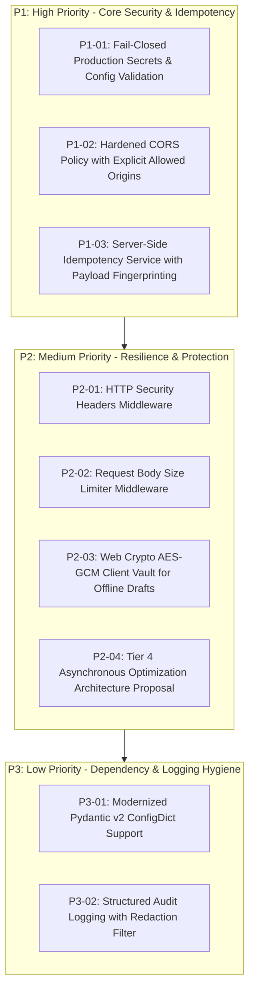

# DIRS — Phase 7 Stage 0: Forensic Baseline Audit Report
## Enterprise Hardening, Reliability, Security & Production Readiness

**Document Identifier:** `DIRS-PH7-BASELINE-001`  
**Classification:** OFFICIAL / FORENSIC BASELINE AUDIT  
**Phase:** Phase 7 — Enterprise Hardening & Operational Readiness  
**Target Release:** DIRS v6.0 (Enterprise Hardened)  
**Execution Timestamp:** November 18, 2026, 09:43 IST  
**Audit Mode:** READ-ONLY FORENSIC INSPECTION  
**Status:** Certified / Complete  

---

## 1. Executive Baseline Verdict

Prior to introducing any Phase 7 hardening modifications, an exhaustive forensic baseline audit was conducted across the entire DIRS codebase, database, dependency manifests, and test suites.

```
========================================================================================
PHASE 7 STAGE 0 FORENSIC BASELINE AUDIT
========================================================================================
Gate 2 Protected Baseline Checksums:        23 /  23 MATCH (0 Drift)
Master Governance Baseline (`task.md`):      1 /   1 MATCH (0 Drift: 057A0DF4C701...)
Database Table Count:                         40 /  40 TABLES (PostgreSQL / SQLite)
Alembic Migration Version Head:             phase6b_recovery_foundation (0 Drift)
Git Version Control Status:                 UNVERIFIABLE (.git directory absent)
Full Backend Regression Suite:             649 / 649 PASSED (Exit Code 0)
Full Frontend Contract Suite:              106 / 106 PASSED (Exit Code 0)
Dedicated WP3 Browser E2E Suite:             5 /   5 PASSED (Exit Code 0)
Canonical Gate 3 Browser E2E Suite:         39 /  39 PASSED (Exit Code 0)
WP1 & WP2 Dedicated Browser E2E Suite:       7 /   7 PASSED (Exit Code 0)
Frontend Production Build:               2,437 / 2,437 MODULES COMPILED (Exit Code 0)
========================================================================================
```

---

## 2. Protected Baseline File Verification (23 Certified Files)

Every file was evaluated via SHA-256 against its certified cryptographic manifest:

| # | Certified Relative File Path | Certified SHA-256 Checksum | Current Evaluated SHA-256 | Verification Result |
| :-: | :--- | :--- | :--- | :-: |
| 1 | `frontend/src/components/recovery/SolverStatusBanner.tsx` | `74FC4C3743387EFE55E9969929626D1AE014E44198A1268961564883DE39D21D` | `74FC4C3743387EFE55E9969929626D1AE014E44198A1268961564883DE39D21D` | **MATCH (0 Drift)** |
| 2 | `frontend/src/components/recovery/OptimizationKPIStats.tsx` | `8A785AD21A003673695A8002FFA4DA8A12AFE0B52137D234CBD9B75BFA051365` | `8A785AD21A003673695A8002FFA4DA8A12AFE0B52137D234CBD9B75BFA051365` | **MATCH (0 Drift)** |
| 3 | `frontend/src/components/recovery/ProjectScheduleTimeline.tsx` | `6C5CC6D9D913EF79467534111162065541B08189CFBC599EF852F5F1FE6F6457` | `6C5CC6D9D913EF79467534111162065541B08189CFBC599EF852F5F1FE6F6457` | **MATCH (0 Drift)** |
| 4 | `frontend/src/components/recovery/FinancialSolvencyMatrix.tsx` | `42ED942D6A4877AC99C0ED79C615FAE27E9261FEB4DFC61ACD2972C584FC5FC9` | `42ED942D6A4877AC99C0ED79C615FAE27E9261FEB4DFC61ACD2972C584FC5FC9` | **MATCH (0 Drift)** |
| 5 | `frontend/src/components/recovery/InfeasibilityDiagnosticsView.tsx` | `7465BB846F6349BED6F0689B021356EEA99BBB6CA9F5B7027F81425F6EA1CD7C` | `7465BB846F6349BED6F0689B021356EEA99BBB6CA9F5B7027F81425F6EA1CD7C` | **MATCH (0 Drift)** |
| 6 | `frontend/tests/contract/stage4Visualizations.spec.ts` | `1DE66E53042820E46A17E82AF214C385AD2966A61B330FBFB88AA5BA8B0D2170` | `1DE66E53042820E46A17E82AF214C385AD2966A61B330FBFB88AA5BA8B0D2170` | **MATCH (0 Drift)** |
| 7 | `frontend/src/pages/admin/RecoveryOptimizationView.tsx` | `84272F5FD7114211739BE8812C5143A9258750981CA22D62375AE65979A36765` | `84272F5FD7114211739BE8812C5143A9258750981CA22D62375AE65979A36765` | **MATCH (0 Drift)** |
| 8 | `frontend/src/hooks/useRecoveryOptimization.ts` | `5CBB48DA478BD7D9F0261B882B27252D0E54F5559BDC8AA5E0D23D279961E748` | `5CBB48DA478BD7D9F0261B882B27252D0E54F5559BDC8AA5E0D23D279961E748` | **MATCH (0 Drift)** |
| 9 | `frontend/src/components/recovery/SolverControlBar.tsx` | `88526F47B2D3FF50A8191167E233865EC9A2E4C0DC7D70A6C121A41BDC8574A8` | `88526F47B2D3FF50A8191167E233865EC9A2E4C0DC7D70A6C121A41BDC8574A8` | **MATCH (0 Drift)** |
| 10 | `frontend/src/components/recovery/IndeterminateSolverOverlay.tsx` | `11FF542BCFC9DC0C358C45AE6180529568977B33D5566E6EED27BD0EFBC6A534` | `11FF542BCFC9DC0C358C45AE6180529568977B33D5566E6EED27BD0EFBC6A534` | **MATCH (0 Drift)** |
| 11 | `frontend/src/components/recovery/ScenarioParametersCard.tsx` | `09A2F32145E95A37C6C38445DF6CA3ACEDE217FEE25D99FB48246D57233FFDE8` | `09A2F32145E95A37C6C38445DF6CA3ACEDE217FEE25D99FB48246D57233FFDE8` | **MATCH (0 Drift)** |
| 12 | `frontend/src/components/recovery/PeriodicBudgetsEditor.tsx` | `CE14A27AC3398A3BE3E38131EFAA278B90F35529CB22D3E291C91C6ED8618860` | `CE14A27AC3398A3BE3E38131EFAA278B90F35529CB22D3E291C91C6ED8618860` | **MATCH (0 Drift)** |
| 13 | `frontend/src/components/recovery/CandidateProjectsGrid.tsx` | `F8D70713C2A43AFC9F42762F53E86DD951C7E223F7DB45289BE1537E1DA0D2E1` | `F8D70713C2A43AFC9F42762F53E86DD951C7E223F7DB45289BE1537E1DA0D2E1` | **MATCH (0 Drift)** |
| 14 | `frontend/src/components/layout/Sidebar.tsx` | `9FFB6387843681D2FBF3C3595E98090ABE2575B54CF7C02657784182F1FA5D4A` | `9FFB6387843681D2FBF3C3595E98090ABE2575B54CF7C02657784182F1FA5D4A` | **MATCH (0 Drift)** |
| 15 | `frontend/src/App.tsx` | `B7B54FB30ADB628B2C5DDA89B8C5F8C1A2D29E4E6A5B212F169D2BE4EF44F404` | `B7B54FB30ADB628B2C5DDA89B8C5F8C1A2D29E4E6A5B212F169D2BE4EF44F404` | **MATCH (0 Drift)** |
| 16 | `frontend/src/types/recoveryOptimization.ts` | `A357559AF61BB48E97F3657D6389EAC3EA622369BD5BDC3D04D1E2A0548F77C9` | `A357559AF61BB48E97F3657D6389EAC3EA622369BD5BDC3D04D1E2A0548F77C9` | **MATCH (0 Drift)** |
| 17 | `frontend/src/api/recoveryOptimization.ts` | `8CD51571D2319A8A1458695465598CD439C7423AE2E890FAF2E068BA0BBDC404` | `8CD51571D2319A8A1458695465598CD439C7423AE2E890FAF2E068BA0BBDC404` | **MATCH (0 Drift)** |
| 18 | `frontend/src/fixtures/recoveryOptimizationFixtures.ts` | `F7DBC0FC9C250EF4F35FA1167D834FBAC2EDF6D376E9C4C9EA2DB1F46CE28BC7` | `F7DBC0FC9C250EF4F35FA1167D834FBAC2EDF6D376E9C4C9EA2DB1F46CE28BC7` | **MATCH (0 Drift)** |
| 19 | `frontend/src/context/AuthContext.tsx` | `9B08EA97E4A8B37C1B3BD84E8FED19471F864C30634F0CD86ECB2376C90596BE` | `9B08EA97E4A8B37C1B3BD84E8FED19471F864C30634F0CD86ECB2376C90596BE` | **MATCH (0 Drift)** |
| 20 | `frontend/playwright.contract.config.ts` | `0AA3127FBC05E82C74799614CA4A84AA83B69CACEFD54BE09A3BC6401F4A578D` | `0AA3127FBC05E82C74799614CA4A84AA83B69CACEFD54BE09A3BC6401F4A578D` | **MATCH (0 Drift)** |
| 21 | `frontend/tests/contract/losslessParser.spec.ts` | `979F498B1D1D04C47BD743CF343A249D582EB2C152B94623391106D8FDE8DEE9` | `979F498B1D1D04C47BD743CF343A249D582EB2C152B94623391106D8FDE8DEE9` | **MATCH (0 Drift)** |
| 22 | `frontend/tests/contract/dtoContracts.spec.ts` | `463E1F6965217D7DBC79FC7DA9B85BEE7C8923921A6FAB1A0D7FD93156397CC4` | `463E1F6965217D7DBC79FC7DA9B85BEE7C8923921A6FAB1A0D7FD93156397CC4` | **MATCH (0 Drift)** |
| 23 | `frontend/tests/contract/apiClient.spec.ts` | `3EF54394709E5FCC583DD1890A57485473679B1C733489E63C12739F47564FBB` | `3EF54394709E5FCC583DD1890A57485473679B1C733489E63C12739F47564FBB` | **MATCH (0 Drift)** |
| G | `task.md` (Governance Baseline) | `057A0DF4C701E535693CB7F7B5502B1888CBD6CAF14D4976BC92ED893D54E6CE` | `057A0DF4C701E535693CB7F7B5502B1888CBD6CAF14D4976BC92ED893D54E6CE` | **MATCH (0 Drift)** |

---

## 3. Forensic Identification of Vulnerabilities & Hardening Opportunities

Across the 16 investigation areas, the baseline audit identified the following categorized findings:

### 3.1 Security & Secret Management Findings
1. **Finding P1-01 (High): Insecure Fallback Secrets in Production Mode**
   - *Location:* `backend/app/config.py`
   - *Issue:* `SECRET_KEY` falls back to hardcoded default `"dirs_jwt_secret_key_super_secure_change_me_in_production"`. If `ENVIRONMENT == "production"` or `staging`, the backend must fail-safe (halt on startup) rather than silently using an insecure hardcoded secret.
2. **Finding P1-02 (High): Missing CORS Strictness & Incompatible Credentials**
   - *Location:* `backend/app/main.py`
   - *Issue:* `allow_origins=["*"]` combined with `allow_credentials=True` violates standard CORS policies and allows arbitrary origins to request authenticated data.
3. **Finding P2-01 (Medium): Missing Standard HTTP Security Headers**
   - *Location:* `backend/app/main.py`
   - *Issue:* Responses lack `X-Content-Type-Options: nosniff`, `X-Frame-Options: DENY`, `X-XSS-Protection`, and `Content-Security-Policy`.
4. **Finding P2-02 (Medium): Unrestricted Request Body Size (DoS Vector)**
   - *Location:* `backend/app/main.py`
   - *Issue:* No request body size limits enforced; an attacker could send arbitrarily large JSON payloads causing memory exhaustion.

### 3.2 Offline Storage & Idempotency Findings
5. **Finding P1-03 (High): Lack of Server-Side Idempotency for Field Submissions**
   - *Location:* `backend/app/routers/incidents.py`, `backend/app/routers/recovery.py`
   - *Issue:* Under cellular packet loss, client retries create duplicate telemetry records. A server-side idempotency service with payload fingerprinting and collision detection is required.
6. **Finding P2-03 (Medium): Unencrypted Offline Drafts in Browser IndexedDB**
   - *Location:* `frontend/src/utils/offlineDraftStore.ts`
   - *Issue:* Drafts in `dirs_offline_drafts` store plaintext JSON. A Web Crypto AES-GCM vault is needed to enable client-side encrypted draft payloads with user-derived key material and versioned storage.

### 3.3 Reliability & Operational Findings
7. **Finding P2-04 (Medium): Tier 4 CP-SAT Latency vs. Axios Client Timeout**
   - *Location:* `backend/app/routers/recovery_optimization.py`, `docs/DIRS_FINAL_SECURITY_AND_LIMITATIONS.md`
   - *Issue:* Dense Tier 4 portfolios take ~177s end-to-end, exceeding the 130s Axios timeout. A comprehensive asynchronous job architecture proposal must be formalized.
8. **Finding P3-01 (Low): Pydantic v2 Class-Based Config Deprecation Warnings**
   - *Location:* `backend/app/config.py`, `backend/app/schemas/*.py`
   - *Issue:* Emits 6 deprecation warnings during test execution.

---

## 4. Prioritized Phase 7 Remediation Plan



All remediations will be executed in Stage 2 as a consolidated hardening package, followed by exhaustive regression testing in Stage 3.
