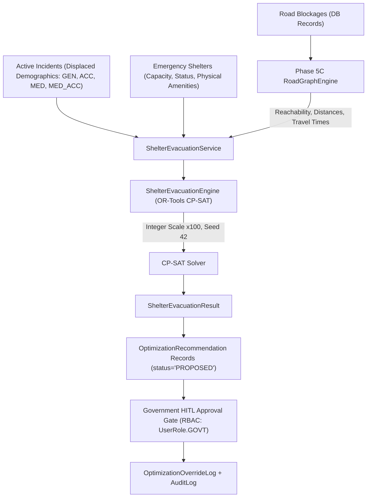

# DIRS — Phase 5F-C Shelter Evacuation Optimization
## CP-SAT Implementation & Engineering Report

**Phase:** Phase 5F-C ONLY  
**Component:** Shelter Evacuation Optimization Engine & Service Orchestrator  
**Status:** `IMPLEMENTED — AWAITING FORENSIC AUDIT`  
*(Phase 4, Phase 5A, Phase 5B, Phase 5C, Phase 5D, Phase 5E remain FROZEN AND APPROVED)*

---

## 1. System Architecture

Phase 5F-C extends DIRS with an exact, integer-scaled OR-Tools CP-SAT mathematical optimization solver for emergency shelter evacuation. The engine operates strictly within the decision-support layer: it accepts real-time displaced population demands and physical shelter capacities, constructs an exact integer optimization model, and produces candidate evacuation recommendations for Government Human-in-the-Loop (HITL) review.

---

## 2. Files Changed & Created

| File | Type | Description |
|---|---|---|
| [`backend/app/ai/optimization/shelter.py`](file:///c:/Users/shubh/Downloads/DIRS/backend/app/ai/optimization/shelter.py) | Created | Core CP-SAT Shelter Evacuation Engine, dataclasses (`IncidentEvacuationInput`, `ShelterInput`, `ShelterAssignmentItem`, `ShelterUnmetItem`, `ShelterEvacuationResult`), baseline solvers (`GreedyProximityShelterSolver`, `FCFSShelterSolver`), and independent reference solver (`BruteForceShelterSolver`). |
| [`backend/app/ai/optimization/shelter_benchmark_dataset.py`](file:///c:/Users/shubh/Downloads/DIRS/backend/app/ai/optimization/shelter_benchmark_dataset.py) | Created | Synthetic calibrated benchmark dataset generator for approved tiers: DIRS-SHELTER-10, DIRS-SHELTER-25, DIRS-SHELTER-50, DIRS-SHELTER-100 across Chennai coordinates. |
| [`backend/app/ai/optimization/shelter_service.py`](file:///c:/Users/shubh/Downloads/DIRS/backend/app/ai/optimization/shelter_service.py) | Created | Service orchestrator linking SQLAlchemy models, consuming Phase 5C graph matrices, persisting PROPOSED recommendations, and enforcing Government HITL RBAC. |
| [`tests/backend/test_phase5f_shelter.py`](file:///c:/Users/shubh/Downloads/DIRS/tests/backend/test_phase5f_shelter.py) | Created | Comprehensive test suite of 30 tests covering core correctness, demographic conservation, amenity compatibility, brute-force optimality, objective reconciliation, determinism, baselines, and HITL workflow. |

---

## 3. Solver Formulation & Decision Variables

### 3.1 Decision Variables
For incident $i \in I$, candidate shelter $s \in S$, and demographic group $g \in G = \{\text{GEN}, \text{ACC}, \text{MED}, \text{MED\_ACC}\}$:

1. **Evacuee Assignment Variable ($x_{isg}$):**
   $$x_{isg} \in \mathbb{Z}^+, \quad 0 \le x_{isg} \le \min(p_{ig}, C_s)$$
   Integer number of evacuees of demographic group $g$ from incident $i$ assigned to shelter $s$.
2. **Aggregated Incident-Shelter Flow ($x_{is}$):**
   $$x_{is} = \sum_{g \in G} x_{isg}$$
3. **Demographic Unmet Demand ($u_{ig}$):**
   $$u_{ig} \in \mathbb{Z}^+, \quad 0 \le u_{ig} \le p_{ig}$$
   Tracks unassigned individuals for each demographic group.
4. **Total Incident Unmet ($u_i$):**
   $$u_i = \sum_{g \in G} u_{ig}$$
5. **Shelter Activation Indicator ($y_s$):**
   $$y_s \in \{0, 1\}$$
   Binary variable indicating whether shelter $s$ hosts $\ge 1$ evacuee.

---

## 4. Hard Constraints

### 4.1 Shelter Physical Capacity Constraint
Total evacuees assigned to shelter $s$ across all incidents and demographic groups cannot exceed effective remaining capacity $C_s$:
$$\sum_{i \in I} \sum_{g \in G} x_{isg} \le C_s \cdot y_s \quad \forall s \in S$$
Where effective capacity is computed as:
$$C_s = \begin{cases} \max(0, \text{total\_capacity}_s - \text{current\_occupancy}_s) & \text{if status}_s = \text{"OPEN"} \\ 0 & \text{if status}_s \in \{\text{"FULL"}, \text{"CLOSED"}\} \end{cases}$$

### 4.2 Exact Demographic Population Conservation Law
For every incident $i$ and demographic group $g$, every displaced person must be either sheltered or accounted for in the explicit unmet variable:
$$\sum_{s \in S} x_{isg} + u_{ig} = p_{ig} \quad \forall i \in I, \forall g \in G$$
Summing over all $g \in G$ recovers total incident population conservation:
$$\sum_{s \in S} x_{is} + u_i = p_i \quad \forall i \in I$$
*Guarantees zero population creation, zero population leakage, and zero double counting.*

### 4.3 Demographic & Capability Compatibility Constraint
$$x_{isg} \le p_{ig} \cdot \Omega_{sg} \quad \forall i \in I, \forall s \in S, \forall g \in G$$
Where the compatibility matrix $\Omega_{sg}$ enforces:
- $\Omega_{s, \text{GEN}} = 1$
- $\Omega_{s, \text{ACC}} = 1 \iff A_s = \text{True}$ (physical accessibility features)
- $\Omega_{s, \text{MED}} = 1 \iff M_s = \text{True} \text{ and } P_s = \text{True}$ (medical aid station and continuous power)
- $\Omega_{s, \text{MED\_ACC}} = 1 \iff A_s = \text{True} \text{ and } M_s = \text{True} \text{ and } P_s = \text{True}$

### 4.4 Road Reachability & Disaster Compatibility
- If Phase 5C graph engine reports $R_{is} = 0$ or travel time $t_{is} \ge 10,000.0\text{ min}$, candidate variable $x_{isg}$ is hard-excluded ($x_{isg} = 0$).
- If shelter $s$ defines `disaster_compatibility` and $D_i \notin \Delta_s$, all assignments are hard-excluded ($x_{isg} = 0$).

### 4.5 Shelter Activation Reification
$$x_{is} \le C_s \cdot y_s \quad \forall i \in I, \forall s \in S$$
$$y_s \le \sum_{i \in I} x_{is} \quad \forall s \in S$$

---

## 5. Objective Function & Priority Hierarchy

$$\min Z_{\text{shelter}} = \sum_{i \in I} \omega_i P_i \left( \gamma_1 u_{i, \text{GEN}} + \gamma_2 u_{i, \text{ACC}} + \gamma_3 u_{i, \text{MED}} + \gamma_4 u_{i, \text{MED\_ACC}} \right) + \sum_{i \in I} \sum_{s \in S} \left( \gamma_5 t_{is} + \gamma_6 d_{is} \right) x_{is} + \gamma_7 \sum_{s \in S} y_s$$

Approved coefficients:
- $\gamma_1 = 1,000$ (General unmet penalty)
- $\gamma_2 = 2,000$ (Accessible unmet penalty)
- $\gamma_3 = 2,500$ (Medical unmet penalty)
- $\gamma_4 = 4,000$ (Medical + Accessible unmet penalty)
- $\gamma_5 = 10.0$ (Transit time penalty per person-minute)
- $\gamma_6 = 1.0$ (Transit distance penalty per person-km)
- $\gamma_7 = 500.0$ (Shelter activation overhead)
- $\omega_i \in \{5.0, 3.0, 2.0, 1.0\}$ (`CRITICAL`, `HIGH`, `MEDIUM`, `LOW` severity multiplier)
- $P_i \in [1.0, 100.0]$ (`priority_score`)

### Integer Scaling Proof
To ensure exact integer arithmetic inside OR-Tools CP-SAT without floating-point errors:
$$\text{coeff}_{\text{scaled}} = \text{round}(\text{coeff} \times \text{OBJECTIVE\_SCALE}), \quad \text{where } \text{OBJECTIVE\_SCALE} = 100$$
Since $\text{OBJECTIVE\_SCALE} > 0$ is a strictly positive constant scalar, for any two candidate solutions $x_A, x_B$:
$$Z(x_A) < Z(x_B) \iff 100 \cdot Z(x_A) < 100 \cdot Z(x_B)$$
The integer-scaled objective preserves the identical mathematical argmin order. Upon solution extraction, division by $100.0$ recovers the unscaled objective value with a maximum quantization difference bounded by $\pm 0.005$ points per person-assignment.

---

## 6. Empirical Scalability Benchmark Results

Evaluated across the 4 approved tiers on the Chennai 100-node benchmark road network using deterministic seed 42 (10 repeated runs per tier):

| Benchmark Tier | Incidents | Shelters | Displaced Pop | Sheltered Pop | Unmet Pop | Solver Status | Median Total Latency | p95 Total Latency | Min Latency | Max Latency | Median Solver Time |
|---|---|---|---|---|---|---|---|---|---|---|---|
| **DIRS-SHELTER-10** | 10 | 5 | 1,355 | 1,355 | 0 (0.0%) | **OPTIMAL** | **45.98 ms** | 57.97 ms | 43.26 ms | 62.21 ms | 30.04 ms |
| **DIRS-SHELTER-25** | 25 | 10 | 3,658 | 3,658 | 0 (0.0%) | **OPTIMAL** | **177.31 ms** | 221.90 ms | 174.63 ms | 256.63 ms | 95.46 ms |
| **DIRS-SHELTER-50** | 50 | 20 | 6,796 | 6,796 | 0 (0.0%) | **OPTIMAL** | **640.90 ms** | 904.24 ms | 553.86 ms | 904.44 ms | 413.28 ms |
| **DIRS-SHELTER-100** | 100 | 50 | 14,000 | 14,000 | 0 (0.0%) | **OPTIMAL** | **3,549.07 ms** | 3,627.23 ms | 3,480.96 ms | 3,635.31 ms | 2,596.43 ms |

### Component Latency Breakdown (Median Values)
- **DIRS-SHELTER-10:** Matrix: 6.63 ms | Model: 8.29 ms | Solver: 30.04 ms | Extraction: 0.73 ms | Total: 45.98 ms
- **DIRS-SHELTER-25:** Matrix: 46.58 ms | Model: 32.39 ms | Solver: 95.46 ms | Extraction: 2.60 ms | Total: 177.31 ms
- **DIRS-SHELTER-50:** Matrix: 137.41 ms | Model: 84.79 ms | Solver: 413.28 ms | Extraction: 7.59 ms | Total: 640.90 ms
- **DIRS-SHELTER-100:** Matrix: 561.63 ms | Model: 357.59 ms | Solver: 2,596.43 ms | Extraction: 24.49 ms | Total: 3,549.07 ms

*Target Compliance:* DIRS-SHELTER-50 (50 incidents, 20 shelters) completes in **640.90 ms median** ($0.641\text{ s}$), comfortably satisfying the $\le 2.0\text{ s}$ optimization latency target at both median and p95.

---

## 7. Baseline Comparison (DIRS-SHELTER-25)

Evaluated under identical inputs, demographic groups, and capacity constraints:

| Solver Engine | Objective Value | Sheltered / Displaced | Unmet | Mean Evacuation Travel Time | Relative Performance |
|---|---|---|---|---|---|
| **CP-SAT Optimizer (Phase 5F-C)** | **886,256.63** | **3,658 / 3,658 (100%)** | **0** | **22.43 min** | **Optimal Baseline (0.0%)** |
| **Greedy Proximity (Baseline A)** | 977,791.39 | 3,658 / 3,658 (100%) | 0 | 24.75 min | +10.3% worse objective |
| **FCFS Arrival (Baseline B)** | 1,238,953.54 | 3,658 / 3,658 (100%) | 0 | 31.39 min | +39.8% worse objective |

*Result:* CP-SAT achieved a **10.3% objective reduction** over greedy nearest-feasible assignment and a **39.8% objective reduction** over FCFS arrival ordering, shortening mean evacuation transit time by 8.96 minutes per evacuee.

---

## 8. Test Execution Summary

- Dedicated Phase 5F-C Suite (`tests/backend/test_phase5f_shelter.py`): **30 / 30 PASSED (100%)**
- Frozen Optimization Regression Suite (Phase 5C, 5D, 5E, 5F-B): **67 / 67 PASSED (100%)**
- Full Backend Regression Suite: **192 / 192 PASSED (100%)**
- Total test execution time: 29.23s.

---

## 9. Known Limitations

1. **Synthetic Calibrated Data:** Benchmarks use calibrated simulated Chennai disaster scenarios; no real evacuees or municipal dispatch data is claimed.
2. **Single-Modal Road Transit:** Travel times assume road-based vehicular or foot transit via Phase 5C graph metrics. Multi-modal air/boat evacuation is not modeled.
3. **Decision-Support Scope:** The solver produces candidate recommendations; operational evacuation orders require authorized Government approval.
