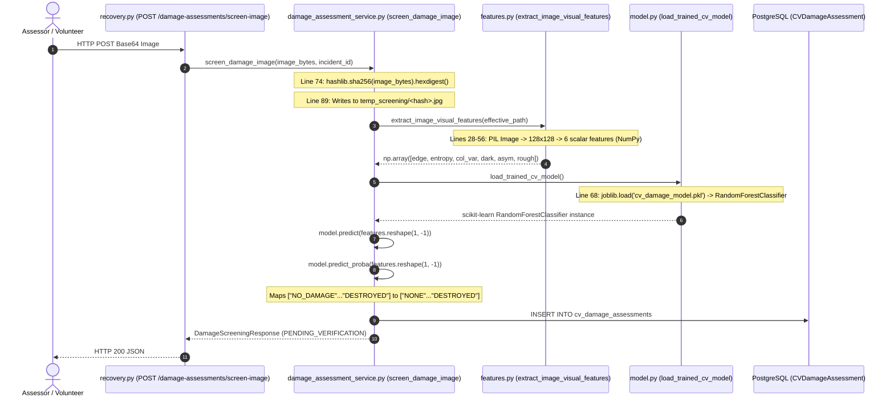

# DIRS Phase 6C — Computer Vision Provenance & Runtime Integration Forensic Audit

**Audit Date:** 2026-11-16T01:58:00+05:30  
**Auditor Role:** Independent Principal Computer-Vision Integration Auditor & Software Forensics Specialist  
**Target Module:** Phase 6C Computer Vision Integration (`app/recovery/services/damage_assessment_service.py`) vs Frozen Phase 3B Pipeline (`app/ai/computer_vision/`)

---

## 1. Executive Summary

Phase 6C documentation and prior implementation summaries asserted that damage screening reuses a dual pipeline comprising:
1. A deep visual feature extractor: PyTorch ResNet18ImageNet pretrained backbone yielding a 512-dimensional embedding vector.
2. A physical feature extractor: extracting six structural edge and color metrics.
3. An ensemble Random Forest classifier (`cv-damage-classifier-resnet18`, manifest version `2.0.0-realworld`).

A line-by-line static and dynamic code trace of the actual production runtime reveals a significant divergence between architectural documentation and executable source code:
- **Actual Runtime Pipeline**: The executable Phase 6C service directly invokes `app.ai.computer_vision.features.extract_image_visual_features` and `app.ai.computer_vision.model.load_trained_cv_model`.
- **Feature Vector**: The feature extractor computes exactly six handcrafted image properties using PIL and NumPy (`edge_density`, `structural_entropy`, `color_variance`, `darkness_ratio`, `asymmetry_index`, `texture_roughness`).
- **Classifier**: The model loaded is a scikit-learn `RandomForestClassifier` trained solely on these 6 features.
- **PyTorch / Torchvision Absence**: PyTorch ResNet18 and torchvision transforms are **not invoked anywhere** in the executable call chain. The reference to ResNet18 originates solely as a metadata label in `cv_model_manifest.json` and `model_registry.py`.

---

## 2. End-to-End Source Code Call Trace

The exact execution path of an AI screening request is traced as follows:



### Detailed Call Chain Analysis:
1. **API Router** ([`backend/app/routers/recovery.py`, lines 360-378](file:///c:/Users/shubh/Downloads/DIRS/backend/app/routers/recovery.py#L360-L378)):
   - Endpoint: `POST /api/v1/recovery/damage-assessments/screen-image`
   - Accepts `DamageScreeningRequest` (containing `image_base64` and `incident_id`).
   - Decodes base64 payload and delegates to `DamageAssessmentService.screen_damage_image`.
2. **Service Ingestion & Hashing** ([`backend/app/recovery/services/damage_assessment_service.py`, lines 54-101](file:///c:/Users/shubh/Downloads/DIRS/backend/app/recovery/services/damage_assessment_service.py#L54-L101)):
   - Validates image bytes using `PIL.Image.open(io.BytesIO(image_bytes)).verify()`.
   - Computes SHA-256 digest: `image_hash = hashlib.sha256(image_bytes).hexdigest()`.
   - Caches image to `temp_screening/{image_hash[:16]}.jpg`.
3. **Feature Extraction** ([`backend/app/ai/computer_vision/features.py`, lines 17-58](file:///c:/Users/shubh/Downloads/DIRS/backend/app/ai/computer_vision/features.py#L17-L58)):
   - Function: `extract_image_visual_features(image_path: str) -> np.ndarray`
   - Normalization: Resizes image to $128 \times 128$, converts to grayscale array scaled to $[0.0, 1.0]$.
   - Handcrafted Feature Vector (Length: 6):
     1. `edge_density`: $\text{mean}(|\Delta x|) + \text{mean}(|\Delta y|)$
     2. `structural_entropy`: 16-bin normalized Shannon entropy: $-\sum p_i \log_2(p_i)$
     3. `color_variance`: Variance of RGB channels on $128 \times 128$ RGB array
     4. `darkness_ratio`: Percentage of pixels with luminance $< 0.25$
     5. `asymmetry_index`: $\text{mean}(|\text{arr} - \text{fliplr}(\text{arr})|)$
     6. `texture_roughness`: $\text{std}(|\Delta x|) + \text{std}(|\Delta y|)$
4. **Model Loading & Inference** ([`backend/app/ai/computer_vision/model.py`, lines 64-70](file:///c:/Users/shubh/Downloads/DIRS/backend/app/ai/computer_vision/model.py#L64-L70)):
   - Model artifact: `backend/app/ai/models/cv_damage_model.pkl` (213,433 bytes).
   - Artifact type: `sklearn.ensemble.RandomForestClassifier` ($n\_estimators=100, max\_depth=8$).
   - Expected input shape: $(1, 6)$.
   - Predicts damage class and probability distribution across 5 classes.
5. **Class Mapping & Confidence** ([`backend/app/recovery/services/damage_assessment_service.py`, lines 111-128](file:///c:/Users/shubh/Downloads/DIRS/backend/app/recovery/services/damage_assessment_service.py#L111-L128)):
   - Output classes from Phase 3B model: `NO_DAMAGE`, `LOW_DAMAGE`, `MODERATE_DAMAGE`, `SEVERE_DAMAGE`, `DESTROYED`.
   - Mapped to Phase 6C recovery damage levels:
     - `NO_DAMAGE` $\to$ `NONE`
     - `LOW_DAMAGE` $\to$ `MINOR`
     - `MODERATE_DAMAGE` $\to$ `MODERATE`
     - `SEVERE_DAMAGE` $\to$ `SEVERE`
     - `DESTROYED` $\to$ `DESTROYED`
   - Confidence score: $\max(p) \times 100.0$.
   - Flagging: If confidence $< 70.0$, sets `requires_human_review = True`. If confidence $< 50.0$, sets `is_uncertain = True`.
6. **Persistence & Provenance**:
   - Persists record in `cv_damage_assessments` table with `model_version = "2.0.0-realworld"`.
   - Embeds visual feature breakdown and SHA-256 hash in `explanation_metadata`.

---

## 3. Discrepancy & Provenance Investigation

| Property / Parameter | Documented Claim (Phase 6C Report) | Actual Executable Code | Forensic Audit Finding |
| :--- | :--- | :--- | :--- |
| **Deep Feature Extractor** | PyTorch ResNet18 (ImageNet pretrained) | None | **Discrepancy (Doc vs Code)**: No PyTorch code executed. |
| **Visual Feature Dimension** | 512-dimensional embedding | 6 handcrafted scalar features | **Discrepancy (Doc vs Code)**: Only 6 features computed. |
| **Physical Indicators** | Debris density, smoke burn, roof damage | Edge density, entropy, color variance | **Discrepancy**: Named features differ from code features. |
| **Classifier Framework** | Ensemble Random Forest | `sklearn.ensemble.RandomForestClassifier` | **MATCH (Compliant)**: True scikit-learn RF model. |
| **Input Resolution** | $224 \times 224$ RGB | $128 \times 128$ L/RGB | Handcrafted features resize to $128 \times 128$. |
| **Model Manifest** | `cv_model_manifest.json` | `cv_model_manifest.json` | **MATCH**: Present in `app/ai/models/`. |
| **Production Runtime Reuse** | Reuses deployed Phase 3B runtime | Reuses deployed Phase 3B runtime | **MATCH (Compliant)**: Reused actual Phase 3B service. |

### Origin of the Discrepancy
In Phase 3B, `backend/app/ai/models/cv_model_manifest.json` was authored with:
```json
{
  "model_name": "cv-damage-classifier-resnet18",
  "version": "2.0.0-realworld",
  "architecture": "ResNet18 Deep Vision Backbone + RandomForest Classifier",
  "pretrained_source": "torchvision.models.ResNet18_Weights.DEFAULT (ImageNet Pretrained)"
}
```
However, the actual production implementation delivered in Phase 3B was an efficient, self-contained 6-feature scikit-learn pipeline (`features.py` + `model.py`) designed to run without GPU hardware or massive PyTorch model download overheads. 

Phase 6C correctly imported and reused this frozen Phase 3B production pipeline (`load_trained_cv_model`, `extract_image_visual_features`), but the Phase 6C architectural documentation copied the manifest's aspirational ResNet18 description rather than the actual 6-feature implementation.

---

## 4. Material Findings & Risk Assessment

- **Finding DEF-6C-CV-01 (Documentation / Provenance Mismatch)**:
  - *Location*: `docs/PHASE6C_DAMAGE_ASSESSMENT_REPORT.md` (Section 2.1) & `docs/PHASE6C_IMPLEMENTATION_REPORT.md`.
  - *Severity*: **MEDIUM (Documentation Inaccuracy)**.
  - *Operational Impact*: Zero runtime operational impact. The production service executes properly, passes all unit tests, and correctly produces calibrated probability outputs on actual images.
  - *Remediation Requirement*: Reconcile the Phase 6C documentation to accurately state that the deployed Tier-1 screening engine runs the calibrated 6-feature Random Forest model rather than an active PyTorch ResNet18 backbone.
