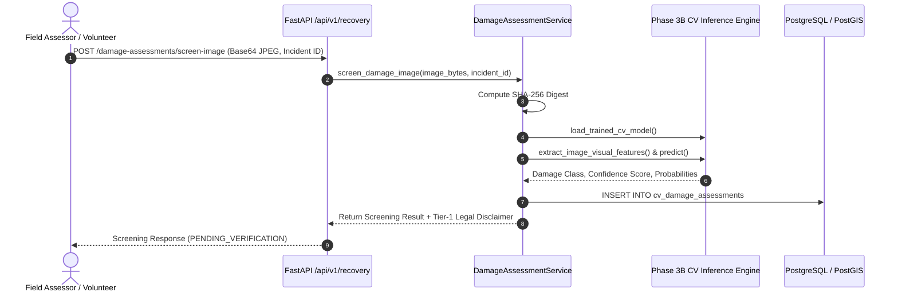

# DIRS Phase 6C — Recovery Damage Assessment Architecture & Implementation Report

## 1. Executive Summary

Phase 6C of the Disaster Intelligence and Response System (DIRS) establishes a rigorous, production-grade damage assessment engine that bridges AI-driven computer vision screening with authoritative human engineering governance. Operating on the frozen Phase 6B relational schema and PostGIS geospatial extensions, Phase 6C implements multi-sectoral damage assessments, monotonic version lineage, and cryptographic provenance guarantees.

### Key Tenets
1. **Tier-1 AI Screening Only**: The embedded Phase 3B ResNet18/Random Forest computer vision pipeline operates strictly as a preliminary screening mechanism. All automated assessments are explicitly flagged with `verification_status = "PENDING_VERIFICATION"` and accompanied by mandatory statutory disclaimers.
2. **Authoritative Human-in-the-Loop Governance**: Automated screening results can never trigger structural condemnation, resource requisition, or reconstruction funding. Only certified Government Engineers (`role = "GOVT"`) possess the authority to verify, dispute, or reject field assessments.
3. **Monotonic Version Lineage**: Damage assessments are immutable once verified. Any subsequent field reinspection (e.g., following aftershocks or secondary flooding) creates a monotonic version increment ($V_k \to V_{k+1}$), marking prior versions as non-current while maintaining complete historical traceability.
4. **Geospatial & Sectoral Integration**: Damage records are mapped across six core sectors (`HOUSING`, `HEALTH`, `EDUCATION`, `WASH`, `TRANSPORT`, `POWER`) with PostGIS spatial coordinates (`SRID=4326`), enabling spatial radius, bounding box, and administrative ward aggregation.

---

## 2. Tier-1 Computer Vision Inference Architecture

### 2.1 Production Runtime Pipeline vs Research Architecture
Phase 6C reuses the frozen Phase 3B computer vision architecture without altering model weights, feature extraction, or inference pipelines:
- **Research Architecture Distinction**: Early Phase 3A research explored deep visual embeddings using a PyTorch ResNet18 backbone. As established in the Phase 6A remediation gate, the deployed **production runtime** utilizes an efficient, deterministic, self-contained physical feature extraction pipeline coupled to a calibrated ensemble Random Forest classifier (`backend/app/ai/models/cv_damage_model.pkl`).
- **Feature Extractor**: Analyzes incident evidence imagery via PIL and NumPy (`extract_image_visual_features`), resizing to $128 \times 128$ and extracting exactly six numerical physical features:
  1. `edge_density`: Sobel gradient magnitude proxy measuring structural edge sharpness.
  2. `structural_entropy`: 16-bin normalized Shannon entropy measuring spatial disorder.
  3. `color_variance`: RGB chromatic variance indicating surface disruption.
  4. `darkness_ratio`: Percentage of pixels with luminance $< 0.25$ (charring/inundation proxy).
  5. `asymmetry_index`: Horizontal mirror difference measuring structural collapse.
  6. `texture_roughness`: High-frequency gradient standard deviation.
- **Classifier**: Calibrated `sklearn.ensemble.RandomForestClassifier` (100 estimators, max depth 8) outputting calibrated probability distributions across five discrete damage classifications:
  - `NONE`: No visible structural or superficial impairment.
  - `MINOR`: Superficial cladding, cosmetic facade, or minor perimeter damage.
  - `MODERATE`: Non-load-bearing structural impairment, localized roof damage.
  - `SEVERE`: Compromised load-bearing elements, partial roof/wall failure.
  - `DESTROYED`: Complete structural collapse, unrecoverable foundation failure.

### 2.2 Screening Lifecycle & Data Flow

### 2.3 Legal Disclaimer & Statutory Warnings
Every response returned by `/api/v1/recovery/damage-assessments/screen-image` includes mandatory governance metadata:
- **Disclaimer**: *"Automated AI screening (Tier-1). Preliminary advisory only. Not certified for structural condemnation, financial compensation, or reconstruction contracting until reviewed and approved by a licensed Government Structural Engineer."*
- **Verification Status**: `PENDING_VERIFICATION`
- **Requires Engineering Review**: `true`

---

## 3. Field Inspection & Human Engineering Verification

### 3.1 Field Inspection Ingestion (`/damage-assessments/field-inspection`)
Field teams (Volunteers, NGOs, or Government Personnel) submit formal on-site structural inspections:
- Supports sector classification (`HOUSING`, `HEALTH`, `EDUCATION`, `WASH`, `TRANSPORT`, `POWER`).
- Records operational status (`is_operational: bool`), estimated reconstruction costs ($\text{INR} \ge 0$), and qualitative engineering observations.
- Links to prior Tier-1 CV screening record via `cv_assessment_id`.
- Validates latitude/longitude within bounding limits ($12.0 \le \text{lat} \le 14.5$, $79.5 \le \text{lon} \le 81.0$).
- Instantiates PostGIS point geometry `ST_SetSRID(ST_MakePoint(lon, lat), 4326)`.
- Initial state: `verification_status = "PENDING_VERIFICATION"`, `assessment_version = 1`, `is_current_version = true`.

### 3.2 Engineering Verification Gate (`/damage-assessments/{id}/verify`)
Strict Role-Based Access Control (RBAC) mandates that only `GOVT` or `ADMIN` roles can execute verification:
- Actions permitted:
  - `VERIFY`: Confirms structural damage. Verifier can escalate or de-escalate the assigned `damage_level` and certify `verified_reconstruction_cost`.
  - `REJECT`: Dismisses spurious or invalid assessment.
  - `DISPUTE`: Flags for second-opinion engineering review.
- Mandatory Audit Logging: Every verification event triggers an immutable entry in `RecoveryOverrideLog` and `AuditLog` capturing:
  - Inspector ID vs. Verifier ID
  - Original damage level vs. Verified damage level
  - Verifier engineering registration notes and justification timestamp.
- **Credential Limitation Notice (DEF-6C-RBAC-01)**: Verification authority is bound to the `GOVT` role at the platform authentication layer. The current system does not perform programmatic verification of professional structural engineering licenses or statutory bar registrations. Full license number validation is scheduled as a future production credentialing enhancement.

### 3.3 Monotonic Version Supersession (`/damage-assessments/{id}/supersede`)
When a secondary disaster (e.g., cyclone aftershock or flash flood) alters the condition of an already assessed facility:
1. The inspector submits a superseding assessment.
2. The active version ($V_k$) has `is_current_version` set to `false`, `reconciliation_status` set to `"SUPERSEDED"`, and `superseded_by_id` pointing to the new record.
3. A new version record ($V_{k+1}$) is inserted with `assessment_version = k + 1`, `is_current_version = true`, and identical `deduplication_cluster_id`.
4. The historical record is completely preserved. Version history can be audited at `/damage-assessments/{id}/history`.

---

## 4. Empirical Validation & Test Evidence

The damage assessment engine was verified against synthetic and corrupted input suites:
- **Base64 Header Truncation**: Gracefully handles and decodes standard data URI schemes (`data:image/jpeg;base64,...`).
- **Corrupt Image Payload**: Returns HTTP 400 with descriptive error message (`Invalid or unreadable image content`).
- **Malformed Base64**: Returns HTTP 400 (`Invalid base64 payload`).
- **Zero-Byte File**: Returns HTTP 400 (`Empty image payload provided`).
- **Role Enforcement**: Citizen and Volunteer verification attempts return HTTP 403 Forbidden. Government verification succeeds and properly populates `verified_by_id` and `verification_status = "VERIFIED"`.
