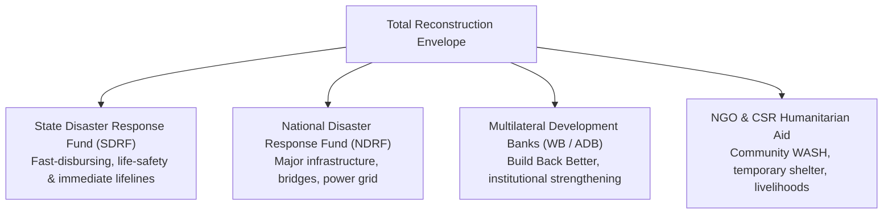

# DIRS Phase 6D-A — Multi-Period Budget & Resource Optimization Architecture

**Document ID:** `DIRS-PHASE6D-DOC-05`  
**Classification:** OPERATIONS RESEARCH & INFRASTRUCTURE FINANCE  
**Author:** Principal Disaster Recovery Economist & Operations Research Scientist  
**Date:** November 16, 2026  
**Status:** COMPLETE (PHASE 6D-A DESIGN BASELINE)  

---

## 1. Executive Summary

Disaster reconstruction finance is characterized by complex funding streams with distinct statutory restrictions, multi-year disbursement tranches, and acute procurement bottlenecks. 

This document formulates the financial and logistical resource constraints governing Phase 6D, strictly distinguishing **project budget, resource quantities, procurement lead times, funding commitments, and cash-flow expenditures**.

---

## 2. Multi-Source Funding Architecture

Reconstruction capital derives from heterogeneous sources, each governed by statutory ring-fencing rules:

### 2.1 Funding Stream Compatibility Matrix

Let $f \in \mathcal{F} = \{\text{SDRF}, \text{NDRF}, \text{MULTILATERAL}, \text{NGO\_CSR}\}$ denote funding streams:

| Funding Stream $f$ | Permissible Sectors | Eligible Project Types | Maximum Multi-Period Horizon | Matching Fund Rule |
| :--- | :--- | :--- | :---: | :--- |
| **SDRF** | `HEALTH`, `WASH`, `HOUSING` | Immediate public lifelines, emergency shelter repair | 12 months (4 quarters) | 100% State/Central statutory share |
| **NDRF** | `TRANSPORT`, `POWER`, `WASH` | Regional bridges, electrical transmission, sea walls | 24 months (8 quarters) | Central approval audit required |
| **MULTILATERAL** | All Sectors | Permanent resilient reconstruction, drainage master plans | 48 months (16 quarters) | Environmental & social compliance |
| **NGO_CSR** | `HOUSING`, `LIVELIHOODS` | Micro-grants, artisanal tool kits, community wells | 6 months (2 quarters) | Direct non-governmental release |

### 2.2 Mathematical Ring-Fencing Constraint
Let $B_{f, t}$ be the budget available from funding stream $f$ in period $t$, and let $\Phi_{j, f} \in \{0, 1\}$ be the eligibility indicator of project $j$ for funding stream $f$:
$$\sum_{j \in \mathcal{P}} c_{j, t - \tau_j + 1} \cdot \Phi_{j, f} \cdot y_{j, t} \le B_{f, t} \quad \forall f \in \mathcal{F}, \forall t \in \mathcal{T}$$

---

## 3. Strict Distinction of Financial & Resource Terminology

To prevent operational ambiguity, Phase 6D establishes immutable definitions:

| Term | Mathematical Symbol | Physical Dimension | Definition & Operational Governance |
| :--- | :---: | :---: | :--- |
| **Project Budget Envelope** | $B_t$ | INR ($\text{Currency}$) | Total authorized ceiling of public funds available for commitment in period $t$. |
| **Funding Commitment** | $\tilde{C}_j$ | INR ($\text{Currency}$) | Total legal liability encumbered when project $j$ is sanctioned and awarded to tender. |
| **Cash-Flow Expenditure** | $c_{j, \delta}$ | INR / Period | Actual capital disbursed in period $\delta$ based on physical milestone achievement. |
| **Resource Quantity** | $q_{j, m}, u_{j, r}$ | Physical Units | Physical volume of materials (e.g. metric tons of steel) or labor (e.g. crew-days). |
| **Resource Cost** | $p_{m} \cdot q_{j, m}$ | INR ($\text{Currency}$) | Market or scheduled rate of physical inputs. $\sum_m \text{Cost}_m \le C_j$. |

---

## 4. Multi-Period Budget Carry-Forward Mechanics

Public financial rules differ regarding whether unspent funds expire at fiscal period-end:
1. **Lapse Rule (Non-Carry-Forward)**:
   Unspent funds at period $t$ cannot be rolled into period $t+1$:
   $$\text{Available Budget } B_t^{\text{eff}} = B_t$$
2. **Carry-Forward Rule with Retention Rate $\alpha \in [0.0, 1.0]$**:
   Unspent budget rolls forward to cushion downstream project surges:
   $$B_t^{\text{eff}} = B_t + \alpha \cdot \max\left(0, \; B_{t-1}^{\text{eff}} - \sum_{j \in \mathcal{P}} c_{j, t - \tau_j} \cdot y_{j, t-1}\right)$$
   Where $\alpha = 1.0$ represents complete capital rollovers (standard in multilateral grants), and $\alpha = 0.0$ represents standard annual budgetary lapsing.

---

## 5. Physical Resource & Procurement Lead-Time Constraints

### 5.1 Critical Construction Resources ($\mathcal{R}$ and $\mathcal{M}$)
Reconstruction projects demand specialized resources subject to local market saturation:
- **Renewable Resources $\mathcal{R}$ (Flow per Period)**:
  1. `WORKFORCE_ENGINEERING`: Licensed structural engineers and site supervisors ($\text{person-days}$).
  2. `WORKFORCE_SKILLED`: Masons, bar-benders, certified welders, electricians ($\text{person-days}$).
  3. `HEAVY_MACHINERY`: Hydraulic excavators, concrete boom pumps, road rollers ($\text{machine-days}$).
- **Non-Renewable Materials $\mathcal{M}$ (Stock and Cumulative Delivery)**:
  1. `CEMENT_OPC`: Ordinary Portland Cement ($\text{metric tons}$).
  2. `STRUCTURAL_STEEL`: TMT reinforcement bars and structural I-beams ($\text{metric tons}$).
  3. `PIPING_DI`: Ductile Iron potable water pipes ($\text{kilometers}$).
  4. `TRANSFORMERS`: Distribution transformers $11\text{ kV}/415\text{ V}$ ($\text{units}$).

### 5.2 Procurement Lead Times & Supply Ingestion
Let $\Lambda_m$ denote the procurement and transportation lead time (in periods) for material $m$:
- If a project requires specialized material $m$ (e.g. substation transformer with lead time $\Lambda = 2$ periods), the project **cannot start** before period $t = \Lambda_m + 1$:
  $$x_{j, t} = 0 \quad \forall t \le \Lambda_{m_j}$$
- The cumulative delivery schedule $M_{m, t}$ models batch deliveries from national supply chains:
  $$M_{m, t} = \sum_{\tau=1}^{t - \Lambda_m} \text{ShippedBatch}_{m, \tau}$$

### 5.3 Material Substitution Invariants
In post-disaster environments, supply disruptions require technical substitutions:
- **Permissible Substitution**: Manufactured sand (M-Sand) replacing river sand; Pozzolana Portland Cement (PPC) replacing OPC in non-load-bearing masonry.
- **Substitution Invariant Equation**:
  $$q_{j, m} \le \text{Stock}_m + \sum_{s \in \text{Substitutes}(m)} \eta_{s, m} \cdot \text{Stock}_s$$
  Where $\eta_{s, m}$ is the engineering substitution equivalence factor (e.g. $1.05\text{ tons M-Sand} \equiv 1.0\text{ ton River Sand}$).
- **Non-Permissible Substitution**: TMT steel reinforcement **cannot** be substituted with substandard steel; structural concrete grade cannot be downgraded below design specifications.
