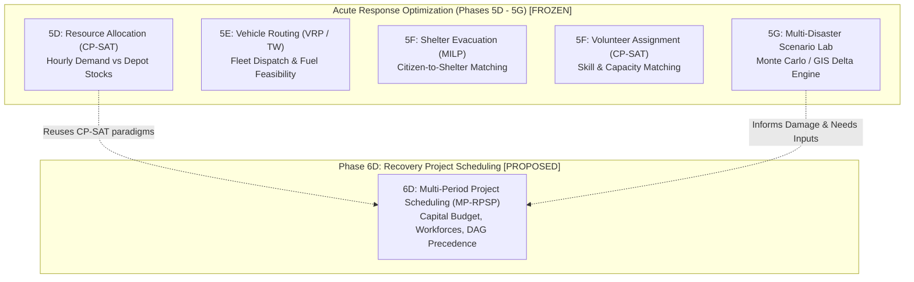

# DIRS Phase 6D-A — Current-State Architectural Audit & Asset Inventory

**Document ID:** `DIRS-PHASE6D-DOC-01`  
**Classification:** RESEARCH & ARCHITECTURAL AUDIT  
**Author:** Principal Operations Research Scientist, Systems Architect & Forensic Auditor  
**Date:** November 16, 2026  
**Status:** COMPLETE (PHASE 6D-A DESIGN BASELINE)  

---

## 1. Executive Summary

Phase 6D of the Disaster Intelligence and Response System (DIRS) addresses **Post-Disaster Recovery Prioritization & Multi-Period Project Scheduling (MP-RPSP)**. Unlike the acute emergency response phases (Phases 1–5), which operate on hourly response horizons, Phase 6D operates on multi-week, multi-month, and multi-year recovery horizons. 

This audit reviews existing project assets across Phases 1 through 6C, establishes the baseline of reusable algorithmic components, identifies available versus missing database fields, and defines strict boundaries to prevent duplication of existing optimization engines.

---

## 2. Review of Existing Optimization Engines (Phases 5D–5G)

The DIRS backend houses four mature, frozen optimization engines under `backend/app/ai/optimization/`:

### 2.1 Emergency Resource Allocation (`allocation.py` — Phase 5D)
- **Engine**: Google OR-Tools CP-SAT (`CpModel`).
- **Domain**: Matches acute, perishable emergency supplies (water cartons, food packets, medical kits) from local staging depots to active incident demand nodes.
- **Horizon**: Discrete single-period emergency dispatch ($t \in [0, 24\text{ hours}]$).
- **Reuse Principle**: Phase 6D **must not** duplicate emergency relief allocation. Phase 6D handles durable capital reconstruction materials (cement, structural steel, heavy machinery, labor-months) distributed over quarters/years.

### 2.2 Vehicle Routing & Logistics (`routing.py` — Phase 5E)
- **Engine**: OR-Tools Routing Model (`RoutingIndexManager`, `RoutingModel`).
- **Domain**: Solves Capacitated Vehicle Routing with Time Windows (CVRPTW), road blockages, and terrain impedance penalties.
- **Reuse Principle**: Project contractors manage their own hauling; Phase 6D schedules project execution periods and procurement lead times, rather than turn-by-turn vehicle turnarounds.

### 2.3 Shelter & Volunteer Optimization (`shelter.py` & `volunteer.py` — Phase 5F)
- **Engine**: Integer Linear Programming / CP-SAT.
- **Domain**: Matches displaced populations to emergency shelters and deploys volunteer squads for immediate triage.
- **Reuse Principle**: Distinct from long-term housing reconstruction projects (`HOUSING` sector) and certified public works contractors.

### 2.4 Integrated Orchestrator (`orchestrator.py` — Phase 5F/5G)
- **Domain**: Coordinates acute multi-engine optimization runs, serializing recommendations and logging decisions to `OptimizationRun` and `OptimizationRecommendation`.
- **Architectural Reuse for Phase 6D**: Phase 6D will implement a dedicated `RecoveryOptimizationService` that follows the identical solver lifecycle (Model Formulation $\to$ Validation $\to$ CP-SAT Solving $\to$ Solution Serialization $\to$ Human Government Approval Gate).

---

## 3. Audit of Phase 6B/6C Recovery Data Foundation

Phase 6B created the relational schema, and Phase 6C operationalized damage assessments and recovery needs. The following table provides an exhaustive field-by-field audit of what is currently available in the frozen schema versus what Phase 6D optimization requires:

### 3.1 Entity: `recovery_projects` (`backend/app/models/recovery.py`)

| Schema Column | Data Type | Optimization Role in Phase 6D | Current Availability | Forensic Notes & Gaps |
| :--- | :--- | :--- | :---: | :--- |
| `id` | `String(36)` | Unique project identifier $j \in \mathcal{P}$ | **Available** | Primary key. |
| `project_code` | `String(50)` | Human-readable tracking tag | **Available** | Unique index. |
| `need_id` | `String(36)` | Link to target humanitarian need | **Available** | Nullable FK to `recovery_needs`. |
| `sector` | `String(50)` | Sectoral category $s \in \mathcal{S}$ | **Available** | `HOUSING`, `WASH`, `HEALTH`, etc. |
| `priority_score` | `Float` | Initial objective coefficient $b_j$ | **Available** | Currently 0.0; Phase 6D will compute via MCPI. |
| `priority_tier` | `String(20)` | Lexicographic grouping | **Available** | `TIER_1`, `TIER_2`, `TIER_3`, `TIER_4`. |
| `status` | `String(50)` | Project state lifecycle | **Available** | `PROPOSED`, `APPROVED`, `IN_PROGRESS`, etc. |
| `estimated_cost` | `Float` | Total capital expenditure $C_j$ | **Available** | Total lump-sum cost. |
| `actual_expenditure` | `Float` | Post-execution spend | **Available** | Retrospective tracking. |
| `funding_source` | `String(100)` | Funding stream identifier | **Available** | `STATE_SDRF`, `NATIONAL_NDRF`, etc. |
| `time_indexed_cost_profile` | `JSON` | Disbursal schedule $c_{j, \delta}$ | **Available** | JSON array of floats (e.g. `[10.0, 15.0]`). |
| `estimated_duration_days` | `Integer` | Duration in days | **Available** | Must be mapped to discrete periods $d_j$. |
| `earliest_start_date` | `DateTime` | Release date boundary $E_j$ | **Available** | Earliest allowable period boundary. |
| `planned_completion_date` | `DateTime` | Target deadline $D_j$ | **Available** | Milestone deadline. |
| `latitude`, `longitude` | `Float` | Geospatial coordinates | **Available** | Used for geographic equity constraints. |
| `approval_status` | `String(30)` | Governance gate | **Available** | `PENDING_APPROVAL`, `APPROVED`. |
| *district* | — | Administrative zoning constraint | **MISSING** | Currently only on `recovery_needs`, not `recovery_projects`. Must be resolved via need relation or added. |
| *min_duration / max_delay*| — | Delay penalty bounds | **MISSING** | Must be represented in project metadata or solver config. |

### 3.2 Entity: `project_dependencies` (`backend/app/models/recovery.py`)

| Schema Column | Data Type | Optimization Role in Phase 6D | Current Availability | Forensic Notes & Gaps |
| :--- | :--- | :--- | :---: | :--- |
| `predecessor_project_id` | `String(36)` | Tail node $i$ in DAG edge $(i, j)$ | **Available** | FK to `recovery_projects.id`. |
| `successor_project_id` | `String(36)` | Head node $j$ in DAG edge $(i, j)$ | **Available** | FK to `recovery_projects.id`. |
| `dependency_type` | `String(30)` | Relationship type | **Available** | Defaults to `FINISH_TO_START`. |
| `lag_days` | `Integer` | Minimal lag $L_{ij}$ in days | **Available** | Mapped to planning periods $L_{ij} / \Delta t$. |
| `is_critical_path` | `Boolean` | CPM status flag | **Available** | Computed and updated by CPM-PL service. |
| `rationale` | `Text` | Engineering justification | **Available** | Mandatory for auditability. |

### 3.3 Entity: `recovery_resources` (`backend/app/models/recovery.py`)

| Schema Column | Data Type | Optimization Role in Phase 6D | Current Availability | Forensic Notes & Gaps |
| :--- | :--- | :--- | :---: | :--- |
| `project_id` | `String(36)` | Project demanding resource | **Available** | FK to `recovery_projects.id`. |
| `material_category` | `String(50)` | Resource type $r \in \mathcal{R}$ | **Available** | `CEMENT`, `STRUCTURAL_STEEL`, `WORKFORCE`, etc. |
| `quantity_required` | `Float` | Resource demand $u_{j, r}$ | **Available** | Total project demand. |
| `quantity_delivered` | `Float` | Delivered inventory | **Available** | Execution tracking. |
| `unit_of_measure` | `String(30)` | Measurement dimension | **Available** | `METRIC_TONS`, `LABOR_HOURS`, etc. |
| `unit_cost_estimate` | `Float` | Price per unit | **Available** | Cost calculations. |
| *period_resource_rate* | — | Time-indexed consumption rate | **MISSING** | Currently total project lump-sum; solver assumes uniform rate $u_{j, r} / d_j$. |

---

## 4. Phase 6C Needs & Damage Ingestion Audit

Phase 6C provides the raw inputs from which project priority criteria are constructed:
1. **Verified Damage Level**: Ingested via `RecoveryAssessment.damage_level` (`NONE`, `MINOR`, `MODERATE`, `SEVERE`, `DESTROYED`). Certified by Government Engineers (`verification_status == "VERIFIED"`).
2. **Demographic Need Breakdown**: Ingested via `RecoveryNeed` JSON metadata (`general_need`, `accessibility_need`, `medical_need`, `med_accessibility_need`).
3. **Census Baseline Population**: Ingested via `RecoveryNeed.census_baseline_population`. Acknowledged as a user-supplied operational estimate with soft-flagging and reconciliation conflict quarantine.
4. **Data Freshness & Provenance**: Stored on `RecoveryAssessment.freshness_status` (`FRESH`, `MODERATE`, `STALE_AMBER`, `EXPIRED_RED`) and `provenance_tier`.

---

## 5. Architectural Boundary Constraints

To maintain software integrity:
- **Zero Schema Modifying Calls during Phase 6D-A**: Phase 6D-A produces mathematical models and architectural designs only.
- **Solver Interface Segregation**: The multi-period scheduler will interface cleanly through abstract Pydantic request/response models.
- **Human-in-the-Loop Imperative**: The solver's output will be marked `PROPOSED_PORTFOLIO` and stored in `optimization_runs`/`recommendations` or new recovery scheduling run entities; no project schedule or budget disbursement will activate autonomously without signed Government sanction orders.
