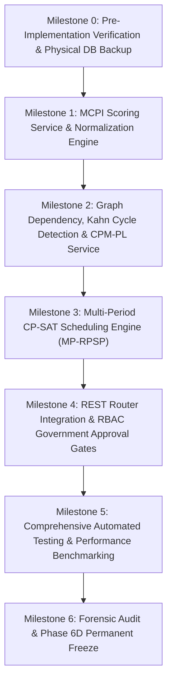

# DIRS Phase 6D-A — Phased Implementation Roadmap & Engineering Plan

**Document ID:** `DIRS-PHASE6D-DOC-11`  
**Classification:** PROJECT MANAGEMENT & ENGINEERING SPECIFICATION  
**Author:** Principal Software Architect & Systems Engineer  
**Date:** November 16, 2026  
**Status:** COMPLETE (PHASE 6D-A DESIGN BASELINE)  

---

## 1. Executive Summary

This roadmap establishes the chronological engineering execution sequence for Phase 6D (Recovery Prioritization & Multi-Period Project Scheduling), moving from algorithmic research (Phase 6D-A) to future implementation (Phase 6D-B) upon explicit project-owner authorization.

---

## 2. Phased Implementation Sequence (Phase 6D-B Execution Plan)

### Milestone 0: Pre-Implementation Verification & Safety Backup
- **Prerequisites**:
  - Live PostgreSQL 18.6 with PostGIS 3.6.2 running on port 5432.
  - Alembic revision confirmed at `phase6b_recovery_foundation`.
  - Full backend regression verified ($\ge 382$ passing tests).
  - Frontend production build clean (0 errors).
- **Mandatory Action**:
  - Capture physical recoverable database backup: `backend/backups/dirs_db_pre_phase6d_backup.sql`.
  - Verify backup restorable to disposable test database.

### Milestone 1: MCPI Prioritization Engine (`app/recovery/services/mcpi_service.py`)
- Implement normalized multi-criteria scoring:
  - $\phi_L$ (Life-Safety Urgency), $\phi_C$ (Infrastructure Tier), $\phi_V$ (Vulnerability Density), $\phi_D$ (Dependency Centrality), $\phi_E$ (Economic Restoration).
- Implement survey confidence decay discount multiplier $\Omega_j$.
- Implement Stage 1 Lexicographic Safety Pre-Filter ($S_L \ge 0.85 \implies \text{TIER\_1\_MANDATORY}$).
- Implement deterministic tie-breaking logic.
- Deliver unit test suite `test_mcpi_scoring.py` covering all normalization bounds, edge cases, and tie-breakers.

### Milestone 2: Dependency Graph & CPM-PL Service (`app/recovery/services/cpm_service.py`)
- Implement Kahn's Topological Sort algorithm for $O(|\mathcal{V}| + |\mathcal{E}|)$ cycle detection.
- Implement Cycle Isolation and DFS path extraction returning `ERR_CYCLIC_DEPENDENCY`.
- Implement CPM-PL with Virtual Source ($S_0$) and Virtual Terminal ($T_*$) for arbitrary disconnected components.
- Compute Early Start ($\text{ES}$), Early Finish ($\text{EF}$), Late Start ($\text{LS}$), Late Finish ($\text{LF}$), and Total Float ($\text{TF}$).
- Flag critical path projects and update `ProjectDependency.is_critical_path`.
- Deliver unit test suite `test_cpm_service.py` validating DAGs, cycles, disconnected components, and float calculations.

### Milestone 3: Multi-Period CP-SAT Scheduling Engine (`app/recovery/services/recovery_scheduler.py`)
- Implement Google OR-Tools CP-SAT formulation:
  - Variable instantiation: `model.NewIntervalVar`, `x[j, t]`, `y[j, t]`, `w[j]`.
  - Multi-predecessor precedence with lags ($w_j \le w_i$ and $\tau_j \ge \tau_i + d_i + L_{ij}$).
  - Multi-period capital cash-flow constraints ($c_{j, \delta} \le B_t$).
  - `model.AddCumulative` for renewable equipment and workforce capacity.
  - District equity floors and multi-source funding constraints.
- Implement deterministic solver controls: `random_seed = 42`, `max_time_in_seconds = 60.0`.
- Implement automated infeasibility diagnosis with relaxation advisory.

### Milestone 4: REST Router Integration & Governance Gates (`app/routers/recovery_optimization.py`)
- Mount endpoints under `/api/v1/recovery/optimization/*`.
- Enforce strict RBAC: calculation and schedule solving restricted to `GOVT` / `ADMIN`.
- Implement Government Approval Gate (`POST /runs/{run_id}/approve`):
  - Transitions recommended portfolio from `PROPOSED_PORTFOLIO` to `SANCTIONED_BY_GOVERNMENT`.
  - Emits immutable log to `RecoveryOverrideLog`.

### Milestone 5: Comprehensive Automated Testing & Performance Benchmarking
- Develop dedicated integration test file `tests/backend/test_phase6d_optimization.py` ($\ge 8$ dedicated test cases).
- Execute full 4-tier benchmark suite (Small $N=10$, Medium $N=50$, Large $N=200$, Stress $N=500$).
- Verify zero regression across existing 382 tests (Total tests $\ge 390$).
- Verify clean frontend production build.

### Milestone 6: Forensic Audit & Phase 6D Permanent Freeze
- Execute independent forensic code and database audit.
- Confirm Alembic revision remains unchanged.
- Author all Phase 6D completion and benchmark reports.
- Issue final acceptance gate verdict.

---

## 3. Governance Charter & Stop Condition

> [!CAUTION]
> This roadmap is an architectural blueprint. Execution of Milestone 0 through Milestone 6 is strictly conditional upon explicit project-owner authorization. Under no circumstances will implementation commence during Phase 6D-A.
