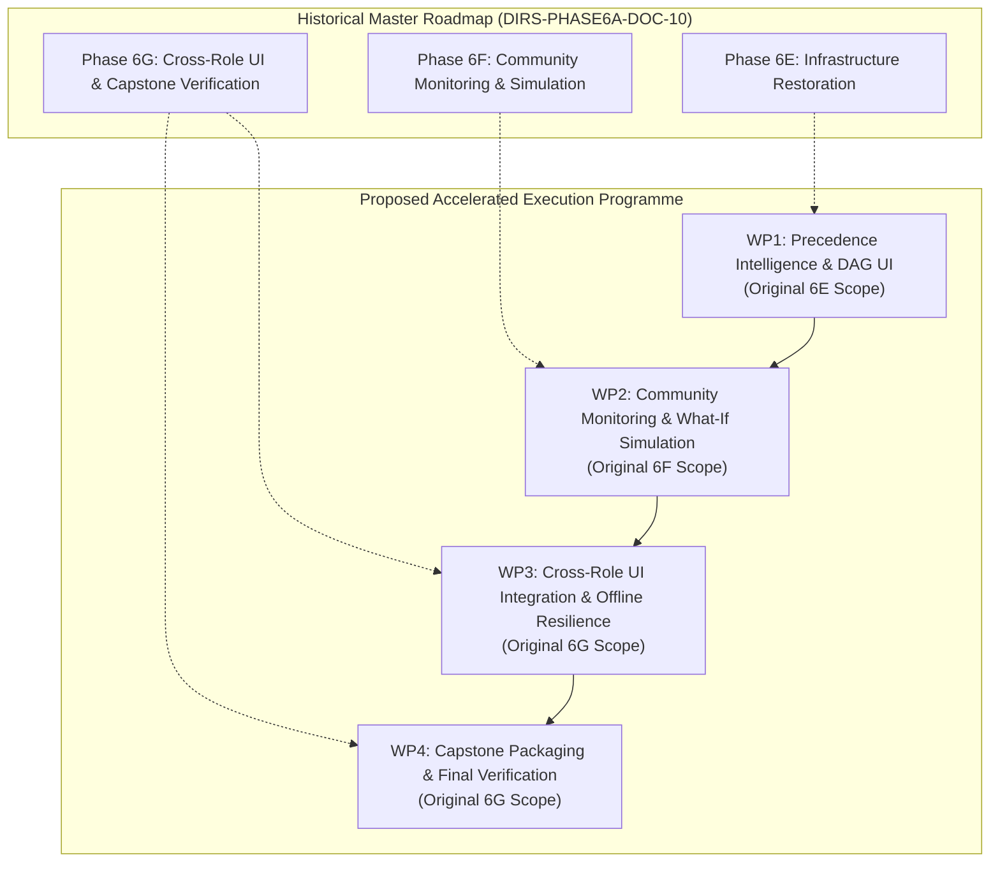
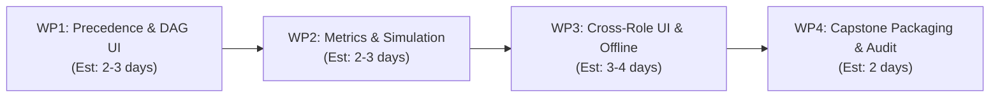

# DIRS Phase 6E: Implementation Roadmap & Execution Specification

**Document Reference:** `DIRS-PHASE6E-DOC-03`  
**Security Classification:** Strict Internal Engineering Specification  
**Baseline Parent:** Phase 6D-B Permanent Closure & Gate 2 Certified Baseline  
**Mode:** PROPOSED ACCELERATED EXECUTION ROADMAP  
**Governance Status:** PENDING PROJECT-OWNER AUTHORIZATION  

---

## 1. Executive Summary & Programme Structure

This implementation roadmap outlines the engineering execution plan for the remaining post-Phase 6D recovery capabilities in DIRS.

### 1.1 Dual Roadmap Traceability
* **Original Master Roadmap Identity:**
  - **Phase 6E:** Infrastructure Restoration Intelligence & Project Dependency Resolution
  - **Phase 6F:** Community Recovery Monitoring, Vulnerability Rescoring & Simulation Engine
  - **Phase 6G:** Cross-Role UI Integration, End-to-End Verification & Capstone Forensic Closure
* **Proposed Accelerated Execution Programme:**
  - Combines the outstanding functional requirements of 6E, 6F, and 6G into four structured, consolidated Work Packages (**WP1 through WP4**) to enable rapid, cohesive delivery without unnecessary micro-gating.
  - Requires explicit Project-Owner authorization before implementation begins.

---

## 2. Work Package Specifications

### 2.1 Work Package 1: Infrastructure Restoration Intelligence & Precedence Visualization
* **Original Phase Alignment:** Phase 6E
* **Objective:** Expose the existing pure mathematical CPM-PL and cycle detection algorithms via FastAPI REST endpoints, and implement an interactive, native React DAG visualizer.
* **Backend Deliverables:**
  - `GET /api/v1/recovery/dependencies/graph`: Extracts projects and dependencies, executes `ProjectDependencyService.analyze_dag()`, and returns compiled nodes (with coordinates, durations, ES/EF/LS/LF, floats, critical flag) and edges.
  - `POST /api/v1/recovery/dependencies/validate-edge`: Dry-run cycle validation that checks whether adding a candidate edge creates a cycle, returning `{is_valid: bool, cycle_path: List[str]}` without database mutation.
  - Pydantic DTOs in `backend/app/schemas/recovery.py`: `PrecedenceGraphResponse`, `PrecedenceEdgeValidateRequest`, `PrecedenceEdgeValidateResponse`.
* **Frontend Deliverables (React 18 / TypeScript):**
  - `frontend/src/components/recovery/PrecedenceGraphVisualizer.tsx`: Pure React SVG/HTML5 Canvas component with topological layout, critical path highlights (red stroke/glow), zoom/pan controls, and node selection inspector.
  - Real-time cycle prevention feedback modal.
* **Database Feasibility:** Supported by existing schema (`ProjectDependency`, `RecoveryProject`). Zero migrations required.

---

### 2.2 Work Package 2: Community Recovery Monitoring & Simulation Engine
* **Original Phase Alignment:** Phase 6F
* **Objective:** Deliver multi-sector longitudinal metric aggregation with confidence decay, and an in-memory "What-If" scenario simulation engine for recovery planners.
* **Backend Deliverables:**
  - `backend/app/recovery/services/community_monitoring_service.py`: Computes sector recovery indices, applies exponential temporal confidence decay ($C(t) = C_0 \cdot e^{-\lambda t}$), and evaluates ward health.
  - `GET /api/v1/recovery/community-metrics/summary`: Returns aggregated sector progress and confidence metrics.
  - `POST /api/v1/recovery/simulation/what-if`: In-memory parameter perturbation engine evaluating budget adjustments ($\pm 50\%$), resource shifts, and disaster recurrence shocks without database persistence.
* **Frontend Deliverables (React 18 / TypeScript):**
  - `frontend/src/pages/admin/RecoverySimulationView.tsx`: Interactive simulation workbench featuring perturbation sliders (budget, resources, shocks), side-by-side Recharts timeline comparisons, and bottleneck alerts.
* **Database Feasibility:** Supported by existing schema (`CommunityRecoveryMetric`, `RecoveryProject`). Zero migrations required.

---

### 2.3 Work Package 3: Cross-Role UI Integration & Offline Resilience
* **Original Phase Alignment:** Phase 6G
* **Objective:** Deliver dedicated recovery interfaces for all four operational roles (`CITIZEN`, `VOLUNTEER`, `NGO`, `GOVT`), incorporating browser-side offline resilience for field assessments.
* **Frontend Deliverables (React 18 / TypeScript):**
  - **Citizen Recovery View:** `frontend/src/pages/citizen/CitizenRecoveryView.tsx` — Public ward restoration status tracking and household damage claim submission.
  - **Volunteer Field Assessment:** `frontend/src/pages/volunteer/VolunteerAssessmentForm.tsx` — Rapid mobile-optimized survey form.
  - **Offline Resilience:** `frontend/src/hooks/useOfflineDrafts.ts` — HTML5 `indexedDB` caching (`dirs_offline_db`) for field survey drafts, with automatic sync replay to `/api/v1/recovery/damage-assessments/field-inspection` upon reconnection.
  - **NGO Resource Matchmaking:** `frontend/src/pages/ngo/NGORecoveryResourcesView.tsx` — Displays unmet reconstruction needs and enables formal equipment/material pledging.
  - **Command Center Integration:** `frontend/src/components/recovery/RecoveryHealthWidget.tsx` — Embedded into `frontend/src/pages/admin/CommandCenter.tsx`.
* **Database Feasibility:**
  - Citizen reporting & Volunteer surveys: Supported by existing schema (`RecoveryAssessment` with `provenance_tier`).
  - NGO resource pledging: Supported with application-layer changes (recording pledge details in `supplier_info` and setting `delivery_status="PLEDGED"` in `RecoveryResource`).

---

### 2.4 Work Package 4: Capstone Packaging, Demonstration Data & Final Verification
* **Original Phase Alignment:** Phase 6G
* **Objective:** Create deterministic demonstration datasets, execute the cross-role acceptance suite, and produce capstone operator runbooks.
* **Deliverables:**
  - `scripts/seed_phase6e_capstone.py`: Deterministic multi-hazard seed script generating an integrated scenario (e.g., severe flood affecting 4 municipal wards, 30 damage sites, 12 interdependent recovery projects, and NGO pledges).
  - Cross-role backend integration suite: `tests/backend/test_phase6e_cross_role.py`.
  - Multi-persona Playwright E2E suite validating citizen $\rightarrow$ volunteer $\rightarrow$ NGO $\rightarrow$ government flows.
  - Comprehensive operator runbooks and capstone architecture documentation.

---

## 3. Strict Boundary & Non-Goals

The following activities belong exclusively to **Phase 7** and are strictly prohibited in Phase 6E:
1. High-concurrency load testing ($10,000+$ virtual users).
2. Distributed chaos engineering and network fault injection.
3. External multi-agency federation (NDRF, IMD, CWC).
4. Cloud multi-region Kubernetes/Helm deployment orchestration.
5. Third-party CREST penetration testing.

---

## 4. Work Package Dependencies & Schedule

Implementation will proceed sequentially, package by package, only upon receiving explicit Project-Owner authorization for each work package.
