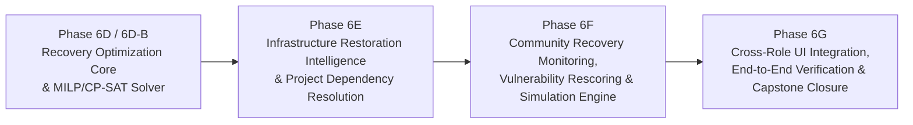

# DIRS Phase 6E: Master Roadmap Reconciliation & Historical Traceability

**Document Reference:** `DIRS-PHASE6E-DOC-01`  
**Security Classification:** Strict Internal Engineering Specification  
**Governing Authority:** DIRS Architectural Review Board & Project Ownership  
**Mode:** READ-ONLY FORENSIC RECONCILIATION & EXECUTION RESTRUCTURING  
**Parent Baselines:** Phase 6D-B Certified Baseline, Gate 2 Frozen Baseline (23 files)  

---

## 1. Executive Summary & Purpose

The purpose of this document is to establish authoritative historical traceability for the post-Phase 6D phases of the Disaster Intelligence and Response System (DIRS) and to formally define the proposed accelerated execution programme for remaining recovery capabilities.

Crucially, this specification:
1. **Preserves Original Phase Identity:** Fully honors the historical definitions of Phase 6E, Phase 6F, and Phase 6G as recorded in the master roadmap (`DIRS-PHASE6A-DOC-10`).
2. **Details the Proposed Consolidated Execution Structure:** Proposes a unified, accelerated four-package execution programme that combines the remaining responsibilities of 6E, 6F, and 6G into structured work packages (WP1 through WP4), pending explicit Project-Owner approval.
3. **Reconciles Erroneous Literature:** Clarifies that isolated references to decentralized CRDT consensus were exploratory proposals without codebase or schema backing, and reaffirms the centralized municipal governance model.

---

## 2. Concept A: Original Roadmap Phase Identity

The canonical historical reference for Phase 6 is `docs/PHASE6_IMPLEMENTATION_ROADMAP.md` (Document ID `DIRS-PHASE6A-DOC-10`), established during Phase 6A remediation. The authoritative original roadmap divided post-Phase 6D work into three distinct, sequential phases:

### 2.1 Original Phase 6E: Infrastructure Restoration Intelligence & Project Dependency Resolution
* **Scope:** Critical Path Method with Positive Lag (CPM-PL), Kahn’s algorithm topological sorting, cycle detection, critical path calculation, and spatial infrastructure topological linking.
* **Historical Implementation Status:**
  - The *pure mathematical algorithms* for Kahn's cycle detection and CPM-PL were implemented during Phase 6D-B Milestones 1 and 2B in `backend/app/recovery/services/project_dependency_service.py` to support precedence constraints in the CP-SAT solver.
  - However, standalone DAG API endpoints, graph extraction queries, and interactive visual dependency components were not exposed.

### 2.2 Original Phase 6F: Community Recovery Monitoring, Vulnerability Rescoring & Simulation Engine
* **Scope:** Longitudinal ward recovery indicator tracking (`CommunityRecoveryMetric`), confidence decay modeling ($C(t) = C_0 \cdot e^{-\lambda t}$), census reconciliation against affected household baselines, and what-if simulation for resource reallocations and disaster shocks.
* **Historical Implementation Status:**
  - Database models (`CommunityRecoveryMetric`, `RecoveryNeed`) and basic ingestion routes were established in Phase 6B.
  - The analytical simulation engine and dynamic parameter perturbation endpoints remain unbuilt.

### 2.3 Original Phase 6G: Cross-Role UI Integration, End-to-End Verification & Capstone Forensic Closure
* **Scope:** End-to-end integration across all four operational user personas (`CITIZEN`, `VOLUNTEER`, `NGO`, `GOVT_OFFICIAL`), field assessment workflows with offline client resilience, unified command center dashboard widgets, capstone scenario demonstration datasets, and system closure audits.
* **Historical Implementation Status:**
  - Role-specific dashboard shells exist in `frontend/src/pages/`, but recovery-specific workflows (damage claims, volunteer field surveys, NGO resource pledges) are not fully wired to recovery backend services.

---

## 3. Concept B: Proposed Accelerated Execution Programme (Consolidated 6E/6F/6G)

To eliminate bureaucratic overhead between micro-gates and ensure efficient delivery, an **Accelerated Execution Programme** is proposed. Under this programme, the remaining deliverables of Phases 6E, 6F, and 6G are organized into four consolidated Work Packages (WP1 through WP4):

| Work Package | Title | Primary Scope | Original Phase Traceability |
| :--- | :--- | :--- | :--- |
| **WP1** | Infrastructure Restoration Intelligence & Precedence Visualization | Standalone precedence DAG API routes, cycle validation endpoints, and React SVG/Canvas DAG visualizer (`PrecedenceGraphVisualizer.tsx`). | **Original Phase 6E** |
| **WP2** | Community Recovery Monitoring & Simulation | Multi-sector indicator aggregation, confidence decay service, and interactive "What-If" scenario simulation engine (`RecoverySimulationView.tsx`). | **Original Phase 6F** |
| **WP3** | Cross-Role UI Integration & Offline Resilience | Citizen recovery portal, volunteer field assessment forms with IndexedDB offline caching, NGO pledge matching, and command center health widgets. | **Original Phase 6G** (Cross-Role & Offline) |
| **WP4** | Capstone Packaging, Demonstration Data & Final Verification | Deterministic multi-hazard seed datasets, multi-role acceptance tests (`tests/backend/test_phase6e_cross_role.py`), runbooks, and formal capstone closure. | **Original Phase 6G** (Packaging & Verification) |

> [!IMPORTANT]
> **Governance Notice:** The consolidated execution structure is a proposed project management vehicle. It does **not** overwrite historical records. Implementation of these packages remains strictly subject to explicit Project-Owner authorization.

---

## 4. Rejection of Decentralized CRDT Proposal

A rogue proposal appeared in line 83 of `docs/PHASE6D_B_FINAL_READINESS_GATE.md` describing Phase 6E as *"Decentralized Synchronization, Conflict-Free Replicated Data Types (CRDTs), and central reconciliation"*.

Forensic analysis confirms:
1. **Zero Repository Precedent:** No CRDT dependencies (`yjs`, `automerge`), no peer-to-peer protocols, and no distributed conflict-resolution schemas exist in the DIRS codebase.
2. **Architectural Contradiction:** DIRS operates on a centralized municipal command architecture with strict role-based access control (RBAC), relational integrity, and authoritative government approval gates. Peer-to-peer synchronization contradicts this design.
3. **Formal Determination:** Decentralized CRDT synchronization is formally rejected as ungrounded scope creep. True field resilience is achieved via standard client-side browser caching (HTML5 IndexedDB) with background replay to authoritative FastAPI endpoints upon network restoration, as specified in WP3.

---

## 5. Traceability Matrix

| Original Phase Requirement | Original Phase | Proposed Consolidated Work Package | Technical Deliverables |
| :--- | :---: | :---: | :--- |
| CPM-PL Topological Sorting | 6E | WP1 | `backend/app/recovery/services/project_dependency_service.py` (already present) |
| Precedence Graph API Route | 6E | WP1 | `GET /api/v1/recovery/dependencies/graph` |
| Dry-Run Cycle Validation | 6E | WP1 | `POST /api/v1/recovery/dependencies/validate-edge` |
| Interactive Precedence DAG UI | 6E | WP1 | `frontend/src/components/recovery/PrecedenceGraphVisualizer.tsx` (React) |
| Community Metric Aggregation | 6F | WP2 | `backend/app/recovery/services/community_monitoring_service.py` |
| Temporal Confidence Decay | 6F | WP2 | Exponential decay calculation in monitoring service |
| What-If Scenario Simulation | 6F | WP2 | `POST /api/v1/recovery/simulation/what-if` & `RecoverySimulationView.tsx` |
| Citizen Recovery Claims | 6G | WP3 | `frontend/src/pages/citizen/CitizenRecoveryView.tsx` |
| Offline Field Assessments | 6G | WP3 | IndexedDB store (`dirs_offline_db`) + `OfflineAssessmentForm.tsx` |
| NGO Resource Matchmaking | 6G | WP3 | `frontend/src/pages/ngo/NGORecoveryResourcesView.tsx` |
| Command Center Widget | 6G | WP3 | `frontend/src/components/recovery/RecoveryHealthWidget.tsx` |
| Multi-Hazard Capstone Seed | 6G | WP4 | `scripts/seed_phase6e_capstone.py` |
| Cross-Role Acceptance Tests | 6G | WP4 | `tests/backend/test_phase6e_cross_role.py` + Playwright suites |
