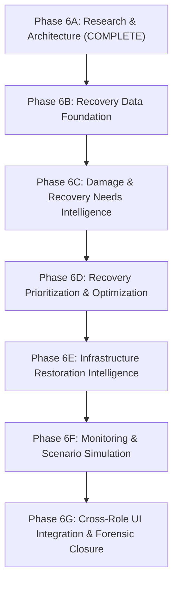

# DIRS Phase 6A — Implementation Roadmap & Execution Plan
## Staged Subphase Decomposition (6B through 6G), Quality Gates, Dependencies, and Rollback Protocols

**Document ID:** `DIRS-PHASE6A-DOC-10`  
**System:** Disaster Intelligence and Response System (DIRS)  
**Classification:** PROJECT MANAGEMENT & IMPLEMENTATION ROADMAP  
**Author:** Principal Disaster-Management Systems Architect & Capstone Lead  
**Date:** November 16, 2026 (Remediated Dependency Baseline)  

---

## 1. Roadmap Strategy and Capstone Scope Alignment

Phase 6 ("Post-Disaster Intelligence & Recovery Analytics") is engineered for disciplined execution across a four-member engineering team. To guarantee that frozen Phases 1–5G (368 passing tests) remain 100% regression-free, Phase 6 is divided into **six sequential, independently reviewable subphases** (6B through 6G), preceded by architectural freeze gate 6A:

---

## 2. Subphase Breakdown and Specifications

### Subphase 6A: Research, Architecture, Mathematical Modeling & System Audit (Current)
- **Status:** Complete & Awaiting Project-Owner Sign-Off.
- **Deliverables:** Fourteen comprehensive architectural, mathematical, source verification, and governance documents under `docs/`.
- **Constraint:** Zero code or schema modifications permitted.

---

### Subphase 6B: Recovery Data Foundation
- **Scope:**
  - Create SQLAlchemy 2.x declarative models in `backend/app/models/recovery.py`: `RecoveryAssessment`, `RecoveryNeed`, `RecoveryProject`, `ProjectDependency`, `RecoveryResource`, `CommunityRecoveryMetric`, `RecoveryOverrideLog`.
  - Implement Pydantic 2.x schemas in `backend/app/schemas/recovery.py` using `ConfigDict` and `json_schema_extra`.
  - Implement Alembic migration script for PostgreSQL 18.6 / PostGIS 3.6.2 tables with spatial indexes and foreign key constraints (`ON DELETE RESTRICT` / `CASCADE`).
  - Unit tests for model relationships and cascade behaviors.
- **Dependencies:** Subphase 6A approval.
- **Acceptance Gate:**
  - Database migration executes cleanly forward and backward (`alembic upgrade head`, `alembic downgrade -1`).
  - Automated unit and model contract tests pass ($\ge 15$ tests).
  - Existing 368 backend tests continue to pass with 0 regressions.

---

### Subphase 6C: Damage and Recovery Needs Intelligence
- **Scope:**
  - Implement `AssessmentService` in `backend/app/recovery/services/assessment_service.py`.
  - Integrate read-only Phase 3B computer-vision screening via `ComputerVisionService.analyze_incident_image()`.
  - Implement Census Baseline Reconciliation Engine in `backend/app/recovery/services/needs_service.py` capping reported ward headcounts against census population to strictly prevent double-counting.
  - Implement duplicate assessment clustering and monotonic assessment versioning (`is_current_version`, `superseded_by_id`).
  - Implement REST endpoints: `POST/GET /api/v1/recovery/assessments`, `POST /api/v1/recovery/assessments/{id}/verify`, `GET /api/v1/recovery/needs`.
- **Dependencies:** Subphase 6B completion.
- **Acceptance Gate:**
  - Double-counting prevention verified: duplicate citizen reports capped to census totals.
  - Tier-1 CV facade screening integration verified with test images.
  - Versioning verified: new inspections create version 2 without overwriting historical version 1.
  - Regression suite passes 100%.

---

### Subphase 6D: Recovery Prioritization and Optimization
- **Scope:**
  - Implement `RecoveryPrioritizer` in `backend/app/recovery/optimization/prioritizer.py` computing the Multi-Criteria Recovery Priority Index (MCPI).
  - Implement statutory district bounding intervals validation ($w_L \in [0.20, 0.45]$, $\sum w = 1.0$) with rejection of malformed weights.
  - Implement `ProjectScheduler` using Google OR-Tools CP-SAT in `backend/app/recovery/optimization/project_scheduler.py` solving the Multi-Period Recovery Project Scheduling Problem (MP-RPSP).
  - Implement soft budget relaxation for capital deficit diagnostics.
  - Implement REST endpoints: `POST /api/v1/recovery/prioritization/calculate`, `POST /api/v1/recovery/projects`, `POST /api/v1/recovery/projects/{id}/approve`.
- **Dependencies:** Subphase 6C completion.
- **Acceptance Gate:**
  - Mathematical invariant tests proven: periodic budget conservation, weight normalization.
  - 4-project 4-period numerical toy example independently passes in automated pytest.
  - CP-SAT solve time $< 5.0\text{ seconds}$ on 50-project benchmark instance.

---

### Subphase 6E: Infrastructure Restoration Intelligence
- **Scope:**
  - Implement `InfrastructureGraphEngine` in `backend/app/recovery/graph/dependency_graph.py`.
  - Implement Kahn's cycle detection and Tarjan's SCC algorithm with structured cycle error paths (`ERR_CYCLIC_DEPENDENCY`).
  - Implement multi-predecessor forward pass and multi-successor backward pass.
  - Implement virtual source ($S_0$) and virtual terminal ($T_*$) augmentation for disconnected project networks.
  - Implement critical path extraction ($\mathcal{V}_{\text{crit}} = \{j \mid \text{TF}_j = 0\}$).
  - Implement REST endpoints: `POST /api/v1/recovery/dependencies`, `POST /api/v1/recovery/restoration-graph/solve`.
- **Dependencies:** Subphase 6D completion.
- **Acceptance Gate:**
  - Cycle detection tests pass: cycles $A \rightarrow B \rightarrow C \rightarrow A$ rejected with HTTP 400 and full cycle path.
  - Disconnected subgraphs successfully augmented and scheduled with single makespan $T_{\max}$.
  - Float math verified: critical path nodes verified with $\text{TF} == 0$.

---

### Subphase 6F: Community Monitoring and Recovery Scenario Simulation
- **Scope:**
  - Implement `CommunityMonitoringService` in `backend/app/recovery/services/monitoring_service.py` tracking longitudinal ward recovery indicators.
  - Implement exponential confidence decay model ($\lambda$ in $\text{days}^{-1}$) and discrete freshness categories (`FRESH`, `MODERATE`, `STALE_AMBER`, `EXPIRED_RED`).
  - Implement `RecoverySimulationEngine` in `backend/app/recovery/services/simulation_service.py` extending Phase 5G immutable what-if simulation architecture (budget cuts, supply delays, secondary shocks).
  - Implement REST endpoints: `GET /api/v1/recovery/community-monitoring`, `POST /api/v1/recovery/simulation/run`.
- **Dependencies:** Subphase 6E completion.
- **Acceptance Gate:**
  - Monotonic confidence decay verified across simulated time steps.
  - Simulation state verified 100% isolated: base database records confirmed unmodified during and after simulations.

---

### Subphase 6G: Cross-Role UI Integration, End-to-End Verification & Forensic Closure
- **Scope:**
  - Frontend React 18 / TypeScript components:
    - Government Recovery Command Center: Interactive timeline/Gantt view, project portfolio table, MCPI weight adjustment sliders, and approval modals.
    - Citizen Community Recovery Dashboard: Ward-level utility status, shelter decommissioning indicators, and assistance requests.
  - Comprehensive end-to-end cross-role integration tests (`tests/backend/test_phase6_cross_role.py`).
  - Final capstone demonstration packaging, user documentation, and video walkthrough script.
- **Dependencies:** Subphase 6F completion.
- **Acceptance Gate:**
  - Full cross-role end-to-end integration pass across Citizen and Government workflows.
  - Frontend production build (`tsc && vite build`) compiles with 0 errors.
  - Complete backend test suite ($\ge 410$ total tests) achieves 100% pass rate.

---

## 3. Rollback Protocol and Safety Controls

In the event that an implementation subphase introduces an architectural regression or fails an acceptance gate:
1. **Database Rollback:** Alembic downgrade script executes atomically:
   `alembic downgrade -1`
2. **Git Branch Isolation:** Each subphase is developed in an isolated feature branch (`feature/phase6b-models`, `feature/phase6c-needs`, etc.). Merges to `main` require a clean run of the frozen 368 regression tests.
3. **Emergency Disablement:** The recovery router group can be completely unmounted from `main.py` by commenting out a single line (`# app.include_router(recovery.router)`), immediately restoring the exact Phase 1–5G operational baseline without service disruption.
