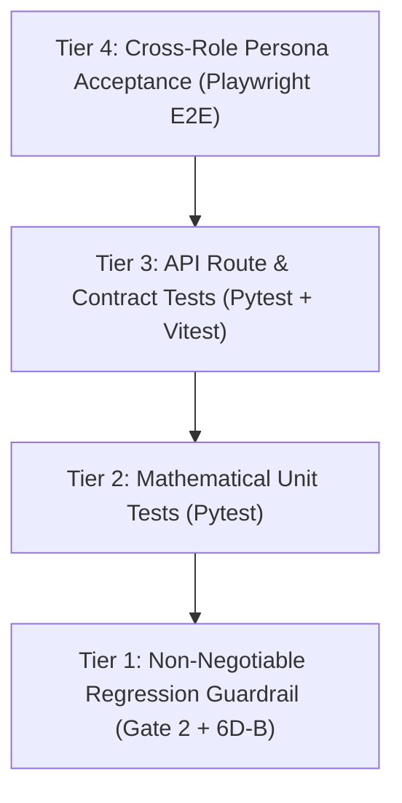

# DIRS Phase 6E: Acceptance and Test Strategy

**Document Reference:** `DIRS-PHASE6E-DOC-04`  
**Security Classification:** Strict Internal Engineering Specification  
**Baseline Parent:** Phase 6D-B Permanent Closure & Gate 2 Certified Baseline  
**Mode:** ACCEPTANCE SPECIFICATION & QUALITY GOVERNANCE  
**Governance Status:** PENDING PROJECT-OWNER AUTHORIZATION  

---

## 1. Executive Summary & Strategy Overview

This document specifies the verification methodology, quality gates, and multi-tier test suites required to validate the proposed Accelerated Execution Programme (covering remaining Phase 6E, 6F, and 6G capabilities).

### 1.1 Dual Roadmap Alignment
- **Historical Phase Scope:**
  - Original Phase 6E: Infrastructure Precedence Intelligence
  - Original Phase 6F: Community Recovery Monitoring & Simulation
  - Original Phase 6G: Cross-Role UI Integration, Offline Resilience & Capstone Verification
- **Execution Delivery:** Grouped into four consolidated Work Packages (WP1 through WP4).

---

## 2. Multi-Tier Testing Pyramid

### 2.1 Tier 1: Regression Guardrail Suite (Non-Negotiable)
Before committing any package deliverables, the entire baseline test suite must pass with zero failures:
* **Backend Regression Suite:** 612 tests across unit, integration, and security layers (`pytest tests/`). Execution time budget: $\le 60\text{ s}$.
* **Frontend Contract Suite:** 76 contract tests verifying DTO compliance (`npm run test:contract`).
* **Frontend Gate 3 E2E Suite:** 39 canonical Playwright E2E tests (`npx playwright test`).
* **Gate 2 Baseline Integrity:** SHA-256 validation of the 23 certified Gate 2 baseline files and `task.md`.

### 2.2 Tier 2: Mathematical & Algorithmic Unit Tests
Focuses on pure mathematical functions in `backend/app/recovery/services/`:
* Kahn’s algorithm topological sort and exact directed cycle extraction (`ProjectDependencyService`).
* Forward and backward CPM-PL passes, Total Float, Free Float, and Critical Path flags.
* Exponential temporal confidence decay: $C(t) = C_0 \cdot e^{-\lambda t}$.
* Population and need disparity calculations.

### 2.3 Tier 3: Route Contract & Component Tests
* **FastAPI Endpoints:**
  - `GET /api/v1/recovery/dependencies/graph`
  - `POST /api/v1/recovery/dependencies/validate-edge`
  - `GET /api/v1/recovery/community-metrics/summary`
  - `POST /api/v1/recovery/simulation/what-if`
* **React Component Tests (Vitest / React Testing Library):**
  - `PrecedenceGraphVisualizer.tsx`: Validates SVG rendering of nodes, directed dependency edges, and critical path highlighting.
  - `RecoverySimulationView.tsx`: Validates perturbation slider bindings and Recharts delta rendering.
  - `useOfflineDrafts.ts`: Validates IndexedDB persistence and retrieval under mock network conditions.

### 2.4 Tier 4: Cross-Role End-to-End Acceptance (Playwright)
* Cross-role disaster recovery lifecycle execution across all four user personas (`CITIZEN`, `VOLUNTEER`, `NGO`, `GOVT`).
* Offline field simulation: Disconnecting browser network, filling out volunteer damage assessments, verifying IndexedDB storage, reconnecting network, and asserting automatic background synchronization.

---

## 3. Work Package Acceptance Criteria

### 3.1 Work Package 1: Infrastructure Restoration & Precedence Visualization (Original 6E)
* **AC-WP1-01 (Graph API Contract):** `GET /api/v1/recovery/dependencies/graph` returns HTTP 200 with complete node attributes (id, title, duration, ES, EF, LS, LF, total_float, is_critical) and directed edges (predecessor_id, successor_id, lag_days).
* **AC-WP1-02 (Cycle Dry-Run Validation):** `POST /api/v1/recovery/dependencies/validate-edge` with a candidate edge that introduces a cycle returns `{is_valid: false, cycle_path: ["PRJ-1", "PRJ-2", "PRJ-1"]}` without modifying database records.
* **AC-WP1-03 (React Visualizer):** `PrecedenceGraphVisualizer.tsx` renders nodes as SVG elements with topological layout, highlights critical paths in red/amber, and supports panning and zooming.

### 3.2 Work Package 2: Community Monitoring & Simulation Engine (Original 6F)
* **AC-WP2-01 (Aggregated Metrics API):** `GET /api/v1/recovery/community-metrics/summary` aggregates ward-level indicators into sector health indices and applies temporal confidence decay.
* **AC-WP2-02 (Simulation Engine):** `POST /api/v1/recovery/simulation/what-if` accepts budget variations ($\pm 50\%$) and resource changes, returning projected makespan and bottleneck shifts in $< 500\text{ ms}$ without database mutation.
* **AC-WP2-03 (Simulation UI):** `RecoverySimulationView.tsx` renders side-by-side Recharts comparisons of baseline vs. simulated recovery curves.

### 3.3 Work Package 3: Cross-Role UI Integration & Offline Resilience (Original 6G)
* **AC-WP3-01 (Citizen Portal):** `CitizenRecoveryView.tsx` allows citizens to track ward recovery and submit damage reports.
* **AC-WP3-02 (Volunteer Field Form & IndexedDB):**
  - `VolunteerAssessmentForm.tsx` saves draft surveys to IndexedDB (`dirs_offline_db`) when `navigator.onLine === false`.
  - Upon reconnection, pending drafts are replayed to `POST /api/v1/recovery/damage-assessments/field-inspection`.
* **AC-WP3-03 (NGO Matchmaking):** `NGORecoveryResourcesView.tsx` allows NGOs to view open material needs and record pledges (persisted via `supplier_info` / `delivery_status="PLEDGED"`).
* **AC-WP3-04 (Command Center Widget):** `RecoveryHealthWidget.tsx` renders summary KPIs in `CommandCenter.tsx`.

### 3.4 Work Package 4: Capstone Packaging & System Hardening (Original 6G)
* **AC-WP4-01 (Seed Script):** `scripts/seed_phase6e_capstone.py` populates a deterministic multi-hazard scenario (flood affecting 4 wards, 12 interdependent projects, 30 damage sites).
* **AC-WP4-02 (Full E2E Pass):** `tests/backend/test_phase6e_cross_role.py` and Playwright suites pass with 100% success rate.
* **AC-WP4-03 (Zero Regression):** Full 612 backend tests, 76 contract tests, and 39 Gate 3 tests maintain 100% pass rate.

---

## 4. Test Case Inventory

| Test ID | Category | Target | Expected Result |
| :--- | :--- | :--- | :--- |
| **TC-6E-CPM-01** | Unit | `ProjectDependencyService.compute_cpm_pl` | Correct ES, EF, LS, LF, float, and critical path |
| **TC-6E-CPM-02** | Unit | `ProjectDependencyService.detect_cycle_and_toposort` | Raises `CyclicDependencyError` with cycle path |
| **TC-6E-API-01** | Contract | `GET /recovery/dependencies/graph` | HTTP 200, valid nodes, edges, critical path |
| **TC-6E-API-02** | Contract | `POST /recovery/dependencies/validate-edge` | HTTP 200, returns `{is_valid: false}` on cycle |
| **TC-6E-API-03** | Contract | `GET /recovery/community-metrics/summary` | HTTP 200, sector scores with confidence decay |
| **TC-6E-API-04** | Contract | `POST /recovery/simulation/what-if` | HTTP 200, non-mutating comparative projection |
| **TC-6E-UI-01** | React Component | `PrecedenceGraphVisualizer.tsx` | SVG renders DAG nodes and critical path |
| **TC-6E-UI-02** | React Component | `RecoverySimulationView.tsx` | Sliders update what-if projection charts |
| **TC-6E-UI-03** | React Component | `CitizenRecoveryView.tsx` | Displays ward metrics and damage report form |
| **TC-6E-UI-04** | React Component | `VolunteerAssessmentForm.tsx` | Validates inputs and triggers offline hook |
| **TC-6E-UI-05** | React Component | `NGORecoveryResourcesView.tsx` | Submits resource pledge with project linkage |
| **TC-6E-OFF-01** | Resilience | `useOfflineDrafts.ts` | Saves draft to IndexedDB on offline event |
| **TC-6E-OFF-02** | Resilience | Background Replay Queue | Replays drafts on online event; confirms ACK |
| **TC-6E-E2E-01** | Playwright E2E | Cross-Role Disaster Lifecycle | Citizen report $\rightarrow$ Volunteer survey $\rightarrow$ Gov schedule $\rightarrow$ NGO pledge |

---

## 5. Pass/Fail Governance

A work package can only achieve closure when:
1. All associated Phase 6E test cases achieve 100% pass rate.
2. The 612 backend regression tests, 76 contract tests, and 39 Gate 3 tests achieve 100% pass rate.
3. Clean production build: `npm run build` succeeds with 0 TypeScript diagnostics.
4. SHA-256 hashes of the 23 certified Gate 2 baseline files and `task.md` remain unchanged.
