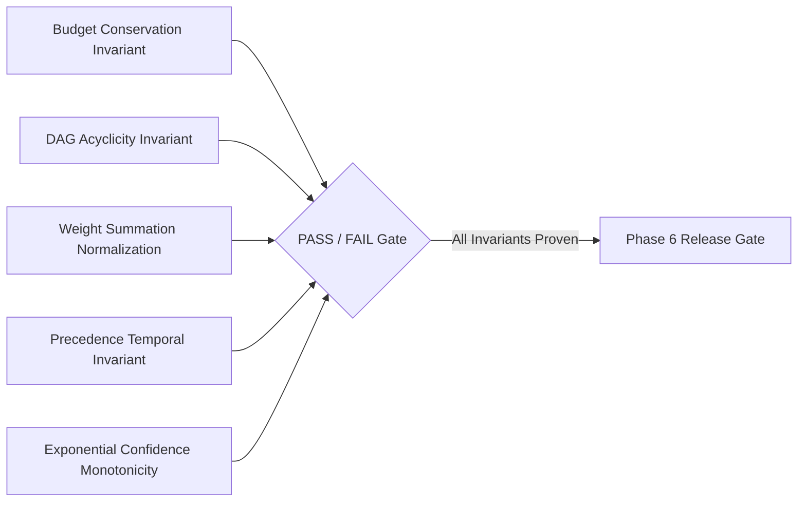

# DIRS Phase 6A — Prospective Validation & Benchmark Plan
## Verification Methodology, Invariant Testing, Sensitivity Framework, and Scalability Gates

**Document ID:** `DIRS-PHASE6A-DOC-09`  
**System:** Disaster Intelligence and Response System (DIRS)  
**Classification:** QUALITY ASSURANCE, BENCHMARK DESIGN & VALIDATION GATE  
**Author:** Principal QA Architect & Operations-Research Scientist  

---

## 1. Validation Philosophy and Anti-Fabrication Safeguards

> [!WARNING]
> **PROSPECTIVE BENCHMARK NOTICE:**  
> All benchmark performance figures, solver convergence speeds, and accuracy metrics in this document represent **proposed engineering targets**. In accordance with strict Phase 6A rules, no synthetic benchmark results shall be claimed as achieved until automated test suites are executed and empirically recorded in Phase 6B/6C.

The Phase 6 validation harness is designed around six rigorous testing tiers:
1. **Unit & Contract Tests:** Verifying schema validation, serialization, and boundary conditions.
2. **Mathematical Invariant Tests:** Proving conservation of funds, non-negativity, acyclic graph structure, and topological sorting invariants.
3. **Missing-Data & Adversarial Tests:** Probing solver behavior under sparse, contradictory, or malicious inputs.
4. **Determinism & Reproducibility Tests:** Ensuring identical random seeds and inputs produce bit-identical project schedules.
5. **Sensitivity & Trade-off Analysis:** Evaluating MCPI ranking stability under weight perturbations.
6. **Scalability Benchmarks:** Evaluating CP-SAT and CPM performance under large-scale district portfolios ($N = 50, 100, 250, 500$ projects).

---

## 2. Mathematical Invariant Verification Suite

### 2.1 The Five Core Invariant Tests

| Invariant ID | Mathematical / Logical Invariant Definition | Verification Test Implementation | Expected Assertion |
| :---: | :--- | :--- | :--- |
| **INV-01** | **Periodic Budget Conservation:** For every planning period $t$, total allocated capital expenditure must not exceed the available periodic budget envelope: $\sum_j c_{j, \tau} \cdot x_{j, t - \tau + 1} \le B_t$. | Run MP-RPSP solver across 50 simulated project instances with tight budgets. | `assert sum(period_expenditures) <= budget_envelope` |
| **INV-02** | **DAG Acyclicity & Precedence Invariant:** For every dependency edge $(i, j) \in \mathcal{E}$, the successor's start date must be strictly greater than or equal to the predecessor's finish date plus lag: $S_j \ge C_i + L_{ij}$. | Generate synthetic 100-node graph with random dependencies; assert no cycles and verify schedule validity. | `assert schedule[j].start >= schedule[i].completion + edge.lag` |
| **INV-03** | **Weight Normalization Invariant:** For MCPI calculation, sum of criteria weights must equal 1.0: $\sum_{k} w_k = 1.0 \pm 10^{-4}$. | Submit malformed weights ($\sum w = 1.4$) via API. | System rejects with `HTTP 422 Unprocessable Entity`; valid weights yield score in $[0, 100]$. |
| **INV-04** | **Double-Counting Headcount Reconciliation:** In any ward, the sum of affected persons cannot exceed the census baseline cap: $\sum_{j \in W} P_j \le P_{\text{census}}(W)$. | Ingest duplicate citizen reports in Ward 14 totaling $15,000$ in a ward of $10,000$ residents. | Reconciliation engine caps total to $10,000$ and flags duplicate records. |
| **INV-05** | **Confidence Decay Monotonicity:** Data confidence $\mathcal{C}(t)$ must strictly decrease monotonically as elapsed time increases: $t_2 > t_1 \implies \mathcal{C}(t_2) \le \mathcal{C}(t_1)$. | Evaluate confidence function over a 60-day simulated timeline. | `assert all(c[i] >= c[i+1] for i in range(len(c)-1))` |

---

## 3. Prospective Scalability Benchmark Specifications

The following benchmark suites are designed to evaluate the computational tractability of Phase 6 solvers prior to production deployment:

### Benchmark Suite A: Critical Path Method (CPM-PL) Graph Engine
- **Target Subsystem:** `app/recovery/graph/dependency_graph.py`
- **Methodology:** Generate synthetic Directed Acyclic Graphs with forward and backward passes.
- **Trial Count:** 100 independent trials per dataset size.
- **Hardware Environment:** Quad-Core x86_64, 16 GB RAM, PostgreSQL 16 (Standard Development Baseline).

| Dataset Size | Graph Density (Edges/Node) | Proposed Target Metric | Baseline Comparison | Expected Limitation |
| :---: | :---: | :---: | :---: | :---: |
| $N = 50$ Projects | $1.5\times$ | Solve time $< 15\text{ ms}$ | NetworkX baseline ($25\text{ ms}$) | Trivial graph size; memory overhead negligible. |
| $N = 100$ Projects | $2.0\times$ | Solve time $< 35\text{ ms}$ | NetworkX baseline ($60\text{ ms}$) | Well within real-time interactive UI limits. |
| $N = 250$ Projects | $2.5\times$ | Solve time $< 100\text{ ms}$ | NetworkX baseline ($180\text{ ms}$) | District-scale disaster recovery threshold. |
| $N = 500$ Projects | $3.0\times$ | Solve time $< 250\text{ ms}$ | NetworkX baseline ($450\text{ ms}$) | State-level multi-district portfolio ceiling. |

### Benchmark Suite B: Multi-Period Project Scheduling (MP-RPSP) Solver
- **Target Subsystem:** `app/recovery/optimization/project_scheduler.py` (OR-Tools CP-SAT)
- **Methodology:** Multi-period MILP scheduling with budget and workforce resource constraints over a 26-week horizon.
- **Optimality Gap Target:** $\le 2.0\%$ within a 10-second solve limit.

| Dataset Size | Constraints Count | Proposed Target Metric | Solver Timeout Limit | Fallback Strategy |
| :---: | :---: | :---: | :---: | :---: |
| $N = 25$ Projects | $\approx 250$ constraints | Solve time $< 500\text{ ms}$ | 5.0 seconds | Exact optimal solution guaranteed. |
| $N = 50$ Projects | $\approx 600$ constraints | Solve time $< 2.5\text{ s}$ | 10.0 seconds | High-quality near-optimal solution ($\le 1.0\%$ gap). |
| $N = 100$ Projects | $\approx 1500$ constraints | Solve time $< 8.0\text{ s}$ | 15.0 seconds | Terminate at best bound; return feasible portfolio. |

---

## 4. Sensitivity Analysis Design for MCPI

To ensure the prioritization framework is robust against arbitrary weight manipulation, a sensitivity analysis harness is specified:
1. **One-At-A-Time (OAT) Sensitivity:** Vary each weight $w_k$ by $\pm 20\%$ while renormalizing the remaining four weights proportionally.
2. **Kendall's Tau ($\tau$) Rank Correlation:** Compute the rank correlation of the resulting project ranking relative to the baseline ranking:
   $$\tau = \frac{C - D}{\frac{1}{2} n (n - 1)}$$
   - Target: $\tau \ge 0.85$, confirming that modest weight adjustments do not cause wild, destabilizing rank reversals.
3. **Pareto Frontier Exploration:** In cases where life-safety and economic objectives directly conflict, the solver plots the 2D Pareto trade-off curve, allowing government leaders to inspect the exact opportunity cost of competing policies.

---

## 5. Security & RBAC Verification Tests

| Test ID | Test Scenario | Actor Role | Expected HTTP Status | Expected Boundary Enforcement |
| :---: | :--- | :--- | :---: | :--- |
| **SEC-01** | Attempt project budget approval | `VOLUNTEER` | `403 Forbidden` | Non-government actors strictly blocked from financial commitments. |
| **SEC-02** | Submit unverified damage assessment | `CITIZEN` | `403 Forbidden` | Citizens report via standard reports; official assessments require inspector roles. |
| **SEC-03** | Override project priority without justification | `GOVT` | `422 Unprocessable` | Justification field mandatory; empty strings blocked. |
| **SEC-04** | Access unmasked household PII | `NGO` | `403 Forbidden` | Household beneficiary identity masked; only aggregate statistics returned. |
